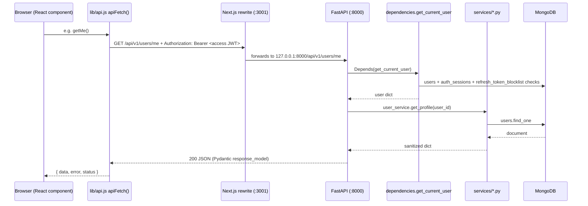
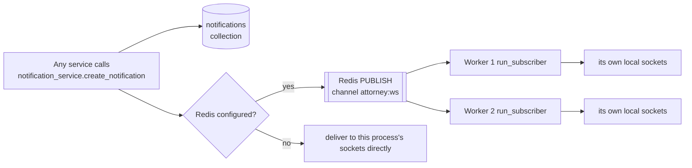
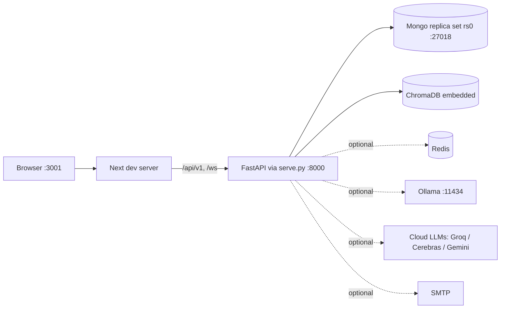

# 00 — Architecture Overview

This is the "big picture" file. Read it first. The other files in `docs/flows/`
zoom into one module each.

Everything here was checked against the code on 2026-10-20. Where the code and
an old plan file disagree, the code wins.

---

## 1. What the system is

Attorney.AI is a legal help platform for Pakistan. It has three kinds of user:

| Role | What they do | Home page |
|---|---|---|
| `client` | Asks the AI chatbot, fills an intake, finds and hires a lawyer, books appointments, drafts documents | `/dashboard` |
| `lawyer` | Manages appointments, cases, clients, drafts, research, review requests | `/lawyer` |
| `admin` | Manages users, KYC, disputes, analytics, retention | `/admin` |

The roles are defined in `UserRole` in
[constants.py](../../backend/app/core/constants.py).

The system has four running parts:

| Part | Tech | Where |
|---|---|---|
| Frontend | Next.js (React, JSX) on port 3001 (`next dev -p 3001`) | `frontend/src` |
| Backend API | FastAPI (async Python) on port 8000 | `backend/app` |
| Main database | MongoDB (Motor async driver) | `backend/app/db` |
| Vector store | ChromaDB (embedded, for legal retrieval) | `backend/app/db/chroma.py`, `backend/app/ai` |
| Optional | Redis (pub/sub, locks, rate limits, cache), Ollama (local LLM), SMTP (email), Daily.co (video) | config driven |

---

## 2. Folder layout

### 2.1 Frontend (`frontend/src`)

```
frontend/src/
  app/                    Next.js App Router (each folder = a URL)
    (auth)/               login, register, reset-password, verify-email
    (client)/             client URLs: dashboard, chat, intake, lawyers, cases,
                          documents, agreements, appointments, tracking, tools, profile
                          layout.jsx mounts <ClientApp/> once for all of them
    lawyer/               lawyer URLs: appointments, cases, clients, drafts, documents,
                          review-requests, vault, ai-assistant, causelist, caselaw, ...
                          layout.jsx = ProtectedRoute(lawyer) + ChatDockProvider
    admin/                admin URLs: users, kyc, analytics, lawyer-monitoring, ...
    terms/, privacy/      public legal pages
    sign/                 public e-signature link page (agreements)
    page.jsx              public landing page
  components/
    client/               client screens (ClientApp, ModIntake, ModChatbot, ModTracking, ...)
    lawyer/               lawyer screens (App.jsx, AppointmentsPage, CasesPage, ChatDock, ...)
    admin/                admin screens (AdminApp, AdminKYCVerification, ...)
    shared/               used by both roles (AppointmentThread, ChatPieces, ProtectedRoute,
                          CaseContext, VideoCall, ...)
    auth/                 AuthShell.jsx (login/register look), ResendForm.jsx
    analyzer/             Document Analyzer UI (lawyer only)
    ai/, layout/, domain/*   present but EMPTY folders today
  context/AuthContext.jsx the signed-in user, login(), logout()
  lib/api.js              EVERY backend call goes through here (about 3,200 lines)
  lib/socket.js           helper that stops two WebSockets opening at once
  lib/notificationTarget.js  where a notification click goes + in-page event bus
```

Key idea: the client side is **one long-lived React app**. The file
[(client)/layout.jsx](../../frontend/src/app/%28client%29/layout.jsx) mounts
`<ClientApp/>` once, and the URL only picks which screen is visible. This
stops the shell from reloading on every sidebar click.

The lawyer side works the same way through
[components/lawyer/App.jsx](../../frontend/src/components/lawyer/App.jsx), which
has a `pageMap` from page name to page component.

### 2.2 Backend (`backend/app`)

```
backend/app/
  main.py               creates the FastAPI app, middleware, lifespan (startup/shutdown),
                        background loops, and registers every router
  dependencies.py       get_current_user, require_client / require_lawyer / require_admin
  api/v1/routes/        HTTP endpoints, one file per feature (thin: validate + call service)
  services/             business rules (the real logic lives here)
  repositories/         small classes over one Mongo collection (BaseRepository)
  db/
    mongodb.py          connect / get_database / get_client
    collections.py      one get_xxx_col() function per Mongo collection
    indexes.py          create_all_indexes() + "enforce" checks run at startup
    chroma.py           ChromaDB connection
  schemas/              Pydantic request/response models (what the API accepts/returns)
  models/               older Pydantic models of stored documents
  core/
    config.py           Settings (reads .env) — all feature flags live here
    constants.py        enums: UserRole, KycStatus, NotificationType, AppointmentStatus, ...
    security.py         bcrypt, JWT create/decode, CNIC encryption
    exceptions.py       AuthError(401), ForbiddenError(403), NotFoundError(404),
                        ConflictError(409), AppValidationError(422), ServiceUnavailableError(503)
    redis_client.py     optional Redis client + distributed locks
    ws_ticket.py        one-time WebSocket tickets
    rate_limit.py       slowapi limiter (per user or IP)
    live_auth.py        re-checks a socket user is still allowed
  websockets/           chat_socket.py (/ws/chat), notification_socket.py, manager.py
  ai/                   the LangGraph AI pipeline, retrieval, guards, LLM providers
  utils/                email.py (SMTP), geocoding, validators
backend/scripts/        serve.py, dev_mongo_replset.py, seeders, eval and ingest scripts
backend/tests/          pytest suite (about 470 files)
```

The rule of thumb is **route → service → repository/collection**. Routes stay
thin. Services hold the rules. Collections are reached through
[collections.py](../../backend/app/db/collections.py).

---

## 3. How one request flows end to end

The browser never talks to port 8000 directly. It talks to the same origin
that served the page, and Next.js forwards the call.

[next.config.js](../../frontend/next.config.js) has two rewrites:

```js
{ source: '/api/v1/:path*', destination: `${API_TARGET}/api/v1/:path*` },
{ source: '/ws/:path*',     destination: `${API_TARGET}/ws/:path*` },
```

`API_TARGET` is `API_PROXY_TARGET` or `http://127.0.0.1:8000`.

Why: an invited signer may open a link through a tunnel (ngrok). If the page
called `http://localhost:8000`, that would point at *their* machine. A relative
`/api/v1` keeps everything on one origin, so there is also no CORS problem.

The proxy timeout is raised to 180 s (`experimental.proxyTimeout`) because some
routes (intake conversion, document generation) run longer than Next's default
30 s.

Other settings in `next.config.js`:

- `distDir` = `NEXT_DIST_DIR` or `.next`. Why: running `next build` while
  `next dev` uses the same `.next` folder breaks the dev server
  ("Cannot find module './5611.js'"), so a build can be sent elsewhere.
- `allowedDevOrigins` lists ngrok and trycloudflare hosts, because the Next
  dev server blocks cross-origin requests from unknown hosts (tunnels).

Overrides on the browser side: `NEXT_PUBLIC_API_URL` replaces the relative
`/api/v1` base, and `NEXT_PUBLIC_WS_URL` replaces the socket origin
(`websocketUrl()` in `lib/api.js`). Without them, sockets use the page's own
host with `wss:` on https and `ws:` on http.

On the backend, the app is created with `redirect_slashes=False`: a path with
or without a trailing slash is not redirected, it must match exactly.



### 3.1 `apiFetch` (frontend)

[lib/api.js](../../frontend/src/lib/api.js) has one core wrapper, `apiFetch(path, options)`:

1. Adds `Authorization: Bearer <token>` if an access token is in memory.
2. Sends `credentials: 'include'` so the HttpOnly `refresh_token` cookie goes along.
3. On a **401 with a token**, it calls `_tryRefresh()` once (single-flight, so
   many parallel 401s cause only one `/auth/refresh`) and retries the request.
4. Returns `{ data, error, status }`. It never throws for HTTP errors. `error`
   has a readable `message` and, when the server sent one, a machine `code`
   (`formatResponseError` understands FastAPI's `detail`, Pydantic arrays,
   and the app's `{error, status_code}` envelope).

There is a matching `apiFetchMultipart` for file uploads (always `POST`, no
`Content-Type` header so the browser sets the multipart boundary, same 401 →
refresh → retry logic).

Other cases `apiFetch` handles (details in doc 18 §5.1):

- `fetch` throws (offline, backend down) → `status: 0`, "Network error.
  Please check your connection."
- 401 and the refresh failed with 401/403 → token cleared, "Session expired.
  Please sign in again."
- 401 and the refresh failed with 5xx/network → `status: 0`, "The server is
  restarting or unavailable…" — the user is **not** signed out.
- 401 with no token at all (not on login/register/forgot/reset) → "You are
  signed out. Please sign in again on this address…".
- `options.returnResponse: true` returns the raw `Response` (for blob
  downloads and SSE streams) but still gets the auto-refresh.

### 3.2 Errors (backend)

Services raise the classes in
[exceptions.py](../../backend/app/core/exceptions.py). Global handlers in
`main.py` turn them into JSON:

```json
{ "error": "<detail>", "status_code": 403 }
```

Rate limits return 429 with `"Too many requests. Please slow down."`.
Anything unexpected returns a generic 500 `"Internal server error"` (the
traceback is printed in the server log only, never sent to the browser).

The four handlers registered in `main.py`:

| Handler | Catches | Body |
|---|---|---|
| `http_exception_handler` | every `HTTPException` (all app error classes) | `{error: detail, status_code}`; 400, 409 and 422 are also **logged** with method, path and the first 300 characters of the reason |
| `validation_exception_handler` | Pydantic request validation (`RequestValidationError`) | 422 `{error: "The request was not valid.", status_code: 422, detail: [...]}`; the log line has only the field location and rule type, never the value (bodies can hold signatures and private text) |
| `rate_limit_handler` | `RateLimitExceeded` | 429 |
| `generic_exception_handler` | any other exception | 500 |

The error classes: `AuthError` 401 (adds `WWW-Authenticate: Bearer`),
`ForbiddenError` 403, `NotFoundError` 404 ("<Resource> not found"),
`ConflictError` 409, `AppValidationError` 422, `AIServiceError` and
`ServiceUnavailableError` 503, and `ReviewLimitError` 409 (a permanent
"reached its review limit" that clients must not retry).

### 3.3 Middleware order (outer → inner)

`RequestIdMiddleware` (adds a request id to every log line) → CORS →
`RateLimitStateDefault` → `SlowAPIMiddleware` → routes. CORS allows
`FRONTEND_URL` (and its `localhost`/`127.0.0.1` twin) plus ports 3000–3005 on
both hosts in development, plus the comma-separated `CORS_ORIGINS`; it allows
credentials (the refresh cookie), all methods and all headers.

`RateLimitStateDefault` exists because when Redis is down slowapi swallows the
error but leaves `request.state.view_rate_limit` unset, and its own middleware
then crashes with a 500. Pre-setting it to `None` makes a Redis outage "no
limit applied" instead of "every limited endpoint fails".

---

## 4. Authentication and roles (short version)

Full details: [18-auth-accounts.md](./18-auth-accounts.md).

| Piece | Where it lives | Lifetime |
|---|---|---|
| Access token (JWT, `type: "access"`, has `sub`, `role`, `sid`) | **Browser memory only** (`accessToken` in `lib/api.js`) | 60 min (`access_token_expire_minutes`) |
| Refresh token (JWT, `type: "refresh"`, has `sid`, `jti`) | HttpOnly cookie `refresh_token`, `samesite=strict` | 7 days (`refresh_token_expire_days`) |
| Session row | `auth_sessions` collection (one per device sign-in) | until expiry or revoke |

Backend role checks are FastAPI dependencies in
[dependencies.py](../../backend/app/dependencies.py):

```python
require_client  = role_required(UserRole.CLIENT)
require_lawyer  = role_required(UserRole.LAWYER)
require_admin   = role_required(UserRole.ADMIN)
require_client_or_lawyer = role_required(UserRole.CLIENT, UserRole.LAWYER)
```

`get_current_user` checks, in order: token present → JWT valid and
`type == "access"` → token not in `refresh_token_blocklist` → user exists and
`is_active` → token not older than the last password change
(`tokens_valid_from`) → its session (`sid`) is still active. The result is
cached on `request.state` so several dependencies in one request do the work
once.

Frontend role checks are in
[ProtectedRoute.jsx](../../frontend/src/components/shared/ProtectedRoute.jsx).
Each area's `layout.jsx` wraps its pages: `(client)` → `['client']`,
`lawyer` → `['lawyer']`, `admin` → `['admin']`. A wrong role is redirected to
its own home. This is only for user experience — the **server** is the real
gate.

---

## 5. Live updates: WebSockets and Redis

There are two WebSocket endpoints:

| Endpoint | File | Used for |
|---|---|---|
| `/ws/notifications?ticket=…` | [notification_socket.py](../../backend/app/websockets/notification_socket.py) | push every new notification to the user |
| `/ws/chat/{session_id}?ticket=…` | [chat_socket.py](../../backend/app/websockets/chat_socket.py) | the client AI chatbot (clients only) |

### 5.1 Tickets, not tokens, in the URL

A URL can end up in logs. So the JWT never goes into the socket URL. Instead:

1. Browser calls `POST /auth/ws-ticket` (normal Bearer auth).
2. [ws_ticket.py](../../backend/app/core/ws_ticket.py) `create_ticket` stores a
   random ticket in the `ws_tickets` collection, valid **60 seconds**, bound to
   the user's auth epoch and session id.
3. Browser opens `ws://<same host>/ws/notifications?ticket=…`.
4. `consume_ticket` deletes it atomically (`find_one_and_delete`), so it works
   **once**.

The socket also re-checks the user every 30 s (`ActiveSessionGate`) and closes
with code `4003` if the account was deactivated, the password changed, or the
session was revoked.

More detail from the code:

- `consume_ticket` also refuses a ticket when the user's auth epoch
  (`tokens_valid_from`) changed, the user became inactive, or the session was
  revoked during those 60 seconds.
- Close codes: **4001** = no/invalid/expired/used ticket; **4003** = account
  inactive, wrong role (chat is clients only), a chat `session_id` that
  belongs to someone else, or the re-check failed.
- `/ws/notifications`: on connect it sends `{"type": "unread_count", "count":
  n}`. It then waits for client frames with a 30 s timeout; on a timeout it
  forces a re-check, so a silent tab is still re-authorised.
- `/ws/chat/{session_id}`: the gate (`_AuthGate`, `required_role="client"`)
  is asked before **every** incoming frame (from a 30 s cache), before the
  frame can store or audit anything; a failed check ends the loop.
- One user can have several sockets (tabs); `ConnectionManager` keeps a list
  per user and drops sockets whose send fails.
- Frontend: `getWsTicket()` goes through `apiFetch`, so an expired access
  token is refreshed first; `lib/socket.js` (`createSocketOwner`) claims the
  right to open a socket synchronously, so two sockets are never opened at
  once for the same purpose.

### 5.2 Fan-out across workers

[websockets/manager.py](../../backend/app/websockets/manager.py) has
`ConnectionManager` (singleton `notification_manager`). A socket lives in one
worker process, so:



- `send_to_user(user_id, msg)` publishes `{"target":"user", ...}` to the
  Redis channel `attorney:ws`.
- Every worker runs `run_subscriber()` (started in the lifespan) and delivers
  to the sockets *it* holds. Each socket is in exactly one worker, so a
  message is delivered once.
- No Redis → direct local delivery (fine for a single-process demo).
- A failed Redis `PUBLISH` also falls back to local delivery. If the
  subscriber's connection drops, it logs, waits 3 s and subscribes again.
- `broadcast(msg)` sends `{"target":"all"}` to every connected user.

### 5.3 Redis is optional everywhere

[redis_client.py](../../backend/app/core/redis_client.py): when `REDIS_URL` is
empty, `get_redis()` returns `None` and every caller must fall back to
in-process behaviour. Redis is used for:

- WebSocket fan-out (above)
- `acquire_period_lock(key, ttl)` — "only one worker runs this sweep this
  period" (`SET key token NX EX ttl`, never released, it just expires). It
  **fails open**: no Redis, or a Redis error → returns `True` and the sweep
  runs anyway (the sweeps are idempotent).
- `acquire_period_lock_strict(key, ttl, job)` — the same but **fails
  closed**: used by the appointment scheduler, which messages people. No
  Redis → `False` (skip this cycle), unless `SCHEDULER_SINGLE_PROCESS=true`,
  which uses an in-process lock (safe only with one worker).
- `redis_lock(key, ttl)` — a mutex for a critical section; released on exit
  by a Lua compare-and-delete so a worker only deletes its own token. No
  Redis → always "acquired".
- rate-limit storage (`slowapi` uses `REDIS_URL` or `memory://`)
- AI result / chunk caches
- citator ingest streams

---

## 6. Background jobs (the "scheduler")

There is no separate worker process. Background loops are `asyncio` tasks
created in the `lifespan()` function of
[main.py](../../backend/app/main.py) and cancelled on shutdown.

| Loop | What it does | Interval | Gate |
|---|---|---|---|
| `_warmup_models` (one-off task) | loads Whisper, intent embeddings, the retrieval embedder, the statute graph and the corpus index in the background (threads), so the first user request does not freeze the event loop | once at startup | always; a failure is only logged |
| `notification_manager.run_subscriber` | Redis pub/sub → local sockets | runs forever | no-op without Redis |
| `_causelist_scheduler` | checks court cause-lists for watched cases | `CAUSELIST_CHECK_HOURS` (6 h), sleeps first; lock TTL 55 min | `redis_enabled() or RUN_SCHEDULERS`, plus Redis period lock |
| `_lawyer_index_reconciler` | re-embeds lawyer profiles for matching (catches index writes that failed) | `LAWYER_RECONCILE_HOURS` (6 h), sleeps first so a restart loop cannot cause an embedding storm | same group |
| `_kyc_erasure_retry` | retries KYC file erasure left pending by account closure | 1 h, sleeps first | same group |
| `_hearing_reminder_scheduler` | day-before hearing notices | `HEARING_REMINDER_INTERVAL_MINUTES` (60, allowed 5–720); runs **first**, then sleeps, so a restart the evening before still sends | same group **and** `HEARING_REMINDERS_ENABLED` |
| `_provenance_relay` | drains the AI audit outbox | `PROVENANCE_RELAY_SECONDS` (30 s) | always (lease-guarded) |
| `_event_outbox_relay` | drains `event_outbox` → notifications | 30 s | always (lease-guarded) |
| `_documents_v2_relay` | V2 document events / stuck generations | 15 s | always; does nothing while `DOCUMENTS_V2` is off (re-checked each tick) |
| `_analyzer_housekeeping`, `_analyzer_worker` | Document Analyzer: expiry (7 days) and purges / extraction stages (up to 5 runs per tick) | 60 s / 5 s | always; inert while `DOC_ANALYZER` off or readiness failed |
| `_review_request_sweep`, `_review_request_notifier` | review-request lifecycle + notices | `REVIEW_REQUEST_SWEEP_MINUTES` (15) / 30 s | always; inert while flag off |
| `_vault_purge` | purges deleted Vault docs after recovery window | 1 h | only acts when `DOCUMENTS_V2` is on; report-only unless `DOCUMENTS_V2_DELETION_ENABLED` |
| `appointment_scheduler_task()` | appointment reminders, outcome nudges, expiry | `APPOINTMENT_SCHEDULER_INTERVAL_MINUTES` (15) | returns `None` unless one of the three appointment flags is on |

Every loop catches and logs its own errors (except cancellation), so one
failed sweep never kills the loop.

Why two kinds of gate? Some loops are **lease-guarded**: each item is claimed
with a conditional update, so running them on every worker is safe. Others are
not, so they need either a Redis lock or `RUN_SCHEDULERS=true` on exactly one
worker.

### 6.1 Event outbox

[event_outbox.py](../../backend/app/services/event_outbox.py) is a small
"transactional outbox". A service writes an event row (`park` or
`park_in_transaction`) in the **same** database transaction as its real work.
A relay later calls `drain_once()` which:

- claims a row with a lease (`lease_owner`, `lease_expires_at`),
- dispatches it by `destination` using an allowlist (today only
  `"notifications"`),
- marks it `delivered`, or retries with backoff, or marks it `dead`.

Delivery is at-least-once. Duplicates are harmless because the notification is
inserted with a unique `logical_event_id`.

Why: without an outbox, a crash between "save the document" and "notify the
lawyer" would lose the notice. (Note: the module docstring still says "no
scheduler drains it yet" — that is out of date; `main.py` now runs
`_event_outbox_relay`.)

---

## 7. Startup checks

`lifespan()` runs, in order:

1. `connect_db()` and `create_all_indexes()`
   ([indexes.py](../../backend/app/db/indexes.py)) — includes TTL indexes, e.g.
   `notifications` auto-delete after 30 days, `ws_tickets` at `expires_at`.
2. `enforce_v2_correctness_indexes()`, `enforce_review_request_indexes()`,
   review-request readiness.
3. Analyzer readiness (only if `DOC_ANALYZER`).
4. `assert_appointment_booking_ready()` — refuses to start if appointment slot
   indexes are wrong (it checks the data as well as the indexes, and repairs
   nothing).
5. `assert_appointment_expiry_activation_ready()` — only when
   `APPOINTMENT_EXPIRY_ENABLED` is on: refuses to start if expiry is not
   ready. It is placed **before any background task is created**, so a refusal
   leaves no orphaned tasks behind. Costs nothing while the flag is off.
6. `connect_chroma()`.
7. Hands the WebSocket manager to `notification_service.set_ws_manager()`.
8. Starts the model warm-up, the subscriber and the background loops
   (section 6).

The review-request readiness check in step 2 (`assert_ready`) refuses a
standalone Mongo (no transactions) once `DOCUMENT_REVIEW_REQUESTS` is on. The
analyzer check in step 3 does **not** stop the app: it closes only the
analyzer routes with 503.

The `Settings` validators in `config.py` run even earlier (at import): a short
or placeholder `SECRET_KEY`, an `ALGORITHM` other than HS256, non-positive
token lifetimes, and in production `LAWYER_AUTO_APPROVE=true`, email
verification without SMTP, a non-https `FRONTEND_URL`, or English OCR without
a benchmark id all stop the backend from starting.

On shutdown it cancels the warm-up, the subscriber and the loops, cancels
**and awaits** the appointment scheduler (so its current cycle unwinds
cleanly), flushes AI threshold samples, and closes Redis, Mongo and Chroma.
A hard kill skips all of this.

---

## 8. Every backend route file

All routers are mounted under `/api/v1` in `main.py`. The order matters in a
few places (for example `document_analyses` is registered **before**
`documents`, otherwise `GET /documents/{doc_id}` would catch
`/documents/analyses`).

| Route file | URL prefix | Purpose |
|---|---|---|
| [admin.py](../../backend/app/api/v1/routes/admin.py) | `/admin` | Admin: KYC queue and decisions, users CRUD, cases, appointment disputes, analytics, lawyer monitoring, retention and legal holds |
| [agreements.py](../../backend/app/api/v1/routes/agreements.py) | `/agreements` | Agreements: drafts, rich body preview, send, sign, decline, invitations, PDF, archive |
| [ai.py](../../backend/app/api/v1/routes/ai.py) | `/ai` | AI query (+ stream), lawyer research, drafting stream, Urdu pleading, compare, answer rating, source lookup |
| [appointment_files.py](../../backend/app/api/v1/routes/appointment_files.py) | `/appointment-files` | Files a client attaches to an appointment (upload, list, download, delete) |
| [appointment_threads.py](../../backend/app/api/v1/routes/appointment_threads.py) | `/appointment-threads` | Read receipts and unread summary for appointment message threads |
| [appointment_video.py](../../backend/app/api/v1/routes/appointment_video.py) | `/appointment-video` | In-app video (Daily.co) for a confirmed consultation; off without a key |
| [appointments.py](../../backend/app/api/v1/routes/appointments.py) | `/appointments` | Book, list, confirm, reschedule, suggest times, cancel, complete, no-show, summaries, disputes, **thread messages** |
| [auth.py](../../backend/app/api/v1/routes/auth.py) | `/auth` | Register, verify email, login, refresh, logout, sessions, ws-ticket, forgot/reset password |
| [bail.py](../../backend/app/api/v1/routes/bail.py) | `/bail` | Bail-eligibility checker |
| [billing.py](../../backend/app/api/v1/routes/billing.py) | `/billing` | Lawyer subscription plans |
| [calculators.py](../../backend/app/api/v1/routes/calculators.py) | `/calculators` | Court-fee and labour-dues calculators (+ PDF) |
| [case_consultations.py](../../backend/app/api/v1/routes/case_consultations.py) | `/case-consultations` | A case's originating and linked consultations (lawyer) |
| [case_files.py](../../backend/app/api/v1/routes/case_files.py) | `/case-files` | A lawyer's private files on a case |
| [cases.py](../../backend/app/api/v1/routes/cases.py) | `/cases` | Cases: create, walk-in, list, confirm, timeline, hearings, milestones, tasks, **case messages** |
| [causelist.py](../../backend/app/api/v1/routes/causelist.py) | `/causelist` | Court cause-list watches and matches |
| [citator.py](../../backend/app/api/v1/routes/citator.py) | `/citator` | Case-law search and "cited by" |
| [conversations.py](../../backend/app/api/v1/routes/conversations.py) | `/conversations`, `/research-conversations` | List/open/rename/archive/delete AI conversations (client chat and lawyer research), cancel a turn, search |
| [disputes.py](../../backend/app/api/v1/routes/disputes.py) | `/disputes` | Overseas property-dispute intake, petition, send to lawyer |
| [document_analyses.py](../../backend/app/api/v1/routes/document_analyses.py) | `/documents/analyses` | Document Analyzer (registered lawyers only; 404 while `DOC_ANALYZER` off) |
| [document_draft_plans.py](../../backend/app/api/v1/routes/document_draft_plans.py) | `/documents/v2/plans` | Client prompt-to-plan drafting feeding the V2 engine |
| [documents.py](../../backend/app/api/v1/routes/documents.py) | `/documents` | Legacy documents: templates, extract, generate, drafts, submit/review, download |
| [documents_v2.py](../../backend/app/api/v1/routes/documents_v2.py) | `/documents/v2` | V2 documents: generate, workspace, revisions, submit, review, return-with-edits, withdraw |
| [documents_v2_folders.py](../../backend/app/api/v1/routes/documents_v2_folders.py) | `/documents/v2` (`/folders`) | Vault folders |
| [documents_v2_trash.py](../../backend/app/api/v1/routes/documents_v2_trash.py) | `/documents/v2` (`/trash`) | Recoverable deletion of Vault documents |
| [engagements.py](../../backend/app/api/v1/routes/engagements.py) | `/engagements` | Hiring a lawyer: request, propose/accept/decline terms, cancel, complete, terminate |
| [inheritance.py](../../backend/app/api/v1/routes/inheritance.py) | `/inheritance` | Islamic inheritance calculator, settlement PDF, demand letter, wasiyyat |
| [intake.py](../../backend/app/api/v1/routes/intake.py) | `/intake` | Client case intake wizard: steps, clarify, evidence, convert, retry analysis |
| [labeling.py](../../backend/app/api/v1/routes/labeling.py) | `/labeling` | Retrieval-labelling queue, agreement stats and exports (research) |
| [lawyer_clients.py](../../backend/app/api/v1/routes/lawyer_clients.py) | `/lawyer-clients`, `/lawyer-actions` | Lawyer's computed Clients index and "what waits on me" counts |
| [lawyer_events.py](../../backend/app/api/v1/routes/lawyer_events.py) | `/lawyer-events` | A lawyer's own calendar events |
| [lawyers.py](../../backend/app/api/v1/routes/lawyers.py) | `/lawyers` | Lawyer directory, counts, matching, availability, bookable slots, reviews |
| [meeting_proposals.py](../../backend/app/api/v1/routes/meeting_proposals.py) | `/meeting-proposals` | Lawyer proposes times on a case; client picks one |
| [notifications.py](../../backend/app/api/v1/routes/notifications.py) | `/notifications` | List notifications, mark one read, mark all read |
| [payments.py](../../backend/app/api/v1/routes/payments.py) | `/payments`, `/webhooks` | Fee requests, checkout, mock pay, receipts; Safepay webhook |
| [provenance.py](../../backend/app/api/v1/routes/provenance.py) | `/provenance` | Read the audit trail of AI answers (owner-scoped) |
| [quick_review.py](../../backend/app/api/v1/routes/quick_review.py) | `/quick-review` | One-off document review by a lawyer who is not hired |
| [review_requests.py](../../backend/app/api/v1/routes/review_requests.py) | `/review-requests` | Client sends a frozen Vault version to their hired lawyer (inert unless flags on) |
| [users.py](../../backend/app/api/v1/routes/users.py) | `/users` | My profile, password, close account, lawyer profile, KYC documents; admin read of any user |
| [voice.py](../../backend/app/api/v1/routes/voice.py) | `/voice` | Speech-to-text (`/voice/transcribe`) |

Plus two WebSocket routers with no prefix: `/ws/chat/{session_id}` and
`/ws/notifications`, and a health check `GET /` that returns
`{"status": "ok", "service": "Attorney.AI API"}` (no database check).

Registration order notes from `main.py`: `documents_v2_trash` and
`documents_v2_folders` are registered **before** `documents_v2` so `/trash`
and `/folders` are not read as a document id; `lawyer_clients.py` mounts two
routers (`router` and `actions_router`), and `payments.py` mounts `router`
and `webhook_router`.

---

## 9. Feature flags (`core/config.py`)

All settings are fields on the `Settings` class in
[config.py](../../backend/app/core/config.py). Pydantic reads them from
`backend/.env` (or from process environment, which wins). Names in `.env` are
the UPPER_CASE of the field. [.env.example](../../backend/.env.example) lists
the names.

| Flag | Default | What it does |
|---|---|---|
| `LLM_PROVIDER` | `groq` | Which cloud LLM chain the AI uses first |
| `LLM_LOCAL_ONLY` | `False` | `True` = only Ollama, never a paid provider |
| `RETRIEVAL_MULTI_QUERY` | `False` | Extra query rewrites during legal retrieval |
| `AGENTIC_DECOMPOSITION_ENABLED` | `False` | Split complex questions into sub-questions |
| `CHAT_ADAPTIVE_LENGTH_CLIENT` | `False` | Adaptive answer length policy for the client chatbot |
| `RESEARCH_ANSWER_SAFEGUARDS` | `False` | Extra safety checks on lawyer research answers |
| `LAWYER_AUTO_APPROVE` | **`True`** | New lawyers are approved at sign-up (demo policy); UI must say "registered", not "verified" |
| `EMAIL_VERIFICATION_REQUIRED` | **`True`** | New accounts must confirm email — only enforced when SMTP is configured |
| `PAYMENTS_DRY_RUN` | **`True`** | Payments do not hit the real gateway |
| `RUN_SCHEDULERS` | **`True`** | Run the non-lease background loops in this process |
| `SCHEDULER_SINGLE_PROCESS` | `False` | Lets the appointment scheduler use an in-process lock when there is no Redis (one worker only) |
| `DOCUMENTS_V2` | `False` | New immutable document/revision model (Vault, review, workspace) |
| `DOCUMENTS_V2_DELETION_ENABLED` | `False` | Actually purge V2 documents (retention) |
| `DOCUMENT_REVIEW_REQUESTS` | `False` | Client → hired lawyer review requests (needs `DOCUMENTS_V2`) |
| `DOC_ANALYZER` | `False` | Document Analyzer for lawyers (needs replica set + keys) |
| `ANALYZER_AI` | `False` | AI report layer of the analyzer (strict provider/model rules) |
| `ANALYZER_PII_REVIEW_REQUIRED` | `True` | Lawyer must confirm the exact AI request before it leaves |
| `ANALYZER_ENGINE_HYPOTHESES` | `False` | New analyzer runs use the fixed drafting-question engine |
| `ANALYZER_HYPOTHESIS_REVIEW_UI` | `False` | Internal drafting-question review screen |
| `INTAKE_DELETION_ENABLED` | `False` | Actually delete expired intakes and evidence |
| `APPOINTMENT_WORKING_HOURS_ENFORCED` | `False` | Refuse bookings outside a lawyer's configured hours |
| `APPOINTMENT_REMINDERS_ENABLED` | `False` | Send appointment reminders |
| `APPOINTMENT_OUTCOME_NUDGES_ENABLED` | `False` | Nudge lawyers to record outcomes (needs an activation instant) |
| `APPOINTMENT_EXPIRY_ENABLED` | `False` | Expire unanswered requests (irreversible) and block confirming lapsed ones |
| `HEARING_REMINDERS_ENABLED` | `False` | Day-before court hearing notices |
| `AGREEMENTS_DIY_BUILDER_ENABLED` | `False` | Client DIY contract template builder (parked: templates withdrawn) |
| `ENGLISH_OCR_ENABLED` | `False` | Local English OCR for evidence |
| `DAILY_API_KEY` | empty | Empty = no in-app video; paste-a-link still works |
| `REDIS_URL` | empty | Empty = Redis disabled, everything falls back to in-process |
| `SMTP_USER` | empty | Empty = no emails sent (and email verification is skipped) |

Why are almost all flags off? Many of them send messages to real people or
delete data. The code comments say the default is "the safety property": a
deploy must never turn them on by accident.

---

## 10. How the demo is run

From the code (scripts in `backend/scripts`):

1. **Local MongoDB replica set** —
   [dev_mongo_replset.py](../../backend/scripts/dev_mongo_replset.py) starts a
   single-node replica set `rs0` on **port 27018**, data in
   `backend/.mongo-rs/`. A replica set is needed because several features use
   **transactions** (appointment messages, analyzer, agreements). A plain
   standalone `mongod` does not support them.
2. **Backend** — [serve.py](../../backend/scripts/serve.py):
   ```
   python scripts/serve.py start --env-overlay <file>
   python scripts/serve.py stop
   python scripts/serve.py status
   ```
   - It runs uvicorn from `backend/venv` in a child process, logs to
     `backend/serve.log` (append), and writes `.serve.pid`.
   - `--env-overlay FILE` reads `KEY=VALUE` lines and applies them to this run
     only. Process env beats `.env`, so the demo can point at local Mongo
     (27018) and blank hosted services without editing `.env`.
   - `--local-only` sets `LLM_LOCAL_ONLY=true` (Ollama only — if Ollama is
     not running, all AI calls fail).
   - `stop` creates a sentinel file so uvicorn shuts down gracefully (Windows
     cannot send SIGTERM to a detached process).
   - It refuses to start if port 8000 is already taken.
3. **Frontend** — `npm run dev` in `frontend` (port 3001).
4. **Ollama** — optional. Defaults: `OLLAMA_BASE_URL=http://127.0.0.1:11434`,
   `OLLAMA_MODEL=qwen2.5:7b`. Used when the provider chain chooses local.



---

## 11. How tests are organised

### Backend — pytest

- Folder: `backend/tests/` (about 470 `test_*.py` files), config in
  [pytest.ini](../../backend/pytest.ini): `asyncio_mode = auto`,
  `--strict-markers`.
- Markers (tiers):
  - default — offline and deterministic (no DB, no network, no LLM)
  - `integration` — needs MongoDB; uses a throwaway database
    (`AAI_TEST_MONGO_URL`, for example the 27018 replica set for tests that
    need transactions)
  - `llm`, `network` — real providers / internet; skipped unless
    `AAI_LIVE_TESTS=1`
  - `corpus` — reads the real Chroma corpus (not in git)
- [conftest.py](../../backend/tests/conftest.py) isolates Chroma so tests
  never open the live store, unless `AAI_ALLOW_LIVE_CHROMA=1`.

Run one file at a time on a small laptop, for example:
`venv/Scripts/python -m pytest tests/test_account_closure.py`.

### Frontend — `node --test`

- Folder: `frontend/tests/` (about 130 `*.test.mjs` files).
- Script in `package.json`:
  `node --import ./tests/support/register.mjs --test --test-force-exit tests/*.test.mjs`
- `tests/support/` has a JSX loader and an API stub, so components and `lib/`
  helpers can be tested without a browser.

---

## 12. Known limits (from the code)

- Some frontend folders (`components/ai`, `components/layout`,
  `components/domain/*`, `src/services`) are empty placeholders.
- `lib/api.js` is one very large file (~3,200 lines); every feature adds to it.
- Without Redis, rate limits and WebSocket delivery are per-process, so
  multiple workers would not share them.
- Features that need transactions return 503 on a standalone Mongo (they do
  not silently fall back to non-atomic writes).
- The `event_outbox.py` docstring is out of date (says nothing drains it; the
  lifespan does).
