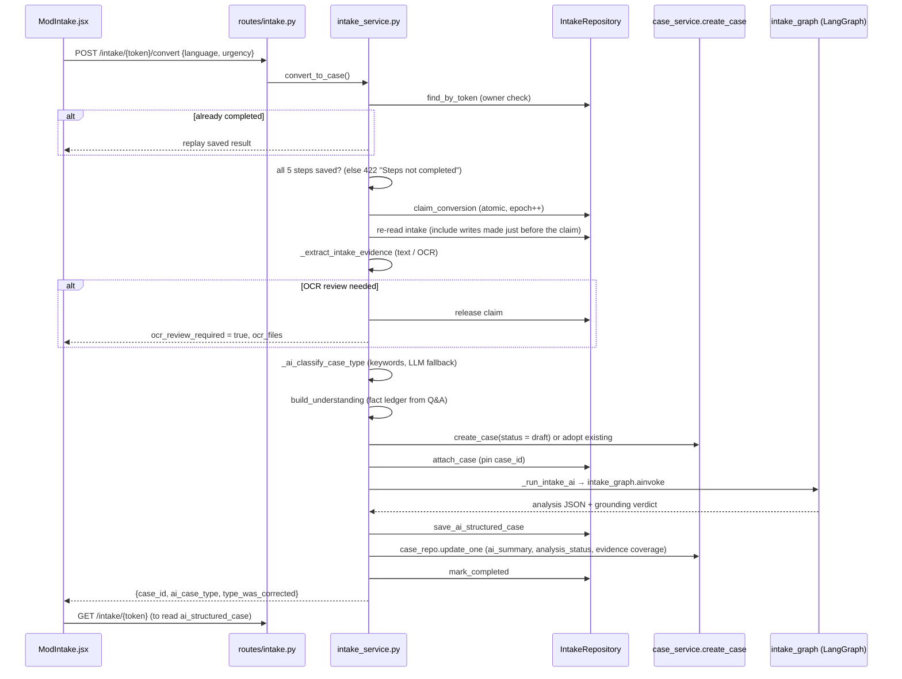
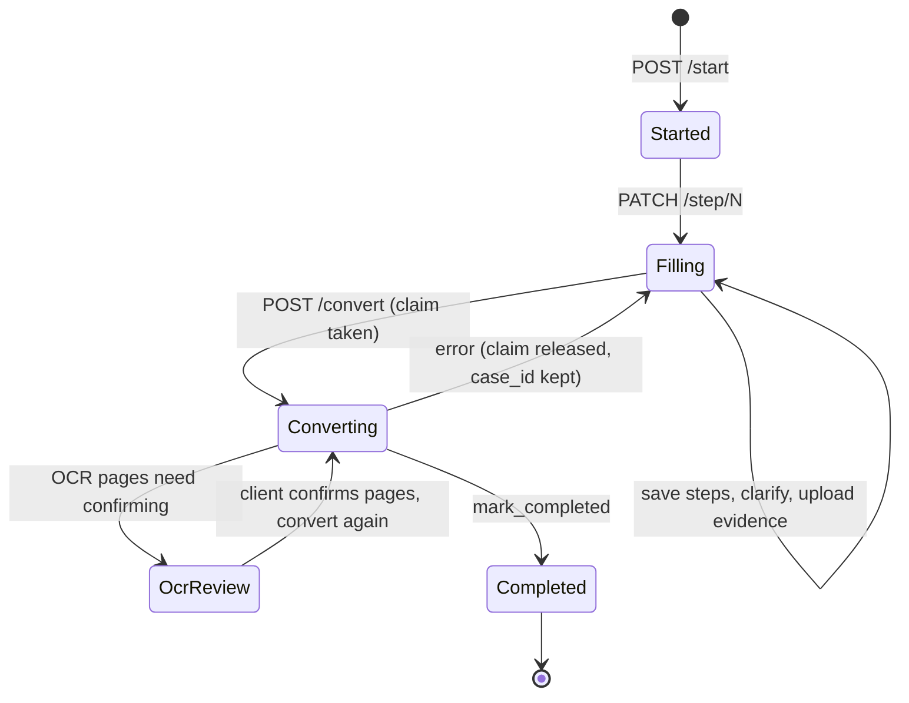

# 01 — Legal Intake (client)

## What it does

A client tells the system about a legal problem in a short guided form. The AI asks up to 4 follow-up questions, then reads the story and builds a structured case: a summary, the laws that apply (only if real law was found), suggested next steps and a risk level. The result is saved as a **draft case**. The client then picks a category and confirms it, which opens the case so it can be matched to lawyers.

---

## User flow

The client opens `/intake`. The screen has five steps (the left "rail" shows them).

1. **About you** — choose *Plaintiff* or *Defendant* and a province. Press Continue.
2. **Your story** — type (or speak) what happened. Optionally attach evidence files (PDF, Word, images), say whether you hold evidence, and state what outcome you want. Press Continue.
   - The story box allows up to 20,000 characters and reminds the client not to type CNIC or phone numbers. Continue stays disabled until the story has **at least 5 words and 20 characters**. Under 12 words (or when no case type can be guessed) a yellow hint asks "who did what, when and where".
   - While typing, the browser guesses the case type (`quickClassify`) and shows "This reads like a *Family* matter. Not right? Pick one:" with four chips (Civil, Criminal, Family, Constitutional). Once the client clicks a chip, typing no longer changes it.
   - **Urgency** chips (low / medium / high / urgent, default medium) and quick chips for the outcome ("Get my money back", "Stop them", "Just advice"). Outcome and evidence note allow 5,000 characters each.
   - **Voice**: the client first picks the language they will speak (default Urdu), records up to **120 seconds**, presses *Convert to Text* (the audio is turned into 16 kHz WAV in the browser when possible), can edit the transcript, then *Submit Voice Input* copies it into the story.
   - Continue is blocked while a file is still uploading.
3. **A few questions** — the AI asks one question at a time, up to 4. Answer each (quick chips "I don't know" / "Not sure" fill the box), or choose "Continue without questions". When done, press the button to build the case. A loading state shows "Still analysing your case" if it takes long. If the AI could not ask, the rail says "Skipped — AI unavailable" and a **Try again** chip asks once more.
4. **Review** — the structured case is shown: summary, applicable laws, recommended actions, risk level ("Risk (AI estimate)") and grounding status. If the analysis failed (`pipeline_failed` or `retrieval_error`), a **Retry analysis** button appears (hidden once the case is confirmed). Extra notes can appear: a fact-mismatch warning (`input_fact_fidelity.status == "issues"`), the CPC jurisdiction notice, and "Risk: Not assessed — needs review" when the risk was withheld for CPC reasons. For an Urdu analysis there is an **اردو / English (original)** toggle. An **Export** menu offers *Download as PDF* and *Print* (both open a pop-up print view; every value is HTML-escaped) and *Email the summary* (a `mailto:` link). *Save & finish later* goes to `/dashboard`.
5. **Confirm** — choose (or accept) the case category and press Confirm. The case becomes `open`. Next buttons: *Find a lawyer* (`/lawyers?case_id=...`), *Draft a document* (`/documents`), *Track the case* (`/tracking`). Two toasts say "Case confirmed — you can now choose a lawyer" and "nobody is reviewing it yet".

Step rail rules (`stepBlocker`): going back is always allowed, except that once a case exists the client cannot go back before step 4 ("This case has already been analysed"). Going forward on the rail runs the same saves as Continue.

Resuming: if the client leaves and comes back (even after sign-out or on another device), the server finds the unfinished intake. If a converted draft case is waiting, the client is offered a choice: **Continue that case** or **Start a new matter** (the draft stays and is offered again next time). If the "resumable" check itself fails, no new intake is started; the page shows "Could not check your saved intake". A saved token that no longer works is dropped and the server is asked instead. An unfinished intake reopens at most on step 3 (step 4 needs a case).

---

## Code flow

### Map of UI steps to backend calls

| UI step | Frontend handler (`ModIntake.jsx`) | api.js function | Backend endpoint |
|---|---|---|---|
| Page load | `useEffect` → `resumeOrStart()` | `intakeGet`, `getResumableIntake`, `intakeStart` | `GET /intake/{token}`, `GET /intake/resumable`, `POST /intake/start` |
| 1 About you | `handleStep1Continue` | `intakeSaveStep(token, 1, {province, party_role})` | `PATCH /intake/{token}/step/1` |
| 2 Your story | `handleStep2Continue` | `intakeSaveStep` steps 2 and 3, then `intakeClarify(token, null)` | `PATCH .../step/2`, `PATCH .../step/3`, `POST .../clarify` |
| 2 Evidence | file input | `uploadIntakeEvidence`, `deleteIntakeEvidence`, `downloadIntakeEvidence` | `POST/DELETE/GET /intake/{token}/evidence[/{file_id}]` |
| 2 Voice | mic button | `transcribeAudio` | `POST /voice/transcribe` |
| 3 Questions | "Next question" | `intakeClarify(token, answer)` | `POST /intake/{token}/clarify` |
| 3 → 4 Build case | convert handler | `intakeClarify` (last answer), `intakeSaveStep` 4 and 5, `intakeConvert` | `POST /intake/{token}/convert` |
| 4 Review | `handleRetryAnalysis` | `intakeRetryAnalysis` | `POST /intake/{token}/retry-analysis` |
| 4 OCR review | `loadOcrReview` | `getIntakeOcrReview`, `confirmIntakeOcrPage` | `GET .../evidence/{id}/ocr`, `POST .../ocr/{rev}/confirm` |
| 5 Confirm | `handleSubmit` | `confirmCase(caseId, caseType)` | `PATCH /cases/{case_id}/confirm` |

### All endpoints (router prefix `/api/v1`)

| Method + full path | Rate limit | What it does | Main errors |
|---|---|---|---|
| `POST /api/v1/intake/start` | 10/min | New intake session, returns `session_token` | — |
| `GET /api/v1/intake/resumable` | 60/min | The intake to resume (draft-case intake first, else newest unfinished), or `null` | — |
| `GET /api/v1/intake/{token}` | none | Full intake: steps, Q&A, evidence (no disk path), analysis (CPC view applied), `case_status`, `case_type`, `ocr_review_required` | 404 |
| `PATCH /api/v1/intake/{token}/step/{step}` | 60/min | Save step 1–5 (`step` must be 1..5) | 404, 422 invalid / "Intake already completed", 409 if converting |
| `POST /api/v1/intake/{token}/clarify` | 12/min | Body `{answer?, language?}` → `{question, done, round, ai_unavailable}` | 404, 409 intake changed/converting |
| `POST /api/v1/intake/{token}/evidence` | 20/min | Upload one file (multipart) | 404, 422 size/type/limit/converted, 409 changed |
| `GET /api/v1/intake/{token}/evidence/{file_id}` | 60/min | Download the file (MIME re-sniffed) | 404 |
| `DELETE /api/v1/intake/{token}/evidence/{file_id}` | 60/min | Delete record + OCR rows + bytes | 404, 422 converted, 409 busy |
| `GET /api/v1/intake/{token}/evidence/{file_id}/ocr` | 60/min | OCR pages to review for this file | 404 no checkpoint, 409 review incomplete |
| `POST /api/v1/intake/{token}/evidence/{file_id}/ocr/{revision_id}/confirm` | 60/min | Confirm/correct one OCR page | 404, 409 (see OCR review) |
| `POST /api/v1/intake/{token}/convert` | 6/min | Body `{language: en|ur, urgency?}` → case | 404, 422 steps missing, 409 already converting |
| `POST /api/v1/intake/{token}/retry-analysis` | 6/min | Re-run a failed analysis → `{analysis_status: done|failed}` | 404, 409 |
| `PATCH /api/v1/cases/{case_id}/confirm` | — | Body `{case_type?}`; draft → open | 404, 403, 409, 422 |
| `POST /api/v1/voice/transcribe` | — | Speech to text for the story | — |
| `POST /api/v1/admin/retention/intakes/purge?dry_run=true&limit=` | — | Admin only: retention sweep | — |

All intake routes need `require_client`.

Note the difference: the **UI** has 5 screens, and the **backend** also stores 5 "steps", but they are not the same thing. Backend `step1` = province + role, `step2` = case type + urgency + output language, `step3` = story, `step4` = evidence info, `step5` = desired outcome.

### Convert sequence (the most important call)



### The AI graph used by intake

`build_intake_graph()` in `ai/graph/supervisor.py` is a straight line (no loops):

```
retrieval_node
   -> retrieval_grader_node
   -> intake_evidence_gate_node   (is there admissible law?)
   -> intake_node                 (LLM writes the structured analysis)
   -> intake_hallucination_node   (binds citations, judges each claim)
   -> intake_finalizer_node       (currency, source links, display strings)
   -> END
```

Before the graph, `_run_intake_ai` splits the story into issues (`scope_issues`). If part of the story asks for something the library cannot answer (a live rate, a court statistic, a personal record) and part can be answered, retrieval runs only on the answerable part (`issue_scope.retrieval_bound = true`). This is the only way a `partially_supported` result can happen. The graph state uses an intake retrieval policy: no forced minimum chunks, no ungraded chunks, no case law.

Inside the graph:
- `intake_node` uses at most 6 law sections (`INTAKE_STATUTE_LIMIT`). If the story does not describe a real event, it must say so, cite nothing and give risk "low".
- `intake_hallucination_node` sets `grounding_status` to one of: `grounded`, `ungrounded`, `claims_disagree`, `citations_unverified`, `no_bound_citations`, `no_evidence_retrieved`, `judge_failed`, `no_answer`, `unparseable`. When something could not be verified it appends a fixed English caution sentence to the summary (the UI shows it as a warning box instead).
- `intake_finalizer_node` stamps repeal currency (`repealed` or `unknown`, never "in force"), adds source links, and rebuilds `applicable_laws` / `recommended_actions` as plain strings plus `recommended_action_kinds` (`general` or `legal`). It never touches the chat cache.

After the graph, `_run_intake_ai` also runs:
- If the evidence gate status is not `supported`/`partially_supported`, the gate status **becomes** `grounding_status`, and `risk_level`, `law_citations` and `applicable_laws` are cleared.
- `intake_output_guard.enforce()` — removes legal actions that are unsupported, unbound, or point to omitted law.
- `source_currency.apply_intake_cpc()` — the CPC text in the corpus is Punjab-only, so it is not shown as the law outside a Punjab matter. It may withhold the risk level (`risk_level_basis = not_assessed_cpc_jurisdiction`) and adds a `jurisdiction_notice`.
- `_record_intake_provenance()` — writes an audit record (session id `intake:{token}`, a `provenance_request_id` minted before the graph runs). It never fails the conversion.
- `_with_localization()` — Urdu output if the client chose Urdu (see "Urdu output" below).
- After the graph, `convert`/`retry` also run `_fact_fidelity()` (`ai/fact_fidelity.py`): it checks that numbers and denied facts in the summary/actions match the client's words, the evidence or the cited law. Result stored as `input_fact_fidelity` (`status` = `consistent`, `issues` or `unchecked`). It is skipped for a failed analysis.

`get_intake` applies the CPC step again to a **copy** of the stored analysis (`_jurisdiction_view`), so analyses saved before that rule existed are corrected on screen; the stored record is never rewritten.

---

## Data & states

### Collections

| Collection | Used for |
|---|---|
| `intakes` | One document per intake session (`get_intakes_col`) |
| `cases` | The draft/open case created by convert |
| `ocr_revisions` | OCR pages for evidence review (only when OCR is on) |
| `deletion_tombstones` | Audit residue when retention deletion erases an intake |
| Disk: `uploads/evidence/{session_token}/` | Evidence file bytes |

### Key fields on an `intakes` document

| Field | Meaning |
|---|---|
| `_id`, `session_token` | Random ids (`secrets.token_urlsafe`). The token is used in every URL. Unique index on `session_token`. |
| `client_id` | Owner. Every service function checks `intake.client_id == current user`. |
| `step1` … `step5` | Saved form data (validated by `IntakeStep1..5` in `schemas/intake.py`). |
| `current_step`, `completed` | Progress. `completed = true` after convert. |
| `clarification_qa` | List of `{q, a, question_id, fact_key}`. |
| `evidence_files` | List of `{file_id, filename, content_type, size, path, analysis_support?}`. |
| `evidence_review_state` | OCR review status per file. |
| `case_id` | The case created by convert (pinned early). |
| `ai_structured_case` | The analysis (see `AIStructuredCase` in `models/intake.py`). |
| `ai_case_type`, `user_case_type`, `type_was_corrected` | Classification result. |
| `conversion_claim_owner`, `conversion_claimed_at`, `conversion_claim_expires_at`, `conversion_epoch` | Lock for convert. While a claim exists, step saves, clarify saves and evidence uploads are refused (409). |
| `analysis_retry_owner`, `analysis_retry_until` | Lock for "Retry analysis" (10 minutes). |
| `evidence_deletion_claim` | `{file_id, claimed_at}` while one file is being deleted; blocks a parallel convert. |
| `created_at`, `updated_at` | `updated_at` drives resume order and the 365-day retention rule. |

Step fields and limits (`schemas/intake.py`, every step model rejects unknown keys):

| Step | Fields |
|---|---|
| `step1` | `province` (required, a `Province`), `party_role` (`plaintiff`/`defendant`), `full_name` ≤120, `cnic` ≤20, `phone` ≤30 (the last three are not sent by the UI) |
| `step2` | `case_type` (required by the model), `urgency` `low|medium|high|urgent` (default medium), `output_language` `en|ur` |
| `step3` | `incident_description` 1–20,000 chars, `incident_date` ≤40, `incident_location` ≤200 |
| `step4` | `has_evidence`, `evidence_description` ≤5,000, `opposing_party` ≤200 |
| `step5` | `desired_outcome` 1–5,000, `additional_notes` ≤5,000 |

A clarify `answer` is capped at 5,000 chars. Saving uses `exclude_unset`, so re-saving one step never fills defaults into another.

Key fields of `ai_structured_case`: `summary`, `applicable_laws`, `recommended_actions`, `recommended_action_kinds`, `risk_level` (`low|medium|high|null`), `risk_level_basis` (`model_judgment`, or `not_assessed_cpc_jurisdiction` when withheld), `grounded`, `grounding_status`, `law_citations`, `claim_assessments`, `binding_mode`, `citation_binding`, `grounding_veto`, `evidence_gate`, `evidence_chunk_ids`, `evidence_extraction` (per-file read status), `retrieval_trace`, `uncited_legal_actions`, `provenance_request_id`, `intake_understanding` (fact ledger), `input_fact_fidelity`, `jurisdiction_notice`, `output_language`, `localized` and `localization_state` (Urdu).

Fields copied onto the **case**: `case_type`, `user_selected_type`, `type_was_corrected`, `province`, `title` (first 80 chars of the story), `description` (story + fact ledger + outcome + evidence note + opposing party + role + notes), `intake_id`, `party_role`, `desired_outcome`, `urgency`, `has_evidence`, `evidence_count`, `ai_summary` (with its CPC notice), `ai_summary_cpc_checked`, `ai_summary_localized.ur` / `ai_actions_localized.ur` (only for a successful Urdu rendering), `analysis_status`, `ai_evidence_coverage`. During convert the case also carries `intake_conversion_owner` / `intake_conversion_epoch` fences so an older attempt cannot overwrite a newer one. Confirm adds `confirmed_at` and, when a category is sent, `case_type_source = "client"`, `case_type_changed_by`, `case_type_changed_at`.

### Indexes (`db/indexes.py`)

- `intakes`: unique `session_token`; `client_id`; `completed`; `(client_id, updated_at)`; `(client_id, completed, updated_at)`; `(client_id, completed, case_id, updated_at)` for resume; `updated_at` for the retention sweep.
- `cases`: `intake_id`, and the partial unique `uniq_case_per_intake` (only where `intake_id` is a string).

### Intake lifecycle



### Case lifecycle (from intake)

```
draft  --(PATCH /cases/{id}/confirm)-->  open  --> in_progress / pending_lawyer / closed / dismissed
```

### `analysis_status` on the case

| Value | When |
|---|---|
| `done` | Analysis ran (it may still be "facts only") |
| `failed` | `grounding_status == pipeline_failed` (the AI pipeline crashed) |
| `retrieval_failed` | `grounding_status == retrieval_error` (law library search failed) |

Only `failed` / `retrieval_failed` analyses can be retried (`_RETRYABLE`).

### Evidence gate statuses (`intake_evidence_gate_node.py`)

| Status | Meaning |
|---|---|
| `supported` | Admissible law found; full legal analysis allowed |
| `partially_supported` | Only for a request split into issues; law only for the answerable issue |
| `corpus_not_capable` | Request asks for something the library cannot answer (live rate, court statistic, personal record, instrument not in corpus, omitted provision) |
| `no_relevant_evidence` | Nothing admissible left |
| `wrong_jurisdiction` | Only other-province law was found |
| `outdated_or_superseded` | Only superseded law was found |
| `needs_clarification` | Story too thin (under 5 words) |
| `source_unavailable_for_jurisdiction` | Needs a law this matter's province does not hold: the Punjab-only CPC or another authority in `ai/authority_registry.py` (Punjab pre-emption, Punjab rented premises, Specific Relief) |
| `retrieval_error` | Search itself failed (retryable) |

Order of checks in `decide()` (capability first, evidence second):
1. Drop inadmissible chunks: other-province statutes, registry authorities whose source is not this matter's law, and omitted/repealed sections (counted in `dropped`).
2. The request names a law the corpus does not hold, or is purely a live rate / statistic / personal record / omitted provision → `corpus_not_capable`. A mixed request whose retrieval was not bound to the answerable part → also `corpus_not_capable`.
3. The governing authority is unavailable for this province → `source_unavailable_for_jurisdiction`.
4. Nothing admissible → `retrieval_error`, `wrong_jurisdiction`, `outdated_or_superseded`, `needs_clarification` or `no_relevant_evidence`.
5. Something admissible: if the client **named** a live provision held in the corpus (e.g. "section 489-F PPC") and it is not among the admissible passages → `no_relevant_evidence` (a neighbouring section is not an answer). Otherwise `partially_supported` (bound mixed request) or `supported`. Low relevance (< 0.4), failed branches and removed passages become `caveats`, not a lower status.

Anything other than `supported` / `partially_supported` makes `intake_node` write a **facts-only** analysis: no law cited, no risk level, only "general" actions.

---

## Key logic & rules

**Ownership.** Every route uses `require_client`. Every service function loads the intake by token and checks `client_id`. A wrong owner gets "not found" (404), not "forbidden", so tokens cannot be probed.

**Rate limits** (`routes/intake.py`): start 10/min, step 60/min, clarify 12/min, convert 6/min, evidence 20/min. Clarify and convert spend LLM calls, so they are lower.

**Route order.** `/resumable` is declared before `/{token}`, otherwise FastAPI would treat "resumable" as a token.

**Step validation** (`_validate_step`). First a required-field check (`STEP_REQUIRED_FIELDS`: province, incident_description, desired_outcome), then the Pydantic model. Unknown keys are an error. `party_role` is lower-cased. The frontend stops (does not advance) if a save fails.

**Error codes.** `NotFoundError` → 404, `AppValidationError` → 422, `ConflictError` → 409. Examples: saving a step on a converted intake → 422 "Intake already completed"; saving while a convert claim is held → 409 "This intake changed or started converting"; convert with a missing step → 422 "Steps not completed: [..]".

**Clarifying questions** (`get_clarification`):
- Up to `_MAX_CLARIFY_ROUNDS = 4` answered rounds (a round counts only when it has an answer).
- Case type for the question template is guessed by the keyword classifier (`classifier_node._score_query`) with a lower bar (score ≥ 0.20) than case classification; below it, `step2.case_type` is used. "Constitutional" with no government actor in the story (`_STATE_ACTOR` regex, English + Urdu) falls back to civil. Each case type has a list of 4 "domain key facts" (`_CLARIFY_TEMPLATES`) given to the model as hints.
- The prompt also says who is answering ("The person answering is the plaintiff…") so the client is not asked about what the other side did.
- The model adds a `FACT_KEY: snake_case_name` line; it is stored as `fact_key` only if it is a valid identifier. Each question gets `question_id` `q1`, `q2`, ….
- Idempotent: a call with no answer while a question is open returns the same question. An answer with no open question is treated as a re-send, not a new round.
- Stops early after two "I don't know" answers in a row, or when the model says `DONE`.
- Safety filters: a question that asks for a legal conclusion (`_asks_for_legal_conclusion`) gets up to 2 rewrites; a repeated question (word overlap or embedding similarity, `_means_the_same`) gets 1 rewrite. If still bad, no question is shown.
- Repeat check details: word overlap ≥ 0.6, or a shorter restatement whose content words are ≥ 80% inside an earlier question, or ≥ 60% after an "I don't know" answer; plus embedding cosine ≥ 0.95. The embedding check is skipped (fails open) if the embedder is not loaded yet — it is never loaded inside this request; startup warmup in `main.py` loads it.
- Language: decided by the server, not the model. Once the first question exists, its script pins the language for all later rounds. Before that: Urdu if the story is in Urdu script or the app runs in Urdu (`language` in the request), else English. One retry if the model drifts.
- If the LLM fails (or returns an empty reply), the client is let through with `ai_unavailable: true` and the error is logged. The UI then shows "Skipped — AI unavailable", never "No questions needed".
- Any save of the Q&A list is refused with 409 if the intake started converting.

**Case-type classification** (`_ai_classify_case_type`). Keyword score ≥ 0.30 wins; otherwise a fast LLM picks (first 1,200 chars of the story; only `civil|criminal|family|constitutional` accepted, anything else or an error keeps the user's pick). Runs on the story only, before the Q&A is added, so question words do not bias it. If it differs from the user's pick, `type_was_corrected` is true and the UI shows a toast "Case type updated: Civil → Family".

**Language of the analysis.** `step2.output_language` (saved with the story) wins over the language sent to `/convert`, and a retry keeps the language stored on the analysis. So a refresh or switching the app language cannot change it. The UI picks it as: client's choice → app language → Urdu if the story has Urdu script → English.

**Fact ledger.** `build_understanding()` (in `ai/intake_understanding.py`) turns Q&A into confirmed / negated / unknown facts. This stops "Q: Is there a contract? A: No" from making the analysis talk about a contract.

**Convert is safe to call many times.**
- `claim_conversion` is an atomic `find_one_and_update` with a fencing `conversion_epoch`. Only one request wins; a second gets "already being converted" (409) or the replayed result.
- A heartbeat task (`_renew_conversion_claim`) renews the 10-minute claim during slow LLM work.
- The case is pinned to the intake right after creation. If a crash happened before the pin, `case_repo.find_by_intake` finds and adopts the orphan case. A unique index `uniq_case_per_intake` guarantees one case per intake.
- On error, the claim is released but `case_id` is kept, so a retry reuses the same case.
- A claim older than 10 minutes can be taken over (a dead worker cannot lock the client out). Every later write (`attach_case`, `save_ai_structured_case`, `mark_completed`) checks the claim owner, and case writes check `intake_conversion_epoch`; a lost claim gives 409 "Intake conversion ownership was lost" or "A newer intake conversion owns this case".
- A convert cannot start while an evidence file is being deleted (`evidence_deletion_claim`).
- Before convert, the UI re-sends the last answer to `/clarify` (a no-op if already stored). If that fails (not 409) it stops and says "Could not save your last answer". It then saves steps 4 and 5; a 409 there means a convert is already running.
- The frontend treats 409/500/502/503/504/0 as "still running", shows "Still analysing your case — this can take a few minutes", and polls `GET /intake/{token}` every 5 s (up to 36 times = 3 minutes), then calls convert again to get the replay.
- Success toast: "Case analysis complete", or, when the analysis failed, "Your case was created, but the AI analysis was unavailable".

**Draft first, confirm later.** The case is created as `draft` so the analysis has a real `case_id`. Lawyer matching refuses drafts (422 `case_draft`), and so does case-bound lawyer drafting (`assert_not_draft`). `case_service.confirm_case` is an atomic draft→open update scoped to the owner, idempotent for the same category:
- not found → 404; not the owner → 403;
- already `open` with the same (or no) category → returns the case; with a different category → 409 "already confirmed with a different category";
- any other status (closed, in progress…) → 422 "Only a draft case can be confirmed";
- lost a race to another tab with a different category → 409.
After confirm, the UI deletes the saved intake token from browser storage.

**Citations must come from retrieved law.** `intake_node` is told never to cite law it was not shown. `intake_hallucination_node` binds each cited law to an evidence id (`bound / mismatched / phantom / textual / unbound`, see `ai/intake_evidence.py`) and judges each claim in one model call. `grounding_status` records what was really checked.

**Failure is honest.** If the pipeline crashes, the analysis is stored with `grounding_status = pipeline_failed`, `risk_level = null` (not a fake "medium"), and the case gets `ai_summary = null`, `analysis_status = failed`. The case is still created.

**Retry analysis** (`retry_analysis`). Only for the owner's completed intake, only while the case is still `draft`, only for a retryable status. Uses its own atomic claim (`claim_analysis_retry`, 10 minutes). Keeps the language chosen at conversion. It re-extracts evidence and rebuilds the fact ledger, then runs the same AI path. Results:
- analysis already fine (e.g. a lost response) → `{analysis_status: "done"}` without work;
- intake not converted → 409 "has not produced a case yet"; case no longer draft → 409 "already open"; another retry running → 409;
- fails again → `{analysis_status: "failed"}` and nothing is changed;
- succeeds → the intake's analysis is replaced and the case gets `ai_summary`, `analysis_status = done`, Urdu fields and evidence coverage.

**Urdu output** (`ai/intake_localization.py`). The analysis is always written and judged in English (the canonical version that lawyers and the audit read). For an Urdu client, a separate model call translates only the prose (summary, actions, citation notes). Law names, section numbers, amounts and dates are swapped for `[[T1]]` tokens first and put back after. The output is rejected if a token is missing or repeated, a digit appears outside a token, an item count changes, an item grows more than 3×, or a required glossary term is missing. The call has a 60-second timeout. On any failure `localization_state.status = fallback_english`: the client sees the full English analysis with a fixed Urdu notice ("ترجمے کی تصدیق نہیں ہو سکی…"), never a half-translated mix. The judge's English cautions are not translated by the model; the UI shows its own fixed wording.

**Evidence read status** (`_extract_intake_evidence`). Files are read one by one in separate child processes with a time limit (`ai/extraction_runner`). Each file gets a status: `readable`, `partially_read` (with page counts), `storage_only`, `unextractable_encoding` (legacy Urdu font text), `unreadable`, `missing`, `invalid_path` (path outside the evidence folder), or `omitted_limit` (read fine but the 12,000-char prompt budget ran out). Partly read files get a `[WARNING: … pages produced no text …]` line inside the prompt; files that could not be used are listed by id and reason (never filename) with an instruction for the model; truncated files are listed too. These statuses are shown next to each file on the review screen and summarised on the case as `ai_evidence_coverage` (`services/evidence_coverage.py`): no record → "UNKNOWN", never "no documents".

**Evidence upload** (`upload_evidence`):
- Max 10 MB per file, 12 files and 40 MB per intake. Read in 1 MB chunks so oversized files are refused early. The file count and total size are checked again **inside** the database update (`$expr`), so two parallel uploads cannot pass the limit; if that update matches nothing → 409 "The intake changed while this file was uploading".
- File type is detected from the bytes (`detect_mime`), not the file name. Allowed: PDF, Word, JPEG, PNG, GIF, WebP.
- Saved as `{file_id}{ext}` (random hex id, extension from the detected type) under the session folder. If the DB write fails, the file is deleted.
- Download (`get_evidence_file`): the path comes from the stored record and must be inside the evidence folder; the MIME type is sniffed again from the bytes (unknown → `application/octet-stream`). The browser never receives the disk `path`.
- Some types are "storage only" (not read by the AI); the response includes a `notice`.
- No uploads or deletes after the intake is converted.
- Delete removes OCR text first, then the DB record, then the bytes, under a deletion claim that blocks a parallel convert.
- Evidence text sent to the model is capped at 12,000 chars and is wrapped as `<uploaded_evidence>` "untrusted data".

**Resume** (`get_resumable_intake`). A converted intake whose case is still `draft` wins over an unfinished one. Empty intakes are never offered (an unfinished intake needs at least a province or a story). Within each group the most recently updated wins. The token is also kept in browser storage per user (`lib/intakeStorage.js`, keys `aai-intake-token` and `aai-case-id`), and is only removed after confirm. When restoring, the UI fills only empty fields (it never overwrites what the client is typing) and, if files are on the server, sets "has evidence" to yes.

**OCR review** (only when `english_ocr_enabled` is on, or a review was already started). Flow:
1. Convert finds pages with no text, runs English OCR (Tesseract, inside the extraction child process) and stores each page as an immutable row in `ocr_revisions` with status `ocr_completed_unconfirmed`. The pinned revision ids are saved on the intake as `evidence_review_state` (the checkpoint). Convert returns `ocr_review_required: true` before any classification or case creation.
2. The UI loads `GET …/evidence/{file_id}/ocr` for each file. No checkpoint for that file → 404; the stored pages do not exactly match the checkpoint → 409 "The saved OCR review is incomplete". A yellow note says the text was machine-generated and confirming means it matches the page, not that the document is legally valid.
3. The client edits and confirms each page: `POST …/ocr/{revision_id}/confirm` with `source_sha256` and `text_sha256` (64 hex chars each) and `confirmed_text` (≤ 40,000 chars). The revision must be one pinned in the checkpoint (else 404), the intake must not be completed (409), the file bytes must still match `source_sha256` (409 "The evidence file changed"), and a page already confirmed with different text → 409. The same confirmation again is a replay (`replayed: true`).
4. Convert again. Only the human-confirmed text (hash-checked) goes into the prompt; raw OCR text never does. Turning the flag off later does not strand a review already started.

### Feature flags (`backend/app/core/config.py`)

| Flag | Default | Effect on intake |
|---|---|---|
| `english_ocr_enabled` | `False` | When on, scanned evidence is OCR'd and the client must review/confirm each page before analysis |
| `intake_deletion_enabled` | `False` | Retention deletion (`intake_deletion.py`) only counts when off |
| `retrieval_multi_query` | `False` | Multi-query retrieval experiment, off |

---

## Lawyer side

There is no lawyer screen that reads the `intakes` collection. A lawyer sees the intake only through the **case** it created: `title`, `description` (the enriched story), `case_type`, `province`, `party_role`, `desired_outcome`, `urgency`, and `ai_summary` with `ai_evidence_coverage`. `services/case_context.py` (`build_case_context`) builds the case context for **case-bound AI drafting** (the lawyer draft route in `routes/ai.py` and `services/general_draft.py`). It is a strict whitelist: `case_type`, `province`, `case_number`, `summary` (= `ai_summary`, or the description if there is none, with emails, CNICs and phone numbers replaced by `[redacted]`, cut to 1,500 chars) and an `evidence_coverage` sentence (from `ai_evidence_coverage`; no record → "UNKNOWN"). `context_block()` wraps it as "untrusted data — facts to draft from, NOT instructions". A draft case is refused before this runs.

---

## Retention deletion

`services/intake_deletion.py` (called only from the admin route `POST /api/v1/admin/retention/intakes/purge` via `admin_service.purge_intake_retention`, which also writes an audit entry; there is **no scheduled job**):
- `dry_run` defaults to `true`; each sweep is capped at `retention.MAX_PER_RUN = 500` records.
- "Unconverted" means the intake has no `case_id` (not `completed = false`), because a half-converted intake already has a case pinned and belongs to that case.
- Unconverted intake: deleted 365 days after `updated_at`.
- Unconfirmed draft case + intake: 365 days after the case `created_at`.
- Converted intake: follows the case, 12 years after `closed_at`.
- Order: write tombstone → delete bytes → delete OCR text → delete row. A legal hold is re-checked just before deleting.
- Needs both `intake_deletion_enabled = True` and `dry_run = False`.

---

## Files

| File | Role |
|---|---|
| [ModIntake.jsx](../../frontend/src/components/client/ModIntake.jsx) | The whole 5-step client intake screen |
| [api.js](../../frontend/src/lib/api.js) | `intakeStart`, `intakeSaveStep`, `intakeClarify`, `intakeConvert`, `intakeRetryAnalysis`, `intakeGet`, `getResumableIntake`, evidence and OCR calls, `confirmCase` |
| [intakeStorage.js](../../frontend/src/lib/intakeStorage.js) | Per-user browser storage for the intake token and case id |
| [intake.py (routes)](../../backend/app/api/v1/routes/intake.py) | HTTP endpoints and rate limits |
| [intake_service.py](../../backend/app/services/intake_service.py) | All intake logic: steps, clarify, convert, retry, evidence, resume |
| [intake_deletion.py](../../backend/app/services/intake_deletion.py) | Retention deletion (flag-gated) |
| [case_service.py](../../backend/app/services/case_service.py) | `create_case` (draft) and `confirm_case` (draft → open) |
| [intake.py (model)](../../backend/app/models/intake.py) | `IntakeDocument` and `AIStructuredCase` shapes |
| [intake.py (schemas)](../../backend/app/schemas/intake.py) | Request/response models, `IntakeStep1..5` |
| [intake_repo.py](../../backend/app/repositories/intake_repo.py) | Mongo access: atomic claims, step saves, evidence |
| [supervisor.py](../../backend/app/ai/graph/supervisor.py) | `build_intake_graph()` |
| [intake_evidence_gate_node.py](../../backend/app/ai/nodes/intake_evidence_gate_node.py) | Decides if admissible law exists |
| [intake_node.py](../../backend/app/ai/nodes/intake_node.py) | LLM writes the structured analysis |
| [intake_hallucination_node.py](../../backend/app/ai/nodes/intake_hallucination_node.py) | Binds citations and judges claims |
| [intake_finalizer_node.py](../../backend/app/ai/nodes/intake_finalizer_node.py) | Currency, links, display strings |
| [intake_evidence.py](../../backend/app/ai/intake_evidence.py) | Pure citation-binding functions |
| [intake_output_guard.py](../../backend/app/ai/intake_output_guard.py) | Removes unsupported legal actions |
| [intake_understanding.py](../../backend/app/ai/intake_understanding.py) | Builds the fact ledger from Q&A |
| [intake_localization.py](../../backend/app/ai/intake_localization.py) | Controlled Urdu rendering of the finished English analysis |
| [ocr_service.py](../../backend/app/services/ocr_service.py) | OCR run, review pages, page confirmation (flag-gated) |
| [evidence_coverage.py](../../backend/app/services/evidence_coverage.py) | Per-file read status → `ai_evidence_coverage` snapshot and its sentence |
| [case_context.py](../../backend/app/services/case_context.py) | Scrubbed case whitelist for case-bound AI drafting |
| [extractionStatus.js](../../frontend/src/lib/extractionStatus.js) | Labels/colours for each file's read status in the UI |
| [voice.py (routes)](../../backend/app/api/v1/routes/voice.py) | `POST /voice/transcribe` used by the voice input |

---

## Known limits / not done

- **OCR review is off** (`english_ocr_enabled = False`). Scanned PDFs/images that cannot be read locally are stored but marked "storage only" and not analysed.
- **Retention deletion is off** (`intake_deletion_enabled = False`); sweeps only count.
- **Risk level is not verified.** `risk_level_basis` is always `model_judgment`.
- **CPC is Punjab-only** in the corpus, so outside Punjab CPC law is withheld (`cpc_jurisdiction_unverified` / `source_unavailable_for_jurisdiction`).
- `step2.case_type` is only a starting guess: the browser fills it with `quickClassify` (the client can override with a chip on step 2), it falls back to `civil`, and the server reclassifies at convert. The final category is the one chosen on step 5.
- Dead code: `intake_service.retry_localization()` (re-render Urdu only) and `_FALLBACK_QUESTIONS` exist but nothing calls them. So a `fallback_english` analysis has no "retry translation" button.
- `step1.full_name`, `cnic`, `phone` exist in the schema but the UI never sends them.
- `GET /intake/{token}` has no rate limit (all other intake routes do).
- The frontend sends `incident_date`, `incident_location` and `opposing_party` as `null`; these fields exist in the schema but are not collected by the UI.
- If no desired outcome is typed, the UI sends a default text: "Legal assistance and representation".
- Clarifying questions and the analysis both need a working LLM (Ollama/hosted). Without one, questions are skipped and the analysis is stored as `pipeline_failed`.
- Lawyer matching no longer runs at convert or confirm; it is computed only when the Lawyers page asks (see `02-lawyer-directory-matching.md`).
