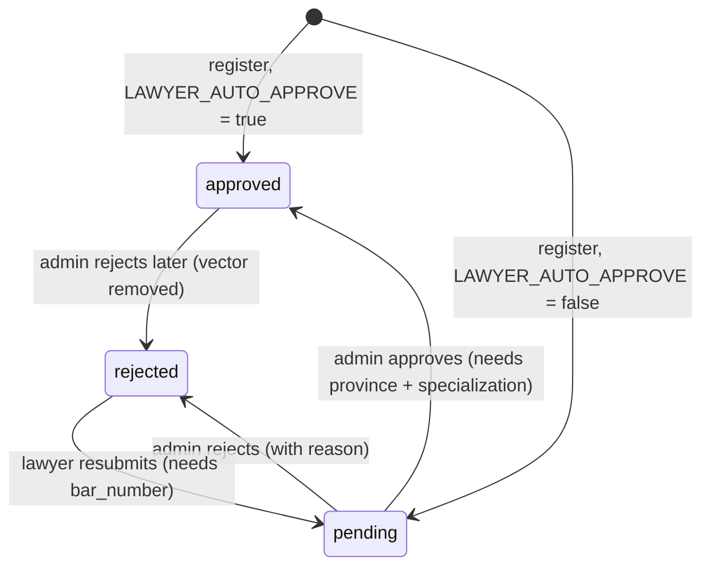

# 02 — Lawyer Directory, Matching and Onboarding

## What it does

Clients find lawyers in three ways: (1) **browse** the directory with filters, search and sort, (2) get an **AI match** ranked for their confirmed case, and (3) get **provisional suggestions** inside the AI chat when the chat cannot finish answering. Lawyers get into the directory by registering, completing onboarding (bar number + practice areas), and optionally setting **working hours** so clients see real bookable slots.

---

## User flow

### Client: browsing (`/lawyers`)

1. The client opens **Lawyers**. Lawyer cards load (page 1, **20 per page** — the UI's `PAGE_SIZE`; the server default is 10, max 50) with area chips showing counts per practice area. Seven chips are shown: Family, Criminal, Civil, Property, Corporate, Employment (`labour`), Constitutional. Banking, tax and cyber still work as server filters but have no chip.
2. The client filters by province, practice area chip, minimum rating or "accepting clients", types a name (or switches to **bar number** search), and picks a sort (Top rated, Lowest rated, Fee low→high, Fee high→low, Most experienced, Name A–Z, Name Z–A). Quick filters: *Available* (= `availability=true`) and *Top Rated* (= `min_rating ≥ 4.8`). Pressing `/` jumps to the search box. Any filter/sort/search change goes back to page 1.
3. **Describe your problem** box: the client types their issue (English or Roman Urdu, e.g. "plot par qabza, Lahore"). `lib/problemFilters.js` (`readProblem`) reads keywords **in the browser only** (the text is never sent) and sets the practice-area and province filters. If nothing is recognised it says so instead of guessing.
4. A map (Leaflet) shows pins. A pin can be **exact** (geocoded office address) or **approximate** (province centre). *My location* uses the browser's position only in page memory; it is never stored or sent.
5. The client opens a lawyer to see the profile, reviews, and actions: **Book appointment**, **Hire**, **Write a review**. A missing bar number shows "Not provided" (never an invented number). The review form appears only if the server says this client may review (see Reviews).
6. **Book**: the date picker asks the server for bookable slots for that lawyer and day (60-minute slots). It also looks up the **earliest open slot in the next 14 days** so the client does not click through empty days. A lawyer with no hours shows the server's "has not set their working hours yet" message; a failed request shows an error, never "no times available". The booking itself and hiring are covered in `13-appointments-client.md` and `15-hire-engagements.md`.

Deep links into `/lawyers`:
- `?case_id=…` — run the AI match for that case.
- `?lawyer=<id>&lawyer_name=<name>&action=book|review` — open one lawyer's profile (found by searching the name, then matching the id), then open booking or the review form. If not listed: "… is not listed right now".
- `?hire=<lawyerId>&hire_name=…&appointment=<id>` — open the hire dialog after a completed consultation.

Directory results are cached in the browser for the session (`DIRECTORY_CACHE`, `COUNTS_CACHE`): within 60 s a revisit shows the cached answer without asking again; after that it shows the cache and refreshes quietly. Typing is debounced 300 ms (not the first load).

### Client: AI match

1. After confirming an intake, the client clicks *Find a lawyer* → `/lawyers?case_id=...` (or the page reads the saved case id).
2. The page calls the match endpoint automatically once the directory has loaded. It shows either **matched** lawyers with a score and reason (e.g. "specializes in family; practises in punjab"; the top one is shown as "AI matched you with …" and a *View Match* button), or a **general listing** with a notice explaining nothing qualified (no lawyer is presented as a recommendation), or **none**.
3. If the case is still a draft, the page says "finish your intake" and the button becomes *Finish intake* (→ `/intake`).
4. If the case cannot be found (403, or 404 twice), the saved case id is forgotten (removed from browser storage and from the URL) and the page says "We could not find your earlier case"; the button becomes *Start intake*.
5. With no case id at all, *Find My Match* opens the "Describe your problem" box instead.

### Client: chat suggestions

When the chat graph ends with `convergence_status == "max_attempts"`, the chat reply includes up to 3 lawyers in a `LawyerMatchPanel`, with a notice that they are **not matched to the facts** and the client should complete a Legal Intake.

### Lawyer: onboarding

1. The lawyer registers (role = lawyer, accepts terms).
2. With `LAWYER_AUTO_APPROVE = True` the account is approved immediately. Onboarding (`OnboardingPage.jsx`) has 4 steps:
   - **Step 1 Professional profile** (required, no Skip): name, **bar license number** (4–64 chars, letters/digits at both ends, same regex as the server), and **1 to 3 practice areas** chosen from only four: Civil Litigation (`civil`), Criminal, Family, Constitutional. Experience in years.
   - **Step 2 Credentials and photo** (optional, *Skip for now*): each file uploads as soon as it is picked to `POST /users/me/kyc/documents`. Kinds: `photo` (JPG/PNG, with a *Take photo* camera button), `bar_certificate`, `education`, `professional` (PDF/JPG/PNG). Max 5 MB each. Re-uploading a kind replaces it. Files are private (only the lawyer and admins).
   - **Step 3 Office and fees**: address and city (sent joined as one `address`), phone (normalised by `toPkPhone`), minimum consultation fee (default 5,000, saved as `hourly_rate`), bio. Pressing Continue saves with two parallel calls (`PATCH /users/me` and `PATCH /users/me/lawyer-profile`, which also sets `availability: true`).
   - **Step 4 Finished**: shows a preview of the public profile.
3. After saving, the page says "Your profile is live" / badge "Registered lawyer" if `kyc_verified` is true, otherwise "Profile saved" / "Awaiting approval".
4. Province is set on the lawyer **Profile** page (`ProfilePage.jsx`), not in onboarding.
5. Working hours are set on the lawyer **Appointments** page.
6. Whether onboarding is done is decided from the **server** profile (`isLawyerOnboarded`: a bar number and at least one specialization), checked in the lawyer `App.jsx`; localStorage `lawyer_onboarded` is only a cache. Until then lawyer routes redirect to onboarding.
7. A rejected lawyer resubmits from the lawyer **Settings** page (`resubmitKyc`).

---

## Code flow

### All endpoints (router prefix `/api/v1`)

| Method + full path | Who | What it does / main errors |
|---|---|---|
| `GET /api/v1/lawyers` | any signed-in user | Directory. Query: `province`, `case_type`, `specialization` (one of `PRACTICE_AREAS`), `min_rating` 0–5, `availability`, `page` ≥1, `page_size` 1–50 (default 10), `q` ≤100, `bar_number` ≤64, `sort` |
| `GET /api/v1/lawyers/counts` | any signed-in user | Area-chip counts; `specialization` repeated up to 20 times; unknown area → 422 "Unknown practice area" |
| `GET /api/v1/lawyers/match/{case_id}?top_n=5` | client | AI match; 404 no case, 403 not your case, 422 `case_draft`; `top_n` 1–20 |
| `GET /api/v1/lawyers/me/availability` | lawyer | Own schedule incl. day-off reasons |
| `PUT /api/v1/lawyers/me/availability` | lawyer | Replace whole schedule; 422 on invalid rules |
| `GET /api/v1/lawyers/{lawyer_id}/availability` | any signed-in user | Public schedule: `configured`, `enforced`, `working_hours`, `unavailable_dates` (dates only, no reasons), `message`; 404 unknown lawyer |
| `GET /api/v1/lawyers/{lawyer_id}/bookable-slots?from=&to=&duration_minutes=60` | any signed-in user | Free slots per PKT day; `duration_minutes` 30–180; 422 bad range/duration |
| `GET /api/v1/lawyers/{lawyer_id}/reviews?page=&page_size=` | any signed-in user | Review page (`page_size` ≤50); 404 not a lawyer |
| `GET /api/v1/lawyers/{lawyer_id}/review-eligibility` | client | `{can_review, already_reviewed, reason}` |
| `POST /api/v1/lawyers/{lawyer_id}/review` | client | Body `{stars, comment?}` → 201; 422 stars, 403 no relationship, 409 duplicate, 404 |
| `POST /api/v1/lawyers/{lawyer_id}/embed` | admin | Manually embed one profile into Chroma |
| `GET /api/v1/users/me` / `PATCH /api/v1/users/me` | any user | Own profile; patch `full_name`, `phone`, `province` (a lawyer's province change re-embeds) |
| `PATCH /api/v1/users/me/lawyer-profile` | lawyer | Update `lawyer_profile` fields (see below); 403 if not a lawyer |
| `POST /api/v1/users/me/kyc/resubmit` | lawyer | Rejected → pending |
| `GET /api/v1/users/me/kyc/documents` | lawyer | Uploaded KYC files by kind (metadata only) |
| `POST /api/v1/users/me/kyc/documents` | lawyer | Form `kind` + `file`; 20/min; 5 MB; type from bytes |
| `GET /api/v1/users/{user_id}` | admin | Full profile of any user (there is no public "lawyer by id") |
| `GET /api/v1/admin/kyc/pending`, `PATCH /api/v1/admin/kyc/{lawyer_id}`, `GET /api/v1/admin/kyc/{lawyer_id}/documents/{kind}` | admin | KYC queue, decision, view a file (inline, `Cache-Control: no-store`) |

(`PATCH /users/me/password` and `POST /users/me/close` are in `18-auth-accounts.md`.)

### Directory search

```
ModLawyers.jsx (effect on filters/page/sort, debounced, cached in DIRECTORY_CACHE)
   -> api.js searchLawyers({province, specialization, min_rating, availability, q, bar_number, sort, page})
   -> GET /lawyers                         routes/lawyers.py  search_lawyers
   -> lawyer_service.search_lawyers()
   -> UserRepository.find_lawyers()  -> lawyer_filter() + paginate(sort)
   -> users collection
   <- each item passed through _sanitize() and _inject_coords()
```

### Directory counts (area chips)

```
ModLawyers.jsx -> api.js lawyerDirectoryCounts({province, min_rating, availability, specializations})
   -> GET /lawyers/counts -> lawyer_service.directory_counts()
   -> asyncio.gather( count_lawyers(area) for each chip, count_lawyers(), count_lawyers(availability=True) )
   <- {by_specialization: {...}, total, accepting}
```

One request replaces the old nine separate searches. It uses the same `lawyer_filter`, so a chip's number always equals what clicking it lists. Each chip count uses the page's other filters (province, rating, availability); `total` and `accepting` are for the **whole directory, unfiltered**. The page only asks for counts after the list has loaded once (a server that is down gets no more calls).

### AI match for a case

```mermaid
sequenceDiagram
    participant UI as ModLawyers.jsx
    participant R as GET /lawyers/match/{case_id}
    participant S as lawyer_service.match_lawyers_for_case
    participant V as lawyer_embeddings (Chroma)
    participant DB as users (Mongo)

    UI->>R: matchLawyers(caseId)  (poll up to 5 times, 3 s apart)
    R->>R: require_client, owner check, refuse draft (422 case_draft)
    R->>S: match_lawyers_for_case(case_id, top_n=5)
    S->>V: query_similar_lawyers(description, province, pool=top_n*4)
    V-->>S: hits with raw similarity → calibrated 0..1
    S->>DB: resolve hits; drop unmatchable (and forget stale vectors)
    S->>DB: find_lawyers(province, case_type, include_federal=True)
    S->>S: merge pools; _qualifies_as_match; _score_lawyer
    alt something qualified
        S-->>UI: result_kind = matched (top 5, with match_score, match_reason)
    else nothing qualified
        S->>DB: _general_listing (province, then anywhere)
        S-->>UI: result_kind = general_listing (match_score = null) or none
    end
```

### Chat provisional suggestions

```
chat_socket.py (after a chat turn, only if convergence_status == "max_attempts")
   -> _conversation_signals(graph state)   # case_type + confidence + province, never a hybrid turn
   -> _fetch_matched_lawyers(session, n=3, signals)
        case_id bound?  -> match_lawyers_for_case
        else            -> lawyer_service.suggest_lawyers_from_signals
   -> WS frame: matched_lawyers, match_result_kind, match_notice, suggest_lawyer=true
   -> ModChatbot.jsx -> LawyerMatchPanel.jsx (uses lib/lawyerMatch.js for heading/notice)
```

### Onboarding and profile

```
OnboardingPage.jsx submit()
   -> api.js updateMe({full_name, phone})            -> PATCH /users/me
   -> api.js updateLawyerProfile({bar_number, specializations, experience_years,
                                   hourly_rate, address, bio, availability})
                                                      -> PATCH /users/me/lawyer-profile
   -> user_service.update_lawyer_profile()
        geocode address -> lat/lng
        $set lawyer_profile.<field>
        if specializations/bio/experience_years changed -> schedule_embed(user_id)
```

`LawyerProfileUpdate` fields: `bar_number` (4–64 chars, pattern `^[A-Za-z0-9][A-Za-z0-9\-/ .]*[A-Za-z0-9]$`), `specializations`, `availability`, `bio`, `experience_years`, `hourly_rate`, `address`. Only non-null fields are written. If an address is sent and geocoding finds it, `lat`/`lng` are saved too (that is what makes a pin "exact").

Things that (re)schedule an embedding (`schedule_embed`, fire-and-forget): a profile edit touching `specializations`/`bio`/`experience_years`, a lawyer changing `province` via `PATCH /users/me`, admin KYC approval, admin reactivation, and accepting an engagement. KYC rejection calls `forget_lawyers` to remove the vector.

KYC documents (`services/kyc_documents.py`): `POST /users/me/kyc/documents`, list with `GET /users/me/kyc/documents`. Kinds: `photo` (JPEG/PNG), `bar_certificate`, `education`, `professional` (PDF/JPEG/PNG). Max 5 MB, read in 1 MB chunks; empty file → 422; type checked from the bytes; unknown kind → 422. One file per kind: a re-upload replaces it, and the old file is deleted only after the record points at the new one. Stored on disk under `{upload_root}/kyc/{user_id}/`, record in `lawyer_profile.kyc_documents.{kind}` (metadata only). On account closure the files are erased tombstone-first (`kyc_erasure_pending`), and failed deletions are retried by the hourly sweep (`retry_pending_erasures`). A rejected lawyer can `POST /users/me/kyc/resubmit`. Admin reviews with `GET /admin/kyc/pending`, opens files with `GET /admin/kyc/{lawyer_id}/documents/{kind}`, and decides with `PATCH /admin/kyc/{lawyer_id}`.

### Working hours and slots

```
Lawyer: AppointmentsPage.jsx -> getMyWorkingHours / saveMyWorkingHours
        -> GET/PUT /lawyers/me/availability
        -> lawyer_availability_service.read_own / replace_own
        -> lawyer_availability.validate_schedule (pure rules) -> lawyer_availability collection (upsert, _id = lawyer id)

Client: ModLawyers.jsx booking modal -> getBookableSlots(lawyerId, {from, to, duration_minutes: 60})
        -> GET /lawyers/{id}/bookable-slots
        -> lawyer_availability_service.bookable_slots
             schedule − exception days − taken slots (appointments, hearings, diary) − past times

Booking (appointments module) -> lawyer_availability_service.assert_bookable (only when the flag is on)
```

---

## Data & states

### Collections

| Collection | Used for |
|---|---|
| `users` | Lawyers are users with `role = "lawyer"` and a `lawyer_profile` sub-document |
| `lawyer_reviews` | One review per (client, lawyer); unique index |
| `lawyer_availability` | One schedule document per lawyer (`_id` = lawyer id) |
| Chroma `lawyers_collection` | Profile embeddings for semantic matching |
| `appointments`, lawyer events, hearings | Read to compute taken slots |

### Key lawyer fields

| Field | Meaning |
|---|---|
| `role`, `is_active`, `province` | Top-level user fields. Province: `punjab`, `sindh`, `kpk`, `balochistan`, `federal` |
| `lawyer_profile.bar_number` | Shape-checked only; nobody verifies it with a Bar Council |
| `lawyer_profile.specializations` | From `PRACTICE_AREAS`: civil, criminal, family, constitutional, property, corporate, banking, tax, labour, cyber |
| `lawyer_profile.kyc_verified`, `kyc_status`, `kyc_auto_approved`, `kyc_rejection_reason` | Approval state |
| `lawyer_profile.rating`, `total_reviews` | Recomputed from `lawyer_reviews` |
| `lawyer_profile.availability` | Boolean "accepting clients" |
| `lawyer_profile.experience_years`, `hourly_rate`, `bio`, `address`, `lat`, `lng` | Profile details |

### KYC states



KYC rules (`admin_service.process_kyc`, `user_service.resubmit_kyc`):
- **Approve** is refused (422) if the profile has no **province** ("use 'federal' for a nationwide practice") or no **specialization** (`_matchability_gaps`), because the lawyer would be "verified" but never matched. (It does not check the bar number; the listing rule does.) On approve: `kyc_verified = true`, `kyc_status = approved`, reason cleared, in-app notification `KYC_APPROVED`, email (`send_kyc_result_email`, a failed email is only logged), audit `kyc.approved`, and `schedule_embed`.
- **Reject**: `kyc_verified = false`, `kyc_status = rejected`, `kyc_rejection_reason` (default "Not specified"), notification `KYC_REJECTED` with the reason, email, audit `kyc.rejected`, and `forget_lawyers` (out of the match pool).
- **Resubmit**: 403 if not a lawyer; 422 "already verified"; 422 "already awaiting review" unless the status is `rejected`; 422 if there is no bar number. Sets `pending` and clears the old reason. Editing the profile never re-opens a rejected KYC by itself.

Being **approved** is not the same as being **listed**. A lawyer appears to clients only when all are true:

```
role == "lawyer"  AND  is_active  AND  lawyer_profile.kyc_verified
AND  bar_number is a non-blank string  AND  at least one specialization
```

This rule lives in `UserRepository.lawyer_filter` (for queries) and `lawyer_profile_complete` (for a document already loaded).

### Indexes (`db/indexes.py`)

- `users`: single-field indexes on `role`, `province`, `lawyer_profile.kyc_verified`, `lawyer_profile.specializations`, `is_active`; the compound `lawyer_match_pool` (`role, is_active, kyc_verified, province, specializations, rating desc`) so search and match pools filter and sort from one index.
- `users`: partial unique `uniq_bar_number` on `lawyer_profile.bar_number` (only where it is a string): one bar number per account. If duplicates already exist, index creation is skipped and the offenders are logged (startup continues).
- `lawyer_reviews`: `lawyer_id`, `client_id`, `created_at`, and unique `uniq_client_lawyer_review` on `(client_id, lawyer_id)`.
- `lawyer_availability`: keyed by `_id` = lawyer id (no extra index).

### Match result kinds

| `result_kind` | Meaning | `match_score` |
|---|---|---|
| `matched` | Lawyers with evidence of fit, ranked | number 0..1 |
| `general_listing` | Nothing fit; lawyers to browse, with a `notice` | `null` |
| `none` | No listed lawyers at all | — |
| `provisional` | Chat only: lawyers listing this case type, not matched to facts | `null` |
| `unavailable` | Chat only: signals too weak (confidence < 0.7); show nothing | — |

---

## Key logic & rules

**Server-side filtering, sorting and paging.** Older code filtered only the first page in the browser. Now the database does it. `sort` must match `^(rating|fee|experience|name)_(asc|desc)$`; the server maps the key to real fields (`LAWYER_SORTS`, each with `_id` as a tie-breaker), so a caller cannot sort on any field. Lawyers with no fee sort first on `fee_asc` and last on `fee_desc` (they are not hidden). Free text `q` is `re.escape`d and capped at 100 chars, then searched case-insensitively in name, province and specializations. `bar_number` is a case-insensitive **substring** search (escaped). If both `case_type` and `specialization` are given, the lawyer must list both (`$all`). Fee and experience are sort keys only, not filters.

**`min_rating` is only applied when > 0.** In Mongo, `$gte: 0` excludes documents with no `rating` key, which would hide unrated lawyers.

**`include_federal`.** The directory filter "Punjab" means Punjab only. The matcher uses `include_federal=True`: a provincial matter also includes `federal` lawyers, and a federal matter includes all provinces.

**Two evidence questions in matching** (`lawyer_service.py`):
1. *Qualification* (`_qualifies_as_match`): may we call this lawyer a match at all? Yes only if the lawyer lists the case type or a related term (`_RELATED_TERMS`), **or** calibrated semantic score ≥ `_MATCH_SEMANTIC_FLOOR = 0.35`. Province, rating, availability and experience are not evidence of fit.
2. *Ranking* (`_score_lawyer`):

| Factor | Weight |
|---|---|
| Semantic similarity (calibrated) | 0.50 |
| Specialization (exact = 1.0, related = 0.5) | 0.20 |
| Same province | 0.17 |
| Rating / 5 | 0.07 |
| Availability | 0.04 |
| Experience / 20 (max 1) | 0.02 |

"Related" specialization means one of the lawyer's specialization strings contains a related term from `_RELATED_TERMS` (e.g. for criminal: penal, defense, fir, bail, crime, prosecution).

`match_reason` is built from: "strong profile match" (semantic ≥ 0.60) or "partial profile match" (≥ 0.35), "specializes in X" / "related specialization", "practises in <province>", "available now", "N yrs experience" (N ≥ 5); none of these → "general match". The UI shows the score as "NN% match score".

Match inputs: the vector query text is the case `description`, else `ai_summary`, else "`<type>` legal matter in `<province>`". A case with no province is treated as `federal`. The vector store is filtered to that province **or** `federal` lawyers (a federal case searches everyone). If the vector search fails, only the Mongo pool is used. A vector hit for an approved lawyer who has not finished onboarding is skipped but **not** deleted (the reconcile job would only add it back). Unqualified candidates are dropped, never used to fill the 5 slots.

General listing notices: "No lawyer on the platform lists this case type in `<province>` yet. These are registered lawyers available in `<province>`…" (province + federal, first `top_n`), else "No lawyer is registered in `<province>` yet. These are registered lawyers practising elsewhere in Pakistan." `none` says "No registered lawyers are available on the platform yet."

If a lawyer has **no vector** (`semantic_score is None`), the other weights are scaled up so the score stays on 0..1. If the lawyer **is indexed** but did not appear in the vector results, the score is `0.0` (a real poor fit), not `None`. This check uses `indexed_lawyer_ids`.

**Similarity calibration** (`lawyer_embeddings.calibrate_similarity`). Raw e5 cosine is never below about 0.72, so it is rescaled: `(raw − 0.77) / (0.86 − 0.77)`, clipped to 0..1. Off-topic queries measured at most 0.15 after calibration.

**Profile text for embeddings** (`build_profile_text`): specializations, province, experience, bio, plus domain *terms* from recent cases (never the client's prose). Embedding is re-scheduled when `specializations`, `bio` or `experience_years` change. A background job in `main.py` runs `reconcile_index()` every `lawyer_reconcile_hours` (default 6) to keep Chroma in sync with Mongo.

**Stale vectors are removed.** If a vector hit resolves to a deleted or unverified lawyer, `forget_lawyers` deletes it from Chroma, so one ghost row cannot poison every query.

**Match permissions.** `GET /lawyers/match/{case_id}` needs `require_client`, the case must belong to the caller (403 otherwise), and must not be a draft (422 with `code: "case_draft"`). `top_n` is bounded 1..20 because the pool size is `top_n * 4`.

**Frontend match polling.** `ModLawyers.jsx` tries up to 5 times, 3 s apart. It stops at once on 0 (server down: "Cannot reach the server"), 401 ("Session expired"), 403, 422 draft, any other error, a non-empty list, or `kind == "none"`. A 404 is retried once, then the saved case id is forgotten. The case id comes from `?case_id=` or the user-scoped `aai-case-id` saved by the intake. The match runs automatically only after the directory list has loaded (`backendUp`).

**Provisional suggestions, details.** The pool is `find_lawyers(province, case_type, include_federal=True)` of size `top_n × 4`; `top_n` is clamped to 1..10 (chat asks for 3). If the type is clear but nobody lists it, the result is `none` with "No registered lawyer lists `<type>` matters `<where>` yet." The `provisional` notice says "Based on this conversation, these registered lawyers handle … They have not been matched to your facts — complete a Legal Intake for a proper match." In the chat panel (`lib/lawyerMatch.js`) the headings are: matched → "Connect with a lawyer for personalized advice" (or "AI reached its limit — consult a lawyer" when `suggest_lawyer`), general_listing → "No specific match — registered lawyers you can browse", provisional → "Lawyers who handle this kind of matter"; `none`/`unavailable` show only a notice. A null `match_score` is never shown as "0% match". The panel's button is *Book Consultation →*.

**Provisional suggestions are careful.** `suggest_lawyers_from_signals` needs a known case type with confidence ≥ 0.7, uses only lawyers whose specialization **exactly** matches, sorts with `_score_lawyer(..., semantic=None)`, and returns `match_score = null`. The signals come from the server's graph state, never from the browser, and a hybrid (two case types) turn gives no suggestion.

**Safe output.** `_sanitize` reuses `user_service._sanitize` to strip secrets and the embedding field. `_inject_coords` adds `location_precision` (`exact`, `approximate`, `none`), so the UI does not offer turn-by-turn directions to an invented point.

**Reviews.** `review_eligibility` and `submit_review` share one rule (`_has_review_relationship`): the client must have a retained engagement (accepted, completed or terminated) **or** a completed appointment with that lawyer. One review per pair (unique index). Stars 1–5 (else 422), comment cut to 1000 chars. `recompute_rating` rebuilds the average from all reviews, so it is safe to run many times. Public reviewer names are shortened ("Muhammad U."; one-word name as is; no name → "Verified client"); the review payload never carries the client id or email.
- Eligibility answers: `{can_review: false, reason: "already_reviewed"}`, `{can_review: false, reason: "no_completed_relationship"}`, or `{can_review: true}`. The UI **fails closed**: while unknown or on error, no form.
- Submit errors: 404 not a lawyer, 403 "You can only review a lawyer you have worked with", 409 "You have already reviewed this lawyer". On a duplicate the rating is recomputed **before** the 409 (repairs a half-finished earlier attempt).
- The review is inserted first, then the rating recomputed, so a blocked duplicate never changes the rating.

**Availability rules** (`lawyer_availability.py`, pure functions):
- Half-hour boundaries only; end must be after start; no overlapping intervals on one weekday.
- Time zone is always `Asia/Karachi`.
- A lawyer with no saved schedule has **no** hours. The system never invents default office hours.
- Schedules are replaced **wholesale** (`PUT`), so overlap checks always see the full set.
- `/me/...` routes are declared before `/{lawyer_id}/...` so "me" is not read as an id, and the lawyer id for writes comes from the token only.
- Slots are "advice, not a reservation": unique slot indexes in the appointments module decide races.
- Hearings block 180 minutes (`HEARING_HOLD_MINUTES`); lawyer diary events also block slots.
- Hearing details: only hearings on the lawyer's cases that are not `closed`/`dismissed` and have no `outcome` yet. A hearing with **no time** blocks the whole day; one with an unreadable time blocks 180 minutes from the start of that day's working hours.
- Taken appointment slots use the appointment statuses that hold a slot (`policy_active_statuses`, from the appointment index spec), and look one day either side so an appointment late the previous day is counted.
- Weekday `0` = Monday … `6` = Sunday. Times are exact `HH:MM`.
- **Exceptions** are whole PKT days off (`YYYY-MM-DD`), with an optional reason ≤ 200 chars; the same date twice is an error. Clients see only the dates (`unavailable_dates`), never the reason.
- A slots request may cover at most **31 days** (`MAX_RANGE_DAYS`); `duration_minutes` must be 30–180 **and** a multiple of 30 (`duration_error`). Every day in the range is returned, including empty ones.
- The owner or an **admin** may manage a schedule (`_assert_may_manage`); the routes only expose the lawyer's own.
- The `message` field explains the state in plain words: no hours set → "has not set their working hours yet … you can still send a request"; hours set but not enforced → "not yet enforced at booking"; enforced → "These are the times this lawyer is available".
- `assert_bookable` (only when the flag is on) refuses with 422: no schedule ("cannot be booked with them at the moment"), outside hours, or clashing with a hearing/diary entry ("The lawyer is not available at that time").

**Auto-approve** (`auth_service.initial_kyc_fields`). With the flag on, a new lawyer gets `kyc_verified = True`, `kyc_status = approved`, `kyc_auto_approved = True`. The UI therefore says **"Registered"**, never "Verified". `Settings.validate_production_transport` refuses to start with this flag in `APP_ENV=production`.

### Feature flags (`backend/app/core/config.py`)

| Flag | Default | Effect |
|---|---|---|
| `lawyer_auto_approve` | `True` | Demo policy: approve lawyers at sign-up; forbidden in production |
| `appointment_working_hours_enforced` | `False` | When off, bookings outside working hours are still accepted; slots are shown but marked `enforced: false` |
| `lawyer_reconcile_hours` | `6` | How often the Chroma lawyer index is reconciled |

---

## Files

| File | Role |
|---|---|
| [ModLawyers.jsx](../../frontend/src/components/client/ModLawyers.jsx) | Client Lawyers page: directory, filters, map, AI match, booking, hire, reviews |
| [LawyerMatchPanel.jsx](../../frontend/src/components/client/LawyerMatchPanel.jsx) | Lawyer card list inside a chat reply |
| [lawyerMatch.js](../../frontend/src/lib/lawyerMatch.js) | Headings and notices per `result_kind` |
| [ModChatbot.jsx](../../frontend/src/components/client/ModChatbot.jsx) | Client chat; mounts the match panel |
| [OnboardingPage.jsx](../../frontend/src/components/lawyer/OnboardingPage.jsx) | Lawyer onboarding wizard (4 steps, KYC uploads, `isLawyerOnboarded`) |
| [SettingsPage.jsx](../../frontend/src/components/lawyer/SettingsPage.jsx) | KYC documents and "resubmit" after a rejection |
| [problemFilters.js](../../frontend/src/lib/problemFilters.js) | "Describe your problem" → area + province filters, in the browser |
| [kyc_documents.py](../../backend/app/services/kyc_documents.py) | KYC file storage, replace, erasure on closure |
| [admin_service.py](../../backend/app/services/admin_service.py) | `process_kyc` (approve/reject), `_matchability_gaps` |
| [ProfilePage.jsx](../../frontend/src/components/lawyer/ProfilePage.jsx) | Lawyer profile editing (incl. province) |
| [AppointmentsPage.jsx](../../frontend/src/components/lawyer/AppointmentsPage.jsx) | Lawyer working-hours editor |
| [api.js](../../frontend/src/lib/api.js) | `searchLawyers`, `lawyerDirectoryCounts`, `matchLawyers`, reviews, `getBookableSlots`, `getMyWorkingHours`, `saveMyWorkingHours`, `updateLawyerProfile` |
| [lawyers.py](../../backend/app/api/v1/routes/lawyers.py) | Directory, counts, match, reviews, availability endpoints |
| [users.py](../../backend/app/api/v1/routes/users.py) | `/users/me/lawyer-profile`, KYC documents and resubmit |
| [lawyer_service.py](../../backend/app/services/lawyer_service.py) | Search, counts, matching, scoring, suggestions, reviews |
| [user_service.py](../../backend/app/services/user_service.py) | Profile update, geocoding, re-embed trigger, KYC resubmit |
| [auth_service.py](../../backend/app/services/auth_service.py) | Registration and `initial_kyc_fields` (auto-approve) |
| [user_repo.py](../../backend/app/repositories/user_repo.py) | `lawyer_filter`, `find_lawyers`, `count_lawyers`, `recompute_rating` |
| [lawyer_embeddings.py](../../backend/app/ai/lawyer_embeddings.py) | Chroma index, calibration, reconcile |
| [chat_socket.py](../../backend/app/websockets/chat_socket.py) | Chat-side suggestions (`_fetch_matched_lawyers`) |
| [lawyer_availability.py](../../backend/app/services/lawyer_availability.py) | Pure schedule rules and slot maths |
| [lawyer_availability_service.py](../../backend/app/services/lawyer_availability_service.py) | Schedule read/write, bookable slots, `assert_bookable` |
| [config.py](../../backend/app/core/config.py) | Feature flags |

---

## Known limits / not done

- **Bar numbers are not verified.** With auto-approve on, any registered lawyer with a bar number and a practice area is listed. Production must turn the flag off and use the admin KYC queue.
- **Working hours are not enforced** (`appointment_working_hours_enforced = False`). Lawyers without a schedule show no bookable slots, but bookings are still accepted.
- **No public "lawyer by id" endpoint.** `user_service.get_lawyer_by_id` exists but nothing calls it, and the comment in `users.py` mentions a "public /lawyers/{id} endpoint" that is not in `lawyers.py`. The profile shown to clients comes from the directory/match data already loaded.
- **`experience_asc` sort.** The route pattern accepts it, but `LAWYER_SORTS` has no such key, so it silently falls back to `rating_desc`.
- **Onboarding does not set province.** The lawyer must set it on the Profile page; until then the province filter and the 0.17 province weight cannot apply, and the map pin has `location_precision: "none"` unless an address was geocoded.
- **Ratings on seeded profiles** are noted in the code as weak evidence, which is why rating weight is only 0.07.
- **Matching is computed on request**, not stored. `confirm_case` no longer writes `matched_lawyers`.
- **Chat suggestions** appear only when the chat ends with `max_attempts`, not on every answer.
- **"Verified" vs "Registered" is not consistent.** Onboarding and the client directory say "Registered", but the lawyer's own `ProfilePage.jsx` maps `kyc_status = approved` to "Verified lawyer ✓ — Your Bar enrolment was checked by our team", and no UI reads `kyc_auto_approved`. So an auto-approved lawyer is told they were checked when they were not.
- **Profile fields are barely validated on the server.** `LawyerProfileUpdate` checks only the bar-number shape. `specializations` is any list of strings (not checked against `PRACTICE_AREAS`), and `bio`, `experience_years`, `hourly_rate`, `address` have no limits (the 600-char bio limit is only in `ProfilePage.jsx`).
- **Duplicate bar number gives a 500.** The unique index `uniq_bar_number` rejects a second account with the same number, but `update_lawyer_profile` does not catch `DuplicateKeyError`, so the client gets the generic "Internal server error" instead of a clear message.
- **Onboarding offers only 4 practice areas** (civil, criminal, family, constitutional), max 3; the other six (`property`, `corporate`, `banking`, `tax`, `labour`, `cyber`) can only be chosen on the Profile page.
- `GET /lawyers/{id}/availability` has an api.js wrapper (`getLawyerWorkingHours`) but no component calls it; the booking UI uses `bookable-slots` instead.
