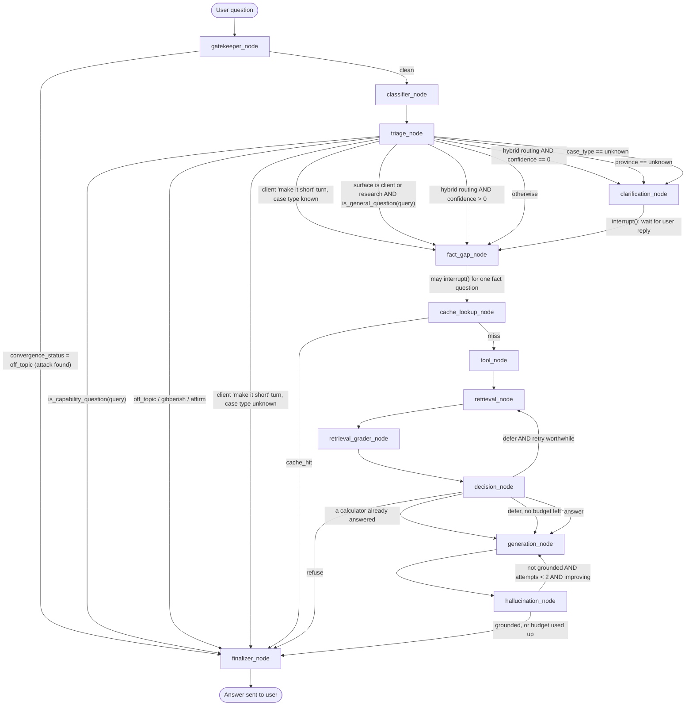
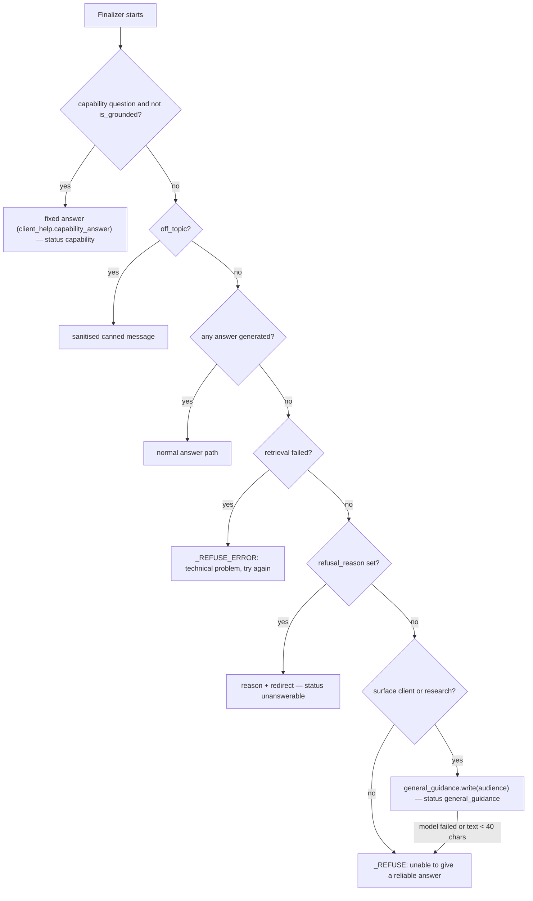

# 03 — AI pipeline (the shared RAG graph)

> Written from the code in October 2026. If this doc and the code disagree, the code is right.

## 1. What it does

This is the **engine** behind two screens:

- the **client AI chat** (doc [04](04-ai-chat-client.md)), and
- the **lawyer AI research assistant** (doc [05](05-ai-research-lawyer.md)).

Both send a question into the **same LangGraph graph** (`chat_graph`). The graph:

1. blocks attacks (prompt injection),
2. works out the area of law, the province and the language,
3. asks a clarifying question if important facts are missing,
4. searches the law library (ChromaDB + BM25),
5. decides if the evidence is good enough to answer,
6. writes an answer that may only cite the sources it was given,
7. checks every cited sentence against those sources,
8. cleans the answer, labels the citations, and caches it.

The difference between the two screens is one state field: **`surface`** — `"client"` or `"research"`. Some safety rules switch on or off by surface (see section 5).

From the user's view: they type a question, and they get either
- a **sourced answer** with citation chips and a confidence band,
- a **clarifying question**,
- a **fixed "what I can do" answer** (if they asked about the assistant itself),
- a **labelled general guidance** answer (library had too little), or
- an honest **refusal** ("I could not find a reliable answer" / "technical problem, try again" / "the law cannot answer this kind of question").

There is also a second, smaller graph, `intake_graph`, used only by intake case conversion. It is covered in doc [01](01-legal-intake.md); this doc mentions it only briefly.

## 2. User flow (what the user sees, step by step)

| # | What happens | Node(s) |
|---|--------------|---------|
| 1 | User sends a question. | route (doc 04 / 05) builds the state |
| 2 | An attack ("ignore previous instructions…") is refused at once. | `gatekeeper_node` |
| 3 | The system guesses the area of law (civil / criminal / family / constitutional) and the province from keywords. | `classifier_node` |
| 4 | An LLM confirms the area of law, detects the language (English, Urdu script, Roman Urdu), and filters greetings, off-topic and gibberish. | `triage_node` |
| 5 | If the question is "can you help me?", a fixed answer comes back. | `route_after_triage` → `finalizer_node` |
| 6 | If the area of law or province is unknown, the user is asked one question. The graph **pauses** and waits. | `clarification_node` (uses `interrupt()`) |
| 7 | If key facts are missing, the user may be asked one more targeted question. | `fact_gap_node` (uses `interrupt()`) |
| 8 | If the same generic question was answered recently, the cached answer is returned. | `cache_lookup_node` |
| 9 | Calculators (bail, court fee, inheritance, case law) run if the question needs them. | `tool_node` |
| 10 | The law library is searched. | `retrieval_node` |
| 11 | The found sections are scored. | `retrieval_grader_node` |
| 12 | The system decides: answer, search again, or refuse. | `decision_node` |
| 13 | The answer is written. | `generation_node` |
| 14 | Every cited sentence is checked against its source. If it fails, the answer is written once more. | `hallucination_node` |
| 15 | Final cleaning, citation labels, notices, cache write. | `finalizer_node` |

## 3. Code flow

### 3.1 Entry points

| Caller | Surface | How it calls the graph |
|--------|---------|------------------------|
| `chat_endpoint` in [chat_socket.py](../../backend/app/websockets/chat_socket.py) (WebSocket `/ws/chat/{session_id}`) | `"client"` | `chat_graph.ainvoke(state, config={"configurable": {"thread_id": session_id}})` |
| `ai_research` → `_run_research_turn` in [ai.py](../../backend/app/api/v1/routes/ai.py) (`POST /api/v1/ai/research`) | `"research"` | `chat_graph.ainvoke(state, config={"configurable": {"thread_id": thread_id}})` |

Both build the starting state with `_build_state()` in `chat_socket.py`, then set `state["surface"]`. The surface is set **only by the trusted server route**, never by the browser.

If the graph paused on a clarifying question last turn, the route resumes it instead: `chat_graph.ainvoke(Command(resume=<user's reply>), config)`.

**Endpoints in [ai.py](../../backend/app/api/v1/routes/ai.py) and whether they use this graph** (full table with guards and UI callers: doc [05](05-ai-research-lawyer.md) §4.1):

| Endpoint | Uses `chat_graph`? |
|----------|--------------------|
| `POST /api/v1/ai/research` | **yes** (`surface = "research"`) |
| WebSocket `/ws/chat/{session_id}` (in `chat_socket.py`) | **yes** (`surface = "client"`) |
| `POST /api/v1/ai/query`, `POST /api/v1/ai/query/stream` | no — one direct LLM call (`PURPOSE_DIRECT_CHAT`), no retrieval, no grounding |
| `POST /api/v1/ai/draft/stream` | no — its own retrieval from the identity indexes + `draft_guard` (doc 08) |
| `POST /api/v1/ai/pleading-urdu/stream`, `POST /api/v1/ai/pleading-urdu/pdf` | no — translation / PDF render |
| `POST /api/v1/ai/compare` | no — sends one prompt to every provider |
| `POST /api/v1/ai/rate`, `GET /api/v1/ai/source/{source_file}` | no — rating and citation source file |

The `intake_graph` (same `supervisor.py`) is a straight line with no clarification and no retry: `retrieval_node → retrieval_grader_node → intake_evidence_gate_node → intake_node → intake_hallucination_node → intake_finalizer_node`. It has **no checkpointer** (it never pauses).

### 3.2 The graph (built in `build_chat_graph()` in [supervisor.py](../../backend/app/ai/graph/supervisor.py))

All routing functions live in [edges.py](../../backend/app/ai/graph/edges.py):

| Function | After node | Rule (in order) |
|----------|-----------|-----------------|
| `route_after_gatekeeper` | gatekeeper | `convergence_status == "off_topic"` → finalizer, else classifier |
| `route_after_triage` | triage | 1. `client_help.is_capability_question(query)` → finalizer. 2. `off_topic` → finalizer. 3. a client/research "make it short / in detail" follow-up (`presentation_base_query`) → fact_gap if the case type is known, else finalizer (ends honestly). 4. `surface` in client/research **and** `is_general_question(query)` → fact_gap (no clarification for "What is khula?"). 5. `routing_mode == "hybrid"`: confidence 0 → clarification, > 0 → fact_gap. 6. `province == "unknown"` → clarification. 7. `case_type == "unknown"` → clarification. 8. else fact_gap |
| (plain edge) | clarification | always → fact_gap |
| (plain edge) | fact_gap | always → cache_lookup |
| `route_after_cache` | cache_lookup | `cache_hit` → finalizer, else tool_node |
| (plain edge) | tool_node | always → retrieval (tools are **not** re-run on a retrieval retry) |
| `route_after_decision` | decision | a successful calculator result → generation. `refuse` → finalizer. `defer` → retrieval if `_retry_is_worthwhile` else generation. `answer` → generation |
| `route_after_hallucination` | hallucination | grounded → finalizer. Else retry generation only if `generation_attempts < 2` and confidence still improving |

`is_general_question()` is a regex: the question starts with (optionally "please" / "can you" / "could you") "what is / what are / what does / what's / which / list / name / explain / define / describe / tell me / give me / how many / overview / summarise / difference between…", is ≤ 300 characters, and does **not** talk about the asker's own matter ("my", "mine", "our", "I am / was / have / had / got", "we are / were / have / had").

`_retry_is_worthwhile()`: at most 3 retrieval attempts (`_MAX_RETRIEVAL_ATTEMPTS`), the score must improve by more than 0.05, and a retry is pointless if no new facts were added (`fact_delta == 0`).

### 3.3 Each node, in simple words

**`gatekeeper_node`** ([gatekeeper_node.py](../../backend/app/ai/nodes/gatekeeper_node.py))
Two layers. Layer 1: tight regexes (`heuristic_injection_match`) for "ignore previous instructions", "you are now DAN", system-prompt leaks and so on. Layer 2: a fast LLM classifier (`llm_injection_reason`) for subtle attempts. On a hit, `_block()` sets `answer = CANNED_REFUSAL` ("I can't help with that request. I'm an assistant for Pakistani legal matters…"), `convergence_status = "off_topic"`, `is_grounded = True`, `confidence = 1.0`, and logs a warning. **Fail-open:** if the LLM layer errors, the question goes through (the regex layer still ran). The client socket also runs the regex layer *before* the graph.
- An empty query is skipped (returns `{}`).
- Layer 1 patterns include: "ignore / disregard / forget previous instructions", "you are now …", "act / pretend as DAN / an unrestricted AI", "developer mode", "jailbreak", "DAN mode", "reveal / print your system prompt", raw chat-template tokens (`<|im_start|>`, `[INST]`, `<<SYS>>`, `### system`), "no longer bound by your rules", "bypass safety / filters". They are kept tight on purpose: "can the court disregard the rules of evidence?" and "act as an unrestricted agent for my brother" (power-of-attorney wording) must **not** be blocked.
- Layer 2 (`llm_injection_reason`) always uses the **fast** tier (`_prefer_fast()` returns `True`; measured: same catches as the big model, ~1 s instead of ~2.4 s), purpose `PURPOSE_GATEKEEPER`, structured output `GatekeeperVerdict {is_injection, reason}`. The prompt says a normal legal question about crimes or defying a court order is **not** an injection.

**`classifier_node`** ([classifier_node.py](../../backend/app/ai/nodes/classifier_node.py))
No LLM. Regex "signal tables" score each area of law (e.g. `FIR`, `bail` → criminal; `khula`, `talaq`, Urdu `خلع` → family). It also finds the province from city names (always, every turn). Output: `classifier_case_type`, `classifier_confidence`, `routing_mode`:
- best score 0 → `hybrid` (no signal at all),
- 2+ areas above 0.15 → `hybrid` (real overlap, e.g. theft of property),
- else `single`.
It only writes `case_type` itself when confidence ≥ 0.85. If a case type was already set (UI choice, previous turn), it keeps it.

**`triage_node`** ([triage_node.py](../../backend/app/ai/nodes/triage_node.py))
- **Gibberish guard** (`_is_gibberish`): fewer than 2 words of 3+ letters → canned "I didn't quite understand that".
- **Follow-up turns:** if the route already marked the turn as `format` / `deepen` ("make it short" / "explain in detail"), triage re-uses the previous question (`presentation_base_query`) and, for client turns with no case type, types that question with one LLM call.
- **Follow-up detection** (short messages after an AI reply): `_detect_intent` asks the LLM for `format / deepen / affirm / new`. `affirm` ("ok", "shukria") gets a canned reply.
- **Full LLM triage** (`TriageOutput`): `category` (legal / off_topic / gibberish), `language`, `normalized_query`, `case_type` + confidence, `complexity`, `urgency`, `province`, `known_facts`.
- Order inside triage: (1) capability question → passes through ungrounded (see §7), (2) gibberish guard, (3) a pre-set `format`/`deepen` follow-up from the route, (4) follow-up intent detection, (5) full LLM triage.
- **Follow-up detection limits:** only when there is a previous AI message **and** the new message is ≤ 20 words; the LLM verdict is used only if its confidence is ≥ 0.65 and it is not `new`. On any LLM error the intent is `new`.
- **Untyped "make it short":** if the question being re-answered still has no case type after one extra LLM call, triage sets `refusal_reason` to a fixed message ("I couldn't tell which area of law your previous question falls under… Please ask the question again, with a little detail") in English or Urdu. The route then ends the turn at the finalizer, which shows it as `unanswerable` (it never searches the civil default).
- **Inputs to the LLM:** the last 5 turns of history (`format_history`) as "Conversation so far", and the question truncated to 1,500 words (`… [TRUNCATED]`).
- **Model tier:** the fast tier only when a Gemini key is set (`_prefer_fast`), otherwise the main tier (the 9-field schema is too much for a small model).
- **Case type fallback** (`_resolved_case_type`): if the LLM says `unknown`, the classifier's hint (`classifier_case_type`) is used whenever its confidence is > 0. Before this, a correct keyword classification ("khula" → family at 0.35) was thrown away and the turn went to clarification.
- Off-topic / gibberish (LLM verdict) → canned "I can only assist with Pakistani legal matters…", `is_grounded = True`, `convergence_status = "off_topic"`.

**Language detection (en / ur / roman_urdu).** The LLM labels the language, then `_reconcile_language()` corrects it from the script actually present: Urdu characters present → `ur`; no Urdu characters but labelled `ur` → `roman_urdu`. For Roman Urdu the LLM transliterates into Urdu script (`normalized_query`), which is what retrieval searches. For English, `_enforce_en_invariant()` forces `normalized_query` to equal the original query. **Why:** a real failure (FAILURE_CASE_001) where an English PPC question was "normalised" into corrupted Urdu, retrieval searched the wrong thing, and the answer cited the wrong section. The repair is logged at ERROR and flagged in `invariant_violation`.

**Province.** `jurisdiction.resolve()` decides it. A province the user chose (or the case record) **always wins** over the LLM's guess. The basis is saved in `jurisdiction_basis`: `user_selected`, `case_record`, `inferred_from_query` or `unspecified`.

**`clarification_node`** ([clarification_node.py](../../backend/app/ai/nodes/clarification_node.py))
A fast LLM writes ONE question about what is missing, in the user's language (`question_language_instruction` from [_language.py](../../backend/app/ai/nodes/_language.py)). Then `interrupt(question)` **pauses the graph**. The route sends the question to the user. When the user replies, the route resumes with `Command(resume=reply)`; `merge_user_reply` folds the reply into the state. It increases `clarification_attempts`, which also marks the turn as personalised (never cached).

**`fact_gap_node`** ([fact_gap_node.py](../../backend/app/ai/nodes/fact_gap_node.py))
Usually **skips** asking. It proceeds without a question when:
- it is a "make it short / in detail" follow-up,
- `complexity == "simple"` and there is ≥ 1 known fact, or it already asked once,
- `complexity == "complex"` and 2 attempts were used or ≥ 3 facts are known,
- province, case type, a 12+ word description and 2+ facts are all present.
Otherwise the LLM (with a per-area template of key facts) either replies `PROCEED` or one targeted question, and the node calls `interrupt()`. `fact_delta` counts new facts learned, which later decides if a retrieval retry is worth it.

**`cache_lookup_node`** ([cache_node.py](../../backend/app/ai/nodes/cache_node.py)) + [cache.py](../../backend/app/ai/cache.py)
`cache_block_reason()` refuses the cache when the turn is **personalised** (has conversation history, clarifications, a case id, or touches the user's private documents), uses **web search**, or needs **law not held for the province**. The same function is used by the lookup **and** by the finalizer's write, so they cannot disagree. Answerability-blocked questions also skip the cache.
Key = `sha256(normalized_query | case_type:province | language bucket (en/ur) | variant)`. The variant includes the response mode, policy version, and surface (`client` answers and `research` answers never share entries). Entries also carry version tags (`EMBEDDING_MODEL_VERSION`, `CHUNKING_STRATEGY_VERSION`, `DECISION_POLICY_VERSION = "v6"`) — a mismatch is a miss. Storage: Redis if configured, else an in-process dict. TTL is a safety net: `cache_result_ttl = 600` s (10 min) for answers, `cache_chunk_ttl = 300` s (5 min) for the retrieval chunk cache. A cached entry also stores its claims, the measured scores (`relevance_score`, `bm25_confidence`, `signal_variance`) and `answer_llm` (which model wrote it), so a cache hit does not show "unassessed" claims or zero scores. A cache error never fails the answer (write is best-effort).

**`tool_node`** ([tool_node.py](../../backend/app/ai/nodes/tool_node.py))
Lets the model call deterministic engines (bail eligibility, court fee, inheritance shares, case law, and the user's own documents). Up to 3 rounds. Results go into `tool_results`, **not** into `retrieved_chunks`, so the grader never scores away a computed figure and a retrieval retry never overwrites it. Document tools are bound to the authenticated `user_id`.
- **Cost gate first** (`tools.should_offer_tools`): a word-boundary keyword check on the query + case type (bail, zamanat, FIR, arrest, 497, offence, section, fee, stamp, suit, injunction, writ, inheritance, wirasat, heir, estate, died, case law, precedent, judgment, LHC, supreme court…). No keyword and no document wording (`mentions_document`) → the node returns empty **without any LLM call**.
- Tools: `find_offence_sections`, `check_bail_eligibility`, `calculate_court_fee`, `compute_inheritance_shares`, `search_case_law` (`LEGAL_TOOLS`), plus `list_my_documents` / `read_document` built per request (they read the client's own intake evidence).
- The model (main tier, `PURPOSE_TOOL_SELECTION`) is told never to guess a section or a `file_id`, to call `find_offence_sections` first for an offence named in words, and to stop if that lookup fails.
- Another round runs only if a "precursor" tool ran (`find_offence_sections`, `list_my_documents`); a round where every call is a repeat stops the loop. Identical repeated calls are **not** re-run (answered from the earlier result). Tool output given back to the model is capped at 4,000 characters.
- **Fail-open:** if tool selection errors, the node stops and the graph answers from statute text as before. A tool that raises on bad arguments returns `{"error": …}` instead.
- A successful engine result makes `route_after_decision` go straight to generation (a low statute score must not refuse a correct computed figure).

**`retrieval_node`** ([retrieval_node.py](../../backend/app/ai/nodes/retrieval_node.py))
1. Base query = `normalized_query` (or a case-derived `retrieval_query_supplement`). On retries, known facts are appended.
2. `_expand_query`: fixes aliases (IPC → PPC, MFLO → Muslim Family Laws Ordinance 1961…), then a fast LLM rewrites into legal terms. The rewrite is only used if it contains legal keywords. On an identical retry the previous rewrite is reused (saves tokens).
3. Case law (Lahore High Court judgments) is searched separately on the raw query (min score 0.78, max 3) and kept in `case_law_chunks`.
4. `build_retriever()` → hop 1 search.
5. Hop 2: follow cross-references found in hop 1 (graph first, text re-query fallback), merge with RRF.
6. Topic rules + **named-statute affinity** (`apply_affinity`): if the user named a statute, its chunks go first.
7. Optional web search (toggle; client UI keeps it off).
8. `apply_client_exact_provisions`: if the user named a provision ("Section 489-F PPC"), its exact text is fetched by identity and pinned first (client always; research only with safeguards on).
If the retriever cannot be built, `retrieval_error = True` (this is a **fault**, not "no law found").

**Retriever** ([retriever.py](../../backend/app/ai/pipelines/retriever.py))
- Collection by case type: `civil_collection`, `criminal_collection`, `family_collection`, `constitutional_collection` (default civil).
- `EnsembleRetriever` = **BM25 (weight 0.6)** + **Chroma semantic search (weight 0.4)** with `intfloat/multilingual-e5-base` embeddings (with `query:` / `passage:` prefixes). `FIRST_STAGE_K = 10` (measured; raising it made results worse).
- Province filter: `province IN (asked, "federal")`. **Unknown province = no filter at all** (search everything and say so). Earlier, unknown silently meant federal-only and hid 1,608 provincial chunks.
- Chunks tagged `retrieval_scope = "reference_only"` (forms, schedules) are excluded.
- Lawyer research with safeguards ON uses versioned **identity indexes** (`research_ident` → `sec_v2` for criminal, `ident_v2` for civil). If the verified index is missing, `index_health.require` raises and the turn reports a retrieval error — it never silently falls back to the base index.

**`retrieval_grader_node`** ([retrieval_grader_node.py](../../backend/app/ai/nodes/retrieval_grader_node.py)) + [scoring.py](../../backend/app/ai/scoring.py)
Grades the first 8 chunks (`_MAX_TO_GRADE`). One fast LLM call returns `[1,0,1,…]`. A wrong-length array is treated as a failure, and a failure gives every chunk a neutral 0.5 (it does **not** become "everything irrelevant"). `score_retrieval_batch` combines three signals:

| Signal | Weight | What it is |
|--------|--------|-----------|
| keyword (lexical) | 0.40 | rarity-weighted coverage of the query's own distinctive terms |
| embedding | 0.35 | real cosine similarity from vectors stored in Chroma |
| llm | 0.25 | the grader's 0/1 |

A variance penalty applies when signals disagree. Output: `relevance_score`, `signal_variance`, `bm25_confidence`, `signal_origin = "measured"`. Topic order, statute affinity and exact provisions are re-applied after grading so they stay first.

**`decision_node`** (`_decision_node` in supervisor → [decision_engine.py](../../backend/app/ai/decision_engine.py))
1. First the **authority gate** (`authority_registry.chat_gate`): a question needing law the corpus does not hold for this province is refused, or (mixed question) that law's text is removed.
2. **Answerability gate** ([answerability.py](../../backend/app/ai/pipelines/answerability.py)): questions statutes can never answer — a current rate, a court statistic, a personal record, a prediction — are refused with `refusal_reason` + `refusal_redirect`, whatever the scores say.
3. Zero chunks → refuse (`arbitration_source = "error"` if retrieval crashed, `"none"` if it found nothing).
4. Otherwise `arbitrate()` picks the most confident evidence (LLM-graded score, cache, BM25 capped at 0.55) and `_select_action()` chooses `answer / defer / refuse` by **minimum expected loss** over a harm matrix ([harm.py](../../backend/app/ai/harm.py)). Below the refusal ceiling (seed 0.10) it always refuses. After 2 defers (`MAX_CLARIFICATION_DEPTH`) it must choose answer or refuse.

**`generation_node`** ([generation_node.py](../../backend/app/ai/nodes/generation_node.py))
- Builds ONE numbered evidence list with `build_generation_evidence()` (8 statutes normally, 4 on a retry, plus case law and tool output). The same ids are used by the prompt, the judge and citation matching.
- Picks the system prompt: legacy IRAC (`_SYSTEM_EN` / `_SYSTEM_UR`, or `_SYSTEM_DEEPEN`) or, for client chat with adaptive length, `response_policy.system_prompt(mode, …)`.
- Adds riders: authority limits, case-law rider, research identity rider (safeguards on), exact-provision rider, case context block (lawyer research with a bound case), mixed-jurisdiction rider (province unspecified + provincial evidence), tool rider.
- Rules in the prompt: cite only sections in the context, put `[n]` markers on sentences, end with `{"confidence": 0.85}`.
- Uses the **main** model tier (`get_llm(purpose=answer_generation)`).

**`hallucination_node`** ([hallucination_node.py](../../backend/app/ai/nodes/hallucination_node.py))
- `split_claims()` splits the answer into sentences and ties each to the `[n]` ids it cites (deterministic).
- A fast LLM judge (`GroundingOutput`) returns `is_grounded` plus a per-claim verdict: `supported / partial / unsupported`.
- Downgrade-only safety checks (client always; research with safeguards): `period_support.withdraw_claims` (a stated time period not in the source), `exact_provision.misattributed`, `tool_contract.false_denial_claims`; research also `issue_relevance.downgrade`.
- `grounding_veto()` can overrule a "grounded" verdict: any matched claim `unsupported`, or no claim `supported`, or no citation resolved.
- Not grounded → confidence halved (min 0.2), a caution note appended, and generation may retry once.

**`finalizer_node`** ([finalizer_node.py](../../backend/app/ai/nodes/finalizer_node.py)) — see section 5.3 for the order of its checks.

### 3.4 Citations: three different modules, three questions

| Module | Question it answers | Used where |
|--------|--------------------|-----------|
| [answer_citations.py](../../backend/app/ai/answer_citations.py) | "Did the answer cite a source **it was actually given**?" Labels each citation `matched`, `unresolved` or `retrieved`. Also builds evidence, splits claims, `grounding_veto`, `apply_currency` (marks `repealed` / `unknown`). | chat graph (generation, hallucination, finalizer) |
| [citation_verification.py](../../backend/app/ai/citation_verification.py) | "Does this section **exist** in a statute we hold fully?" Verdicts `VERIFIED`, `NOT_IN_CORPUS`, `OMITTED`, `UNVERIFIABLE`. | drafting / document services. In the chat graph only its parser is used (`confident_citation` in retrieval). |
| [corpus_index.py](../../backend/app/ai/corpus_index.py) | "How complete is the corpus for this statute?" Builds a section index from the four collections, so absence only counts as evidence where coverage is dense (e.g. PPC 509 of 511 sections). Also the drafter's identity index. | backing data for both modules above |

There is deliberately **no "verified" label** in chat. A section existing is not proof that it says what the answer claims.

## 4. Data & states

### 4.1 Storage

| Store | What | Notes |
|-------|------|-------|
| ChromaDB | `civil_collection`, `criminal_collection`, `family_collection`, `constitutional_collection`, identity variants (`…ident_v2`, `…sec_v2`), case-law collection | statute chunks with metadata `statute`, `section_number`, `province`, `source_file`, `retrieval_scope` |
| MongoDB `lg_checkpoints`, `lg_checkpoint_writes` | LangGraph checkpoints (`MongoDBSaver` in [checkpointer.py](../../backend/app/ai/graph/checkpointer.py)) | needed so a paused clarification survives a restart or another worker |
| Redis `aicache:result:*`, `aicache:chunk:*`, `aicache:colver` | semantic answer cache | in-process dict if Redis is off |
| MongoDB provenance (via `provenance_service`) | audit record per turn | written by the routes, not the graph |

### 4.2 Key state fields (`AgentState` in [state.py](../../backend/app/ai/graph/state.py))

| Group | Fields |
|-------|--------|
| Input | `query`, `normalized_query`, `session_id`, `case_id`, `case_context`, `user_id`, `user_role`, `surface`, `language`, `web_search_enabled` |
| Classification | `case_type`, `case_type_confidence`, `classifier_case_type`, `classifier_confidence`, `routing_mode` (`single`/`hybrid`), `complexity`, `urgency`, `province`, `province_inferred`, `jurisdiction_basis`, `known_facts` |
| Follow-ups | `followup_intent` (`format`/`deepen`/`affirm`), `followup_base_query`, `retrieval_query_supplement`, `response_mode` |
| Clarification | `needs_clarification`, `clarification_question`, `clarification_attempts`, `clarification_depth` |
| Retrieval | `retrieved_chunks`, `reranked_chunks`, `case_law_chunks`, `expanded_query`, `relevance_score`, `signal_variance`, `bm25_confidence`, `signal_origin`, `retrieval_error`, `retrieval_attempts`, `requested_provisions` |
| Tools | `tool_results`, `tool_calls_made`, `tool_conflicts` |
| Decision | `arbitration_output` (`answer`/`defer`/`refuse`), `arbitration_source`, `arbitration_confidence`, `refusal_kind`, `refusal_reason`, `refusal_redirect`, `authority_limits` |
| Answer | `answer`, `citations`, `confidence`, `model_confidence`, `generation_evidence`, `claim_assessments`, `is_grounded`, `grounding_veto`, `periods_removed` |
| Cache | `cache_hit`, `cache_confidence`, `cached_answer_llm` |
| Loop control | `prev_relevance_score`, `prev_confidence`, `fact_delta`, `generation_attempts`, `convergence_status` |
| History | `messages` (append-only) |

**Important:** LangGraph drops any key a node returns that is **not declared** in `AgentState`. New fields must be added there.

### 4.3 `convergence_status` values (what the route reads at the end)

| Value | Meaning |
|-------|---------|
| `converged` | grounded answer |
| `max_attempts` | an answer that did not pass grounding, **or** a plain refusal |
| `general_guidance` | labelled general guidance (no library support) |
| `capability` | fixed "what I can do" answer |
| `unanswerable` | refused because the corpus can never hold this kind of fact |
| `error` | retrieval failed (technical problem) |
| `off_topic` | attack, off-topic, gibberish or affirmation |
| `needs_clarification` | set by fact_gap while asking |
| `pending` | initial value from `_build_state`; triage resets it while a turn is still running |
| `rejected` | **set by the client socket, not the graph**: message refused before the graph ran (too long, bad message id, id reused for a different question, conversation busy) |
| `timeout` | **set by the client socket, not the graph**: the 120 s turn budget ran out (research raises HTTP 503 instead) |

## 5. Key logic & rules

### 5.1 Surfaces and feature flags ([answer_safeguards.py](../../backend/app/ai/answer_safeguards.py), [config.py](../../backend/app/core/config.py))

| Helper | True when | Effect |
|--------|-----------|--------|
| `answer_safeguards.on(state)` | `surface == "client"` **or** `research_on` | exact-provision pinning, period-support check, misattribution check, false-denial check, tool/statute reconciliation, normalised citation matching |
| `answer_safeguards.research_on(state)` | `surface == "research"` **and** `RESEARCH_ANSWER_SAFEGUARDS = true` | plus identity index, Urdu citation forms (`urdu_citation_forms`), issue relevance, foreign-law guard, visible-authority checks, research follow-ups |

| Flag (`settings.*`) | Default | What it does |
|---------------------|---------|--------------|
| `research_answer_safeguards` | `False` | turns on research-only safeguards above. Off = old research behaviour (rollback). |
| `chat_adaptive_length_client` | `False` | client answer length modes (`brief`, `standard`, `case_analysis`, `detailed`) from [response_policy.py](../../backend/app/ai/response_policy.py). Off = old IRAC prompts, except "make it short" still answers briefly. Research is always `legacy`. |
| `retrieval_index_variant` | `"base"` | A/B contextual index (`ctx_v1`) |
| `retrieval_multi_query` | `False` | multi-query retrieval, intake only |
| `llm_provider`, `llm_local_only` | `"groq"`, `False` | see 5.5 |

**How the client length mode is chosen** (`response_policy.decide_mode`, flag on, client only; the same function feeds generation, the cache read and the cache write):
1. a "make it short" follow-up or brief words (brief, short, summarise, tl;dr, concise, one line…) → `brief` (~60–120 words); a "explain in detail" follow-up or detail words → `detailed` (up to ~900 words),
2. `complexity == "complex"`, or ≥ 25 words that talk about the asker ("my", "mujhe", "میرا"…) → `case_analysis` (~300–600 words, compact IRAC),
3. a definition question of ≤ 15 words → `brief`,
4. otherwise `standard` (~150–300 words).
With the flag off the mode is `legacy`, except a client "make it short" turn, which is still `brief`. Research is always `legacy`.

**Why one helper:** every node asks `on()` / `research_on()` instead of testing the surface itself, so the two surfaces cannot drift apart silently, and a new surface gets nothing by accident.

### 5.2 Refusal vs general guidance vs capability

- **Capability** ([client_help.py](../../backend/app/ai/client_help.py)): a short message (≤ 90 chars) that is *only* a question about the assistant ("can you help me with my case?", "kya aap meri madad kar sakte hain?", Urdu `مدد … کر سکت`). Answered with a fixed text in English, Urdu script or Roman Urdu. Nothing retrieved, nothing cached, never counted as grounded. "Can you help me, my landlord locked me out" is **not** a capability question (it has a matter).
- **General guidance** ([general_guidance.py](../../backend/app/ai/general_guidance.py)): used only when nothing was generated **and** there was no specific reason to refuse **and** no fault. The main LLM writes orientation from general knowledge with strict rules (no statute quotes, no invented cases, no reporter citations, Pakistan only). It always starts with a header:
  - lawyer: "General guidance — not from the AttorneyAI legal library…" (`HEADER_EN` / `HEADER_UR`)
  - client: "General information — not from the AttorneyAI legal library… not legal advice. Confirm it with a lawyer…" (`CLIENT_HEADER_EN` / `_UR` / `_ROMAN`), under 220 words.
  It is never cached and `is_grounded = False`.
- **Refusal with a reason** (unanswerable / authority unavailable) and **fault messages** are never replaced by guidance. **Why:** guidance must not hide a real reason or a broken search.

### 5.3 Finalizer order on a normal answer

1. `_sanitise`: remove prompt leakage lines (`System:`, `Human:`, `Assistant:`, `[INST]`, `Note to AI:`…), scrub PII (`scrub_pii`), tidy markdown (max one blank line, no trailing spaces). The claim texts are PII-scrubbed the same way (`_sanitised_claims`), keeping their verdicts. Any later step that removes a sentence marks its claim `removed_from_answer: true` and `support: "unsupported"` (`_mark_removed`) — kept for the audit, never counted as said.
2. (safeguards on, not a cache hit) `tool_contract.contradicted_provisions` — an answer that denies a provision whose text is in its evidence is withheld whole.
3. `period_support.strip_unsupported_periods` — removes time periods ("3 years") the sources do not state, adds one plain notice.
4. `exact_provision.enforce` — a provision the user named but the model never saw may not be explained from elsewhere.
5. (research with safeguards) `jurisdiction_guard.strip_foreign` (Indian law removed), `visible_authority` checks.
6. `annotate_citations_from_evidence` — label citations against `generation_evidence`.
7. `apply_currency` — mark `repealed` or `unknown` (never "in force").
8. `source_currency.apply_cpc_jurisdiction` — the CPC on file is the Punjab text; unless Punjab is confirmed, CPC claims are downgraded and a notice is added.
9. Authority limits notice, or the whole answer withheld if it needs law not held (and the gate was skipped).
10. Cache write — only if grounded, not blocked, not a cache hit, not a follow-up.
11. `apply_source_links` — link citations to source documents (after the cache write, so links are fresh).

### 5.4 Why the graph is built this way (main decisions)

| Decision | Why (from code comments) |
|----------|--------------------------|
| Gatekeeper first | stop attacks before any LLM sees the question in a trusted role |
| Keyword classifier before LLM triage | cheap, and it catches gibberish before the user is interrupted with a question |
| User-selected province beats LLM inference | a stated jurisdiction is a fact |
| Unknown province searches everything | "unknown" used to mean federal-only and hid provincial law |
| Tools kept out of `retrieved_chunks` | computed figures are ground truth; they must not be graded away |
| Decision engine as the single routing authority | one place decides answer / defer / refuse; edges only read the verdict |
| One numbered evidence list | the prompt, judge and citation matcher must agree what `[3]` means |
| `grounding_veto` | the judge's boolean and its own claim list can disagree; the safer one wins |
| `MongoDBSaver` checkpoints | `interrupt()` pauses mid-graph; state must survive restarts and other workers |
| Same `cache_block_reason` for read and write | so a rule cannot be added to one and missed in the other |

### 5.5 LLM providers and failover ([llm.py](../../backend/app/ai/llm.py))

- Two tiers: **main** (`get_llm`, answers, general guidance) and **fast** (`get_fast_llm`, grader, query rewrite, clarification). `get_structured_llm` gives typed output (triage, judge).
- Models: Groq `openai/gpt-oss-120b` (main) / `openai/gpt-oss-20b` (fast); Cerebras `gpt-oss-120b`; Gemini `gemini-3.5-flash-lite`; OpenRouter Llama 3.3 70B / 3.1 8B.
- Order: `groq, groq2, groq3, groq4, groq5, cerebras, gemini, openrouter`. Each module **starts on its own Groq key** (`_GROQ_PRIMARY`): chat/research purposes (answer generation, direct chat, gatekeeper, intent, triage, fact gap, grounding judge, tool selection) start on `groq3`, intake on `groq`, drafting (`document_drafting`, `petition_drafting`, `draft_stream`, `pleading_urdu`) on `groq5`, shared retrieval nodes (query expansion, retrieval grader) and `model_compare` on `groq4`. **Any other labelled purpose also starts on `groq4`.** The other Groq keys follow; non-Groq providers keep their places.
- If no provider can be built, `RuntimeError("No language model is available right now…")` names which keys to configure (or, in local-only mode, how to start Ollama).
- A provider is used only if its library is installed **and** its key is set.
- Failover (`_with_failover`) happens only on transient errors: timeouts, connection errors, 5xx, 429 — and 400 (because a small model may emit a malformed tool call that a stronger provider can answer).
- `LLM_PROVIDER=ollama` puts local Ollama first (cloud still behind it). `LLM_LOCAL_ONLY=true` uses Ollama only (no paid call can happen).
- Every call carries a `purpose` (e.g. `PURPOSE_TRIAGE`) for provenance — who wrote which part.

### 5.6 Jurisdiction ([jurisdiction.py](../../backend/app/ai/jurisdiction.py))

- Allowlist only: `federal, punjab, sindh, kpk, balochistan`. Anything else (e.g. "National") = `unknown`.
- `PROVINCES_WITH_CORPUS = {"punjab"}`: Sindh, KPK and Balochistan currently return federal law only, and the UI must say so.

## 6. Files

| File | Role |
|------|------|
| [supervisor.py](../../backend/app/ai/graph/supervisor.py) | builds `chat_graph` and `intake_graph`; decision node wrapper with authority gate |
| [edges.py](../../backend/app/ai/graph/edges.py) | all routing functions and retry budgets |
| [state.py](../../backend/app/ai/graph/state.py) | `AgentState` — every field the graph keeps |
| [checkpointer.py](../../backend/app/ai/graph/checkpointer.py) | `MongoDBSaver` for paused graphs |
| [gatekeeper_node.py](../../backend/app/ai/nodes/gatekeeper_node.py) | prompt-injection gate (regex + LLM) |
| [classifier_node.py](../../backend/app/ai/nodes/classifier_node.py) | keyword area-of-law + province classifier |
| [triage_node.py](../../backend/app/ai/nodes/triage_node.py) | LLM triage, language detection, follow-up intent |
| [clarification_node.py](../../backend/app/ai/nodes/clarification_node.py) | asks one question with `interrupt()` |
| [fact_gap_node.py](../../backend/app/ai/nodes/fact_gap_node.py) | decides if a fact question is needed |
| [_language.py](../../backend/app/ai/nodes/_language.py) | language instruction for questions |
| [cache_node.py](../../backend/app/ai/nodes/cache_node.py) | cache lookup + `cache_block_reason` |
| [tool_node.py](../../backend/app/ai/nodes/tool_node.py) | deterministic legal engines |
| [retrieval_node.py](../../backend/app/ai/nodes/retrieval_node.py) | query expansion, hop 1/2, affinity, exact provisions |
| [retriever.py](../../backend/app/ai/pipelines/retriever.py) | BM25 + Chroma ensemble, province filter, index variants |
| [retrieval_grader_node.py](../../backend/app/ai/nodes/retrieval_grader_node.py) | LLM grades + three-signal score |
| [scoring.py](../../backend/app/ai/scoring.py) | keyword/embedding/LLM weights and variance |
| [decision_engine.py](../../backend/app/ai/decision_engine.py) | answer / defer / refuse |
| [answerability.py](../../backend/app/ai/pipelines/answerability.py) | refuses questions statutes cannot answer |
| [generation_node.py](../../backend/app/ai/nodes/generation_node.py) | writes the answer with numbered sources |
| [hallucination_node.py](../../backend/app/ai/nodes/hallucination_node.py) | grounding judge + per-claim checks |
| [finalizer_node.py](../../backend/app/ai/nodes/finalizer_node.py) | refusals, guidance, cleaning, citation labels, cache write |
| [answer_citations.py](../../backend/app/ai/answer_citations.py) | evidence ids, claim split, citation labels, veto, currency |
| [citation_verification.py](../../backend/app/ai/citation_verification.py) | existence check of citations (drafting) + parser |
| [corpus_index.py](../../backend/app/ai/corpus_index.py) | what the corpus holds per statute |
| [answer_safeguards.py](../../backend/app/ai/answer_safeguards.py) | `on()` / `research_on()` surface switches |
| [response_policy.py](../../backend/app/ai/response_policy.py) | client answer length modes, cache variant |
| [general_guidance.py](../../backend/app/ai/general_guidance.py) | labelled guidance for lawyer and client |
| [client_help.py](../../backend/app/ai/client_help.py) | capability questions and fixed answers |
| [jurisdiction.py](../../backend/app/ai/jurisdiction.py) | province allowlist and resolution |
| [llm.py](../../backend/app/ai/llm.py) | providers, tiers, failover |
| [cache.py](../../backend/app/ai/cache.py) | Redis / in-memory semantic cache |
| [config.py](../../backend/app/core/config.py) | feature flags and provider settings |

## 7. Known limits (from the code)

- **Corpus coverage:** provincial statutes exist only for **Punjab**. Other provinces get federal law only.
- **Capability answers (fixed 2026-10-20).** Triage now checks `is_capability_question` *first* — before its gibberish guard and before calling the model — and returns the turn ungrounded with the language set from the script (`ur` / `roman_urdu` / `en`). Earlier, "help me" was caught as gibberish and "what can you do?" could be labelled off-topic; both set `is_grounded = True`, so the finalizer skipped the capability answer. Test: `test_triage_lets_a_capability_question_through_ungrounded`.
- **Grounding is checked by an LLM judge** on the fast tier. The deterministic checks only ever downgrade; they cannot prove support.
- **Existence ≠ support.** `citation_verification` can say a section exists; it cannot say the section supports the claim.
- **`apply_currency` never says "in force"** — repeal data covers only a few statutes, so most citations are `unknown`.
- **Thresholds are seeds** (`threshold_manager`: generation floor 0.20, refusal ceiling 0.10). The conformal threshold is not fitted yet, so `conformal_state.current_threshold` returns None and has no effect.
- **The CPC on file is the Punjab text**; non-Punjab CPC answers are downgraded with a notice.
- **Research safeguards and adaptive length are off by default** — with the flags off, research runs the older behaviour (comment in config: "NOT a statement that those answers are reliable").
- **Latency/cost:** a full turn makes several LLM calls (gatekeeper, triage, rewrite, grader, generation, judge). The route caps a turn at `TURN_TIMEOUT_S = 120` seconds.
