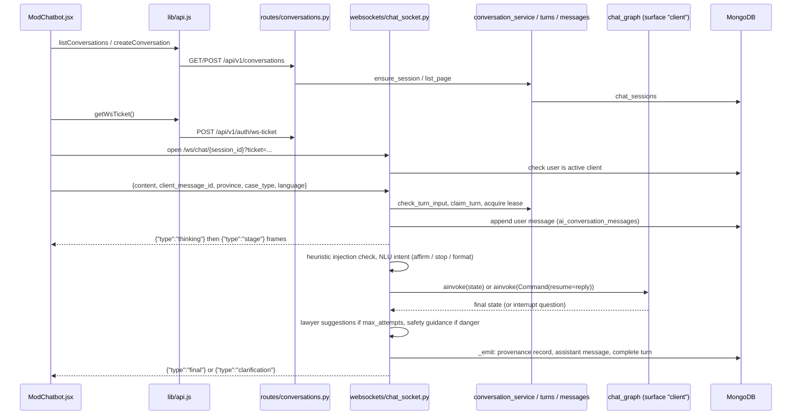

# 04 — AI chat (client)

> Written from the code in October 2026. If this doc and the code disagree, the code is right.
> The AI engine itself (nodes, retrieval, grounding) is explained in doc [03](03-ai-pipeline-rag.md). This doc covers the **client screen, the WebSocket, and how conversations are stored**.

## 1. What it does

A logged-in **client** opens the AI chat and asks legal questions in **English, Urdu script or Roman Urdu** (typed or spoken). The assistant:

- answers from the Pakistani law library, with citation chips and a confidence band,
- may ask **one clarifying question** first,
- answers "can you help me?" with a fixed **"what I can do"** message,
- gives **plain-language general information** (clearly labelled, "not legal advice") when the library has too little,
- shows **lawyer suggestions** when it could not give a reliable answer,
- adds **immediate-safety guidance** when the message describes violence or a threat to a person,
- keeps a **history of conversations** in a sidebar (rename, delete, search).

Conversations belong to the client only. The client chat has **no case binding** (that is a lawyer research feature).

## 2. User flow

| # | User does | What happens |
|---|-----------|--------------|
| 1 | Opens AI chat | `ModChatbot` loads the conversation list (`GET /conversations`) and restores or creates a conversation (`POST /conversations`). |
| 2 | (optional) Picks a province from the chip ("No jurisdiction filter", Punjab, Sindh, KPK, Balochistan, Federal only) | Saved in `localStorage` (`aai-province`). Defaults to the user's profile province. |
| 3 | Types or speaks a question | Voice uses the shared `VoiceButton` in **server mode** (doc [06](06-voice-input.md)). |
| 4 | Presses Send | The message appears at once. A "thinking" indicator and progress stage labels show while the graph runs. |
| 5a | Gets an answer | Answer text (rendered by `RichText`), citation chips, per-claim checks, confidence band, rate buttons. |
| 5b | Gets a clarifying question | Shown as a question bubble. The next message the user sends is the **reply** — the paused graph resumes. |
| 5c | Asks "make it short" / "explain in detail" | The previous question is re-answered in the new length (it still goes through retrieval and checks). |
| 6 | Not a reliable answer (`max_attempts`) | A lawyer suggestion card (`LawyerMatchPanel`) appears under the answer with a link to **Lawyers**. |
| 7 | Clicks Stop | `POST /conversations/{id}/cancel` — the answer is discarded when it arrives. |
| 8 | Refreshes the page mid-answer | On reconnect the page sends `{"action": "resume"}`; the stored answer is replayed or "still working" is shown. |
| 9 | Searches the sidebar | Typing is debounced 250 ms. The list is filtered by title / first question; from 2 characters the page **also** searches message text (`GET /conversations/search/messages`) and shows the matching snippets. |
| 10 | Scrolls up in a long chat | "Load earlier messages" fetches older pages of 50 (`before_seq` cursor). |
| 11 | Clicks Regenerate on the last answer | The question before it is sent again as a **new** turn (the server keeps both answers). |
| 12 | Deletes a conversation | Browser `confirm("Delete this conversation and its messages?")`. Deleting the open conversation starts a new chat. |

## 3. Code flow

### 3.1 Overview



### 3.2 Frontend: `ModChatbot.jsx`

File: [ModChatbot.jsx](../../frontend/src/components/client/ModChatbot.jsx)

- **State:** `msgs`, `inp`, `typing`, `stage`, `province`, `wsStatus`, the current session id (`sessionIdRef`).
- **`connect()`** — takes a "claim" on the socket (`createSocketOwner` from `lib/socket.js`, so only one socket is opened even if a reconnect and a conversation switch race), gets a **one-time 60-second WS ticket** (`getWsTicket` → `POST /auth/ws-ticket`; the JWT is never put in the URL), then opens `websocketUrl("/ws/chat/{sid}")?ticket=…`. On open, if a turn was waiting, it sends `{"action": "resume", client_message_id}`.
- **`send()`** — appends the user bubble, then sends one frame:
  ```json
  { "content": "...", "client_message_id": "<attempt id>", "case_type": "<from CaseContext or null>",
    "province": "<chip or null>", "language": "en", "web_search": false }
  ```
  The `client_message_id` is one id per **attempt** (`newAttempt` from `lib/attempt.js`). Re-sending the same attempt replays the first answer instead of paying for a second run. `case_id` is **never** sent.
- **`ws.onmessage`** handles frame types:

| Frame `type` | UI action |
|--------------|-----------|
| `thinking` | show typing indicator |
| `stage` | show progress label (not added to the transcript) |
| `pending` | keep waiting (the turn is still running) |
| `final` | add AI bubble: `text`, `refs` (citations), `claims`, `confidence`, `confidenceBand`, `status` (= `convergence_status`), `jurisdiction`, `historySaved`, `auditSaved`, `requestId`, `matchedLawyers` (only if `suggest_lawyer`), `matchResultKind`, `matchNotice` |
| `clarification` | add a question bubble (`isClarification: true`), no lawyer card |
| `cancelled` | add a notice ("Stopped." or what really happened) |
| `resume_unknown` / `resume_dead` | "That question didn't finish. Please ask it again." |
| `control_rejected` | toast |
| `error` | toast + error bubble |

- **Rendering:** AI text goes through [RichText.jsx](../../frontend/src/components/shared/RichText.jsx) — a small safe markdown view (`**bold**`, `*italic*`, lists, `###` headings, simple tables). It builds React elements, **never** `innerHTML`, so an answer cannot inject markup. User text is shown as plain text.
- **Message actions:** shared `MessageActions` from `ChatPieces.jsx` (copy, rate up/down via `rateAnswer` → `POST /ai/rate` with `source: "chat"`, regenerate on the last answer).
- **Confidence:** a "High / Moderate / Low confidence" dot is shown only when the server sent a `confidence_band` (not on clarifications or errors).
- **Lawyer card:** [LawyerMatchPanel.jsx](../../frontend/src/components/client/LawyerMatchPanel.jsx) — purely presentational. It shows ranked candidates, or a "general listing" with the service's notice beside it, or a short "unavailable" note. "Book" goes to `/lawyers`.
- **Voice:** `<VoiceButton mode="server" serverLanguage="auto" …/>`. While recording, the socket is left alone; when recording stops and the socket dropped, `onListening` reconnects.
- **Web search:** hard-coded `false` for clients.
- **Which conversation opens:** the open conversation id is remembered per tab in `sessionStorage` (`readActiveSession` / `writeActiveSession` in `lib/conversations.js`, keyed by surface + user). On mount the page reopens it (`GET /conversations/{id}`), or creates a new one. If the reopened conversation has a `pending_turn`, the page starts waiting on that turn id again and asks for it with `resume` once the socket opens. An unavailable conversation shows the toast "That conversation is no longer available".
- **Reconnect:** on close, up to 5 retries with back-off `min(1000·2ⁿ ms, 30 s)`; the retry counter resets only after the socket has been stable for 10 s. No retry while the mic is recording (Chrome can drop the socket when it takes the audio device); recording end reconnects.
- **Client-side deadline:** `CLIENT_TURN_TIMEOUT_MS = 150 000` (longer than the server's 120 s, so the server's own message normally wins). If nothing arrives, the page stops waiting and adds "This is taking longer than expected and I've stopped waiting. Please try again."
- **Send rules:** empty text is ignored; a second send while waiting → toast "Still answering your last question."; socket not open → toast "Reconnecting..." and the message is **not** sent. The Send button is disabled unless the box has text and the socket is `connected`. The placeholder shows "Connecting..." / "Offline — reconnecting...".
- **Sidebar:** 30 conversations per page with "load more" (`next_cursor`), grouped by date (`groupConversations`), duplicates removed on merge. A message-search banner says when some old (legacy, embedded) conversations could not be searched (`has_unsearchable_history`). Rename and delete are per row.
- **Under each AI answer:** the jurisdiction line ("Jurisdiction: Punjab (your selection)" or "(inferred from your question)"; nothing for `unspecified` / `not_applicable`), a collapsible Sources list (a chip with a `sourceUrl` opens the PDF through `openSourceDocument` → `GET /ai/source/{file}`, fetched with the token and opened as a blob in a new tab; a blocked pop-up is reported), an amber warning when `history_saved` is false ("This answer could not be saved to your history…"), an audit notice only when the audit record is not safely written (`auditNotice`).
- **Rating:** thumbs are shown only when the answer has a `request_id`, its audit record was saved (not pending), and it is not a clarification. After one click the other thumb disappears (the server would allow changing it — one row per user + answer, upserted).
- **Footer:** "Informational only — not legal advice. Verify with a qualified Pakistani lawyer."

### 3.3 Backend: the WebSocket `chat_endpoint`

File: [chat_socket.py](../../backend/app/websockets/chat_socket.py), route `@router.websocket("/ws/chat/{session_id}")` (mounted without the `/api/v1` prefix).

**On connect**
1. `consume_ticket(ticket)` → user id. No ticket → close `4001`.
2. User must be `is_active` and `role == "client"`, else close `4003`.
3. `conversations.open_ref(SURFACE_CLIENT, session_id, user_id)` — the conversation identity is `(surface, document id)`. Another user's session id → close `4003`.
4. `graph_config = {"configurable": {"thread_id": session_id}}` — the client session id **is** the LangGraph thread.

**For each frame (loop)**
1. `_AuthGate.allows()` — re-checks the account before anything else (a deactivated account is stopped mid-session). It is an `ActiveSessionGate` with `required_role="client"`: asked on **every** frame, but the database is read at most once per `_AUTH_RECHECK_SECONDS = 30`. It also checks that the **login session** behind the ticket is still active, so logging out elsewhere ends the socket. A refusal just breaks the loop (socket ends).
2. Control actions: `cancel` (`turns.abandon_turn` + release lease) and `resume` (read the turn ledger, never start new work). Both first validate `client_message_id` with the same rule as a question; an invalid id → `{"type": "control_rejected", "action", "content"}`.
   - `cancel` replies `{"type": "cancelled", client_message_id, ok, outcome, content}`. `outcome` is `stopped` ("Stopped. Any answer already being written will be discarded."), `answered` ("That answer had already finished — it is in your history."), `ended` ("That question had already stopped.") or `unknown` ("There is nothing running to stop."). Only `stopped` frees the conversation lease.
   - `resume` replies: unknown id → `resume_unknown`; completed → the stored frame, byte-identical; in progress → `pending` "Still working on your previous message."; failed / cancelled → `resume_dead` with its `status`.
3. A frame with empty `content` is ignored. `conversation_limits.check_turn_input(query)` — too long (> 32,000 chars) → refused *before* any model call.
4. **Claim the turn:** `turns.request_fingerprint(...)` + `turns.claim_turn(...)`:
   - the `client_message_id` must match `^[A-Za-z0-9_.:@-]{1,128}$` (no id → the server makes `auto.<random>`),
   - the fingerprint covers the message, `language`, `province` (frame or stored), `surface = client` and `web_search`,
   - `CLAIM_REPLAY` → send the stored answer again (no new run, the only output that skips `_emit`),
   - `CLAIM_IN_PROGRESS` → `pending` frame "Still working on your previous message.",
   - a **failed or cancelled** turn, or one whose lease expired (crashed worker), can be claimed again (guarded so only one racer wins),
   - otherwise `acquire_conversation_lease` (only one running turn per conversation; busy → refusal).
   - Refusals at this stage are sent as a normal `final` frame with `convergence_status: "rejected"` and audited as `blocked` (`_refuse`): bad id (`arbitration_source: "turn:bad_message_id"`), same id reused for a **different** question (409 text "This message id was already used for a different question. Send a new message id.", `turn:conflict`), conversation busy ("Another message is still being answered in this conversation. Wait for it to finish before sending the next one.", `turn:conversation_busy`), oversize (`limits:oversize`).
5. Store the user message (`conversations.append_message`, idempotent per conversation + turn + role; a failed write does not stop the turn). Allowed session meta from the frame (`case_type`, `province`) is saved with `update_meta`. A key that is **present but null** clears the stored value (so choosing "No jurisdiction filter" really clears an earlier Punjab); an absent key leaves it alone.
6. A lease **heartbeat** renews both the turn and conversation leases every 60 s (`LEASE_SECONDS // 3`) while the graph runs. A `{"type": "thinking"}` frame is sent and a `ProgressReporter` sends `stage` frames (each stage once).
7. `imminent_danger.detect(query)` — deterministic check for violence/threats aimed at a person.
8. If the graph is **paused** on a question (`_extract_interrupt_question(pre_snap)`), resume it: `chat_graph.ainvoke(Command(resume=query))`. Danger is also checked on the **paused question's original query**, because the reply is about the same matter.
9. Otherwise:
   - `heuristic_injection_match(query)` → gatekeeper refusal without running the graph (`convergence_status: "off_topic"`, `arbitration_source: "gatekeeper:heuristic"`, audited as `blocked`; safety guidance is still added if danger was detected).
   - `intent_classify(...)` (the NLU engine in `app/ai/intent/`: embeddings → LLM → keyword), given the stored history. Short `affirm` → canned "Understood. Feel free to ask any follow-up questions…", short `stop` → "Session ended. Come back whenever you need legal guidance." Both are sent with `convergence_status: "converged"`, `arbitration_source: "nlu:affirm"` / `"nlu:stop"`, no confidence score, audited as `shortcut`. These shortcuts apply only to messages ≤ 15 words, and (2026-10-20) only when `allows_canned_reply(query)` is true: ≤ 6 words and nothing asked (no `?`, no what/how/why/when/where/which/who/can/could/should/tell/explain/kya/kaise/kyun/kab/kahan/kaun/batao/samjhao…). So "Okay, now tell me how to file an FIR" runs the graph.
   - Everything else (`new_query`, `format_brief`, `format_detail`, `clarify`, unknown): `_build_state(...)`, set `state["surface"] = "client"`, add `client_turn_overrides(...)`, then `chat_graph.ainvoke(state)` with a 120 s timeout (`turns.TURN_TIMEOUT_S`).
10. Read the result (`post_snap`):
   - new interrupt question → frame `{"type": "clarification", "question": …, "request_id"}`, audited as `clarification`,
   - else frame `{"type": "final", content, citations, claims, confidence…, convergence_status, arbitration_source, request_id}`, audited as `answer`. The graph's `clarification_attempts` is copied onto the session (`update_meta`) so the next turn starts from it.
   - If `convergence_status == "max_attempts"` → `_fetch_matched_lawyers(...)` adds `matched_lawyers` (max 3), `match_result_kind`, `match_notice`, `suggest_lawyer: true`.
11. Timeout → `type: "error"` with "That took longer than expected and was stopped. Your question was not lost — send it again, or try a narrower one." (`convergence_status: "timeout"`, `arbitration_source: "turn:timeout"`). Any other exception → `type: "error"`, "AI assistant is temporarily unavailable. Please try again." Both are audited as `error`.
12. If danger was detected → `_with_safety(...)` prepends safety guidance to whatever is sent (answer, refusal, clarification, error) and adds `safety_guidance: "safety-v1"` to the frame; the stored message and the audit record get the same text.
13. `_emit(...)` — **the one exit**: writes the provenance (audit) record, stores the assistant message, completes the turn and releases the lease, then sends the frame (with `history_saved`, `audit_saved`, `audit_pending`, `jurisdiction`, `jurisdiction_basis`, `request_id`).

**Inside `_emit` (order matters):**
- `jurisdiction` / `jurisdiction_basis` are stamped on **every** frame; a frame that consulted no law (canned reply, refusal, fault) reports basis `not_applicable`. Every frame gets a `request_id`, including shortcuts and refusals.
- **Fence first:** before any side effect, the worker checks it still holds the turn **and** the conversation lease, then `complete_turn` (fenced on the owner token) stores the frame for replay. A worker that lost the race sends and stores **nothing**.
- Then provenance is written; `audit_saved` / `audit_pending` are corrected on the stored copy first, then on the frame (so a replay is identical).
- The assistant message is stored only if the user's question was stored too (never an orphan answer). `set_pending_question` remembers whether the turn ended in a clarifying question. `history_saved` becomes `true` only when **both** halves were stored.
- The lease is released and the heartbeat stopped in a `finally`, even if the browser disconnected during the send.
- A missing audit type is treated as a bug: it is logged and recorded as `error` with `arbitration_source: "unaudited_path"`.

**On disconnect** (`WebSocketDisconnect`) the server only logs it; everything is already stored per turn.

### 3.4 How the message becomes graph state (`_build_state`)

| State field | Value for client chat |
|-------------|----------------------|
| `query` | the message |
| `surface` | `"client"` (set by the route, not the browser) |
| `language` | from the frame — the UI sends `"en"`; **triage re-detects** the real language from the text, so Urdu / Roman Urdu questions are answered in that language |
| `case_type` | the UI's case-type choice if it is one of civil/criminal/family/constitutional, else `"unknown"` (confidence 1.0 when chosen) |
| `province`, `jurisdiction_basis` | `jurisdiction.resolve(...)` from the frame or the stored session; unset → `unknown` / `unspecified` (search everything) |
| `case_id`, `case_context` | from frame/session, but clients cannot set `case_id` (not in settable meta), so none in practice |
| `messages` | the stored history (server-side, not from the browser) + the new question. Only the last **4** stored messages are replayed (`conversation_service.CONTEXT_WINDOW = 4`), and the current turn's own question is excluded so it is not sent twice |
| per-turn keys (`followup_base_query`, `retrieval_query_supplement`, `response_mode`, `refusal_reason`, `generation_evidence`, `claim_assessments`, `tool_results`…) | reset to empty every turn, because the socket's graph thread is the whole session and a key not written would survive from the previous turn's checkpoint |
| `clarification_attempts`, `clarification_depth` | from the stored session |
| `web_search_enabled` | `false` from this UI |

### 3.5 "Make it short" / "explain in detail" (`client_turn_overrides`)

> 2026-10-20: a `format_brief`/`format_detail` message is treated as a reshape of the LAST answer only if `is_reshape_request(query)` — ≤ 4 words, or it points back ("it", "this", "again", "isko"…). "Explain in simple words the punishment for theft" is a new question.

`format_brief` with **no previous AI answer** (`last_ai_content` empty) is treated as an ordinary question — there is nothing to shorten.

When the NLU intent is `format_brief` or `format_detail`:
- `followup_intent` = `format` or `deepen`,
- `followup_base_query` and `retrieval_query_supplement` = the **previous user question** (from stored history),
- the case type resolved for that previous question is re-used from the graph checkpoint (`_previous_case_type`), unless the user picked one.

**Why:** it used to rewrite the old answer with a separate unchecked model call, losing all citations. Now the previous question goes through the full checked graph again, just with a different length (`response_policy.explicit_request` → `brief` / `detailed`).

## 4. Data & states

### 4.1 Collections

| Collection | One document per | Key fields |
|------------|-----------------|-----------|
| `chat_sessions` | client conversation | `session_id`, `client_id` (owner), `title`, `case_type`, `province`, `clarification_attempts`, `clarification_depth`, `active_turn` (lease), deletion phase |
| `ai_conversation_messages` | message (both surfaces) | conversation id, `seq`, `role` (`user`/`assistant`), `content`, answer fields (citations, claims, confidence…), `client_message_id`, `turn_id` |
| `ai_conversation_turns` | AI turn (claimed **before** the graph runs) | `conversation_id` (= `<surface>:<doc id>`), `client_message_id`, `content_hash` (fingerprint), `status` (`in_progress`/`completed`/`failed`/`cancelled`), `lease_owner`, `lease_expires_at`, `attempts`, stored `response`, `request_id`, `stage` / `stage_label` |

**Indexes** ([indexes.py](../../backend/app/db/indexes.py) and the services that own them):
- `ai_conversation_turns`: **unique** `(conversation_id, client_message_id)` — this unique index *is* the idempotency guarantee (created by `conversation_turns.ensure_indexes`, which raises if it cannot); plus `(conversation_id, status)` and `lease_expires_at`.
- `chat_sessions`: unique `session_id`; `client_id`; `(client_id, deleted_at, updated_at desc, _id desc)` for the paged list.
- `ai_conversation_messages`: unique per `(conversation_id, turn_id, role)` and `(conversation_id, seq)`; `(owner_id, surface)`; a **text index** on `content` for message search; `(conversation_id, created_at)`.
- `lg_checkpoints`: unique `(thread_id, checkpoint_ns, checkpoint_id)`; `lg_checkpoint_writes`: unique per `(…, task_id, idx)`.
- Ratings go to the `response_ratings` collection (one row per user + `request_id`).
| `lg_checkpoints`, `lg_checkpoint_writes` | LangGraph checkpoint | `thread_id` = client `session_id` |
| provenance (via `provenance_service`) | audit record per turn | `request_id`, turn type (`answer`, `clarification`, `shortcut`, `blocked`, `error`), state snapshot |

### 4.2 REST endpoints ([conversations.py](../../backend/app/api/v1/routes/conversations.py), prefix `/api/v1`)

Every `/conversations` route is guarded by `require_client` (a lawyer gets 403). The owner id always comes from the token and is put into the Mongo filter. "No such conversation" and "not yours" give the **same** 403 "Conversation not available".

| Method & full path | api.js function | Purpose and rules |
|--------------------|-----------------|-------------------|
| `GET /api/v1/conversations` | `listConversations` | paged list for the sidebar, newest first. Query: `include_archived` (default false), `limit` 1–100 (default 30), `after` (cursor ≤ 512 chars), `search` (≤ 120 chars; matches the **title** or the **first question** at the start of a word, regex-escaped). Returns `conversations`, `next_cursor`, `has_more`. Row: `session_id`, `title` (or the first question, or "New conversation"), `case_id`, `archived`, `message_count`, `awaiting_clarification`, dates. |
| `POST /api/v1/conversations` | `createConversation` | new conversation; the server mints the `session_id` (`token_urlsafe(16)`). Optional `title` (≤ 120). A `case_id` in the body is **ignored** on this surface. |
| `GET /api/v1/conversations/{session_id}` | `getConversation` | one conversation + one page of messages, oldest first within the page. **No cursor = the newest page.** Query: `before_seq` (walk back, follow `older_cursor` while `has_older`), `after_seq` (walk forward), `page_size` 1–200 (default 50). Messages keep their trust fields (citations, claims, confidence, jurisdiction, `request_id`). Also returns `pending_question` / `pending_turn`. |
| `PATCH /api/v1/conversations/{session_id}` | `renameConversation` | rename (`title` 1–120 chars; extra spaces collapsed) |
| `DELETE /api/v1/conversations/{session_id}` | `deleteConversation` | delete (see 5.5); returns `{success, message}` where `message` is the honest deletion notice |
| `POST /api/v1/conversations/{session_id}/cancel` | `cancelClientTurn` | stop a running turn. Body `client_message_id` (1–128, same id rule as the socket). **Always 200**; the message says stopped / already answered / already ended / nothing running. |
| `GET /api/v1/conversations/search/messages` | `searchConversations` | search your own message **text** (MongoDB text index). Query `q` 1–200 chars, `limit` ≤ 25. One result per conversation (its best match) with `snippet`, `matched_seq`, `matched_role`; `has_unsearchable_history` is true when you have old conversations whose messages are embedded and cannot be searched. Deleted conversations never match. The path is `/search/messages` (not `/search`) so it cannot clash with a conversation id. |
| `POST /api/v1/auth/ws-ticket` | `getWsTicket` | one-time socket ticket (60 s, single use, atomic `find_one_and_delete`) |
| WebSocket `/ws/chat/{session_id}?ticket=…` | `websocketUrl` | the chat turn itself (§3.3); mounted **without** the `/api/v1` prefix |
| `POST /api/v1/ai/rate` | `rateAnswer` | thumbs up/down. Body: `request_id` (1–200), `session_id` (1–200), `rating` `up`/`down`, `comment` ≤ 500, `source` `chat`/`research`. The conversation must be yours and a provenance record with that `request_id`, owned by you and **for that session**, must exist — else 403 "Answer not available". One row per (user, `request_id`), upserted, so a second click changes the rating. The stored previews come from the audit record, never from browser text. |
| `GET /api/v1/ai/source/{source_file}` | `openSourceDocument` | the corpus PDF behind a citation chip (any logged-in user). Resolved by a dictionary of known basenames, never a joined path (no traversal, no symlinks). Unknown or ambiguous name → 404 "Source document not available". Served inline. |

There is **no archive route** for client conversations (only research has one); `include_archived` exists on the list for completeness.

## 5. Key logic & rules

### 5.1 Answers the client can get

| `convergence_status` | What the client sees |
|----------------------|----------------------|
| `converged` | sourced answer, citation chips, claim checks |
| `general_guidance` | starts with **"General information — not from the AttorneyAI legal library. This is a general explanation… not legal advice. Confirm it with a lawyer before you act."** (English / Urdu / Roman Urdu header from `general_guidance.CLIENT_HEADER_*`), then ≤ 220 words of plain guidance with practical next steps. Never cached, not grounded. |
| `capability` | the fixed "Yes — I can help you understand your legal position…" text (`client_help.ANSWER_EN/UR/ROMAN`) listing what it can do and what to tell it, ending with a pointer to **Lawyers**. |
| `unanswerable` | why the law cannot answer this kind of question, plus where to go |
| `max_attempts` | an answer that failed grounding (with a caution note), or "I was unable to provide a reliable answer…", **plus the lawyer card** |
| `error` | "I hit a technical problem searching the legal documents… try again" |
| `off_topic` | canned off-topic / gibberish / gatekeeper text |
| `converged` with `arbitration_source` `nlu:affirm` / `nlu:stop` | the socket's canned "Understood…" / "Session ended…" reply (graph not run) |
| `rejected` | the socket refused the message before the graph (too long, bad id, id reused, conversation busy) — shown as a normal answer bubble |
| `timeout` (frame `type: "error"`) | the 120 s turn budget ran out |

The general-information header is part of the **answer text** itself; the client UI renders it with `RichText` like any other paragraph (the lawyer UI, by contrast, strips it and shows a coloured label — doc 05).

### 5.2 Client-only safeguards (always on for `surface = "client"`)

From `answer_safeguards.on(state)` (doc 03 §5.1):
- a provision the user **named** is fetched by exact identity and must be explained from its own text,
- time periods not stated in the sources are removed with a notice,
- claims citing the wrong Act are downgraded,
- citations are matched on normalised text (e.g. "489‑F" with a non-breaking hyphen),
- answer length modes, **only if** `CHAT_ADAPTIVE_LENGTH_CLIENT=true` (default off → old IRAC prompts; "make it short" still answers briefly).

Client cache entries use their own key variant (`…|client|client-guard-v2`) so they are never mixed with research answers.

### 5.3 Lawyer suggestions in chat

- Added **only** to a `final` frame whose `convergence_status == "max_attempts"`. Never under a clarifying question.
- The client chat has no case, so `_fetch_matched_lawyers` calls `lawyer_service.suggest_lawyers_from_signals(...)` with signals from the **server's** graph state (`_conversation_signals`): `case_type`, the higher of `classifier_confidence` / `case_type_confidence`, and `province`.
- No suggestion when routing was `hybrid` (two areas at once) or the case type is unknown, or confidence is below `_PROVISIONAL_MIN_CONFIDENCE = 0.7` in `lawyer_service.py`.
- The verdict (`result_kind`: ranked vs `general_listing` vs `unavailable`) travels with the list so the UI never presents a browsing list as "matched". It never raises — a matching failure cannot break the chat turn.
- Each lawyer is projected to a fixed set: `id`, `full_name`, `province`, `match_score` (a finite number or `null` = "not ranked"; NaN/Infinity become `null` because they would break the JSON frame), `match_reason`, `rating` (0.0 when missing), `specializations` (list of strings only). A malformed row costs that row, never the turn.

### 5.3a Imminent-danger guidance ([imminent_danger.py](../../backend/app/ai/imminent_danger.py))

- `detect(text)` is a regex check (no model). It fires only when the message has violence or a threat **aimed at a person** ("beats me", "threatened to kill", "jaan se maar", "مجھے مارتا ہے", "dhamki"…) **and** the asker is involved ("me", "my", "mujhe", "میرا"…) **and** it is happening now / tonight / repeatedly ("tonight", "every day", "abhi", "roz", "آج رات"…). Abstract questions ("punishment for murder", "section 302") do not trigger it unless the text is clearly ongoing or urgent. "A truck hit my car" and "threatened to sue me" do not trigger it.
- `guidance()` gives practical safety steps only (call police, go to a safe place, get medical help and keep the record, tell someone you trust) — no legal conclusion. Written in English, Roman Urdu or Urdu script (chosen from the language / script of the message).
- Emergency numbers **15** (police) and **Rescue 1122** are shown **only when the conversation's province is Punjab** (both verified only from Punjab Government sources); elsewhere the text says "the police emergency number" without a number. No women's helpline number is shown (none was verified).
- `with_guidance` adds the block once (idempotent) at the top of the answer, refusal, clarification, timeout or error. Frame field `safety_guidance: "safety-v1"`; the audit state gets `imminent_danger: true`.

### 5.4 Safety and integrity rules

| Rule | Where | Why |
|------|-------|-----|
| One-time WS ticket, not JWT in URL | `getWsTicket`, `consume_ticket` | tokens in URLs end up in logs |
| Close codes | `chat_endpoint` | `4001` = missing / used / expired ticket; `4003` = not an active client, or the session id belongs to someone else |
| Only active `client` accounts; re-checked every frame (DB read at most every 30 s, login session also checked) | `chat_endpoint`, `_AuthGate` | a deactivated or logged-out account must stop at once |
| `case_id` not settable by the client | `_CLIENT_SETTABLE_META` / `SETTABLE_META` | the browser used to bind chats to any case id |
| History comes from the server | `_session_history`, `recent_context` | the browser must not decide what was "already said" |
| Input size check before the graph | `conversation_limits.check_turn_input` | a provider must not be paid for an answer that cannot be stored |
| Turn claim + lease | `conversation_turns` | resent frames replay; two different turns cannot interleave in one LangGraph thread |
| Every output through `_emit` | `chat_socket._emit` | every visible answer has an audit record (except a replay, which already has one) |
| Imminent-danger guidance | `imminent_danger.detect`, `_with_safety` | a person in danger must never get only a refusal |
| Heuristic injection check before NLU | `heuristic_injection_match` | shortcuts skip the graph, so attacks are blocked before them |

### 5.5 Conversation limits and retention

From [conversation_limits.py](../../backend/app/services/conversation_limits.py) and [conversation_service.py](../../backend/app/services/conversation_service.py):

| Limit | Value |
|-------|-------|
| one message's text (`MAX_CONTENT_CHARS`) | 32,000 characters |
| citations / claims per answer | 200 each |
| metadata per message | 512,000 bytes |
| whole stored message | 768,000 bytes |
| history page size | default 50, max 200 |
| conversation list page | default 30, max 100 |
| search results | 25 |
| title | 120 characters |
| turn lease (`LEASE_SECONDS`) | 180 s (renewed by a heartbeat while running) |
| turn timeout (`TURN_TIMEOUT_S`) | 120 s |

Messages are stored one per document, so a conversation is **not** capped by Mongo's 16 MB limit and old turns are not silently dropped.

**Delete** is two-phase: `deleting` (closed to new work) → `deleted`. Effects (`DELETION_EFFECTS`):

| What | On delete |
|------|-----------|
| messages | removed |
| turn records | removed |
| conversation | tombstoned |
| LangGraph checkpoints | **retained** |
| provenance (audit) | **retained** |

If a **legal hold** covers the user or the case, nothing is removed; the conversation is only hidden (it is set `archived: true`, `DELETION_EFFECTS_HELD`) and the user is told so ("…preserved under a legal hold and cannot be deleted at present"). A conversation still answering cannot be deleted: **409** `DELETE_BUSY` "This conversation is still answering a message. Wait for it to finish, then delete it." Normal success message: "Removed from chat history. The messages are gone from this conversation. An audit record of answers already given is retained…". A `deleting` conversation is closed to new work at once (no lease, no new message), so a half-finished cleanup can be resumed.

There is **no automatic time-based deletion** of chat conversations in the code.

## 6. Files

| File | Role |
|------|------|
| [ModChatbot.jsx](../../frontend/src/components/client/ModChatbot.jsx) | client chat screen: sidebar, socket, send, render |
| [LawyerMatchPanel.jsx](../../frontend/src/components/client/LawyerMatchPanel.jsx) | lawyer suggestion card |
| [RichText.jsx](../../frontend/src/components/shared/RichText.jsx) | safe markdown rendering of answers |
| [ChatPieces.jsx](../../frontend/src/components/shared/ChatPieces.jsx) | shared bubble styles and message actions |
| [VoiceButton.jsx](../../frontend/src/components/shared/VoiceButton.jsx) | dictation (server mode here) |
| [api.js](../../frontend/src/lib/api.js) | `getWsTicket`, `websocketUrl`, conversation and rating calls |
| [chat_socket.py](../../backend/app/websockets/chat_socket.py) | WebSocket endpoint, `_build_state`, overrides, lawyer suggestions, `_emit` |
| [conversations.py](../../backend/app/api/v1/routes/conversations.py) | REST routes for client and research conversations |
| [conversation_service.py](../../backend/app/services/conversation_service.py) | sessions, ownership, meta, delete, list, search |
| [conversation_messages.py](../../backend/app/services/conversation_messages.py) | one-document-per-message storage, paging, search |
| [conversation_turns.py](../../backend/app/services/conversation_turns.py) | turn claim, lease, replay, cancel |
| [conversation_limits.py](../../backend/app/services/conversation_limits.py) | size limits |
| [client_help.py](../../backend/app/ai/client_help.py) | capability questions and fixed answers |
| [general_guidance.py](../../backend/app/ai/general_guidance.py) | client "General information" text |
| [response_policy.py](../../backend/app/ai/response_policy.py) | length modes and "make it short" base query |
| [imminent_danger.py](../../backend/app/ai/imminent_danger.py) | safety guidance |
| [lawyer_service.py](../../backend/app/services/lawyer_service.py) | `suggest_lawyers_from_signals` |
| [conversations.js](../../frontend/src/lib/conversations.js) | remembered open conversation (sessionStorage), message mapping, date grouping, merge |
| [live_auth.py](../../backend/app/core/live_auth.py) | `ActiveSessionGate` used by `_AuthGate` |
| [ws_ticket.py](../../backend/app/core/ws_ticket.py) | one-time 60 s socket tickets |
| [gatekeeper_node.py](../../backend/app/ai/nodes/gatekeeper_node.py) | `heuristic_injection_match` used before the NLU shortcut |

## 7. Known limits (from the code)

- The UI always sends `language: "en"`; the answer language depends on triage detecting the language from the text (there is no language switch on the composer).
- Lawyer suggestions appear only on `max_attempts`. A `general_guidance` or `unanswerable` reply gets no lawyer card, even though the guidance text itself advises seeing a lawyer.
- Province coverage: only Punjab has provincial statutes; the UI shows a note that other provinces return federal law.
- Very short capability messages like "help me" are now caught by triage before its gibberish guard (fixed 2026-10-20, see doc 03 §7), so they get the capability answer.
- Cancel does not stop the provider call already in flight; it only discards the answer.
- Deleting a conversation keeps LangGraph checkpoints and provenance records; no retention period is applied to them in the code.
- Web search is not offered to clients.
