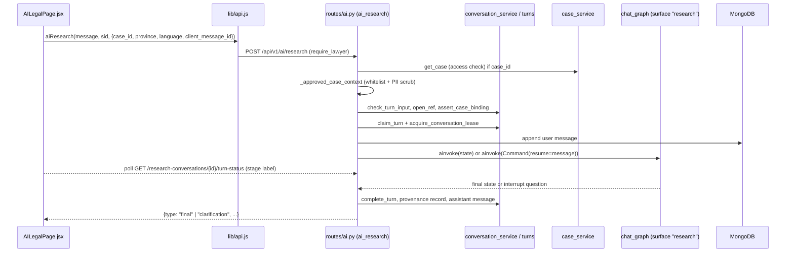

# 05 — AI research assistant (lawyer)

> Written from the code in October 2026. If this doc and the code disagree, the code is right.
> The shared AI engine (nodes, retrieval, grounding, refusals) is explained in doc [03](03-ai-pipeline-rag.md). The client version of the chat is doc [04](04-ai-chat-client.md).

## 1. What it does

A **registered lawyer** uses the AI research page to ask legal research questions. It runs on the **same LangGraph graph** as the client chat, but with `surface = "research"`. Differences from the client chat:

- a research thread can be **bound to one of the lawyer's cases**; the server then feeds checked case facts to the model on every turn,
- it uses **plain HTTP** (`POST /api/v1/ai/research`, one long request), not a WebSocket,
- extra **research safeguards** can be switched on by a flag (`RESEARCH_ANSWER_SAFEGUARDS`),
- when the library has too little, the lawyer gets **labelled general guidance** for professionals,
- it shows more detail: claim checks, citation status, model confidence, and an **audit (provenance) panel**,
- no lawyer suggestions (the user *is* a lawyer).

## 2. User flow

| # | Lawyer does | What happens |
|---|-------------|--------------|
| 1 | Opens **AI Assistant** | `AILegalPage` loads the lawyer's cases (`listCases`), the research thread list, and restores the last thread used in this tab. |
| 2 | (optional) Picks a case | A thread belongs to one case or to none. Switching case starts a **new** thread (`createResearchConversation({ caseId })`). |
| 3 | Types or speaks a question | Voice uses `VoiceButton` in **auto mode** (browser speech first, en-PK) — doc [06](06-voice-input.md). Prompt suggestions (`PromptRail`) can fill the box. |
| 4 | Sends | The page posts `/ai/research` and **polls** `/research-conversations/{id}/turn-status` every 2 s to show the stage label. |
| 5a | Gets an answer | Answer (via `RichText`), citation chips with status, claim-by-claim checks, confidence band, audit button. |
| 5b | Gets a clarifying question | The next message is the reply; the server resumes the paused graph. General educational questions skip clarification. |
| 5c | Gets general guidance | An amber label: "General guidance · not from the library · verify before relying". |
| 6 | Says "make it short" / "explain in detail" | Re-answers the previous question in that length (only when safeguards are on). |
| 7 | Clicks Stop | `POST /research-conversations/{id}/cancel`. |
| 8 | Opens the audit panel | `ProvenancePanel` shows the turn's provenance record (by `request_id`, via `GET /api/v1/provenance/{request_id}/view`, lawyer-only, own turns only — doc 26). |
| 9 | Manages threads | Rename (inline), Archive / Unarchive, Delete (browser `confirm("Delete this thread and its messages?")`), "Show archived threads" toggle, search box (debounced; from 2 characters also searches message text), "load earlier messages" (pages of 50). A thread waiting on a question shows an "awaiting clarification" mark. |
| 10 | Reopens a thread whose answer was still running | The page polls the thread every 3 s, up to 40 times (`RECOVER_INTERVAL_MS`, `RECOVER_TRIES`), until `pending_turn` is gone, then reloads it; if it never settles: "That question didn't finish, and no answer was saved. Please ask it again." |
| 11 | Regenerates / rates | Regenerate re-sends the question as a new turn. Thumbs (`POST /ai/rate`, `source: "research"`) only on answers with a `request_id` (not on clarifications or notices). |

## 3. Code flow



### 3.1 Frontend: `AILegalPage.jsx`

File: [AILegalPage.jsx](../../frontend/src/components/lawyer/AILegalPage.jsx)

- `AILegalPage` wraps `AILegalScreen` in the lawyer drafting theme.
- **Cases:** `listCases({ page_size: 50 })` fills a case list. `activeCaseObj` is the chosen case. Case facts are **not** put into the prompt box — only `case_id` is sent.
- **Threads:** `listResearchConversations`, `createResearchConversation({ caseId })`. `boundCaseRef` remembers which case the open thread is bound to; if the lawyer picked a different case, `send()` first starts a new thread.
- **`send()`** calls:
  ```js
  aiResearch(q, sid, {
    client_message_id: attempt.id,
    language: lang === "UR" ? "ur" : "en",   // lang is fixed to "EN" in this screen
    province: activeCaseObj?.province || null,
    history: msgHistory,                      // ignored by the server
    case_id: activeCaseObj?._id || null,
    signal,                                   // abort = stop waiting
  })
  ```
  One retry with the same attempt id on an ambiguous network failure (`isAmbiguousFailure`), so the server replays instead of running twice. A 4xx is never retried.
- **Browser deadline:** `RESEARCH_TIMEOUT_MS = 150 000` — the request is aborted after 150 s (the server's own limit is 120 s).
- **Error messages** (`researchErrorText`): 403 → "You don't have access to that case any more, so this question was not sent."; 409 → the server's text (e.g. thread fixed to another case, or busy) or "This conversation can't take that question. Start a new thread…"; 413 → "That question is too long to send…"; 422 → "The question couldn't be processed: …"; anything else → "AI service unavailable. Please try again."
- **Stop:** `cancelResearchTurn` → `POST /research-conversations/{id}/cancel`; the page shows the server's message as a notice.
- **Stage polling:** `watchStage` → `researchTurnStatus(sid, attemptId)` every 2 s until the turn is no longer `in_progress`.
- **Rendering an answer:**
  - `convergenceStatus === "general_guidance"` → amber label "General guidance · not from the library · verify before relying", and the header line "General guidance — …" is **removed** from the text before `RichText` renders it.
  - Claims list (supported / partial / unsupported / unassessed) with an explanation that these are automated checks.
  - Citation chips (`SourceChip`) with status (matched / unresolved / retrieved), province and source.
  - Confidence band + model confidence; `ProvenancePanel` with the audit record.
- **Voice:** `LawyerVoice` → `<VoiceButton … />` with default `mode="auto"`, `lang="en-PK"`.

### 3.2 Backend: `POST /api/v1/ai/research`

File: [ai.py](../../backend/app/api/v1/routes/ai.py) — `ai_research` (guard: `Depends(require_lawyer)`), then `_run_research_turn`.

**Request body (`ResearchRequest`):** `message`, `session_id`, `language` (default `en`), `province`, `history` (ignored), `case_id`, `client_message_id`.

**Steps in `ai_research`:**
1. If `case_id`: `_authorised_case_context(case_id, user)` → `case_service.get_case(...)` checks access (`admin | owning client | assigned lawyer`). Denied → `403 "Case not available"`. A **draft** case is refused (`assert_not_draft`).
2. `_approved_case_context(case)` builds a **whitelist** of fields, each PII-scrubbed (`scrub_pii`) and capped:

   | Field | Label | Max chars |
   |-------|-------|-----------|
   | `case_number` | Case number | 60 |
   | `title` | Title | 200 |
   | `case_type` | Type | 40 |
   | `province` | Jurisdiction | 40 |
   | `status` | Status | 40 |
   | `description` | Facts | 1200 |
   | next hearing | — | 40 |

3. `conversation_limits.check_turn_input(message)`.
4. `conversations.open_ref(SURFACE_RESEARCH, …)` and `assert_case_binding(...)` — a thread's case can never change (A→B, A→none, none→A all refused with **409**).
5. `thread_id = case_context.thread_id(user_id, session_id, bound_case_id)` — a hash of all three, so a session id cannot reach another case's checkpoint.
6. Province = the **case's** province when bound (basis `case_record`), else the request's.
7. Claim the turn (`claim_turn`): replay a completed one (returns the **exact stored payload**, same `request_id`), refuse if in progress (409 "Another message is still being answered in this conversation…"), take the conversation lease (busy → the turn is marked failed, 409). Details:
   - `client_message_id` must match `^[A-Za-z0-9_.:@-]{1,128}$` (else 422); without one the server uses `auto.<random>` (no dedupe).
   - The fingerprint covers `message`, `language`, the **effective** province (the case's when bound), the **stored** case id and `surface = research`. The same id with a different fingerprint → 409 "This message id was already used for a different question."
   - A failed / cancelled turn, or one whose lease expired, can be claimed again.
8. History = `conversations.recent_context(...)` from the server's stored messages (last 4, current turn excluded).
9. Store the question (best-effort: a failed write sets `history_saved: false` but the turn still runs); start a lease heartbeat (renews turn **and** conversation lease every 60 s; stops when it loses authority); run `_run_research_turn` with a 120 s timeout.
10. Timeout → the turn is failed and the route raises **503** "That took longer than expected and was stopped. Your question was not lost — send it again, or try a narrower one." Any other error → turn failed, error re-raised. The lease is always released in `finally`.
11. `data["case_record_version"]` records which version of the case record the answer used, so an audit can see the case changed later.

**Steps in `_run_research_turn`:**
1. If the graph is paused on a question: `aupdate_state` re-asserts `surface = "research"` (and the case context), then `ainvoke(Command(resume=message))`.
2. Otherwise `_build_state(...)` (same builder as the client socket), then:
   - `state["surface"] = "research"`,
   - `retrieval_query_supplement = case_context.augment_query(message, case_context)` — case terms are added **only** when the question is too vague to search on; the lawyer's own words always stay,
   - if `settings.research_answer_safeguards`: `retrieval_policy.index_variant = "research_ident"` (verified identity indexes) and `research_followup.overrides(...)` (deterministic "make it short / in detail" detection).
3. After the graph: interrupt question → `{"type": "clarification", "question": …}` (foreign-law references stripped when safeguards are on); else `{"type": "final", answer, citations, claims, confidence, confidence_band, model_confidence, convergence_status, jurisdiction, jurisdiction_basis, arbitration_source, request_id}`.
4. `complete_turn` (only if this worker still holds authority — otherwise 409 busy and nothing is stored or audited), provenance record (`_record_research_turn`), stored assistant message (`_record_research_message`), then `history_saved` / `audit_saved` patched in. Both start `false` and are upgraded on the stored copy first (`annotate_response`), so a replay always equals what the first caller got. Provenance and message writes are best-effort (a Mongo outage does not turn an answer into a 500). The clarification payload is `{type: "clarification", question, request_id, history_saved, audit_saved, audit_pending}`, and the thread's `pending_question` is set (cleared on a final answer).
5. **Stage reporting** (`TurnStageReporter` callback): when the graph enters a node that maps to a user-facing stage (`app/ai/progress.py`), the stage name + label is written on the turn (`turns.record_stage`, fenced on the owner token). Each stage at most once and **never backwards** (a retry of generation after a failed check does not move the label back), so at most ~5 writes per turn. Best-effort.

### 3.3 Inside the graph for `surface = "research"`

- `route_after_triage`: a general educational question ("what are the fundamental rights?", "explain bail before arrest") goes straight to `fact_gap_node` — **no** province/case-type clarification. A lawyer's own matter question can still be clarified.
- `generation_node`: if a case is bound, `_format_case_context` appends a "case on file" block to the system prompt on **every** turn (so it never ages out of the 4-message history window).
- With safeguards on, generation adds the research identity rider, a source-currency rider (the Constitution on file is the 2012 text), and the "governing provision" rider from `issue_lookup` (a provision found by its own heading for the issue, e.g. "Limitation").
- `finalizer_node`: if nothing was generated and there was no reason/fault → `general_guidance.write(state, audience="lawyer")`.

## 4. Data & states

| Collection | What |
|------------|------|
| `research_sessions` | one research thread: `session_id`, `owner_id`, `case_id` (fixed for life), `title`, archive flag, `active_turn` lease |
| `ai_conversation_messages` | messages (shared with client chat; separated by the conversation key) |
| `ai_conversation_turns` | turn claims; also holds the **stage label** the UI polls |
| `lg_checkpoints` | graph checkpoints keyed by the hashed `thread_id` |
| provenance | audit record per turn (`request_id`) |

Indexes on `research_sessions`: unique `session_id`; `(owner_id, deleted_at, updated_at desc, _id desc)` for the list; `(owner_id, case_id)` (sparse) for the case filter. Messages and turns share the indexes listed in doc 04 §4.1.

### 4.1 Research REST endpoints ([conversations.py](../../backend/app/api/v1/routes/conversations.py), prefix `/api/v1/research-conversations`)

Every route is `require_lawyer` and owner-scoped. "Missing", "not yours" and "case no longer accessible to you" all give the **same** 403 "Conversation not available". **Case access is re-checked on every operation** (`_readable` → `case_service.get_case`), not only when the thread was created: a lawyer taken off a matter keeps owning the row but can no longer read it. A storage error during that check counts as "no access" (fail closed).

| Method & full path | api.js function | Purpose and rules |
|--------------------|-----------------|-------------------|
| `GET /api/v1/research-conversations` | `listResearchConversations` | list threads, newest first. Query: `case_id` (a filter only — `"none"` = unbound threads; another lawyer's case id just returns your own empty set), `include_archived`, `limit` 1–100 (default 30), `after` cursor, `search` (≤ 120, title / first question). Rows whose case you can no longer see are **omitted**, not refused. It over-fetches (3× the page, max 200), checks each distinct case once, and when a whole stretch was hidden it still returns a cursor past it, so later accessible threads stay reachable. |
| `POST /api/v1/research-conversations` | `createResearchConversation` | new thread; optional `title` (≤ 120) and `case_id`. The case is checked with `case_service.get_case` **before** it is stored (403 if not accessible). |
| `GET /api/v1/research-conversations/{session_id}` | `getResearchConversation` | thread + one message page (`before_seq` / `after_seq`, `page_size` 1–200, newest page by default) + `pending_question` (a display hint; the graph checkpoint is the real authority) + `pending_turn`. Case re-checked. |
| `PATCH /api/v1/research-conversations/{session_id}` | `renameResearchConversation` | rename (1–120). Refused if the case is no longer accessible (the reply carries the title, which names the matter). |
| `POST /api/v1/research-conversations/{session_id}/archive` | `archiveResearchConversation` | body `{archived: true/false}` (default true). Archive keeps all messages; the thread drops out of the default list. Case re-checked. |
| `DELETE /api/v1/research-conversations/{session_id}` | `deleteResearchConversation` | same two-phase / legal-hold rules as client chat (doc 04 §5.5). **Deliberate exception:** delete is allowed even after case access is lost — it reads nothing back, so it lets the owner remove their questions without revealing anything. |
| `POST /api/v1/research-conversations/{session_id}/cancel` | `cancelResearchTurn` | stop a running turn (`client_message_id` 1–128). Case re-checked. Always 200 with the outcome message (stopped / already answered / already ended / nothing running). |
| `GET /api/v1/research-conversations/{session_id}/turn-status?client_message_id=…` | `researchTurnStatus` | `{status, stage, label, started_at}` of one turn — deliberately nothing else (not the answer, not the question). Unknown turn → all fields `null` (not an error). Case re-checked. |
| `GET /api/v1/research-conversations/search/messages` | `searchResearchConversations` | search your message text (`q` 1–200, `limit` ≤ 25). Each result's case access is re-checked (one check per distinct case), because the snippet carries message text. |

### 4.2 All endpoints in [ai.py](../../backend/app/api/v1/routes/ai.py) (prefix `/api/v1/ai`)

| Method & full path | Guard | Used by (UI) | What it does |
|--------------------|-------|--------------|--------------|
| `POST /api/v1/ai/research` | `require_lawyer` | `AILegalPage` (`aiResearch`) | the research turn (this doc §3.2) |
| `POST /api/v1/ai/rate` | any logged-in user | client chat and research (`rateAnswer`) | thumbs up/down; rules in doc 04 §4.2 |
| `GET /api/v1/ai/source/{source_file}` | any logged-in user | citation chips in both chats (`openSourceDocument`) | serves the corpus PDF behind a citation; 404 "Source document not available" if not held or ambiguous |
| `POST /api/v1/ai/query` | any logged-in user | **no component calls it** (`aiQuery` exists in api.js but is unused) | one direct LLM call, **no RAG graph**, no grounding. Body: `message`, `template_id` (`chat` or `case_context`), `context` (only whitelisted fields `case_title` ≤ 200, `case_type` ≤ 40, `court` ≤ 120, `client_name` ≤ 120, `next_hearing` ≤ 60, shown as "data only"), `history` (last 8 user/assistant messages from the browser). The old `system_prompt` field is accepted but **ignored** (prompt-injection fix). Returns `{response}`. |
| `POST /api/v1/ai/query/stream` | any logged-in user | **no component calls it** (`aiQueryStream` unused) | same as `/query` but streamed as SSE `data: {"content": …}` frames ending with `data: [DONE]`. A provider error is sent as one SSE frame with the fixed text "The AI assistant is temporarily unavailable. Please try again shortly — your question was not lost." (never the raw provider error, which once leaked "Invalid API Key"). |
| `POST /api/v1/ai/draft/stream` | `require_lawyer` | lawyer drafting editor `DocAutomationPage` ("Draft with AI" / Draft Assistant, `aiDraftStream`) | RAG drafting with a legal guard — explained in doc [08](08-documents-drafting-lawyer.md) |
| `POST /api/v1/ai/pleading-urdu/stream` | `require_lawyer` | `DocAutomationPage` → `translateToUrdu` (the "Urdu" translation panel; sends the editor's plain text + template name) | streams a **court-Urdu translation** of the English document (SSE). System prompt: formal court Urdu (مسمی، بنام، مدعی، استدعا…), keep paragraphs, names, dates and every section number **exactly**, output only Urdu. Input capped at 8,000 characters; optional `template` adds "Document type: …". Empty document → one SSE error "Nothing to translate — the document is empty.". Purpose `pleading_urdu` (starts on Groq key 5). No retrieval and no citation check. |
| `POST /api/v1/ai/pleading-urdu/pdf` | `require_lawyer` | `DocAutomationPage` → `downloadUrduPdf`, **only as a fallback** when the V2 path answers 404 `feature_disabled` (the page first tries `pleadingUrduDocumentV2`: `createDocumentV2` + `generateRevisionV2` with the **same** idempotency key) | renders already-translated Urdu as an RTL PDF document owned by the lawyer (`generate_owned_document(…, "urdu_pleading", …)`). Body: `urdu_text` (capped 20,000), `title_ur`, `court_ur`, `english_label` (each capped 200). Optional `Idempotency-Key` header + request fingerprint, so a double click does not create two documents. Empty text → 422 "No Urdu text to render.". Returns `{doc_id, title, revision_id, pdf_sha256}`; the page then downloads it with `downloadDocumentFile`. |
| `POST /api/v1/ai/compare` | `require_lawyer` | **no UI** (diagnostic only) | sends one query to **every** configured provider at once (`available_models(tier)`), returns each answer with latency, token counts and error, plus `fastest`. Body: `query` (required, else 422), `tier` `main`/`fast`, `system` (defaults to the safe prefix but **can be set by the caller**), `max_chars` (default 1200). A failing provider is a result row, never a 500. |

## 5. Key logic & rules

### 5.1 Client chat vs lawyer research

| Aspect | Client chat (doc 04) | Lawyer research (this doc) |
|--------|---------------------|----------------------------|
| Screen | `ModChatbot.jsx` | `AILegalPage.jsx` |
| Transport | WebSocket `/ws/chat/{session_id}` with one-time ticket | HTTP `POST /api/v1/ai/research` + status polling |
| Who | active `client` role | `require_lawyer` |
| `surface` | `"client"` | `"research"` |
| Graph thread id | `session_id` | hash of (user, session, case) |
| Case binding | none (client cannot set `case_id`) | optional, checked by `case_service.get_case`, fixed for the thread's life |
| Case facts in prompt | no | whitelisted, PII-scrubbed `case_context` on every turn |
| Province | UI chip or profile | case's province when bound (`case_record`), else request |
| Pre-graph NLU intent (affirm / stop / format) | yes (`intent_classify`) | no; follow-ups via `research_followup.overrides` (safeguards on only) |
| Answer safeguards (`answer_safeguards.on`) | always on | only if `RESEARCH_ANSWER_SAFEGUARDS=true` |
| Research-only guards (identity index, Urdu citation forms, issue relevance, foreign-law guard, visible authority) | no | only if the flag is on |
| Answer length modes (`CHAT_ADAPTIVE_LENGTH_CLIENT`) | yes, if flag on | never (`legacy` prompts) |
| General question skips clarification | yes | yes |
| No library support | "General information … not legal advice … confirm with a lawyer" (≤ 220 words) | "General guidance — not from the AttorneyAI legal library … verify every article …" + "Verify before relying" list |
| Guidance label in UI | header is part of the text | header stripped, amber label shown |
| Lawyer suggestions | on `max_attempts` | none |
| Imminent-danger guidance | yes | no |
| Voice | `VoiceButton mode="server" serverLanguage="auto"` | `VoiceButton` default `mode="auto"`, `lang="en-PK"` |
| Web search toggle | off | not sent from this UI |
| Audit panel | request id only | full `ProvenancePanel` |
| Cache key variant | ends with `client` + `client-guard-v2` | bare `legacy`, or ends with `research` + `research-guard-v1` when safeguards are on |

### 5.2 Research safeguards (`RESEARCH_ANSWER_SAFEGUARDS`, default `False`)

When **on**, `answer_safeguards.research_on(state)` is true and the graph adds:

| Guard | Where | What it prevents |
|-------|-------|------------------|
| Verified identity index (`research_ident` → `sec_v2` criminal, `ident_v2` civil) | `retriever._index_collection`, `index_health.require` | CPC Order rules or schedule rows mislabelled as sections; if the verified index is missing, the turn reports a retrieval error, never base-index law |
| Exact provision + governing provision (`issue_lookup.fetch_governing`) | `retrieval_node.apply_client_exact_provisions` | describing a section from a row that merely mentions it |
| Urdu citation forms (`urdu_citation_forms`) | citation matching | "پی پی سی دفعہ 302" not recognised as PPC s.302 |
| Issue relevance downgrade | `hallucination_node` | a real source about a different issue counting as "supported" |
| Period support, misattribution, false denial | hallucination + finalizer | unsupported time limits, wrong Act, "section X does not exist" when its text was given |
| Foreign-law guard (`jurisdiction_guard.strip_foreign`) | finalizer + clarification | Indian law presented as Pakistani authority (unless asked for comparison) |
| Visible authority checks | finalizer | "the Act is silent" from a few sections, omitted/mispaired authorities |
| Research follow-ups | `research_followup.overrides` | "make it short" being searched literally |

When **off**, research runs the older behaviour. The config comment states this is a rollback, **not** a statement that those answers are reliable.

### 5.3 Case binding rules (and why)

- Facts come from the **server**, after an access check — the browser used to decide what the model believed about a case.
- Only whitelisted fields; `description` is PII-scrubbed because it is sent to a third-party LLM provider.
- The case context is treated as **data, not instructions** (a description is user text and could hide an injection).
- A thread cannot switch case — that would mix privileged facts of two matters in one history and audit trail.
- A draft case cannot be used for research: 422 "This case is still a draft, so it cannot be used for legal research yet. Confirm it at the end of the intake first."
- "No such case" and "not your case" both become **403 "Case not available"** at this route, so case ids cannot be probed (the real reason is only in the server log).
- The graph thread id is derived from the **stored** binding, never from the request, so a rebind attempt cannot move the conversation onto another case's checkpoint.
- On a clarification **resume**, the route re-writes `surface = "research"` and the fresh case context into the checkpoint (`aupdate_state`) before resuming, because the case context is fetched per turn and an old checkpoint may lack the surface.

### 5.4 General guidance for lawyers ([general_guidance.py](../../backend/app/ai/general_guidance.py))

Used only when: no answer was generated, the turn did **not** fail, and there was **no** specific refusal reason (unanswerable kind, authority not held). The prompt asks for concrete orientation (concept, usual framework, where the law is found), allows naming articles/sections only if confident, forbids quoting statute text, inventing cases or reporter citations (PLD, SCMR, CLC…), and ends with a "Verify before relying" list of 2–4 sources. If the model call fails or returns < 40 characters, the normal refusal stays. The answer is never cached and `is_grounded = False`.

## 6. Files

| File | Role |
|------|------|
| [AILegalPage.jsx](../../frontend/src/components/lawyer/AILegalPage.jsx) | research screen: cases, threads, send, polling, claims, citations, audit panel |
| [RichText.jsx](../../frontend/src/components/shared/RichText.jsx) | safe markdown rendering |
| [ChatPieces.jsx](../../frontend/src/components/shared/ChatPieces.jsx) | shared bubbles and message actions |
| [VoiceButton.jsx](../../frontend/src/components/shared/VoiceButton.jsx) | dictation (auto mode here) |
| [api.js](../../frontend/src/lib/api.js) | `aiResearch`, `createResearchConversation`, `listResearchConversations`, `researchTurnStatus`, `cancelResearchTurn` |
| [ai.py](../../backend/app/api/v1/routes/ai.py) | `ai_research`, `_run_research_turn`, case context whitelist, `TurnStageReporter`; also `/query`, `/query/stream`, `/rate`, `/draft/stream`, `/pleading-urdu/*`, `/compare`, `/source/{file}` (§4.2) |
| [DocAutomationPage.jsx](../../frontend/src/components/lawyer/DocAutomationPage.jsx) | caller of `/ai/draft/stream` and `/ai/pleading-urdu/stream` + `/pdf` |
| [progress.py](../../backend/app/ai/progress.py) | node → stage label map, "never backwards" rule |
| [conversations.py](../../backend/app/api/v1/routes/conversations.py) | research thread REST routes |
| [conversation_service.py](../../backend/app/services/conversation_service.py) | ownership, `assert_case_binding`, delete |
| [conversation_turns.py](../../backend/app/services/conversation_turns.py) | turn claim, lease, stage status |
| [case_context.py](../../backend/app/ai/case_context.py) | `thread_id`, `augment_query`, `next_hearing` |
| [chat_socket.py](../../backend/app/websockets/chat_socket.py) | `_build_state` (shared state builder) |
| [answer_safeguards.py](../../backend/app/ai/answer_safeguards.py) | `research_on()` switch |
| [research_followup.py](../../backend/app/ai/research_followup.py) | "make it short / in detail" for research |
| [general_guidance.py](../../backend/app/ai/general_guidance.py) | lawyer guidance text |
| [config.py](../../backend/app/core/config.py) | `research_answer_safeguards` flag |

## 7. Known limits (from the code)

- `lang` is fixed to `"EN"` in `AILegalScreen` (`useState("EN")` with no setter), so the UI always sends `language: "en"`; Urdu answers depend on triage detecting Urdu in the question text.
- Research safeguards are **off by default**; without them research does not use the identity indexes or the foreign-law / period / issue-relevance guards.
- One long HTTP request per turn: the browser waits up to its own timeout; the server stops at 120 s.
- The case list loads only the first 50 cases (`page_size: 50`).
- The `history` field in the request is ignored; context comes only from stored messages.
- General guidance is not from the library; article/section numbers in it are unverified (the label says so).
- Provincial law exists only for Punjab; a Sindh/KPK/Balochistan case gets federal law only.
- `POST /ai/query` and `/ai/query/stream` are still live endpoints (any logged-in user, including clients) but no screen uses them; they call the LLM directly with no retrieval and no grounding check.
- `POST /ai/compare` lets a lawyer set the `system` prompt freely; it is a diagnostic route with no UI.
- `POST /ai/pleading-urdu/stream` output is not checked: the prompt asks the model to keep section numbers exactly, but nothing verifies the translation.
- If the provenance write fails, the lawyer still gets the answer (best-effort policy) — a turn can be served without an audit record; `audit_saved: false` says so.
