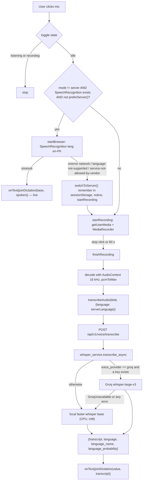

# 06 — Voice input (dictation)

> Written from the code in October 2026. If this doc and the code disagree, the code is right.

## 1. What it does

Both chat screens have a **microphone button** next to Send:

- the client AI chat (doc [04](04-ai-chat-client.md)),
- the lawyer AI research page (doc [05](05-ai-research-lawyer.md)).

The user clicks the mic, speaks, and the spoken words are **added to the text box** (after anything already typed). The user can edit the text, then presses Send as normal. Voice never sends a message by itself.

While listening, **moving sound bars** and a **timer** (`0:07`) appear beside the mic, so the user can see they are being heard.

There are two ways to turn speech into text:

| Mode | How | Good at | Used by |
|------|-----|---------|---------|
| **browser** | the browser's own `SpeechRecognition` (Chrome / Edge) | words appear live while speaking; `en-PK` English | lawyer (first choice) |
| **server** | record audio in the browser, send it to our backend `POST /api/v1/voice/transcribe` (Whisper) | works in any browser with a mic; tells **Urdu from English**; writes Urdu in **Urdu script** | client (always); lawyer (fallback) |

## 2. User flow

### Client (server mode)

| # | User does | What happens |
|---|-----------|--------------|
| 1 | Clicks the mic | Browser asks for microphone permission (first time). Recording starts; sound bars + timer show. |
| 2 | Speaks Urdu or English | Audio is collected in 250 ms pieces. |
| 3 | Clicks the mic again (or 60 s passes) | Recording stops. The button shows a spinner ("Turning your recording into text…"). |
| 4 | Waits a moment | The server transcribes. Urdu speech comes back in Urdu script, English in English. The text is added to the box. |
| 5 | Edits if needed, presses Send | Normal chat turn. Triage detects the language, and the answer comes back in that language. |

### Lawyer (auto mode)

| # | User does | What happens |
|---|-----------|--------------|
| 1 | Clicks the mic | Browser speech recognition starts (`en-PK`). Sound bars show. |
| 2 | Speaks | Words appear in the box **while speaking**. |
| 3 | Stops talking | After 3.5 s of no new words (`SILENCE_MS`), or 60 s total, or a second click, listening ends. |
| 4 | (Browser has no speech service, e.g. Brave/Opera) | A notice says the mic now records instead; it switches to **server mode** at once and remembers this for the tab. |

## 3. Code flow

### 3.1 Frontend: `VoiceButton.jsx`

File: [VoiceButton.jsx](../../frontend/src/components/shared/VoiceButton.jsx)

**Props:** `value`, `onText`, `onError`, `onNotice`, `onListening`, `className`, `size`, `lang = "en-PK"`, `serverLanguage = "en"`, `mode = "auto"`.

**How each screen uses it:**

| Screen | Code | Effect |
|--------|------|--------|
| Client chat ([ModChatbot.jsx](../../frontend/src/components/client/ModChatbot.jsx)) | `<VoiceButton value={inp} onText={setInp} mode="server" serverLanguage="auto" onListening={onListening} …/>` | always records; server picks Urdu or English |
| Lawyer research ([AILegalPage.jsx](../../frontend/src/components/lawyer/AILegalPage.jsx), `LawyerVoice`) | `<VoiceButton value={value} onText={onText} className="ai-mic" onError=… onNotice=…/>` | `mode="auto"`: browser first, server fallback with `serverLanguage="en"` |

**Main pieces:**

- **Capability check (after mount):** `Rec = window.SpeechRecognition || window.webkitSpeechRecognition`, `canRecord = getUserMedia && MediaRecorder`. If neither works (or server mode without recording support), the button renders **nothing**.
- **State:** `idle | listening | recording | transcribing`. `onListening(true/false)` tells the parent (the client chat uses it to reconnect its WebSocket after recording, because Chrome can drop the socket).
- **`toggle()`:** a click while listening/recording stops; while transcribing does nothing; while idle starts browser or server mode.
- **`startBrowser()`:** `rec.lang = lang`, `interimResults = true`, `continuous = true`. Each result joins all partial transcripts and calls `onText(joinDictation(base, spoken))`, where `base` is the text typed **before** speaking. A silence timer (3.5 s) and a max timer (60 s) stop it. Errors:
  - `aborted` → ignored (our own stop),
  - `network`, `language-not-supported`, `service-not-allowed-by-vendor` → switch to server mode (if recording is possible),
  - others → a named message (`ERRORS`: permission refused, no microphone, "Didn't hear anything").
  Browser recognition exposes no audio stream, so a **second** mic stream is opened only to draw the sound bars, and closed with it.
  The 3.5 s silence timer **restarts on every new result**, so listening ends 3.5 s after the last words, not 3.5 s after starting. If `rec.start()` itself throws, the button switches to server mode straight away (when recording is possible).
- **`startRecording()`:** `MediaRecorder` (`audio/webm` if supported), `mr.start(250)`, max 60 s. Mic permission refused → "Microphone permission was refused — allow it in the browser's address bar." A server error is shown with its own message, or "Couldn't turn the recording into text — try again."
- **Cleanup on unmount:** recognition aborted, recorder stopped, all mic tracks stopped and the extra visualiser stream closed, so the mic light goes off when the page closes.
- **Where messages go:** both screens show `onError` as a warning toast (4 s) and `onNotice` (the switch-to-recording notice) as an info toast (6 s).
- **`finishRecording()`:** no chunks → "Didn't hear anything". Otherwise decode the recording with an `AudioContext` at **16 kHz**, convert to WAV with `pcmToWav`, and send. If decoding fails, the raw webm is sent. A reply with no letters or digits (silence often comes back as ".") counts as "no speech".
- **`joinDictation(base, spoken)`:** trims trailing space of the typed text, trims the spoken text, joins with one space. Empty speech leaves the typed text unchanged.
- **`pcmToWav(samples, sampleRate)`:** writes a 44-byte RIFF/WAVE header (PCM, mono, 16-bit) and clamps each float sample to a 16-bit integer. **Why:** a plain WAV can be read by the server with `soundfile`, no ffmpeg needed.
- **`VoiceWave`:** 22 bars. An `AnalyserNode` (fftSize 512) reads the mic; every 50 ms the RMS level × 4.5 (max 1) is pushed into a rolling list and written straight into each bar's `transform: scaleY(...)` — **no React re-render per frame**. A 50 ms `setInterval` is used instead of `requestAnimationFrame` because animation frames stall in background windows. Without Web Audio the bars "breathe" with a sine wave. A `mm:ss` timer sits beside them.
- **`SendArrow`:** the shared upward-arrow icon used on the Send button in both chats.
- **Remembering server mode:** `sessionStorage["attorney:voice-server"] = "1"` after a switch, so the tab goes straight to recording next time.

**API helper** ([api.js](../../frontend/src/lib/api.js)): `transcribeAudio(blob, { language })` builds `FormData` with `audio` (`recording.wav` or `recording.webm`) and `language`, and calls `apiFetchMultipart('/voice/transcribe', …)` (with the user's auth token).

### 3.2 Backend route: `POST /api/v1/voice/transcribe`

File: [voice.py](../../backend/app/api/v1/routes/voice.py)

| Item | Value |
|------|-------|
| Auth | `get_current_user` (any logged-in user) |
| Full path | `POST /api/v1/voice/transcribe` (the only endpoint in `voice.py`, router prefix `/voice`) |
| Rate limit | `10/minute` (`limiter.limit`), counted **per user** when logged in, else per IP (`_user_or_ip` in `core/rate_limit.py`); over the limit → 429 |
| Form fields | `audio` (file), `language`: `"ur" \| "en" \| "auto"` (default `auto`); any other value → 422 (FastAPI `Literal` validation) |
| Size check | empty → 400 "Empty audio file."; > 10 MB (`MAX_BYTES`) → 413 "Audio too large. Maximum 10 MB." |
| Errors | any transcription failure → 500 "Transcription failed. Please try again." |
| Response (`TranscriptionResult`) | `transcript`, `language`, `language_name`, `language_probability` (null when the language was chosen, or on Groq) |

### 3.3 Backend service: `whisper_service.py`

File: [whisper_service.py](../../backend/app/services/whisper_service.py)

`transcribe_async(audio_bytes, filename, language)`:

1. **Groq first** if `settings.voice_provider == "groq"` and a Groq key exists (`groq_api_key`, `groq_api_key_2`). `transcribe_with_groq`:
   - model `settings.voice_groq_model` (default `whisper-large-v3`), temperature 0, 60 s timeout,
   - `language = "ur"` or `"en"` → one call in that language,
   - `language = "auto"` → first call with `response_format = verbose_json` to **detect**. English → return that text. **Anything else** → transcribe again as `"ur"`,
   - Urdu calls include `_URDU_PROMPT` (legal words like قبضہ، وراثت، خلع، ضمانت) to steer spelling,
   - a 429 on the first key tries the second key; other errors raise `GroqUnavailable`.
   - the Groq path always returns `language_probability: null`, `language` `en` or `ur`, and a fixed `language_name` ("English" / the Urdu name from `_LANG_NAMES`).
2. **Local fallback** on `GroqUnavailable` or any other exception: `WhisperService.transcribe` under an `asyncio.Lock` (one CPU inference at a time) in a thread:
   - model `faster-whisper` **base**, CPU, `int8`, beam size 5, loaded lazily (and pre-warmed at startup by `_warmup_models` in `main.py`),
   - audio decoded with `soundfile` (WAV); other formats via a temp file + ffmpeg,
   - `_choose_language`: if the client chose `ur`/`en`, use it; for `auto`, `detect_language` and **sum** the probabilities of the Urdu family (`ur`, `hi`, `pa`, `sd`) against `en` — the larger wins,
   - `vad_filter=True` (silence dropped), Urdu prompt for Urdu.
3. If `voice_provider == "local"`, Groq is skipped (no audio leaves the machine).

**Output is only ever Urdu (Urdu script) or English.** Hindi is never an output.

## 4. Data & states

Nothing is stored. Audio is held in memory for the request (a temp file only for ffmpeg-decoded formats, deleted after) and is not written to MongoDB.

| Place | Key | Meaning |
|-------|-----|---------|
| `VoiceButton` state | `idle / listening / recording / transcribing` | which phase the button is in |
| `sessionStorage` | `attorney:voice-server` | this tab prefers server mode |
| settings | `voice_provider` (`groq` default / `local`), `voice_groq_model` | which transcriber is used |

## 5. Key logic & rules

| Rule | Why (from code comments) |
|------|--------------------------|
| **Client uses server mode with `serverLanguage="auto"`** | Browser recognition is set to one language (`en-PK`) and cannot tell Urdu from English. Our server can, and it writes Urdu speech in **Urdu script**. The answer then follows the question's language. The old client mic (en-US) showed nothing until the end, could not be stopped, and called every error "failed". |
| **Lawyer uses auto (browser first)** | Live words while speaking, Pakistani English (`en-PK`) heard reasonably — the lawyer's previous experience. Server mode is the fallback for browsers without a speech service. |
| **Never Hindi; Urdu-family summed** | The base model heard Urdu as Hindi about half the time (measured hi 0.54–0.93 vs ur 0.07–0.44), and sometimes picked English and wrote Urdu speech out in English letters. Summing ur/hi/pa/sd fixes the choice; Hindi (Devanagari) is never returned. |
| **Groq first, local fallback** | `whisper-large-v3` on Groq was measured far more accurate on Urdu than the local `base`; the local model keeps voice working offline or when the free tier runs out. |
| **Urdu legal prompt** | primes the decoder toward legal words and correct Urdu spelling (e.g. "قبضہ", "حصہ"). VAD stops silence being "transcribed" into the prompt's own words. |
| **WAV at 16 kHz from the browser** | the server can read it without ffmpeg; Whisper works at 16 kHz. |
| **Typed text is kept** | `joinDictation` appends speech after what the user already typed. |
| **A stop is not a failure** | `aborted` is ignored; each real failure gets a specific message. |
| **One inference at a time locally** | `_alock` serialises CPU work so parallel requests queue instead of overloading the machine. |
| **Rate limit + 10 MB cap** | protects the transcription endpoint. |

## 6. Files

| File | Role |
|------|------|
| [VoiceButton.jsx](../../frontend/src/components/shared/VoiceButton.jsx) | the shared mic button: browser/server modes, `joinDictation`, `pcmToWav`, `VoiceWave`, `SendArrow` |
| [ModChatbot.jsx](../../frontend/src/components/client/ModChatbot.jsx) | client chat: server mode, `serverLanguage="auto"`, socket reconnect after recording |
| [AILegalPage.jsx](../../frontend/src/components/lawyer/AILegalPage.jsx) | lawyer research: `LawyerVoice` wrapper, auto mode |
| [api.js](../../frontend/src/lib/api.js) | `transcribeAudio` (multipart upload) |
| [voice.py](../../backend/app/api/v1/routes/voice.py) | `POST /voice/transcribe`: auth, rate limit, size checks |
| [whisper_service.py](../../backend/app/services/whisper_service.py) | Groq Whisper + local faster-whisper, language choice |
| [config.py](../../backend/app/core/config.py) | `voice_provider`, `voice_groq_model`, Groq keys |
| [main.py](../../backend/app/main.py) | `_warmup_models` preloads the local Whisper model |

## 7. Known limits (from the code)

- **Lawyer fallback is English-only:** when the lawyer's browser has no speech service, server mode uses the default `serverLanguage="en"`, so Urdu speech is transcribed as English.
- Browser mode depends on the browser vendor's cloud speech service (missing in Brave, Opera, some Edge setups).
- In `auto` mode on Groq, Urdu speech costs **two** Groq calls (detect, then transcribe as Urdu).
- Voice transcription uses only the first two Groq keys (`groq_api_key`, `groq_api_key_2`), not the full chat key pool.
- The local fallback is the small `base` model on CPU — slower and less accurate on Urdu, and requests are queued one at a time.
- Recording is capped at 60 s in the browser (`MAX_MS`); the server comment speaks of a 2-minute WAV, but the browser stops earlier.
- Roman Urdu is never produced by voice: speech becomes either Urdu script or English.
- Any transcription error returns a generic 500 to the user; the reason is only in the server log.
