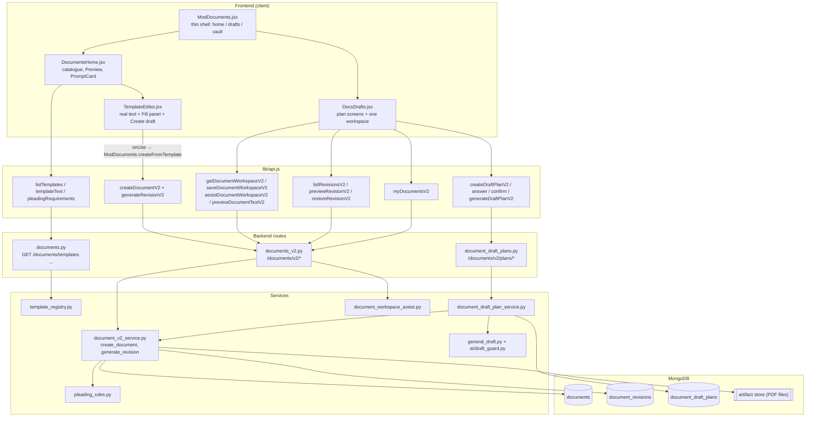
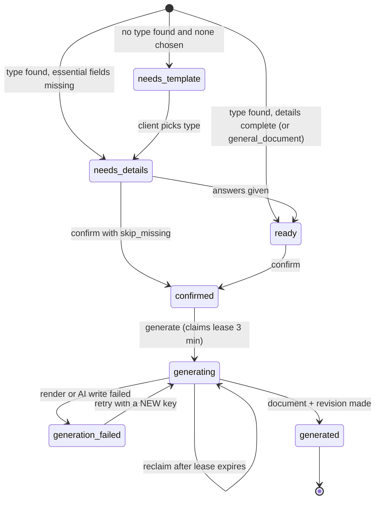
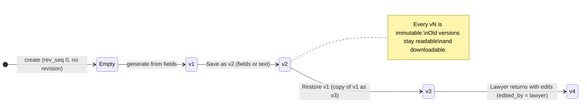
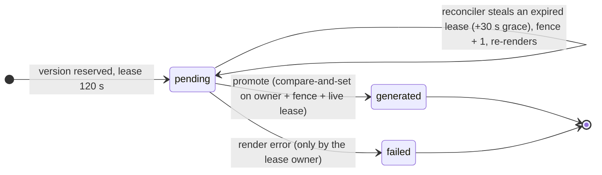
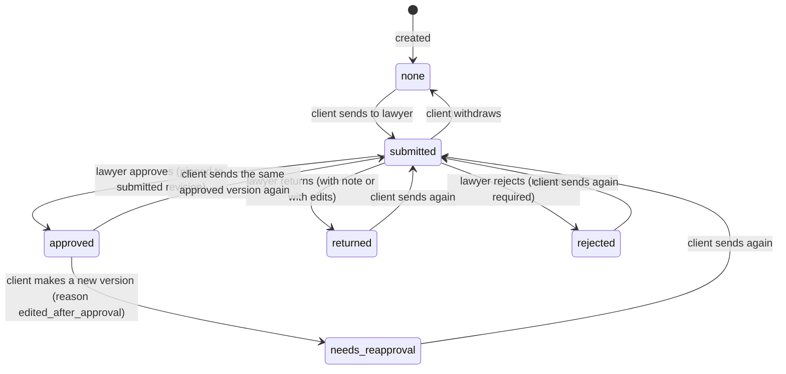

# 07 — Documents & drafting (client side)

> Written from the code in October 2026. If this file and the code disagree, the code is right.
> Lawyer drafting is in [08](08-documents-drafting-lawyer.md). Sending a draft to a lawyer and the lawyer's decision are in [09](09-document-review.md).

---

## 1. What it does

A client (a member of the public) can make a legal document in three ways:

1. **From a template.** Pick a template (legal notice, rental agreement, NDA, bail application, guardianship petition ...). The client sees the template's **real wording** with blanks, fills the blanks, and presses **Create draft**.
2. **From a description, with a template found for them.** The client types "Notice to a tenant for unpaid rent". The system guesses the template, reads details out of the description with AI, asks up to 3 questions, and then makes the document.
3. **From a description, with no template ("general document").** If no template matches, the AI writes the whole document from the description. Every fact the client did not give becomes a `[[PLACEHOLDER]]`. A legal check (`draft_guard`) runs on the text before anything is saved.

Every document then opens in **one drafting workspace**. There the client can:

- fill placeholders, edit the text, ask the AI for changes (a proposal they must accept),
- **save as a new version** (v1, v2, v3 ... — old versions are never changed),
- look at old versions, download them, and **restore** an old one (it comes back as the next version),
- see checks (statutory particulars, citation check),
- **send the document to a lawyer** for review (see doc 09).

All of this needs the `DOCUMENTS_V2` feature flag.

---

## 2. User flow (step by step)

### A. Template path

1. Client opens **Documents**. The home shows a prompt card, the template catalogue and "My documents".
2. The catalogue comes from the server (`GET /documents/templates`). Each card has **Preview** and **Edit**.
3. **Preview** shows the template's real text (from `GET /documents/templates/{type}/text`) and a checklist of what the law requires (`GET /documents/requirements/{type}`). The checklist is "to confirm" only — it never shows a pass.
4. **Edit / Use template** opens the **TemplateEditor**: the page on the left, a **Fill the details** panel on the right.
   - Typing a value puts it into the page at once (live fill).
   - Clicking an amber placeholder on the page jumps to its field.
   - If the template is "AI reads your case" mode and the client has confirmed cases, **Fill from a case** reads details from that case (AI extraction). Only empty fields are filled.
     - This calls the **legacy** `POST /documents/extract` (`document_service.extract_fields`). The case must exist (404), belong to this client (403) and not be a draft case. The client's own case description is used; only when it is empty is the AI case summary used, and only if the CPC jurisdiction check allows it (otherwise 422 with what to do).
     - The model is asked twice at most. The answer says `extraction_status`: `ok`, `empty` (read, found nothing) or `failed` (could not read) — a failure is never shown as a blank form. `truncated: true` when the description was longer than the model was shown.
   - The client may also change the wording itself.
5. **Create draft**:
   - creates a V2 document,
   - renders revision **v1** from the filled fields,
   - if the client changed the wording, saves that wording as **v2** (an `edited_document` revision),
   - opens the drafting workspace.
6. Templates marked **"Calculator"** (inheritance settlement, wasiyyat nama, labour demand) do not use this editor. The card sends the client to the right calculator under `/tools`.
7. Create draft refuses in the browser when no detail is filled ("Fill at least one detail first.") or the template is a calculator one. If the edited wording cannot be saved as v2, the draft still opens (with the template's own wording as v1) and a warning toast says the edits were not applied.

### A2. Instant documents (Tools → "Instant documents", legacy fast path)

1. In `ModTools.jsx` the client picks one of 5 types (legal notice, FIR application, complaint to SP s.154(3), Justice of Peace petition s.22-A, FIA cybercrime complaint) and types one description (10–3000 characters).
2. `POST /documents/quick-notice`: the AI extracts the fields from the text (no case needed). If nothing can be read → 422 "Could not understand the description". `fields` can be sent back to skip extraction.
3. The document is made through `document_writer.generate_owned_document` — a **legacy** file when `documents_v2` is off, a **V2** document + revision when it is on. With V2 on, the `Idempotency-Key` is checked **before** extraction, so a retry returns the same document instead of a new AI run.
4. The page shows a **Download** button for the made PDF.

### B. Prompt path (template found or general document)

1. Client types a description in the prompt card (optionally picks a type and a case).
2. A **draft plan** is created. The server guesses the template from the words (whole-word aliases).
   - Template found → AI extracts fields from the description → plan is `needs_details` or `ready`.
   - No template → plan type is `general_document`, no questions.
3. The workspace shows the plan: up to 3 questions for missing details, and the details the AI found ("Choices I made"), each changeable.
4. The client answers or chooses to skip, then **confirms** the plan.
5. **Generate**: the server creates the V2 document and its first revision. For a general document, the AI writes the text first (fail-closed, see §5).
6. The workspace opens on the new document.

Extra behaviour in `DocsDrafts.jsx`:

- If the server answers `needs_template`, the start card asks for a **Document type** (only templates with `drafting_mode: "ai"` are offered).
- A **general document** (`ready`, no questions) is confirmed and generated **at once** — the client already said what they want.
- The plan id (`attorney.draftPlan.current`) and the generation retry key (`attorney.draftPlan.genKey.<plan>`) are kept in this tab's `sessionStorage`. After a reload the same plan reopens and the **same key** resumes a half-finished generation. A plan already `generated`, or still `needs_template`, is not reopened.
- If generate returns an error (for example the dev proxy's 30 s timeout while a long AI write still runs), the screen re-reads the plan every 4 s, up to 45 times (3 minutes). If the plan became `generated`, the document opens anyway. `generation_in_progress` → "still being generated from another attempt".
- Changing the type, answering and confirming each send the plan's `version`; on any error the latest plan is re-read so the screen is not stale.

### C. In the workspace

1. Left column: **Versions** (this document's revisions) and **History / Saved** (all the client's documents, grouped by day).
2. Centre: the real PDF of the current version, or the text view for editable templates.
3. Right: panels — Fill placeholders, Checks, Ask for changes (AI), Send to a lawyer.
4. **Save as version N**: makes a new immutable revision. If someone else saved first (other tab), the save is refused and the client must reload.
5. **Restore**: an old version is rendered again and becomes the newest version, labelled "Restored from version X".
6. Unsaved edits are kept per tab in `sessionStorage` (key `attorney.unsavedDraft.<docId>`) and a browser warning appears before leaving.
   - Kept edits come back **only onto the same version** they were typed on (`base` = `base_revision_id`) and never while the document is submitted; otherwise they are dropped.
   - Opening another document, going back, opening the Vault or restoring a version first shows a **leave guard**: save as the next version, discard, or keep editing. Viewing an older version is not leaving — the edits stay.
7. While the document is with a lawyer (`submitted`), editing is locked. The banner offers **Withdraw**. The screen re-reads the document **every 15 s** so the banner changes as soon as the lawyer decides.
   - Withdraw answers 409 when the lawyer already decided ("can no longer be withdrawn"); 404 `feature_disabled` means it was sent the old (legacy) way and cannot be withdrawn here.
8. For a text-editable template, the text view follows the details as they are typed: `POST /workspace/text-preview` is called 400 ms after the last change. Nothing is saved.
9. If the first render of a document failed, opening it gives 409 `no_editable_revision` **with its `plan_id`**; the screen offers **Generate again** (through the same plan, so the same document) or delete it from the Vault.
10. "Ask for changes" (AI) shows a proposal; **Apply** only puts it into the editor — it is saved only when the client presses Save.

---

## 3. Code flow

### Explanation

**Template → draft**

- `TemplateEditor.useTemplate()` calls `onUse(spec, values, edited, caseId)`.
- That is `ModDocuments.createFromTemplate`. It:
  1. keeps only fields the template really reads (`spec.fields` minus `structured_fields`),
  2. calls `createDocumentV2` → `POST /documents/v2` → `v2.create_document`,
  3. calls `generateRevisionV2` → `POST /documents/v2/{id}/generate` → `v2.generate_revision`,
  4. if wording was edited, calls `applyEditedWording`: it loads the workspace, fills the `[[FIELD]]` tokens with the values (`fillWordingTokens`; a blank becomes `______`), and saves with `saveDocumentWorkspaceV2` → this makes an `edited_document` revision,
  5. opens the document in `DocsDrafts`.
- The create key is kept per template+case in `templateCreateRef`, so a retry after a failed render reuses the **same** document instead of making a second one.

**Prompt → plan → document**

- `PromptCard.plan()` → `DocsDrafts` → `createDraftPlanV2` → `POST /documents/v2/plans` → `create_plan()`.
- `create_plan` picks the template: the one chosen, or `infer_template_type(prompt)`, or `general_document`.
- For a named template, `_extract()` calls `document_service.extract_fields_from_text` (AI) and `_coerce_model_fields` cleans the result.
- `answerDraftPlanV2` → `PATCH /plans/{id}`; `confirmDraftPlanV2` → `POST /plans/{id}/confirm`; `generateDraftPlanV2` → `POST /plans/{id}/generate` → `generate_plan()`.
- `generate_plan` claims the plan (`status: generating` + a lease of 3 minutes), runs `_write_general` for a general document, then calls `v2.create_document` and `v2.generate_revision`.

**Generating a revision (`document_v2_service.generate_revision`)**

1. Same idempotency key seen before? Return that revision (and check it is the same request).
2. `_require_composable_template` (has a builder, not system-issued) and `_require_substance` (at least one real field, or visible text for free-form).
3. Reserve the next version number in `documents` (atomic `$inc` of `rev_seq` and `content_epoch`). A guarded save uses `reserve_version_if_current` (must still be on the expected revision).
4. Insert a `pending` revision with a lease.
5. `_render_and_select_inner`: render PDF → SHA-256 of the bytes → extract text → citation verification → `pleading_rules.check_pleading` → `template_registry.shape_report` → publish file → "promote" the revision with a compare-and-set → repoint the document to it.

**Workspace**

- `GET /documents/v2/{id}/workspace` (owner only) returns either:
  - `source: "freeform_html"` with `body_html` (general document, edited document, lawyer draft), or
  - `source: "structured_fields"` with `fields` and `text_html` (the template's own wording for these fields, built fresh).
- `POST /workspace/text-preview` returns the template wording for unsaved fields (live view; nothing saved).
- `POST /workspace/revisions` saves:
  - free-form → same type, new HTML,
  - named template with `body_html` → becomes `edited_document`,
  - named template with `fields` → same template, re-rendered.
- `POST /workspace/assist` → `document_workspace_assist.propose` (HTML) or `propose_fields` (fields). It **returns a proposal only** and never saves.

**Versions**

- `GET /documents/v2/{id}/revisions` — list without body text.
- `GET /revisions/{rev}/preview?expected_pdf_sha256=` — the PDF bytes of exactly that revision (409 if the hash changed).
- `POST /revisions/{rev}/restore` — re-renders the old revision's stored fields as a new revision and marks it `restored_from`.

### All endpoints

All paths start with `/api/v1`. "V2 gate" = answers 404 `feature_disabled` while `documents_v2` is off. Errors from V2 routes use the envelope `{ "error": {"code","message"}, "status_code" }`.

**`documents.py` (prefix `/documents`, not gated)**

| Method + path | Who | What it does |
|---|---|---|
| `GET /documents/templates?include_system=&include_lawyer_authored=` | any signed-in user | Catalogue from `template_registry.listing()`. The route adds `drafting_mode`: `dedicated` (has structured fields), `ai` (an extraction prompt exists), else `manual`. Receipts and `lawyer_draft` are hidden unless asked for; `edited_document` / `general_document` are never listed |
| `GET /documents/templates/{template_type}/text` | any signed-in user | The template's own wording with every detail as `[[FIELD]]`, composed by the PDF builder with `mark_all=True`, cleaned by `_clean_draft_html`. 404 for an unknown, system-issued or free-form type. `text_html: null` for a non-prose template (calculated table, Urdu). A builder error gives `null`, never a 500 |
| `GET /documents/requirements/{template_type}` | any signed-in user | `pleading_rules.requirements_for` (type cut to 64 chars). Every item is `to_confirm`; an uncovered type answers `covered: false`, not 404 |
| `POST /documents/quick-notice` | any signed-in user | Flow A2. `text` 10–3000 chars, `template_type` ∈ legal_notice, fir_application, complaint_154_3, petition_22a, fia_cybercrime (else 422). Optional `Idempotency-Key` (same key + different body → 409) |
| `POST /documents/extract` | any signed-in user (must own the case) | Legacy step 1: AI reads a case and returns fields (used by "Fill from a case") |
| `POST /documents/generate` | any signed-in user (must own the case) | **Legacy** step 2: makes a legacy PDF row for a case. Empty `fields` → auto-extract first; all-blank fields → 422 "Not enough detail". Stores `compliance` + `verification` on the row |
| `GET /documents/case/{case_id}` | client (own docs), lawyer (case's lawyer, else 403), admin | Legacy case listing. With V2 on, V2 rows are left out (V2 lists them) |
| `GET /documents/{doc_id}` / `GET /documents/{doc_id}/download` | creator, admin, case lawyer, lawyer it was submitted to | Legacy detail / file download. A stranger client gets 404, a lawyer not on the case 403. With V2 on, a V2 row answers **409** ("served by the V2 document service"); with V2 off it is served read-only through `legacy_view_of_v2_document` (rollback view). `GET /{doc_id}` is registered last so it does not swallow the other paths |
| `POST /documents/{doc_id}/submit`, `PATCH /documents/{doc_id}/review`, `GET /documents/review-queue` | client / lawyer | Legacy review — see [09](09-document-review.md) |
| `POST/GET /documents/drafts`, `DELETE /documents/drafts/{id}` | lawyer | Lawyer "My Drafts" — see [08](08-documents-drafting-lawyer.md) |

**`documents_v2.py` (prefix `/documents/v2`, V2 gate)**

| Method + path | Who | What it does / main refusals |
|---|---|---|
| `POST /documents/v2` (also `/documents/v2/`) | any signed-in user (client **or** lawyer) | Create the identity. Body `template_type` (1–64), `title` (1–200), `case_id?`. `Idempotency-Key` required. Unknown / system-issued template → 422; `edited_document` cannot be created ("begins as a template") → 422; case not yours → 403, missing → 404, draft case → refused. Same key → same document; same key + different request → 409 `idempotency_mismatch` |
| `POST /documents/v2/{id}/generate` | owner (others get 404) | Render the next revision from `fields`. `template_type` in the body must equal the document's: an invalid one → 422, a different valid one → 409 `template_type_mismatch` ("start a new draft"). Current revision is edited text → 409 `edited_text_current`. Render failed → 503 `generation_failed` ("try again with a new request key") |
| `GET /documents/v2/{id}` | owner, reviewing lawyer, past reviewer | Document + its `current_revision` inlined + `access_level`. A lawyer sees the submitted / reviewed revision, never the client's newest draft (see doc 09) |
| `GET /documents/v2/{id}/workspace` | owner only | Editable source (see above). 409 `no_editable_revision` (+ `plan_id`, `plan_version`, `plan_status` when the owner's plan made it); 409 `editor_source_unavailable` when a free-form revision has no safe text |
| `POST /documents/v2/{id}/workspace/text-preview` | owner only | Template wording for unsaved `fields`. Fields too long (> 200,000 chars) → 422; no text view → 409 `text_view_unavailable` |
| `POST /documents/v2/{id}/workspace/assist` | owner only | AI proposal (never saved). `instruction` 1–2000, `body_html` ≤ 200,000. Submitted → 409 `revision_under_review`; base revision not of this document → 409 `stale_workspace`; HTML vs fields mismatch → 422 `invalid_workspace_content` |
| `POST /documents/v2/{id}/workspace/revisions` | owner only | Save as a new revision (guarded by `expected_revision_id`, `expected_version` ≥ 1, `expected_content_epoch` ≥ 0). Same 409/422 codes as assist; render failed → 503 `generation_failed` |
| `GET /documents/v2/mine?cursor=&limit=&folder=&case=` | any signed-in user | Own V2 documents, newest first. `limit` 1–100 (default 25). `folder=none` = no folder, an id = that folder; `case` narrows to one case. Bad cursor → 400 `invalid_cursor` |
| `GET /documents/v2/{id}/revisions?limit=` | owner (all), lawyer (only revisions shown to them) | Newest first, `limit` 1–100 (default 50), no body text |
| `POST /documents/v2/{id}/revisions/{rev}/restore` | owner only | 404 if the revision is not of this document; 409 `revision_not_restorable` (did not finish / no fields), 409 `already_current`, 409 `revision_under_review`; render failed → 503 |
| `GET /documents/v2/{id}/revisions/{rev}/preview?expected_pdf_sha256=` | owner, or a lawyer for a revision shown to them | The PDF bytes. Revision of another document → 404; not generated → 409 `revision_not_ready`; hash differs → 409 `revision_changed`; file missing → 503 `artifact_unavailable`. Headers: strong `ETag` = hash, `Cache-Control: private, max-age=0, must-revalidate`, `X-Revision-Id`, `X-Revision-Version` |
| `POST /{id}/submit`, `PATCH /{id}/review`, `GET /{id}/review/text`, `POST /{id}/review/return-with-edits`, `POST /{id}/withdraw`, `GET /review/queue` | client / lawyer | Review — see [09](09-document-review.md) |

**`document_draft_plans.py` (prefix `/documents/v2/plans`, V2 gate, `require_client`)**

| Method + path | What it does / main refusals |
|---|---|
| `POST /documents/v2/plans` (also `/plans/`) | Create a plan. Body `prompt` (1–8000, blank after trim → 422), `template_type?` (1–64), `title?` (1–200), `case_id?`. `Idempotency-Key` required (422 `missing_idempotency_key`). Same key + different body → 409 `idempotency_mismatch`, same key + same body → the same plan |
| `GET /documents/v2/plans/{id}` | Read your own plan (someone else's → 404) |
| `PATCH /documents/v2/plans/{id}` | Answer: `expected_version` ≥ 0, `answers` 1–25 keys. Already confirmed/generating/generated → 409; wrong version → 409 "changed"; unknown field → 422; text over 4000 chars → 422; non-scalar value → 422; answers to a general document → 422 ("change the description instead"). Sending `template_type` switches type and **re-runs extraction** |
| `POST /documents/v2/plans/{id}/confirm` | `expected_version`, `skip_missing`. Already confirmed → returns it unchanged. Missing answers without `skip_missing` → 422; no detail at all (named template) → 422 |
| `POST /documents/v2/plans/{id}/generate` | `expected_version`, `Idempotency-Key` required. 409 `generation_in_progress` while another attempt's lease is live; 409 "already generated" for another key; 409 "That generation attempt failed. Retry with a new request key." when a failed key is reused; 503 `generation_incomplete` for a retryable state (same key recovers it) |

**Vault folders and trash (`documents_v2_folders.py`, `documents_v2_trash.py`, V2 gate before authentication, client or lawyer, own documents only)** — full rules in [12](12-vault-and-case-files.md):

| Method + path | What it does |
|---|---|
| `GET /documents/v2/folders` | Own folders with document counts (at most 100 folders) |
| `POST /documents/v2/folders` | Create `{name}` — name required, ≤ 60 chars, unique per owner ignoring case (409 `folder_exists`), max 100 (409 `folder_limit`) |
| `PATCH /documents/v2/folders/{folder_id}` | Rename |
| `DELETE /documents/v2/folders/{folder_id}` | Remove; its documents go to "no folder" |
| `PUT /documents/v2/{doc_id}/folder` | File a document `{folder_id}` or `null` |
| `GET /documents/v2/trash` | "Recently deleted" |
| `GET /documents/v2/{doc_id}/deletion-preview` | What deleting will do (warnings) |
| `DELETE /documents/v2/{doc_id}` | Move to the trash (idempotent) |
| `POST /documents/v2/{doc_id}/restore` | Bring back before `purge_after` (idempotent). Not the same as *revision* restore |

Router order matters: trash and folders routers are registered **before** `documents_v2`, and `/mine` is declared before `/{doc_id}`, so `trash`, `folders` and `mine` are never read as a document id.

---

## 4. Data & states

### Collections

| Collection | What it holds | Key fields |
|---|---|---|
| `documents` (`schema_version: 2`) | The document identity. Unique (partial) index `uniq_document_owner_create_key` on `(client_id, create_idempotency_key)` for rows that have a key — two simultaneous creates with one key make ONE document (2026-10-20) | `_id`, `client_id` (the **owner**, client or lawyer), `case_id`, `template_type`, `title`, `current_revision_id`, `current_version`, `rev_seq`, `content_epoch`, `review_status`, `submitted_*`, `review_cycles`, `approved_*`, `approval_history[]`, `reapproval_reason`, `folder_id`, `create_idempotency_key`, `create_fingerprint`, `event_seq`, `pending_events`, `receipts`, `retention_class` |
| `document_revisions` | One row per version, never edited after it is generated | `document_id`, `version`, `status` (`pending`/`generated`/`failed`), `template_type`, `fields`, `artifact_key`, `pdf_sha256`, `text_sha256`, `body_text`, `extraction_status`, `extraction_profile`, `compliance`, `verification`, `field_shape`, `based_on_revision_id`, `edited_by`, `restored_from`, `idempotency_key`, lease fields `lease_owner` / `lease_expires_at` / `fence`. Unique indexes: `(document_id, version)` and `(document_id, idempotency_key)` |
| `document_draft_plans` | The prompt → plan workflow | `owner_id`, `prompt`, `prompt_sha256`, `template_type`, `title`, `case_id`, `fields`, `status`, `version`, `extraction_status`, `extraction_notes[]` ({field, action: joined/dropped/truncated}), `create_idempotency_key` + `create_fingerprint` (unique per owner), `generation_idempotency_key`, `generation_lease_expires_at`, `failed_generation_key`, `generation_error` (`draft_failed` / `render_failed`), `generation` {document_id, revision_id, version, pdf_sha256, status}, `draft_withheld`, `expires_at` (7 days after the last change; a **TTL index** deletes the plan then — the document it made stays) |
| `review_events`, `transition_receipts`, `event_outbox` | Review history, receipts and notification queue (doc 09) | written by the background relay |
| artifact store (files) | The PDF bytes | read by the revision's `artifact_key`, never by a path from the request |

### Template kinds (from `template_registry.py`)

| Kind | Example | Edited how |
|---|---|---|
| Named template, text editable | `legal_notice`, `rental_agreement` | Fields, or edit the text (→ `edited_document`) |
| Named template, structured | `inheritance_settlement`, `wasiyyat_nama`, `labour_demand` | In its calculator only |
| Non-Latin | `urdu_pleading` | Fields only; no citation check |
| `edited_document` | (reached by editing text) | Rich text |
| `general_document` | AI draft from a description | Rich text |
| `lawyer_draft` | Lawyer's free prose (doc 08) | Rich text |
| `payment_receipt` | System only | Never drafted |

### Draft plan lifecycle

### Document versions (revisions)

Each revision row itself goes `pending → generated` or `pending → failed`.

The pointer of the document only moves **forward** (`repoint_document` needs `current_version < version`), so a late or replayed render can never move "current" back.

### Review status of a document (summary — full detail in doc 09)

When a new revision becomes current on an **approved** document, `repoint_document` changes the status to `needs_reapproval` (`reapproval_reason: edited_after_approval`) and copies the old approval (revision, hash, reviewer, time) into `approval_history` in the same atomic update. An approval never moves to new bytes.

---

## 5. Key logic & rules

### Feature flag

- `documents_v2` in [config.py](../../backend/app/core/config.py) — **default `False`**. When off, every `/documents/v2/*`, `/documents/v2/plans/*` and `/quick-review/*` route answers **404 `feature_disabled`** (it looks like the route does not exist). The UI then shows "Drafting from a template needs Documents V2, which is switched off."
- `GET /documents/templates`, `/templates/{type}/text` and `/requirements/{type}` are **not** gated — they describe the PDF builders, which both paths use.

### Ownership and privacy

- The owner is `documents.client_id` (named this way for history; a lawyer who drafts for themselves is also stored there).
- Workspace, save, generate, restore, assist are **owner only**. A reviewing lawyer can read the submitted bytes but never the owner's editing source.
- A document someone else owns answers **404, not 403**. A 403 would confirm the id exists.
- A document can be tied to a case only if the user is the case's client or lawyer, and the case is **not a draft case** (`assert_not_draft`).
- A **draft plan** is stricter: its case must be the caller's **own client case** (`_require_case` checks `client_id` only), and not a draft.
- Creating a V2 document is allowed for **any role** (a lawyer drafting for themselves owns it the same way); generating into it is **ownership**-checked, not role-checked.

### Idempotency (safe retries)

- Every create/generate/save/restore needs an `Idempotency-Key` header. Same key + same body → same result. Same key + different body → 409 `idempotency_mismatch`.
- Why: rendering is expensive, and a double click must not make two documents or two versions.
- Key format: 1–200 printable ASCII characters, no spaces (`validate_idempotency_key`). Missing → 422 `missing_idempotency_key`; bad → 422 `invalid_idempotency_key`. The key is stored hashed (SHA-256) in receipt field paths, so a `.` or `$` in it cannot inject.
- A retry of a revision that is still rendering **waits** (up to 10 s) for it to finish instead of returning a half-made row with no hash; if it is still running, 503 "still being generated — try again in a moment".
- A "same key, same request" check covers the fields too: a key reused with different fields is 409, never the old PDF.
- The browser makes one key per intent (`templateCreateRef`, `saveIntent`, `createIntent`, `generationKey`) and drops it when the content changes or after `generation_failed` (a failed render is final under its key).

### Optimistic concurrency (no lost saves)

- A save sends `expected_revision_id`, `expected_version`, `expected_content_epoch`. If another save happened first, the version cannot be reserved → **409 "This document changed since you opened the editor"**.
- Why: two tabs must not overwrite each other silently.
- `content_epoch` is the real token: it goes up when a version is **reserved** (not when the render finishes), so two slow renders from the same screen cannot both win. Old documents with no epoch count as 0.
- A double click with the same key that loses the reservation is given 1 s to find the winner's row and replay it; only a truly stale save becomes 409.
- AI Assist checks the same three values **before and after** the model call: if the document changed meanwhile → 409 "changed while AI Assist was working", and nothing is applied.

### Rendering pipeline, background work and limits

- `generate_revision` order: idempotency lookup → `_require_composable_template` + `_require_substance` (before a version number is used, so a refused render leaves no gap) → reserve version → insert `pending` row with a lease → render to a worker-private staging file → hash bytes → extract text → checks → publish to an immutable, fence-specific file → **promote** (compare-and-set) → repoint the document.
- Lease 120 s, heartbeat every 30 s while rendering. If a promote is lost, the request reports the winner's result, waits up to 10 s, or answers 503 — never a 500.
- `_documents_v2_relay` in `main.py` runs `document_v2_service.sweep()` **every 15 s on every worker** (safe: all steps are lease/compare-and-set guarded). Each pass: materialise review events → drain the notification outbox → reconcile stuck revisions (steal expired leases, re-render; repoint generated revisions the document missed) → trim old receipts → delete staging files older than 1 hour → delete published files no revision points to (older than 6 hours). It does nothing while `documents_v2` is off.
- A separate hourly `_vault_purge` purges trashed documents after `vault_recovery_days` (30); it only reports unless `documents_v2_deletion_enabled` is on.
- At startup `enforce_v2_correctness_indexes()` **refuses to start** when `documents_v2` is on and a required V2 index is missing (with the flag off it only warns).

### Legacy routes and `document_writer`

- The legacy `/documents/*` read routes are **legacy only**. With V2 on, a V2 document is refused (409) by detail/download and left out of the case list and legacy review queue. With V2 off (a rollback), V2 rows are shown read-only through `legacy_view_of_v2_document`. Legacy writes never touch a V2 row.
- `document_writer.py` is the one seam for routes that make a standalone document (quick notice, labour demand, inheritance documents, dispute petition, Urdu pleading). Flag off → `generate_standalone` (legacy file, `revision_id: null`). Flag on → V2 create + first revision. Routes whose fields come from AI (quick notice, petition) call `replay_owned_document` **before** extraction, so a retry returns what was already produced.

### Workspace AI assist (`document_workspace_assist.py`)

- Free-form or text-edited documents → `propose` (complete revised HTML). Named templates sent as fields → `propose_fields` (only allowed scalar fields; missing keys keep their values; result is a full form).
- The model's HTML is cleaned like pasted HTML. An empty proposal → 503 "Your draft was not changed". Model failure → 503. `applied: false` always.
- This path does **not** run `draft_guard` or the citation check; the checks run only when the client saves a revision.

### Edited text is not rebuilt from fields

- Once a template's text was edited, the current revision is `edited_document`. `POST /generate` on it is refused with **409 `edited_text_current`**. Editing continues in the workspace as text.
- Why: re-rendering from fields would put the template's wording back and silently delete the client's edits.
- After a text edit, the statutory particulars check cannot judge the text, so the UI shows **"Not checked — wording edited"**. The citation check still runs over the text.
- How a save is stored: `lawyer_draft` → `{title, author_name, body_html}`; `general_document` → `{title, body_html}`; `edited_document` → `{title, source_template, body_html}`; a named template saved as text → becomes `edited_document` with `source_template` = the template. A text-editable template saved with `fields` + `body_html` together → 422.
- A restored revision keeps the lawyer's `edited_by` mark when the old version was the lawyer's wording.
- `text_editable` = a known, composable, Latin-script template with no structured (calculated) field. Not receipts, not free-form types, not `urdu_pleading`.
- `_require_substance`: a named template needs at least one field **its builder reads** to be non-blank (a misspelt key does not count); a free-form document needs visible text in `body_html`. Otherwise 422.

### Checks frozen on every revision

- `compliance` = `pleading_rules.check_pleading(...)`. It only covers 4 types: `plaint_civil`, `written_statement` (CPC Order VII/VIII), `guardianship_petition` (Guardians and Wards Act s.10), `wakalatnama_checklist` (CPC Order III Rule 4). Other types get `checked: false` with a reason — **never a silent pass**. It is **advisory**, not blocking.
- `verification` = citation existence check over the extracted text. Urdu text → `unsupported` (the corpus is English).
- `field_shape` = which fields arrived, which are blank, which keys no builder reads (`unknown` = probable typo).
- Why frozen on the revision: they are facts about **those bytes**. Re-computing later would describe a different document.

### Submitting is locked during review

- While `review_status == "submitted"`, generate/save/restore/assist answer **409 `revision_under_review`**: "Withdraw the submitted revision before ...". The reservation itself refuses atomically (`refuse_when_submitted`).
- Only the lawyer's **return with edits** passes `refuse_when_submitted=False` — its new revision is part of the review.
- An unguarded generate that matches nothing tries 3 times (the document may have just left review); if it is really gone → 404; still blocked → 409 "changing under review right now".
- Why: the lawyer must review a fixed file.

### General document (AI, no template) — `services/general_draft.py`

The AI writes the document **only through the same safety path as the lawyer drafter**:

1. **Fail-closed corpus**: `index_health.require_all(DRAFTER_IDENTITY_INDEXES)`. If the verified legal indexes are not readable → no model call, 503.
2. **Grounding**: statute + case-law context is retrieved; exact provisions named in the prompt are fetched.
3. A client rider tells the model: use only given facts, `[placeholder]` for the rest, **add no legal citations** (write "under the applicable law").
4. **Fail-closed guard**: `draft_guard.check(...)`. If it errors or `ran` is false → **nothing is saved** (503 "The legal check on the draft could not run").
5. Text → simple HTML (`text_to_html`), placeholders tokenised to `[[TOKEN]]`, HTML cleaned (`_clean_draft_html`).
   - The first heading becomes `h1`, later CAPITAL lines `h2`, the rest `
`; only the model's `**bold**` becomes `<strong>`, everything else is escaped.
   - `[Father's Name]` → `[[FATHERS_NAME]]` (≤ 40 chars). Brackets with no letter (`[1]`) stay; notes like `[End of Document]` are removed.
   - Title = the draft's first line (soft title case, acronyms such as CNIC/NDA/FIR kept), else the description; at most 90 characters.
   - Jurisdiction: from the plan's case when there is one, otherwise neutral (`draft_jurisdiction.resolve`). Model purpose `PURPOSE_DRAFT_STREAM`.
   - Sentences the guard removed are kept on the plan as `draft_withheld`.
6. The written text is stored **on the plan first**, so a retry after a later failure re-uses it (no second AI bill, no different text).

### Draft plan safety

- Template guessing uses **whole words** only ("plaint" no longer matches inside "complaint"). The longest matching alias wins; if two types tie on length, no type is guessed (→ general document, or `needs_template` when nothing is chosen).
- Only templates that support AI field extraction and have no structured fields can be drafted from a prompt. A chosen type outside that list → 422.
- Questions come from a fixed list of **essential fields** per template (e.g. legal notice: sender, recipient, notice body, demand, response days). At most **3** are shown at a time; `remaining_detail_count` says how many are still missing. They are drafting details, not legal requirements (`legal_requirement: false`).
- The model's extracted values are cleaned without ever failing the request: lists of text are joined, objects dropped, text over 4000 chars cut — each change listed in `extraction_notes` ("combined from a list", "left out", "shortened"). The **client's own** answers are validated strictly (422).
- `extraction_status`: `not_run` (general document), `ok`, `empty`, `failed`.
- Default title: the client's title, else "<Template label> draft", or for a general document the first 90 characters of the description (later replaced by the AI draft's own heading).
- Each answer / confirm / claim increases `version` and is a compare-and-set on it.
- A reclaim after the lease keeps the document an earlier attempt already created (found by its create key), so a reclaim never makes a second document.
- A failed AI write or render sets `generation_failed` with `failed_generation_key`; that key can never be retried — a new key is needed.
- The plan's `prompt` is removed (`$unset`) once the document is generated.
- A plan stuck in `generating` can be reclaimed with a new key only after its 3-minute lease expires.

### "My documents" list

- `GET /documents/v2/mine` — newest first, cursor pagination with `(created_at DESC, _id ASC)`. Returns only what a row needs (no body text, no receipts — receipts hold idempotency keys).
- `downloadable` is false when the current revision did not finish, so the UI greys the row instead of offering a download that would fail.
- Rows with no `created_at` (old legacy rows) are listed **last** and still paginate (cursor marker `-`), instead of disappearing after page 1.
- The cursor is opaque base64 of `created_at|id`; it is only valid with the same `folder` and `case` filters. One extra read fetches the hash of every row's current revision for the whole page.

### Downloads

- `downloadDocumentFile` in `api.js`: when the revision id is known it uses `GET /revisions/{rev}/preview` with the **expected hash** (a regenerated file → 409, never silent other bytes). Only on 404 `feature_disabled` (flag off) does it fall back to the legacy `GET /documents/{id}/download`; any other error is shown as a failure.

---

## 6. Files

| File | Role |
|---|---|
| [ModDocuments.jsx](../../frontend/src/components/client/ModDocuments.jsx) | Thin shell: home / drafting workspace / Vault; `createFromTemplate` |
| [DocumentsHome.jsx](../../frontend/src/components/client/DocumentsHome.jsx) | Template catalogue, Preview dialog, requirements list, `PromptCard` |
| [TemplateEditor.jsx](../../frontend/src/components/client/documents/TemplateEditor.jsx) | Template's real text, Fill panel, Fill from case, Create draft |
| [DocsDrafts.jsx](../../frontend/src/components/client/documents/DocsDrafts.jsx) | Plan screens, the one workspace, versions, restore, send to lawyer |
| [MyDocumentsPanel.jsx](../../frontend/src/components/client/MyDocumentsPanel.jsx) | "My documents" on the home |
| [DocsVault.jsx](../../frontend/src/components/client/documents/DocsVault.jsx) | Vault (all documents, preview, review requests tab) |
| [documentStatus.js](../../frontend/src/lib/documentStatus.js) | Maps `review_status` to label/tone (unknown is never shown as progress) |
| [api.js](../../frontend/src/lib/api.js) | `createDocumentV2`, `generateRevisionV2`, `*DraftPlanV2`, `*WorkspaceV2`, `restoreRevisionV2`, `myDocumentsV2`, `listTemplates`, `templateText` |
| [documents_v2.py](../../backend/app/api/v1/routes/documents_v2.py) | V2 routes: create, generate, workspace, revisions, restore, preview, mine |
| [document_draft_plans.py](../../backend/app/api/v1/routes/document_draft_plans.py) | Plan routes (create/answer/confirm/generate) |
| [documents.py](../../backend/app/api/v1/routes/documents.py) | Legacy routes + template catalogue, template text, requirements |
| [document_v2_service.py](../../backend/app/services/document_v2_service.py) | Create identity, generate revision (lease, hash, checks, promote) |
| [document_draft_plan_service.py](../../backend/app/services/document_draft_plan_service.py) | Prompt → plan → document |
| [general_draft.py](../../backend/app/services/general_draft.py) | AI writes a document with no template (fail-closed) |
| [document_writer.py](../../backend/app/services/document_writer.py) | Single seam for routes that make a standalone document (legacy vs V2) |
| [document_workspace_assist.py](../../backend/app/services/document_workspace_assist.py) | AI "Ask for changes" — proposal only |
| [template_registry.py](../../backend/app/services/template_registry.py) | What templates exist, their fields, which are text-editable |
| [pleading_rules.py](../../backend/app/services/pleading_rules.py) | Statutory particulars check (4 types, advisory) |
| [draft_guard.py](../../backend/app/ai/draft_guard.py) | Legal check on AI text |
| [revision_repo.py](../../backend/app/repositories/revision_repo.py) | Version reservation, lease, promote, repoint |
| [document_transitions.py](../../backend/app/services/document_transitions.py) | Submit / review / withdraw (doc 09) |
| [document_folders.py](../../backend/app/services/document_folders.py) | Vault folders (organisation only) |
| [documents_v2_trash.py](../../backend/app/api/v1/routes/documents_v2_trash.py) | Recently deleted / restore (owner only) |
| [documents_v2_folders.py](../../backend/app/api/v1/routes/documents_v2_folders.py) | Vault folders (owner only) |
| [ModTools.jsx](../../frontend/src/components/client/ModTools.jsx) | "Instant documents" tab → `POST /documents/quick-notice` |
| [document_service.py](../../backend/app/services/document_service.py) | Legacy extract/generate, `extract_fields_from_text`, HTML sanitiser, `legacy_view_of_v2_document` |
| [main.py](../../backend/app/main.py) | `_documents_v2_relay` (15 s), `_vault_purge` (hourly), index checks at startup |

---

## 7. Known limits (from the code)

- **Everything here is off by default** (`documents_v2 = False`). With the flag off, the template editor can still show text, but Create draft fails with a clear message.
- **TemplateEditor "Save"** stores the client's template copy in the **browser only** (`localStorage`, key `attorney.templateCopy.*`). There is no server store for it.
- **DOCX export** in the workspace is shown disabled ("Soon"). The template editor can export `.doc` (HTML that Word opens) and PDF via the browser print dialog.
- **Structured templates** (inheritance, will, labour dues) cannot be edited as text; their tables stay computed.
- **Urdu pleading** gets no citation verification (`urdu_corpus_unsupported`).
- **Particulars check** covers only 4 instrument types; all others say "not checked".
- **General document** needs the verified legal indexes and a working AI provider. If either is missing, nothing is drafted (by design).
- A general document is labelled in the catalogue as "an AI draft for a lawyer to check" — the system does not claim it is legally complete.
- A document can go through at most **64 review cycles** (`MAX_REVIEW_CYCLES`); after that the client must start a new document.
