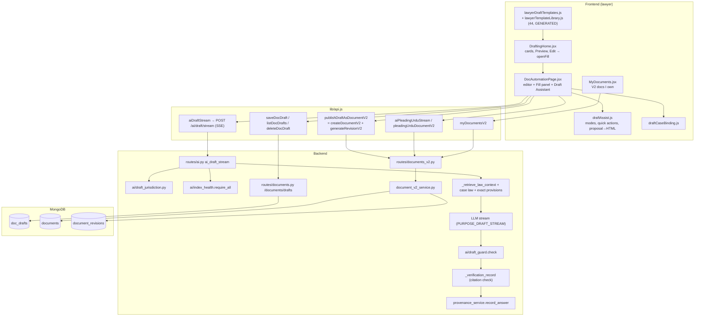
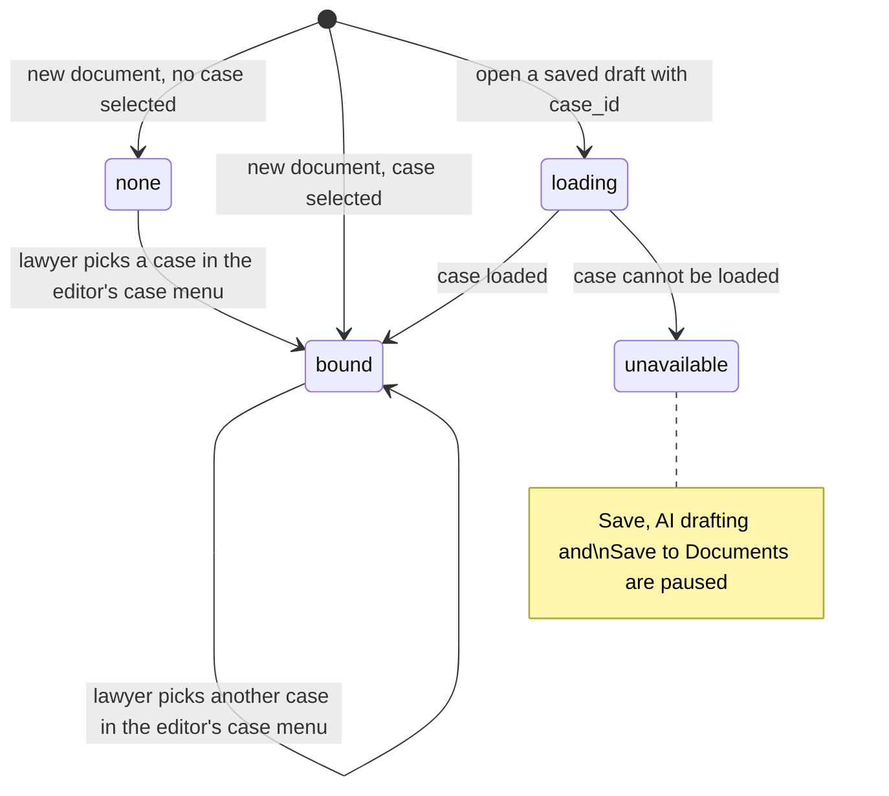
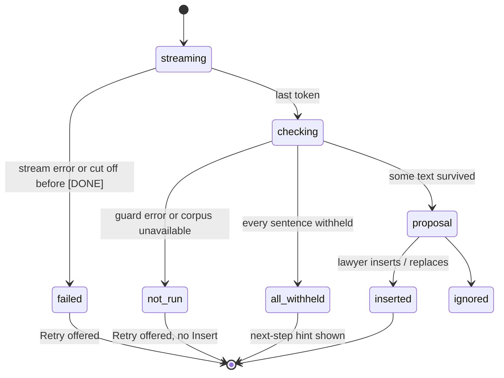
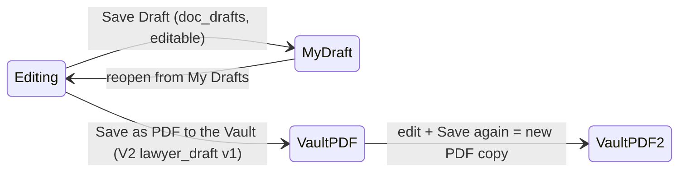

# 08 — Documents & drafting (lawyer side)

> Written from the code in October 2026. If this file and the code disagree, the code is right.
> Client drafting is in [07](07-documents-drafting-client.md). Reviewing a client's document is in [09](09-document-review.md).

---

## 1. What it does

The lawyer has a **Legal Drafting** area (sidebar page `doc-automation`, URL `/lawyer/doc-automation`). It is very different from the client side:

- The client fills **server templates** (PDF builders) and every save is a new immutable V2 revision.
- The lawyer writes **free prose** in a rich-text editor. Templates are **starter HTML bodies** kept in the frontend (a library of **44 templates** generated from real Word `.docx` files, plus a Blank scaffold).
- The lawyer has an AI **Draft Assistant** panel on the right. Every AI reply is a **proposal** that passed a legal check (`draft_guard`). The lawyer chooses where it goes.

The lawyer can save work in two different places:

| Save | Where | What it is |
|---|---|---|
| **Save Draft** | `doc_drafts` collection (legacy route `/documents/drafts`) | Editable working copy, listed in **My Drafts** |
| **Save as PDF to the Vault** | `documents` + `document_revisions` (V2, type `lawyer_draft`) | A fixed, hashed PDF with a citation check, listed in **My documents** / Vault |

---

## 2. User flow (step by step)

### A. Template home (`DraftingHome.jsx`)

1. Lawyer opens Legal Drafting. A strip offers three ways to start: **Blank document**, **My Drafts**, **Draft with AI**.
2. Below: search, sort, grid/list toggle, category chips, and template cards.
   - Categories in the library: Agreement / Contract (7), Application / Petition (11), Business / Commercial (4), Notice / Letter (14), Property (8). Total 44.
   - Each card shows the law it is drafted under (e.g. "CPC Order VII Rule 1").
3. A card can be **bookmarked** (saved in this browser only, `localStorage`).
4. **Preview** shows the starter body exactly as the editor will open it.
   - **Use template** → opens the editor with that body.
   - **Edit** → opens the editor **and** the **Fill placeholders** panel at once (`openFill: true`).

### B. The editor (`DocAutomationPage.jsx`)

1. The page shows the template body. Placeholders like `[Address]` or `___` are found in the live text (`findPlaceholders`).
2. **Case binding**: a new document is bound to the case selected when it opens. A saved draft keeps its own case (or stays caseless). The page's case selector does not change it; the **only** way to change it while the editor is open is the lawyer picking another case from the editor's own case menu (`pickCase` → `onRebind`).
3. A caseless draft must pick a **jurisdiction** (Punjab, Sindh, KP, Balochistan, Federal) or leave it **unspecified** (= jurisdiction-neutral) before asking the AI.
4. **Fill placeholders** panel lists the blanks; typing fills them in the page.
5. **Draft Assistant** panel. The lawyer types an instruction and picks a mode:
   - **Add to draft** (`clause`) — inserted at the cursor,
   - **Rewrite selection** (`rewrite`) — replaces only the selected text,
   - **Whole draft** (`full`) — replaces the draft only if the lawyer chooses,
   - **Ask** (`answer`) — a question; nothing is inserted.
   Quick-action chips (e.g. "Add a ground", "Stronger prayer", "Confidentiality") fill the instruction.
6. The reply streams in. When it finishes, the server sends a `guard` event:
   - sentences that failed the legal check are **withheld** (removed) and listed with reasons,
   - provisions are listed as **supported** or **not checked**,
   - sometimes an **alternative** proposal with `[placeholders]` for invented facts / CPC provisions to verify.
7. The lawyer inserts, replaces, or ignores the proposal. **Ctrl+Z** undoes an insert.
   - **Insert** goes after the cursor/selection as a new paragraph.
   - **Replace selected text** works only while the selected passage is still in the editor **unchanged** (`rewriteTarget`); otherwise the button says it is stale.
   - **Replace whole draft** asks first (`window.confirm`: "formatting is simplified; Ctrl+Z restores").
   - **Copy** puts the text on the clipboard.
   - If the guard **withheld the whole reply**, there is nothing to insert. The panel shows the guard's `next_step` hint and offers to **ask again without citations** (adds "Do not cite any provision or case… write [PROVISION]").
   - A reply that arrives with no `guard` event, or a guard with `ran: false`, is shown as an error with **Retry** — the streamed (unchecked) tokens are never offered.
   - The citation-check result (`verification` event) is added to the chat as a note.
8. **Save Draft** → My Drafts. **Save as PDF to the Vault** → a V2 `lawyer_draft` document.
   - Save Draft: the server checks the case (if any) through `case_service.get_case` (403/404), cleans the HTML, and runs a **citation check over the visible text**, stored with a `text_sha256`. The editor shows a warning **only** when that check found a bad citation (not found / repealed) and the text has not been edited since the save (`CitationWarning`, `checkStale`).
   - Save, AI and Save-as-PDF are disabled while the case binding is `unavailable`.
9. Other tools: **Export .doc** (browser-made Word file), **Translate to court Urdu** (stream) and save the Urdu pleading as a V2 `urdu_pleading` document.
   - The Urdu PDF first tries V2 (`pleadingUrduDocumentV2` = `POST /documents/v2` + `/generate`). Only if that answers 404 `feature_disabled` does it fall back to `POST /ai/pleading-urdu/pdf` (which itself goes through `document_writer`: legacy file when the flag is off). A new translation text gets a new idempotency key.
   - The translation stream has **no** legal check and no citation check; it only translates.

### C. Draft with AI (AI-first)

1. On the home, **Draft with AI** opens the editor with an **empty page** (`aiFirst`), assistant mode set to **Whole draft**, and the cursor in the instruction box.
2. The lawyer describes the facts. If the page is still empty when the reply arrives, the checked draft goes **straight onto the page** (nothing to overwrite). Otherwise it is a proposal.
   - When the guard also built a **placeholder alternative**, that version is the one placed (it keeps every paragraph and marks the facts still to give with `[placeholders]`).
   - An AI-first request sends `template: ""`, so the server calls it a "legal document".
   - A caseless draft must have a jurisdiction chosen before the request is sent (the send button does nothing until then).
3. The document title comes from the AI draft's own heading (`draftTitle`).

---

## 3. Code flow

### Explanation — one Draft Assistant request

`DocAutomationPage.sendToAI()` builds the request and calls `aiDraftStream({instruction, document, template, case_id, case_type, province, history, mode, selection})`.

On the server, `ai_draft_stream` (in [ai.py](../../backend/app/api/v1/routes/ai.py)):

1. **Role**: `require_lawyer`.
2. **Jurisdiction**:
   - With `case_id`: the case is loaded and authorised (`get_case`), draft cases refused (`assert_not_draft`), and `case_type` + `province` come **from the case**, not from the UI. Only a scrubbed whitelist of the case (`build_case_context` → `context_block`) reaches the model.
   - Without: the province must be a valid choice, or empty / "unknown" → **neutral**. Any other value → **422** "Choose a jurisdiction: punjab, sindh, kpk, balochistan, federal -- or leave it unspecified." `case_type` (civil | criminal | family | constitutional) is validated by `resolve_general`.
   - `mode: "rewrite"` with an empty `selection` → **422** "Select the passage to rewrite first." `selection` is at most 6000 characters.
   - `draft_jurisdiction.resolve()` gives the final province and its basis (`case` / `selected` / `neutral`).
3. **Fail-closed corpus**: `index_health.require_all(("criminal_collection__sec_v2", "civil_collection__ident_v2"))`. If an identity index is missing → the stream sends only `guard: {ran: false, reason: "corpus_unavailable"}` and stops. **No model call.**
4. **Retrieval**: `_retrieval_query` drops drafting words ("draft", "grounds", "please" ...) and adds statute wording for practice terms ("condonation" → "extension of period sufficient cause"; "implead/intervener/necessary party" → "strike out or add parties"). Statutes come from the identity indexes (`research_ident` retriever, filtered by `_docs_to_chunks` like chat: no generated Q&A, no statutes superseded in the province); CPC Appendix (court forms) chunks are dropped. The cleaned query keeps **6** chunks and the lawyer's raw words add up to **2** more. A CPC chunk holding two rules is shown as two, each under its own label; a chunk with no real identity is labelled "provision not identified". Case law comes from the citator (top 2, score ≥ 0.78). Provisions the lawyer **names** (at most 3) are fetched by exact identity and put first.
5. **Prompt**: `_DRAFT_SYSTEM` + source-currency rider + mode rider + jurisdiction riders. Last 6 history turns. The current document (first 8000 chars), the case context block and the selected passage.
6. **Stream** tokens to the browser.
7. After the last token, **`draft_guard.check`** on the whole text. If it errors → `guard: {ran: false}` and **no text may be inserted** (the panel shows Retry, not Insert).
8. If the guard ran: citation verification event, then a provenance record (so drafter output is counted in audit statistics). Session id `draft:<lawyer id>`, turn type answer.

SSE events, in order: `{"content": ...}` tokens → `{"guard": {...}}` → `{"verification": {...}}` → `[DONE]`. A model error streams an error event (`ai.stream`) and no guard. In the browser (`aiDraftStream`), a stream that ends without `[DONE]` is an error `stream_incomplete` ("cut off before the legal check finished") — never a shorter draft.

The `guard` object carries: `ran`, `reason`, `text` (what survived), `withheld[]` ({text, reasons}), `supported[]`, `not_checked[]`, `jurisdiction` {province, basis}, `clarify` (a provincial-law topic in a neutral draft), `next_step`, and `placeholder_alternative` {text, label, withheld, supported, not_checked}.

### All endpoints used by the lawyer's drafting page

All paths start with `/api/v1`.

| Method + path | Who | Gate | What it does / limits |
|---|---|---|---|
| `POST /ai/draft/stream` | lawyer (`require_lawyer`) | none | Draft Assistant (SSE). Body: `instruction`, `document` (first 8000 chars used), `template`, `case_id?`, `case_type`, `province`, `history` (last 6 user/assistant turns used), `mode` (`full` default \| `clause` \| `rewrite` \| `answer`), `selection` (≤ 6000) |
| `POST /ai/pleading-urdu/stream` | lawyer | none | Court-Urdu translation (SSE, model purpose `PURPOSE_PLEADING_URDU`). Uses the first 8000 chars; empty document → one `error` event + `[DONE]`. No legal or citation check |
| `POST /ai/pleading-urdu/pdf` | lawyer | none (V2 inside if on) | Render the Urdu text as an RTL PDF through `document_writer` (`urdu_text` ≤ 20,000, `title_ur` / `court_ur` / `english_label` ≤ 200 each; empty text → 422). Optional `Idempotency-Key`. Returns `doc_id`, `title`, `revision_id`, `pdf_sha256` (`null` ids on the legacy path). The UI uses it only as the flag-off fallback |
| `POST /documents/drafts` | lawyer | none | Save or update a My Draft. `title` 1–300, `content` ≥ 1 (≤ 300,000 server-side), `template_name` ≤ 300, `template_icon` ≤ 10, `case_id?`, `draft_id?` (update; someone else's → 403, missing → 404) |
| `GET /documents/drafts` | lawyer | none | Own drafts, newest `updated_at` first; HTML re-cleaned on read |
| `DELETE /documents/drafts/{draft_id}` | lawyer | none | Delete own draft (403 if not yours, 404 if missing) |
| `POST /documents/v2` + `POST /documents/v2/{id}/generate` | lawyer (owner) | `documents_v2` | "Save as PDF to the Vault" (`publishDraftAsDocumentV2`) and the V2 Urdu pleading — **one idempotency key for both calls** |
| `GET /documents/v2/mine` | lawyer | `documents_v2` | My documents (also filters `folder`, `case`) |
| `GET /documents/requirements/{type}` | any signed-in user | none | Checklist for the Plaint template (`plaint_civil`) |

A lawyer calling `POST /documents/v2/{id}/submit` gets **403** (`require_client`): a lawyer's own document has no review lifecycle.

---

## 4. Data & states

### Collections

| Collection | Used for | Key fields |
|---|---|---|
| `doc_drafts` | Lawyer's editable working drafts ("My Drafts") | `owner_id`, `title`, `content` (HTML), `template_name`, `template_icon`, `case_id`, `created_at`, `updated_at`, `verification` + `text_sha256` (server citation check over the visible text, computed on every save) |
| `documents` (V2) | A saved PDF (`template_type: "lawyer_draft"` or `"urdu_pleading"`) | `client_id` = the lawyer (owner), `case_id`, `current_revision_id`, `folder_id` |
| `document_revisions` | The PDF version(s) | `fields` {title, body_html, author_name}, `pdf_sha256`, `verification`, `compliance` |
| `document_folders` | Lawyer's Vault folders | per-owner unique name; organisation only |

There is **no review lifecycle** for a lawyer's own document: `submit` is client-only ("a lawyer has nobody to submit to").

### Case binding of the editor (`draftCaseBinding.js`)

### One Draft Assistant reply

### Saving

Note: "Save a new PDF copy" with **changed** HTML uses a new idempotency key, so it makes a **new** V2 document, not a new version of the old one (`publishKeyRef` is reset when the HTML changes). Same HTML + retry = same document.

---

## 5. Key logic & rules

### Templates live in the frontend, built by a generator

- [lawyerTemplateLibrary.js](../../frontend/src/lib/lawyerTemplateLibrary.js) is **GENERATED** by [build_lawyer_template_library.py](../../frontend/scripts/build_lawyer_template_library.py) from reference `.docx` files. Do not hand-edit it.
- The generator keeps Word formatting (centred bold headings, numbered "That ..." paragraphs, nested lists) and emits only tags the server's HTML sanitiser keeps.
- It applies **legal corrections** listed in the file header, for example: dissolution under DMMA 1939 s.2 (not MFLO s.7); FIR petition under CrPC s.22-A(6); plaint valuation (O.VII r.1) and verification (O.VI r.15); a sale deed is a *bai nama*; consumer complaint under provincial Acts (not India's Act); NEPRA complaint under s.39. The header says: "a lawyer should review before filing".
- [lawyerDraftTemplates.js](../../frontend/src/lib/lawyerDraftTemplates.js) turns the library into cards. `buildContent()` returns the fixed body; an unknown id (Blank) gets a generic scaffold built from **escaped** case data. Only template id 2 (Plaint) is mapped to a server `template_type` (`plaint_civil`) for pleading requirements.

### Why a reply is a proposal (`draftAssist.js`)

The assistant used to replace the whole editor text with the reply, which wiped headings and numbering. Now it is inserted at the cursor, swapped for the selection, or replaces the draft only when asked.

### The legal check — `ai/draft_guard.py`

On a normalised copy of the text (same length, so removed spans map back exactly; Urdu digits and words like "دفعہ" mapped to "Sec."), it runs:

| Check | What gets withheld or flagged |
|---|---|
| Legal authority (`visible_authority`) | Sections a statute does not have, omitted sections, an offence pinned on a procedural code, a provision cited for a subject it does not cover |
| CPC Order/Rule (`cpc_provisions`) | An Order/Rule the Code does not have → withheld; one our copy lacks → "not verified" |
| Personal law | e.g. Divorce Act 1869 in a Muslim custody matter, or community unknown |
| Jurisdiction (`draft_jurisdiction`) | Another province's Act; any provincial Act in a neutral draft |
| Invented facts (`draft_claims`) | A fact the lawyer did not give (compared with the lawyer's input only) |
| Omitted constitutional articles | Reliance on articles omitted whole (184, 186, 186A, 191A) |
| Malformed / internal labels | Broken references |

Then:

- **CPC / Punjab gate**: the CPC text on file is **Punjab's**. Outside a confirmed-Punjab matter, an AI-written CPC citation is removed (or replaced by a `[Verify ...]` placeholder if removing it breaks the sentence). The lawyer's own text is never rewritten. A CPC citation outside Punjab, and any Constitution citation (the copy on file is 2012), is **never "supported"** — it moves to "not checked" with the reason.
- A provision is **supported** only if **every** sentence relying on it passed.
- Anything still cited that no check accounted for is listed as **not checked** — it never just disappears from the counts.
- An **alternative** proposal is built with placeholders for invented facts and CPC references, and checked again in full.

"Supported" means "found and consistent in our library", **not** "legally right".

### Jurisdiction — `ai/draft_jurisdiction.py`

- Case-bound draft → province from the case record (server side).
- Caseless → the province the lawyer chose.
- Not chosen → **neutral**: federal law only, placeholders where provincial law governs, and any unit that names a provincial statute is withheld.

### Case binding — `draftCaseBinding.js`

Before this rule, opening a Case A draft while Case B was selected grounded the AI in Case B and re-saved the draft under B. Now the binding is fixed when the editor opens; if the case cannot be loaded, case-dependent actions are blocked.

### HTML safety

The editor emits tag-based formatting (`<b>`, ``, `align`) not inline CSS (`styleWithCSS=false`). The server sanitiser (`_clean_draft_html`, nh3 allowlist) keeps only:

- tags `p div br span b strong i em u s strike sub sup font ul ol li h1 h2 h3 blockquote hr` and table tags `table thead tbody tr th td` (no attributes on tables);
- attributes `face`/`size` on `font`, and `align` + `style` on any tag — but in `style` **only `text-align`** survives; every other property (above all `color`, and `url(...)`) is removed, and an emptied `style=""` is dropped. Colour is removed so text cannot be hidden from the reader or from the citation checker.

It runs on **write and on read** (old rows are cleaned when listed). A saved draft may be at most **300,000** characters (checked before cleaning) and may not be empty (422). Saved V2 drafts are cleaned again on the server.

### Feature flags

- `documents_v2` (default **False**): needed for **Save as PDF to the Vault**, Urdu pleading as a V2 document, and My documents. When off, the editor says "Saving a draft to Documents is not enabled yet — use Export." The Urdu PDF still works with the flag off: it falls back to `POST /ai/pleading-urdu/pdf`, which makes a **legacy** PDF file (not retry-safe, no revision).
- The Draft Assistant (`/ai/draft/stream`), the Urdu stream and **Save Draft** (`/documents/drafts`) are **not** behind `documents_v2`.

### Related services named in the task (where they really fit)

| Service | Used by | Note |
|---|---|---|
| [document_workspace_assist.py](../../backend/app/services/document_workspace_assist.py) | **V2 workspace** "Ask for changes" (`POST /documents/v2/{id}/workspace/assist`) — owner only, used by the client workspace | Returns a proposal, never saves; refuses if the document changed (stale). Does **not** run `draft_guard` — unlike the Draft Assistant |
| [document_draft_plan_service.py](../../backend/app/services/document_draft_plan_service.py) | **Client** prompt-to-plan routes (`require_client`) | See doc 07 |
| [petition_drafter.py](../../backend/app/services/petition_drafter.py) | Overseas **disputes**: `POST /disputes/{id}/petition` | Special-Court petition; only for a dispute in `ready_for_drafting`; LLM writes only facts + cause of action; missing required field fails the draft; output through `document_writer` |
| [pleading_rules.py](../../backend/app/services/pleading_rules.py) | Every V2 revision (`compliance`) and `GET /documents/requirements/{type}` | Deterministic, advisory; covers plaint, written statement, guardianship petition, wakalatnama checklist |
| [general_draft.py](../../backend/app/services/general_draft.py) | Client general document | Re-uses the lawyer drafter's retrieval, prompt and `draft_guard` |

---

## 6. Files

| File | Role |
|---|---|
| [DraftingHome.jsx](../../frontend/src/components/lawyer/DraftingHome.jsx) | Template home: start strip, cards, Preview (Edit / Use template), My Drafts |
| [DocAutomationPage.jsx](../../frontend/src/components/lawyer/DocAutomationPage.jsx) | The editor, Fill placeholders panel, Draft Assistant, save, export, Urdu |
| [MyDocuments.jsx](../../frontend/src/components/lawyer/MyDocuments.jsx) | V2 documents the lawyer owns (separate from My Drafts) |
| [lawyerTemplateLibrary.js](../../frontend/src/lib/lawyerTemplateLibrary.js) | 44 generated template bodies |
| [lawyerDraftTemplates.js](../../frontend/src/lib/lawyerDraftTemplates.js) | Cards + `buildContent` + Blank scaffold |
| [build_lawyer_template_library.py](../../frontend/scripts/build_lawyer_template_library.py) | Generator from `.docx`, with the legal fixes |
| [draftAssist.js](../../frontend/src/lib/draftAssist.js) | Modes, quick actions, proposal → HTML, placeholder finder |
| [draftCaseBinding.js](../../frontend/src/lib/draftCaseBinding.js) | Fixed case binding per editor |
| [jurisdictions.js](../../frontend/src/lib/jurisdictions.js) | Province choices and labels |
| [api.js](../../frontend/src/lib/api.js) | `aiDraftStream`, `saveDocDraft`, `publishDraftAsDocumentV2`, `pleadingUrduDocumentV2` |
| [ai.py](../../backend/app/api/v1/routes/ai.py) | `POST /ai/draft/stream`, `/ai/pleading-urdu/*` |
| [draft_guard.py](../../backend/app/ai/draft_guard.py) | Legal check on the finished reply |
| [draft_jurisdiction.py](../../backend/app/ai/draft_jurisdiction.py) | Province resolution, foreign/neutral unit detection |
| [documents.py](../../backend/app/api/v1/routes/documents.py) | `/documents/drafts` (My Drafts), `/documents/requirements/{type}` |
| [documents_v2.py](../../backend/app/api/v1/routes/documents_v2.py) | V2 create/generate/mine used by "Save as PDF" |
| [document_service.py](../../backend/app/services/document_service.py) | `save_draft`, `list_drafts`, `_clean_draft_html`, verification record |
| [draft_repo.py](../../backend/app/repositories/draft_repo.py) | `doc_drafts` access |
| [document_writer.py](../../backend/app/services/document_writer.py) | The seam `/ai/pleading-urdu/pdf` goes through (legacy file or V2) |
| [draftVerification.js](../../frontend/src/lib/draftVerification.js) | `verificationView` — how a citation check result is worded |

---

## 7. Known limits (from the code)

- **"Upload template"** has no backend; it is shown disabled.
- **Bookmarked templates** are per browser (`localStorage`).
- Template bodies are **developer-corrected starting points**; the library header says a lawyer should review before filing.
- The library has categories with **no templates yet**; the home lists them with count 0 and suggests Blank or Draft with AI.
- The Draft Assistant **needs the verified identity indexes**. If one is missing, nothing is drafted (by design).
- "Supported" in the guard means the provision exists in our library and the use matches; it is **not** legal advice.
- The CPC on file is **Punjab's** text, so CPC citations outside Punjab are always "not checked".
- A changed draft saved again to the Vault becomes a **new** V2 document, not a new version of the previous one.
- The court-Urdu translation is not checked by `draft_guard` or the citation check (its text is Urdu; the corpus is English), and its V2 revision records verification as `unsupported`.
- **Save as PDF / My documents need `documents_v2`**, which is off by default.
