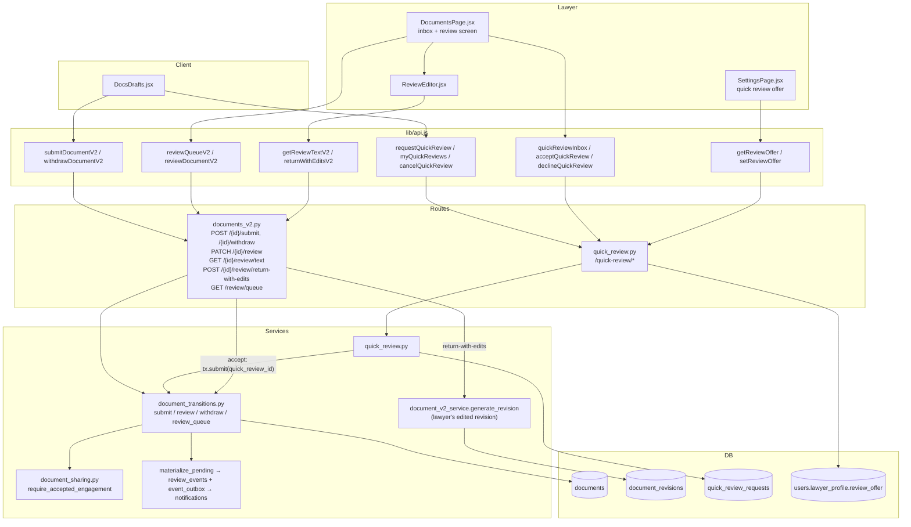
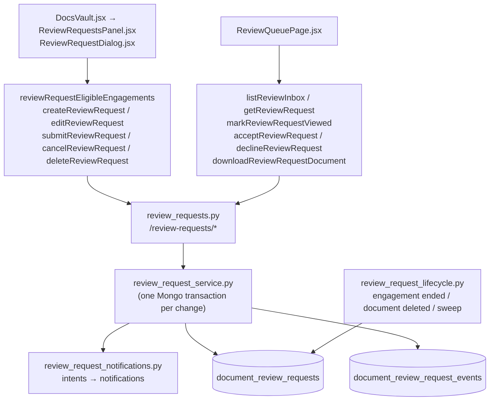
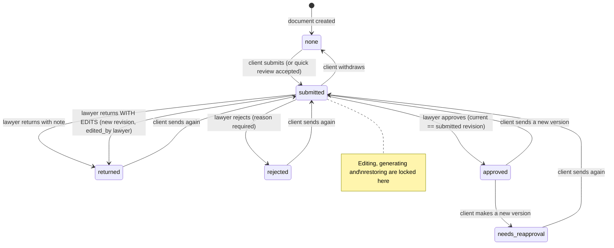
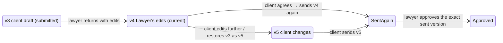
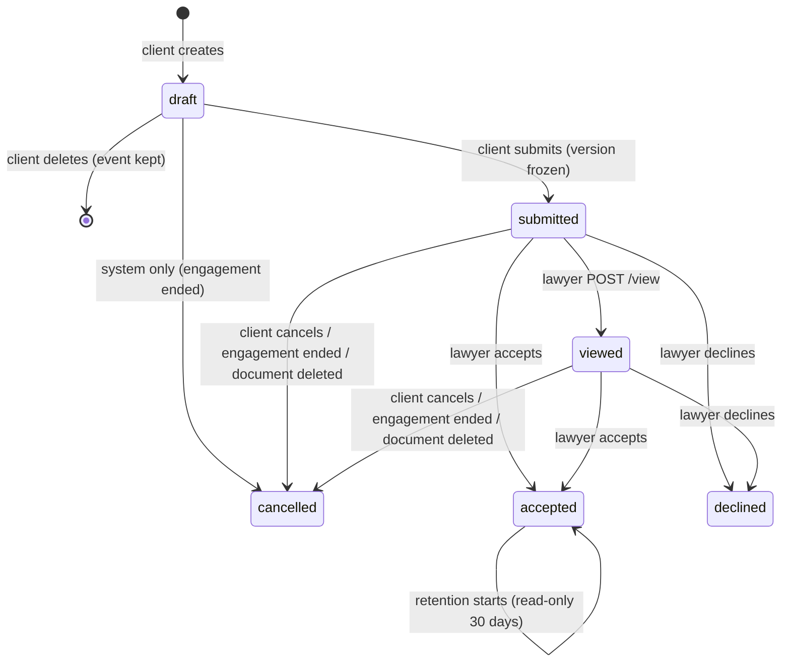

# 09 — Document review (client ↔ lawyer)

> Written from the code in October 2026. If this file and the code disagree, the code is right.
> How a document is made: client [07](07-documents-drafting-client.md), lawyer [08](08-documents-drafting-lawyer.md).

---

## 1. What it does

A client has a draft and wants a lawyer to check it. There are **three separate ways** in the code. It is important not to mix them up:

| # | Way | Who can receive it | What the lawyer can do | Flag(s) |
|---|---|---|---|---|
| A | **Send to my lawyer** (V2 review transitions) | A lawyer the client has an **accepted engagement** with | Approve, Return (note), **Return with edits**, Reject | `documents_v2` |
| B | **Quick document review** | Any lawyer who **offers quick reviews** (not hired) | Accept / Decline the request. Accept turns it into way A for this one version | `documents_v2` |
| C | **Review requests** (Vault "Review requests" tab → lawyer "Review Queue") | Lawyer of an **accepted engagement** | Mark viewed, Accept ("I will review this"), Decline, download the frozen PDF. **No approve/return here** | `documents_v2` **and** `document_review_requests` |

Ways A and B end in the **same review**: the document's `review_status` goes to `submitted`, and the lawyer decides in the **Documents** inbox. Way C is a separate, newer sharing system with its own collection and its own lifecycle. It shares one exact version and gives the lawyer read access; the decision itself happens outside it.

---

## 2. User flow

### Client view

**Way A — Send to my lawyer** (in the drafting workspace, `DocsDrafts.jsx`)

1. Open the document. Press **Send to a lawyer**.
2. The list shows lawyers from the client's **engagements**. If the document is on a case with one engaged lawyer, that lawyer is preselected.
3. Choose urgency (normal / priority / urgent), add a note, tick the confirm box, **Send**.
4. Banner: "With your lawyer for review — editing is off until the lawyer responds." A **Withdraw** button is shown. The workspace re-reads the document **every 15 s** while it is submitted, so the banner changes without a reload.
   - The lawyer list comes from `listEngagements({status: "accepted"})` (never the directory). A send that answers 409 is shown as "This document changed after you opened it" and is **not** retryable; other errors may be retried with the same key.
5. When the lawyer decides, a notification arrives and the banner changes:
   - **Approved by your lawyer** — "Any edit makes a new version, which would need a new approval."
   - **Your lawyer requested changes** — the lawyer's note is shown. "Make the changes, save, then send it again."
   - **Returned with their edits** — the lawyer's wording is now the **current version**, labelled "Lawyer's edits (name)" in Versions. The client reads it. If they agree, they **send it again**. If not, they edit further or **restore** their own earlier version.
   - **Rejected** — the reason is shown. They can edit and send again, or start a new draft.

**Way B — Quick review** (same "Send" panel, "No meeting needed")

1. The list shows lawyers who offer quick reviews, with **fee** and **turnaround** (24/48/72 h).
2. Pick one, add a note, confirm, **Request review**.
3. Until the lawyer accepts, nothing is shared. The client can **withdraw** the request.
4. The screen checks every 20 seconds. When accepted, the document becomes `submitted` to that lawyer (same as way A).
5. If declined, expired (24 h) or the document changed, the client is told "Nothing was shared or charged".
6. The lawyer list (`GET /quick-review/lawyers`) shows active lawyers with the offer switched on (never the client themself), fastest turnaround first, then by name; up to 24 by default (max 50), optional name search `q` (first 60 chars).
7. A double click on "withdraw" sends one cancel only.

**Way C — Review request** (Vault → Review requests, `ReviewRequestDialog.jsx`, 4 steps)

1. **Version** — pick one generated version (current first).
2. **Lawyer** — pick one eligible accepted engagement.
3. **Note and focus** — optional note (≤ 2000 chars) and up to 5 focus points.
4. **Review and submit** — shows exactly what will be shared.
5. It starts as a **draft** (only the client sees it), then **submitted**. The panel shows: Draft / Sent / Opened by the lawyer / Accepted / Declined (+ reason) / Cancelled (+ why).
6. The client can cancel while it is submitted or viewed. **Not after accepted.**

### Lawyer view

**Ways A and B — Documents inbox** (`/lawyer/documents`, `DocumentsPage.jsx`)

1. Tabs: All / Pending Review / Approved / Returned / Rejected. Each tab is a **server query** (`reviewQueueV2({status})`), not a client-side filter.
2. A **Quick review requests** section shows waiting quick-review requests: title, client name, note, fee — **not the document**. Buttons: **Accept** / **Decline**.
3. Open a pending document: the real PDF of the **submitted revision** (PDF.js viewer `ReviewPdfView.jsx`), compliance and citation results.
4. Decide:
   - **Approve**,
   - **Return** with a note,
   - **Reject** with a reason (required),
   - **Edit the text** (`ReviewEditor.jsx`) → **Send back with edits**. This is always a **return**, never an approval.
5. "Next document" moves to the next one still waiting ("Previous" walks back the trail). It never leads to a finished document.
6. Tab counts come from the server with the **first page only** (a "Load more" page carries `counts: null` = unchanged). Counts are documents, not decisions, so the tabs do not add up to All.
7. The inbox re-reads itself when a `document_*` notification arrives, and the quick-review section when a `quick_review_*` one arrives. A notification click opens the document directly (id handed over in `sessionStorage` key `attorney:lawyer-open-doc` or the `attorney:open-review-doc` event); if it is no longer in the list: "It may have been withdrawn."
8. Accepting a quick review re-reads the queue and opens the newly submitted document.
9. With `documents_v2` off the inbox falls back to the legacy `GET /documents/review-queue` (no paging, filtered in the browser).
10. Rows carry flags from the server: `quick_review` (no engagement behind it), `text_edited` (the client edited the template's wording — read it as text), `field_shape` (answers the template has no field for).

**Way C — Review Queue** (`/lawyer/documents/review-queue`, `ReviewQueuePage.jsx`)

1. Filters: All / New / Opened / Accepted / Declined / Cancelled.
2. Opening a request does **not** mark it viewed. The lawyer presses **Mark as viewed**.
3. **Download** the frozen PDF (hash checked on the server).
4. **Accept** or **Decline** (optional reason ≤ 500, with a character counter); both ask for confirmation first.
5. The list is newest submission first, 20 per page with "Load more" (`next_cursor`). A lawyer never sees a draft — only requests that were submitted (`submitted_at` set). `document_available` says whether the download is still allowed.

**Quick review offer** (`SettingsPage.jsx`, `GET/PUT /quick-review/offer`): the lawyer turns quick reviews on, sets a fee (Rs 0 – 1,000,000, whole rupees — the page refuses anything else) and turnaround (24/48/72 h). Turning it on with no fee → 422 "Set your review fee before offering reviews."

---

## 3. Code flow

### Ways A + B (one review engine)

### Way C (review requests)

### Explanation

**Submit (`tx.submit`)** — checked in this order:

1. The document exists (404) and the caller owns it (403). A replay of the same `Idempotency-Key` returns the original receipt; the same key with a different body → 409 `idempotency_mismatch`.
2. `review_status` is in `SUBMITTABLE_FROM` = none, returned, rejected, approved (+ two migration recovery states `needs_reapproval`, `migration_unrecoverable`). Already submitted → 409 "already submitted". `urgency` must be normal / priority / urgent (422).
3. The current revision is `generated`, and `current_version` + `pdf_sha256` match what the client saw. Otherwise 409 "changed since you loaded it".
4. No newer version is still rendering (a `pending` revision with a live lease) → 409 "A new version of this document is still being made". An abandoned render (lease lapsed) does not block.
5. The recipient is a user with role `lawyer` (else 404 "Lawyer"). **No KYC gate** (decision D2: there is no KYC process, so a flag would prove nothing).
6. **Case rule**: if the document has a case, the case must exist (a missing case → **409** "attached to a case that no longer exists" — nobody may receive it), and if it has an engaged lawyer, it must be **this** lawyer. Wrong lawyer → **403, never silently redirected**.
7. **Engagement rule (D1)**: `require_accepted_engagement(client, lawyer, case_id)`. Or, for a quick review, the request must be in status `accepting` for this doc, client and lawyer.
8. One atomic update (`_apply`): sets `submitted_to`, `submitted_revision_id`, `submitted_version`, `submitted_pdf_sha256`, `submitted_at`, `urgency`, `client_note`, `quick_review_id`, clears `review_note`, copies a previous approval into `approval_history`, adds an event intent and a receipt. The update's filter repeats the owner, allowed status, `current_version` and `current_revision_id`, so a change in between makes it match nothing.

**How `_apply` reports a failed atomic update** (`_raise_transition_failure`): document gone → 404; `pending_events` full (8) → 503 "The system is catching up"; the cycle limit (64) for a decision → 409 `review_limit_reached`; submitted but the client's current file is not the submitted one → 409 "not the version submitted to you"; anything else → 409 "changed since you loaded it".

**Errors as the client/lawyer sees them** (`_run` in `documents_v2.py`): 409 `review_limit_reached`, 409 `idempotency_mismatch` / `conflict`, 422 `validation_error`, 503 `backlog_unavailable`, 403 `forbidden`, 404 `not_found`.

**Review (`tx.review`)**: approve | return | reject

1. Replay check **first** (a decision clears `submitted_to`, so a retried response would otherwise get 403 for work already done).
2. `submitted_to == me` (else 403 "not submitted to you") and `review_status == submitted` (else 409).
3. Reject needs a note (422). `action` must be approve / return / reject (422). Only a `return` may carry `edited_revision_id` (422 otherwise). These input checks run before the replay check.
4. **Approve is pinned to the reviewed revision**: if `current_revision_id != submitted_revision_id` → 409 "The client's current file is not the version submitted to you". The same condition is also inside the atomic write, so a generate racing the approval cannot slip in.
5. The guard also requires `submitted_version` and `submitted_pdf_sha256` to equal what the lawyer saw.
6. A **review cycle** is appended (`review_cycles`): lawyer, action, the exact revision/hash/version decided on, client note, lawyer note, optional `edited_revision_id`.
7. Approve sets `approved_revision_id`, `approved_pdf_sha256`, `approved_by`, `approval_binding: "bound_exact"` and **keeps** `submitted_to`. Return/Reject clear the `submitted_*` fields (old `approved_*` stay). Every decision also writes the "who decided last" stamp `reviewer_id`, `reviewed_action`, `reviewed_revision_id/pdf_sha256/version` (kept for compatibility, not used for access).
8. Notification text: "Your lawyer approved / returned your document with changes / rejected your document: "<title>"." + the note.

**After an approval**: if the client makes a new revision, `repoint_document` turns `approved` into `needs_reapproval` (`reapproval_reason: edited_after_approval`) and archives the approval in `approval_history` atomically. The client must submit again.

**Return with edits (`POST /{id}/review/return-with-edits`)**

0. First the lawyer loads the wording with `GET /{id}/review/text` (same `_open_review` rule): free-form → its cleaned `body_html`; text-editable template → the builder's wording for the submitted fields; anything else → 409 `text_not_editable`. It returns `revision_id`, `version` and `pdf_sha256` of the submission.
1. Only while the document is **submitted to this lawyer** (`_open_review`); otherwise 409 `not_under_your_review` ("Only a document waiting for your decision can be edited"). No access at all → 404.
2. `expected_version` + `expected_pdf_sha256` must match the submission (409 `stale_review`).
3. The edited HTML (≤ 200,000 chars) is cleaned; empty visible text → 422 `invalid_workspace_content`. The `Idempotency-Key` may be at most **180** characters here (room for the `.edit` / `.return` suffix). No note → the default note "I have edited the wording. Please read my changes and send it back to me."
4. Free-form → same type with new `body_html`. Text-editable template → becomes `edited_document`. Otherwise 409 `text_not_editable` ("Return it with a note instead").
5. If the client already has a **newer private draft**, refused (409 `client_has_newer_draft`).
6. `generate_revision(..., refuse_when_submitted=False)` makes the new revision; it is stamped `edited_by: {role: "lawyer", user_id, name}`.
7. Then `tx.review(action="return", edited_revision_id=...)`. The decision is recorded against the **client's submitted bytes**; the edit is a proposal.
8. Two derived keys (`<key>.edit`, `<key>.return`) make each step idempotent: a retry finishes the missing step only.

**Withdraw (`tx.withdraw`)**: client only, only while `submitted` (else 409 "not under review"); status back to `none`, `submitted_*` cleared, lawyer notified. It appends no review cycle, so it still works after the 64-cycle limit.

**Quick review accept (`quick_review.accept`)**: claim the request (`requested → accepting`), call `tx.submit(... urgency="normal", note=<request note>, idempotency_key="quick-review.<id>", quick_review_id=<id>)`, then `accepted` with `due_at = now + turnaround`. If submit fails: conflict → `stale` (client told "Your document changed after you asked…", sent as a `quick_review_declined` notification) and the lawyer gets 409; document gone → `cancelled` with `closed_reason: document_deleted` (never reopened) and 409; forbidden → `stale` with `closed_reason: not_eligible` + audit entry; other error → back to `requested`. An already expired request → marked `expired` and 409 "This request has expired". Not waiting any more → 409.

**Legacy review (`documents.py`, before V2)**: `POST /documents/{id}/submit` (client), `PATCH /documents/{id}/review` (lawyer), `GET /documents/review-queue` (lawyer). The legacy submit **substitutes the case's lawyer** for the one chosen (V2 refuses instead), needs a `generated` legacy row, refuses `submitted`/`approved` rows, and applies the same D1 engagement rule. Both legacy write routes refuse any V2 document with **409** ("served by the V2 document service") — they bind no revision or hash. The legacy queue leaves V2 rows out while the flag is on.

**Way C service (`review_request_service.py`) — order of checks for every change** (`_change`): scope (not yours / missing → one identical **404** `not_found`) → replay (same key + same body → the original response; same key + other body → 409 `idempotency_mismatch`) → `expected_state_version` (409 `stale_state`) → receipt cap (64 receipts on one request → 409 `change_limit_reached`) → the transition's own rules. Then, in one transaction: update the row (filtered on the old `state_version` and status), insert one audit event, store the receipt, push notification intents. After commit, delivery is tried at once (best effort).

- **Create** (`create_draft`): document must be the client's V2 document, engagement must be the client's (404 otherwise), engagement status `accepted` (409 `engagement_not_active`), a case document only through that case's engagement (409 `case_mismatch`), the chosen revision must be a **generated** revision of this document with an artifact and the expected hash (other document's revision → 404; otherwise 409 `revision_changed`). A write on the engagement row (`review_request_guard` counter) makes the create conflict with an engagement ending at the same moment. At most one **open** request (draft/submitted/viewed) per document + engagement (unique index → 409 `open_request_exists` with `existing_request_id`). A replay of a create whose draft was deleted → **410** `request_deleted`.
- **Edit** (draft only, else 409 `invalid_transition`): note, focus, revision + hash (must come together, 422), engagement (re-checked like create). Only the fields sent change; an explicit `null` note clears it. Nothing to change → 422.
- **Submit** (draft only): the engagement is re-checked (409 `engagement_not_active`), the document must still exist (409 `document_unavailable` "Delete the draft"), case rule again, optional `expected_pdf_sha256` must equal the frozen hash, and the frozen revision must still be usable (gone or changed → 409 `revision_changed`). Title/template are refreshed from the document.
- **Cancel** (client): only `submitted` or `viewed`; `accepted` → 409 `request_accepted`; a draft → 409 "A draft is deleted, not cancelled". Sets `cancel_reason: client_cancelled`.
- **Delete** (client, draft only): needs the `Expected-State-Version` **header** (422 `missing_expected_state_version`). The row is removed; the audit trail ends with a `draft_deleted` event holding the key hash, so a retried delete answers 204.
- **View** (lawyer): `submitted → viewed` once; later calls return the request unchanged (no error).
- **Accept** (lawyer): only `submitted`/`viewed`, and the engagement must still be `accepted` (409 `engagement_not_active`). **Decline**: only `submitted`/`viewed`; the reason (trimmed, ≤ 500) is stored for the client, never in the audit event. Both close the request (`is_open: false`). The lawyer's receipts are stored under a separate hash (`lawyer|<id>|<key>`) so a key only replays for the same actor.
- **Download** (lawyer): allowed for `submitted`/`viewed` (and their engagement still `accepted`), and for `accepted` until `retention_until`; otherwise 404. The frozen revision must still exist and be generated with an artifact (409 `artifact_unavailable`), have the frozen hash (409 `integrity`), and the bytes are hashed again (409 `integrity`). Access is re-checked inside the transaction that writes the `document_download_authorized` event (a cancel that just committed wins). The event bumps only `event_seq`, never `state_version`, so downloading never makes the lawyer's screen stale. Response headers: `Content-Disposition: attachment; filename="review-request-<id12>.pdf"`, strong `ETag`, `Cache-Control: private, no-store`, `X-Content-Type-Options: nosniff`, `X-Revision-Version`.
- **Transactions**: every write runs in a Mongo transaction; a standalone server → 503 `transactions_unavailable`. A row is validated against the model (`DocumentReviewRequest`) before every write (422 `validation_error`, messages only, never the note).
- **Lists**: client `GET /review-requests` sorted `(created_at DESC, _id ASC)`; lawyer inbox sorted `(submitted_at DESC, _id ASC)`, only statuses submitted / viewed / accepted / declined / cancelled. `limit` 1–50 (default 20); cursor ≤ 512 chars; a bad cursor → 422 `invalid_cursor`; unknown status → 422. Responses never include receipts, key hashes or `pending_events`.
- **Eligible engagements**: the client's `accepted` engagements (only those on the document's case, if it has one), with lawyer name, case title and the id of any already-open request for that pair. No fees or reply times.

### All endpoints

All paths start with `/api/v1`.

**Ways A + B — `documents_v2.py` (prefix `/documents/v2`, 404 `feature_disabled` while `documents_v2` is off)**

| Method + path | Who | Body / rules |
|---|---|---|
| `POST /documents/v2/{id}/submit` | client | `expected_version`, `expected_pdf_sha256`, `lawyer_id`, `urgency` (normal/priority/urgent), `note` ≤ 2000. `Idempotency-Key` required |
| `POST /documents/v2/{id}/withdraw` | client | `Idempotency-Key` required |
| `PATCH /documents/v2/{id}/review` | lawyer | `action` approve/return/reject, `expected_version`, `expected_pdf_sha256`, `note` ≤ 2000. `Idempotency-Key` required |
| `GET /documents/v2/{id}/review/text` | lawyer it is submitted to | Submitted wording for editing (409 `not_under_your_review` / `text_not_editable`) |
| `POST /documents/v2/{id}/review/return-with-edits` | lawyer it is submitted to | `body_html` 1–200,000, `note?` ≤ 2000, `expected_version`, `expected_pdf_sha256`; key ≤ 180 chars |
| `GET /documents/v2/review/queue?status=&cursor=&limit=` | lawyer | `status` all/submitted/approved/returned/rejected (**default `submitted`**; anything else 422), `limit` 1–100 (default 25), cursor = last `_id` |
| `GET /documents/v2/{id}`, `/revisions`, `/revisions/{rev}/preview` | lawyer (scoped) | What a reviewer may read — see §5 |

**Way B — `quick_review.py` (prefix `/quick-review`, 404 `feature_disabled` while `documents_v2` is off)**

| Method + path | Who | Body / rules |
|---|---|---|
| `GET /quick-review/offer` | lawyer | Own offer `{enabled, fee_pkr, turnaround_hours}` (turnaround defaults to 24) |
| `PUT /quick-review/offer` | lawyer | `enabled`, `fee_pkr` 0–1,000,000 or null, `turnaround_hours` 24/48/72 (else 422) |
| `GET /quick-review/lawyers?q=&limit=` | client | Lawyers offering reviews |
| `POST /quick-review/requests` | client | `doc_id` ≤ 64, `lawyer_id` ≤ 64, `expected_version`, `expected_pdf_sha256` ≤ 128, `note` ≤ 1000. 201 |
| `GET /quick-review/requests/mine?doc_id=` | client | Own requests, newest first, last 20 (expires due ones first) |
| `POST /quick-review/requests/{id}/cancel` | client | Only while `requested` (409 "no longer waiting") |
| `GET /quick-review/inbox` | lawyer | Waiting (`requested`) requests, soonest expiry first, at most 50 (expires due ones first) |
| `POST /quick-review/requests/{id}/accept` | lawyer | See "Quick review accept" above |
| `POST /quick-review/requests/{id}/decline` | lawyer | Only while `requested` |

**Way C — `review_requests.py` (prefix `/review-requests`, 404 `feature_disabled` before authentication unless `documents_v2` **and** `document_review_requests` are on). Bodies forbid unknown fields; hashes are exactly 64 characters.**

| Method + path | Who | Body / rules |
|---|---|---|
| `GET /review-requests/eligible-engagements?document_id=` | client | `document_id` 1–64 |
| `POST /review-requests` | client | `document_id`, `revision_id`, `expected_pdf_sha256`, `engagement_id`, `note?` ≤ 2000, `focus[]` ≤ 5 items (each 1–120 chars). `Idempotency-Key` required. 201 |
| `GET /review-requests?status=&cursor=&limit=` | client | Own requests |
| `GET /review-requests/{id}` | client or lawyer | Each gets their own view; read-only, never marks viewed |
| `PATCH /review-requests/{id}` | client | `expected_state_version` ≥ 1 + any of note, focus, revision_id + expected_pdf_sha256, engagement_id. Key required |
| `DELETE /review-requests/{id}` | client | Headers `Idempotency-Key` and `Expected-State-Version`. 204 |
| `POST /review-requests/{id}/submit` | client | `expected_state_version`, optional `expected_pdf_sha256`. Key required |
| `POST /review-requests/{id}/cancel` | client | `expected_state_version`. Key required |
| `GET /review-requests/inbox?status=&cursor=&limit=` | lawyer | Own inbox |
| `POST /review-requests/{id}/view` | lawyer | No body, no key (naturally idempotent) |
| `GET /review-requests/{id}/document` | lawyer | The frozen PDF |
| `POST /review-requests/{id}/accept` | lawyer | `expected_state_version`. Key required |
| `POST /review-requests/{id}/decline` | lawyer | `expected_state_version`, `reason?` ≤ 500. Key required |

**Legacy (`documents.py`, not gated)**: `POST /documents/{id}/submit` (client; `note` ≤ 2000, `urgency`, optional `lawyer_id`), `PATCH /documents/{id}/review` (lawyer; `action`, `note` ≤ 2000), `GET /documents/review-queue` (lawyer). Legacy rows only.

---

## 4. Data & states

### Collections

| Collection | Holds | Key fields |
|---|---|---|
| `documents` | Review state of a V2 document | `review_status`, `submitted_to`, `submitted_revision_id`, `submitted_version`, `submitted_pdf_sha256`, `submitted_at`, `urgency`, `client_note`, `review_note`, `review_cycles[]`, `reviewer_id`, `reviewed_*`, `approved_revision_id`, `approved_pdf_sha256`, `approved_by`, `approval_history[]`, `quick_review_id`, `pending_events[]`, `receipts{}`, `event_seq` |
| `document_revisions` | The bytes; lawyer's edits marked | `edited_by`, `restored_from`, `pdf_sha256` |
| `review_events`, `transition_receipts`, event outbox | Materialised history (by the reconciler) | `logical_event_id`, `event_seq` |
| `quick_review_requests` | Way B | `_id` (random 12-byte token), `doc_id`, `client_id`, `lawyer_id`, `status`, `revision_id`, `version`, `pdf_sha256`, `doc_title`, `template_type`, `client_name`, `lawyer_name`, `note` (trimmed, cut to 1000), `fee_pkr`, `turnaround_hours`, `created_at`, `expires_at` (+24 h), `decided_at`, `due_at`, `closed_reason` (`document_deleted` / `not_eligible`), `audit[]`. Indexes (created lazily on the first request): unique `doc_id` where status is `requested`/`accepting` (one open request per document), `(lawyer_id, status)`, `(client_id, doc_id, created_at)` |
| `users.lawyer_profile.review_offer` | Lawyer's quick-review offer | `enabled`, `fee_pkr`, `turnaround_hours`, `updated_at` |
| `document_review_requests` | Way C | `state_version`, `event_seq`, `status`, `is_open`, `client_id`, `lawyer_id`, `engagement_id`, `case_id`, `document_id`, frozen `revision_id`/`version`/`pdf_sha256`, `document_title`, `template`, `note`, `focus[]`, `submitted_at`, `viewed_at`, `decided_at`, `cancelled_at`, `decline_reason`, `cancel_reason` (`client_cancelled` / `engagement_ended` / `document_deleted`), `retention_started_at`, `retention_until`, `retention_reason`, `create_idempotency_key_hash`, `receipts` (keys stored as SHA-256), `pending_events` (notification intents). Unique: one open request per (document, engagement); one create key per client |
| `document_review_request_events` | Way C audit trail (append-only) | `seq` (unique per request), `type` (created, edited, draft_deleted, submitted, viewed, document_download_authorized, accepted, declined, cancelled, retention_started), `actor_id`, `actor_role` (client/lawyer/system), from/to status, `detail` — ids, hashes and reason codes only |

### Document review status (ways A + B)

Extra recovery states from the migration: `needs_reapproval`, `migration_unrecoverable` — both can only be left by submitting again. `needs_reapproval` is also reached in normal use when an approved document gets a new version (reason `edited_after_approval`); the `recovery` field in API answers explains which case it is.

### Lawyer edits → client's choice

### Quick review request (way B)

```mermaid
stateDiagram-v2
    [*] --> requested: client asks (snapshot fee + turnaround)
    requested --> accepting: lawyer presses Accept (claim)
    accepting --> accepted: tx.submit succeeded (due_at set)
    accepting --> requested: transient error (given back)
    accepting --> stale: document changed / not eligible
    accepting --> cancelled: document deleted (closed_reason)
    requested --> declined: lawyer declines
    requested --> cancelled: client withdraws / document deleted
    requested --> expired: 24 h passed (checked lazily on read or on accept)
    accepted --> [*]
    note right of accepted: due_at = accepted + turnaround\n(shown only; nothing enforces it)
```

### Review request (way C)

---

## 5. Key logic & rules

### Who may see what (V2 documents, `_access` in `documents_v2.py`)

| Reader | Level | Sees |
|---|---|---|
| Owner (client) | `owner` | Everything, always |
| Lawyer it is submitted to now | `reviewer` | Only the **submitted revision** plus any revisions they decided before. Not the client's newer private drafts |
| Lawyer who already decided | `past_reviewer` | Only the revisions they reviewed (and their own edited revision). Status shown is **their** last decision |
| Anyone else | — | 404 (not 403, so ids cannot be probed) |

Why: a lawyer's standing over a document is exactly what the client chose to show them. Showing a later version would attach their approval to bytes they never read.

What a lawyer gets from `GET /documents/v2/{id}`:

- `current_revision` is the **submitted** revision (open review) or the **last one they decided** (past reviewer) — never the client's `current_revision_id`.
- `current_version`, `rev_seq`, `current_revision_id` are removed (they would count the client's private drafts). A past reviewer also loses `submitted_to`, `submitted_at`, `submitted_version`, `urgency`, and sees `review_status` = **their own** last decision, not the document's live status.
- `GET /revisions` lists only the revisions in their set (empty list if none); a preview of any other revision → 404.
- Access is computed from `review_cycles` (every cycle of theirs, plus their `edited_revision_id`); only documents decided before cycles existed fall back to the single `reviewer_id` / `reviewed_revision_id` stamp.
- A document submitted and then withdrawn before the lawyer decided leaves them **no** access and no row in any tab.

### Approval is pinned to bytes

- The client submits with `expected_version` + `expected_pdf_sha256`.
- The lawyer decides with the **submitted** version + hash.
- Approve also requires `current_revision_id == submitted_revision_id`.
- Why: "approving the wrong revision is the most expensive mistake this screen can make: the approval is what gets filed" (comment in `DocumentsPage.jsx`).

### Never approve on edit

The lawyer's edit always produces a **return**. The client must send that version again before it can be approved. So an approval is always of a version the client chose to submit.

### Engagement gate (`document_sharing.py`, decision D1)

- Every client → lawyer submission needs an **accepted** engagement.
- A case document only through an accepted engagement **on that case**.
- A caseless document through any of the client's accepted engagements.
- `requested`, `terms_proposed`, `completed`, `terminated`, `declined`, `cancelled` authorise nothing.
- Both the legacy submit (`document_service.submit_for_review`) and V2 `tx.submit` call the same function, so the rule cannot drift.
- **Exception**: an accepted quick review stands in for the engagement, for that one submission. The public submit route can never pass a `quick_review_id`.

### Quick review rules (`services/quick_review.py`)

- Lawyer opts in; fee is required to enable; turnaround must be 24, 48 or 72 h.
- The fee is **copied onto the request** when made, and is **displayed, not charged** ("the app is a demonstration and the payment provider is not verified").
- Before acceptance the lawyer sees title, client name and note — **never the document**.
- One open request per document (unique partial index). A case with its own lawyer → the request is refused; send it to that lawyer instead.
- Expiry is **lazy**: checked when someone reads, no scheduler needed. A guarded update makes sure only one reader notifies.
- Deleting the document closes waiting requests with an audit entry (`close_for_deleted_document`, called from `vault_deletion.py`); the lawyer is told "The client deleted this document, so the review request was closed."
- Request refusals: document not yours → 403; not in a sendable status → 409 ("already with a lawyer" when submitted); version/hash changed or not generated → 409; asking yourself → 422; lawyer missing or inactive → 404; offer switched off → 409 "not taking review requests right now"; a case engaged with another lawyer → 403 "Send it to them from the document instead"; another open request for this document → 409 "Cancel it first to choose someone else".
- Unlike the rest of V2, quick-review requests take **no** `Idempotency-Key`; the unique index (one open request per document) is what stops a double request.
- The submission made on accept uses urgency `normal` and the request's note as the client note.

### Review requests rules (way C)

- Both flags must be on; otherwise every route is 404 `feature_disabled` **before** authentication.
- **One Mongo transaction per change**: request row (`state_version + 1`), one audit event, the idempotency receipt. On a standalone Mongo (no replica set) this is refused with 503 — never degraded. When the flag is on, `assert_ready()` refuses to start the app without a replica set.
- **Idempotency keys are stored hashed** (SHA-256). Replay check runs before the stale-version check.
- **Optimistic concurrency**: every change names `expected_state_version`; wrong → 409 `stale_state`.
- **Frozen version**: `revision_id`, `version`, `pdf_sha256` may change only while `draft`.
- **GET never changes state** (a prefetch could fire it). "Viewed" is an explicit `POST /view`.
- **Download**: the server checks the revision still exists, is generated, has the frozen hash, then **hashes the bytes again**. Any mismatch → 409, nothing sent. A download writes an audit event.
- **Lifecycle** (`review_request_lifecycle.py`): when an engagement ends or the document is deleted, open requests are **cancelled** and accepted ones get read-only **retention** for `review_request_retention_days` (default 30), set once and never extended. A periodic **sweep** (every `review_request_sweep_minutes`, default 15) catches anything missed.
  - The hooks `end_for_engagement` / `end_for_document` run **inside the engagement transition's (or deletion's) own transaction**: if they fail, the engagement change rolls back too. Events use the `system` actor.
  - The sweep (`_review_request_sweep` in `main.py`, sleeps first, runs on every worker) makes two passes — open requests, then accepted ones without retention — in batches of 200 by `_id`, one transaction per ended engagement / deleted document. Re-running writes nothing.
  - A **draft** cancelled by the system was never shared, so nobody is notified.
  - Lawyer access to an accepted request ends at `retention_until` whatever else happens.
  - **Deletion hold**: while a request is submitted/viewed, or accepted and still inside retention, its frozen revision is "held" (`revision_is_held`), so the Vault purge keeps those bytes.
  - `review_request_retention_days` must be 1–3650 (config validator).
- **Startup**: with the flag on, `enforce_review_request_indexes()` refuses to start if a required index (one-open-request, create-key, inbox, …) is missing, and `assert_ready()` refuses a standalone MongoDB. With the flag off both only warn.
- No analyzer output is attached (`analysis` is always null); the Review Queue offers no "Open in Analyzer".

### Notifications

| Event | Who is told | Type |
|---|---|---|
| Submit (A/B) | Lawyer | `document_submitted` (with priority if not normal) |
| Approve / Return / Reject | Client | `document_approved` / `document_returned` / `document_rejected` ("returned your document with their edits" for edits) |
| Withdraw | Lawyer | `document_withdrawn` |
| Quick review requested | Lawyer | `quick_review_requested` |
| Quick review accepted / declined / expired | Client | `quick_review_accepted` / `_declined` / `_expired` |
| Quick review closed because the document changed (stale) | Client | `quick_review_declined` ("Your document changed after you asked…") |
| Quick review withdrawn by the client, or closed because the document was deleted | Lawyer | `quick_review_cancelled` |
| Review request submitted | Lawyer | `review_request_submitted` |
| Review request accepted / declined | Client | `review_request_accepted` / `_declined` |
| Review request cancelled (if the lawyer could see it) | Lawyer | `review_request_cancelled` |

How they are delivered:

- **Ways A/B**: the transition writes an **intent** into `documents.pending_events` in the same atomic update. A reconciler (`materialize_pending`) writes `review_events`, copies receipts, parks the notification in the event outbox, then removes the intent. If too many intents wait (`MAX_PENDING = 8`), new transitions get **503** (backpressure).
- **Way C**: intents are written on the request row in the same transaction, delivered right after commit (best effort) and by `reconcile()` with backoff. A dedupe key `(request, event seq, recipient, kind)` makes sure only **one** notification is created. Notifications never contain the note, decline reason, document text or hash.
  - `reconcile()` runs from `_review_request_notifier` in `main.py` every `provenance_relay_seconds` (30 s) on every worker, in batches of 100; a failed delivery waits `min(600 s, 2^attempts s)` before the next try. It does nothing while the flag is off.
  - Each notification carries only the title, the other party's name and a deep link `/{role}/review-requests/{request_id}`; an intent whose recipient is no longer that party is never delivered.
- **Quick review** notifications are created directly (not through the outbox).
- **Legacy** submit/review notify directly too (`document_service._notify`, failures ignored); their text includes the note.
- The V2 queue relay (`materialize_pending`) runs inside `_documents_v2_relay` every **15 s**. An intent is removed only after its `review_events` row, the external receipt copy and the outbox entry all succeeded; embedded receipts above 20 per document are trimmed once their copy in `transition_receipts` exists.

### Limits

- `MAX_REVIEW_CYCLES = 64` per document → after that, 409 `review_limit_reached` ("Start a new document"). Withdraw still works.
- Lawyer review queue filters are allow-listed: `all`, `submitted`, `approved`, `returned`, `rejected`; anything else is 422 (not an empty page).

---

## 6. Client view vs lawyer view

| Topic | Client | Lawyer |
|---|---|---|
| Where | Drafting workspace "Send to a lawyer"; Vault "Review requests" tab | Documents inbox (`/lawyer/documents`); Review Queue (`/lawyer/documents/review-queue`); Settings (quick review offer) |
| Starts it | Submit (A), request quick review (B), create + submit review request (C) | Never starts; accepts or declines (B, C) |
| Sees the document | Always (owner) | Only the submitted / reviewed revision; in B only after accepting; in C only while access is granted |
| Can edit | Yes, except while `submitted` | Only via **Return with edits** on an open submission |
| Decisions | Withdraw (A/B), cancel (B/C), delete draft (C), send again | Approve / Return / Return with edits / Reject (A/B); Accept / Decline (B, C) |
| Notes | `client_note` (≤ 2000); C: note + up to 5 focus points | `review_note` (≤ 2000); reject needs a reason; C decline reason ≤ 500 |
| Concurrency guard | `expected_version` + `expected_pdf_sha256`; C: `expected_state_version` | Same pair of the **submitted** revision; C: `expected_state_version` |
| What "approved" means | Approved = that exact version; any edit needs new approval | Their approval is bound to the exact bytes (`approval_binding: bound_exact`) |
| Money | Quick review fee shown only, not charged | Sets fee and turnaround |

---

## 7. Files

| File | Role |
|---|---|
| [DocsDrafts.jsx](../../frontend/src/components/client/documents/DocsDrafts.jsx) | Client send panel (A + B), banners, withdraw, version labels |
| [ReviewRequestDialog.jsx](../../frontend/src/components/client/documents/ReviewRequestDialog.jsx) | Client 4-step review request (C) |
| [ReviewRequestsPanel.jsx](../../frontend/src/components/client/documents/ReviewRequestsPanel.jsx) | Client list of review requests (C) |
| [DocsVault.jsx](../../frontend/src/components/client/documents/DocsVault.jsx) | Vault, hosts the review requests tab |
| [documentStatus.js](../../frontend/src/lib/documentStatus.js) | Status labels (unknown never shown as progress) |
| [reviewRequests.js](../../frontend/src/lib/reviewRequests.js) | Way C status views, limits, error text |
| [DocumentsPage.jsx](../../frontend/src/components/lawyer/DocumentsPage.jsx) | Lawyer inbox, quick review section, review screen, decisions |
| [ReviewEditor.jsx](../../frontend/src/components/lawyer/ReviewEditor.jsx) | Lawyer edits the submitted wording |
| [ReviewPdfView.jsx](../../frontend/src/components/lawyer/ReviewPdfView.jsx) | PDF.js reader for the submitted bytes |
| [ReviewQueuePage.jsx](../../frontend/src/components/lawyer/ReviewQueuePage.jsx) | Lawyer Review Queue (C) |
| [SettingsPage.jsx](../../frontend/src/components/lawyer/SettingsPage.jsx) | Quick review offer |
| [api.js](../../frontend/src/lib/api.js) | All calls listed in §3 |
| [documents_v2.py](../../backend/app/api/v1/routes/documents_v2.py) | Access levels, submit, review, return-with-edits, withdraw, queue |
| [document_transitions.py](../../backend/app/services/document_transitions.py) | Atomic, idempotent transitions; review cycles; queue; reconciler |
| [document_sharing.py](../../backend/app/services/document_sharing.py) | Accepted-engagement rule (D1) |
| [quick_review.py (route)](../../backend/app/api/v1/routes/quick_review.py) | `/quick-review/*` |
| [quick_review.py (service)](../../backend/app/services/quick_review.py) | Offer, request, accept, decline, expiry |
| [review_requests.py](../../backend/app/api/v1/routes/review_requests.py) | `/review-requests/*` |
| [review_request_service.py](../../backend/app/services/review_request_service.py) | Way C writes, transactions, download |
| [review_request_lifecycle.py](../../backend/app/services/review_request_lifecycle.py) | Engagement end / document deletion / sweep / retention |
| [review_request_notifications.py](../../backend/app/services/review_request_notifications.py) | Way C notification intents and delivery |
| [review_request.py (model)](../../backend/app/models/review_request.py) | Statuses, allowed transitions, frozen fields |
| [config.py](../../backend/app/core/config.py) | `documents_v2`, `document_review_requests`, retention days, sweep minutes |

---

## 8. Known limits (from the code)

- **All of this is off by default**: `documents_v2 = False`, `document_review_requests = False`.
- **Way C needs a replica set** (transactions). With the flag on and no replica set, the app refuses to start.
- **Quick review fee is never charged** — display only.
- In **way C** the lawyer's "Accept" means "I will review this"; there is no approve / return / edits inside way C. A document can only get an approved/returned status through ways A/B.
- **Return with edits** works only for free-form documents and text-editable templates. Structured (calculated) and Urdu templates can only be returned with a note.
- **Return with edits** is refused if the client already made a newer private draft.
- Notifications for A/B depend on the reconciler running; delivery order is **not** guaranteed (consumers order by `(document_id, event_seq)`).
- Max **64** review cycles per document.
