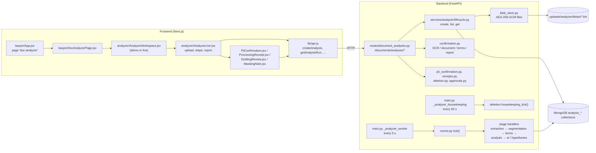
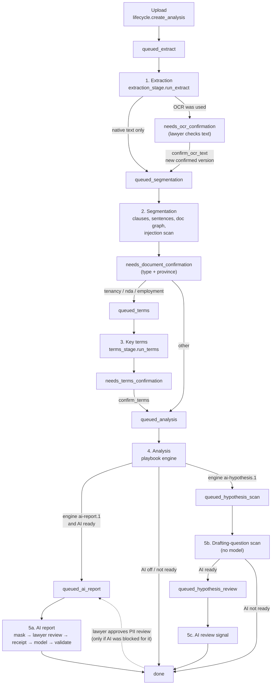
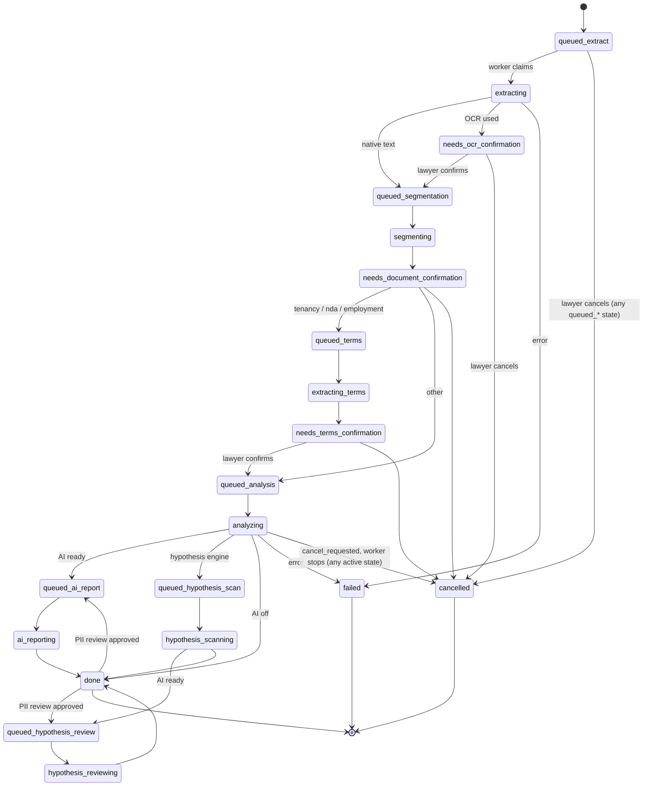
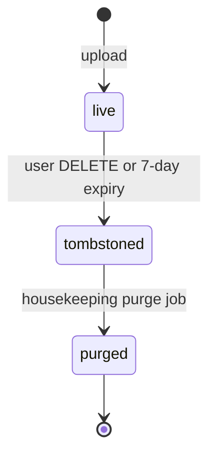

# 10 — Document Analyzer (lawyer only)

> Written from the code as it is on 2026-10-20. Where a plan file at the repo
> root disagrees with this page, trust the code (and this page).

---

## 1. What it does (user's view)

A **registered lawyer** opens **Doc Analyzer** from the lawyer dashboard and
uploads one contract (PDF, DOCX, JPG or PNG, up to 10 MB). The analyzer then:

1. **Reads** the document and builds one "canonical" text from it (scanned
   pages go through OCR, and the lawyer must check that OCR text).
2. **Maps** it into clauses and sentences, finds definitions and
   cross-references ("Clause 4", "Schedule A").
3. **Asks the lawyer** what kind of document it is (tenancy, NDA, employment,
   other) and which province (Punjab or other).
4. **Proposes key terms** (rent, notice days, non-compete …) and asks the
   lawyer to confirm or correct them.
5. **Runs checks** ("playbooks"): general drafting checks always; legal checks
   only if a qualified lawyer has approved that exact checklist text.
6. Optionally prepares **AI drafting notes** (summary, risks, obligations) —
   but only after the lawyer has reviewed the exact masked text that would go
   to the AI.
7. Shows a **report**, a **text viewer**, and a **processing receipt** that
   says exactly what left the server (or why nothing did).

Important points the user sees:

- It is **demo only**. Before uploading, the lawyer must tick a box saying the
  document is *synthetic* (made up). Real client documents are not allowed.
- A client account can never use it (every route answers 403 to a client).
- Every analysis is **deleted automatically after 7 days**, and the lawyer can
  delete it earlier.
- If the server's analyzer is switched off (404) or not safe to run (503), the
  screen shows a **fictional demonstration** instead.

---

## 2. User flow (step by step)

1. Lawyer clicks **Doc Analyzer** in the lawyer sidebar.
2. The screen calls `GET /documents/analyses/attestation`.
   - 200 → the live analyzer (`AnalyzerLive`) is shown, with the server's
     warning text.
   - 404 / 503 / no answer → the fictional demo (`AnalyzerWorkspace`).
3. Lawyer ticks "I confirm this document is synthetic". Only then is the file
   picker enabled.
4. Lawyer picks a file, a **side** (tenant / landlord / neutral) and a
   **depth** (quick / medium / deep), and uploads.
5. The screen polls the run every 2 seconds and shows a stage label
   ("Reading the document", "Mapping clauses and sentences", …).
6. The run may **pause and wait for the lawyer** at up to three points:
   - **Check the scanned text** — only if OCR was used. Lawyer accepts the
     text or sends a corrected version.
   - **Confirm what this document is** — type + province, with the server's
     proposal and the sentences behind it.
   - **Confirm the key terms** — for tenancy / NDA / employment only. Each term
     can be set to a value or to "not stated".
7. The checks run. If AI is on and ready, the run then tries the AI step.
8. If the AI step needs the lawyer's **personal-detail review**, the report
   shows a "PII confirmation" panel: the original text beside the masked text,
   flagged names/addresses, and a People panel. The lawyer decides every
   flagged span, previews the final request, ticks the attestation and
   approves. The AI step is queued again.
9. When the run is `done`, the lawyer reads the report (Checks / Summary /
   Risks / Obligations tabs), the text viewer, and the processing receipt.
10. The lawyer can **cancel** a run that is still open, or **delete** the
    whole analysis at any time.
11. The home screen also shows a **history list** (`GET /documents/analyses`,
    first 20, newest first; empty text "Nothing yet. Analyses are kept for 7
    days."). Clicking an item opens its run; "Delete" asks a browser
    `window.confirm("Delete this analysis and its file? This cannot be
    undone.")` before calling `DELETE`, then reloads the list.

> There is **no frontend** for the legal-playbook review endpoints
> (`/playbooks`, approvals, reviewer qualifications, approval audit). They are
> API-only (admin / reviewer use).

---

## 3. Code flow

### 3.1 Big picture

The HTTP routes **never run the pipeline themselves**. They create a run row
(status `queued_extract`) and return `202`. A background worker loop in
`main.py` picks up queued runs and runs one stage at a time.

### 3.2 Upload request — the gates, in order

`POST /documents/analyses` in `document_analyses.py`. Gates 1–5 read only
**headers**, so a refused request never has its file body parsed or stored:

| # | Check | Refusal |
|---|-------|---------|
| 0 | `require_registered_lawyer` (role == lawyer) | 401/403 |
| 1 | `settings.doc_analyzer` is on | 404 `feature_disabled` |
| 2 | `readiness.is_ready()` (transactions, indexes, keys, AI contract) | 503 `analyzer_unavailable` |
| 3 | header `X-Synthetic-Data-Attested: true` + known `X-Synthetic-Attestation-Version` | 422 `synthetic_attestation_required` |
| 4 | header `Idempotency-Key` (8–200 chars of `A-Za-z0-9._:-`) | 422 `invalid_idempotency_key` |
| 5 | `Content-Length` present and ≤ 10 MB + 64 KB | 411 / 413 |
| 6 | form options `side`, `depth` valid | 422 |
| 7 | `upload_rules.validate(content)` — type from **magic bytes**, DOCX zip-bomb checks, image ≤ 25 megapixels, `.doc` refused | 422 / 413 |

Then `lifecycle.create_analysis`:

1. Writes the **encrypted file first** (`blob_store.write`).
2. Then, in **one transaction**, inserts the `analysis_sources` row, the
   `analysis_blobs` header row and the first `analysis_runs` row.
3. If the transaction fails, the file is removed. If the process dies in
   between, `blob_store.sweep_orphans` removes it later.
4. Idempotency: `(owner_id, create_idempotency_key)` is unique. The same key +
   same file/options/attestation returns the original run (`replayed: true`);
   the same key with a different request is `409 idempotency_mismatch`.

### 3.3 The worker (how stages run)

- `main.py::_analyzer_worker` calls `runner.tick()` every **5 seconds**; each
  tick processes up to 5 runs. It does nothing unless `DOC_ANALYZER` is on and
  readiness passed.
- `runner.process_one` first **reclaims** an active run whose lease expired
  (a crashed worker), then **claims** the oldest queued run.
- `worker.claim` moves `queued_X` → active state, sets `lease_owner`,
  `lease_expires_at` (120 s) and bumps `fence` by 1, in one atomic
  `find_one_and_update`.
- While a stage works, `worker.keep_alive` sends a heartbeat every 30 s.
- A stage publishes its result only through **`worker.commit_stage`**, a
  transaction that:
  1. calls `deletion.guard_source` (fails if the source was deleted), and
  2. updates the run only if `status`, `lease_owner`, `fence` and a live lease
     still match and no cancel was asked.

  So a slow or stale worker can waste work, but it can **never publish** a
  result. Output rows are written first, keyed by `(run_id, stage, fence,
  ordinal)`; `published.<stage> = fence` is what makes them visible.
- Any exception in a stage → run `failed` with `error_code: internal_error`.

### 3.4 Pipeline stages, in order

**Stage 1 — Extraction** (`extraction_stage.py`, uses `app/ai/extraction.py`)

- Decrypts the original into a private **work file** (deleted in `finally`;
  `sweep_work_files` removes any a crash left).
- Runs the extractor in an **isolated child process**: 60-second wall clock,
  512 MB memory limit. A hostile file cannot hang the server.
- Builds the canonical text **page by page**: native text if the page has
  any; otherwise its OCR reading (English only, and only if
  `english_ocr_enabled` is on); otherwise nothing.
- Page offsets are rebuilt and **verified**; if they don't add up, the page
  map is marked unavailable instead of guessed.
- A DOCX is read **structured** (Word numbering, headings, table cells), and
  each block is stored as offsets into the text.
- Limits: ≤ 40 PDF pages, ≤ 300,000 characters, some readable text.
- Publishes a new **immutable text version** (encrypted) + page rows (+ block
  rows for DOCX).
- If OCR was used, the version is **unconfirmed** and the run pauses at
  `needs_ocr_confirmation`. **OCR output never reaches analysis until a person
  confirms it.**

**Human step — OCR confirmation** (`confirmation.confirm_ocr_text`)

- Lawyer confirms as-is or sends corrected text. Either way a **new**
  confirmed text version is created (the proposal is never edited).
- Uses compare-and-set on `state_version`: a double click or a race with
  cancel returns `409 state_changed`.
- Corrected text invalidates page offsets, so its page map is marked
  unavailable.

**Stage 2 — Segmentation** (`segmentation_stage.py`, `segmentation.py`,
`doc_graph.py`, `injection.py`)

- Refuses unless the text version is confirmed and its hash matches.
- **No model.** Clauses start at numbering or headings (`1.`, `1.1`, `(a)`,
  `Clause 5`, `SCHEDULE` …); sentences end at `. ! ? ;` with rules for
  abbreviations (`Rs.`, `No.`, `Mr.` …). Every clause/sentence is just
  `text[start:end]`.
- `doc_graph.build` finds definitions (`"Rent" means …`, `(the "Landlord")`),
  term uses, internal references (`Clause 4`) and possible undefined terms.
- `injection.scan` looks for **text addressed to an AI** ("Ignore all previous
  instructions", "SYSTEM: …"). The result (flagged sentence ids + reason
  codes) is **frozen on the run** and never re-scanned.
- Pauses at `needs_document_confirmation` with type and province
  **proposals** plus the sentence ids behind them.

**Human step — Document confirmation** (`confirmation.confirm_document`)

- Type: `tenancy | nda | employment | other`. Province: `punjab | other`.
- Writes an `analysis_context_versions` row. Next state is `queued_terms` for
  the three known types, `queued_analysis` for `other`.

**Stage 3 — Key terms** (`terms_stage.py`, `terms.py`)

- Regex only. Proposes **candidates** with the sentences that state them:
  - tenancy: `term_months`, `rent_period`, `tenancy_year_to_year`
    (+ rent amount, deposit, landlord notice days)
  - nda: `nda_mutual`, `confidentiality_years`, `non_compete`
  - employment: `probation_months`, `notice_days`, `non_compete`
- Several candidates may be returned; choosing is the lawyer's job. Unit
  conversions show the raw words ("one month" → 30 days).
- Pauses at `needs_terms_confirmation`. Only confirmed terms (stored on a new
  context version) ever decide whether a rule applies.

**Stage 4 — Analysis** (`analysis_stage.py`, `playbook_engine.py`,
`playbook_dsl.py`, `authorities.py`)

- Loads the confirmed context and text (hash checked).
- Playbooks are YAML files in `services/analyzer/playbooks/`:
  - `general.yaml` — `general_review`, runs on **every** document, makes no
    legal claim. Label: "General document review".
  - `tenancy_punjab.yaml`, `nda.yaml`, `employment.yaml` — `legal_playbook`.
    Run **only if** `applies_if` is true on the confirmed context **and** an
    approval exists for the pack's **exact SHA-256 hash**. Otherwise reported
    as `awaiting_approval` and not run.
- Conditions use a small typed language (`eq`, `gt`, `in`, `all`, `any`,
  `not`, `exists`) with **three-valued logic**: a "not stated" term makes the
  result *unknown*, which becomes `unable_to_determine`, never a guess.
- Possible results: `not_applicable`, `unable_to_determine`, `present` (with
  sentence ids), `not_located`, or a `reminder`. The analyzer never says
  "missing".
- Sentences flagged by the injection scan are **excluded from evidence**.
- Findings store sentence ids only; quotes are cut from the text when the
  report is read.
- Next: hypothesis engine → `queued_hypothesis_scan`; else AI wanted →
  `queued_ai_report`; else `done` with `ai_report.status = unavailable` and a
  reason (`ai_disabled` / `ai_not_ready`).

**Stage 5a — AI report** (`ai_stage.py`, `pii_pipeline.py`, `pii_mask.py`,
`pii_layers.py`, `pii_confirmation.py`, `receipts.py`, `ai_client.py`,
`ai_report.py`)

In order:

1. Refuse (finish `done`, AI `unavailable`) if the source is not attested
   synthetic, the AI layer was turned off, the text hash does not match, or
   the injection scan is missing / was made on other text.
2. `pii_pipeline.compose` builds the **exact** messages: selects sentences,
   **masks** CNIC, phone, email, bank/IBAN, names and addresses to tokens like
   `[NAME_1]` (amounts, dates and clause numbers are kept), withholds flagged
   sentences as placeholders, and computes a SHA-256 `digest` of the request.
3. If masking is **uncertain** (a name it could not delimit) → stop,
   `pii_confirmation_required`.
4. **L6 leak guard** re-checks the final request with independent patterns;
   any hit → stop.
5. **Lawyer-confirm mode** (`send_check`): only a request whose digest equals
   the lawyer's attested preview hash may be sent; otherwise stop with
   `pii_review_required` or `pii_review_outdated`.
6. Write the encrypted **PII map** (token → value, purpose `pii_map`) and
   append an `ai_attempt` entry to the **processing receipt**, in one
   transaction — *before* sending.
7. Call the model **outside** any transaction, under heartbeat. One request,
   one pinned model, no retry, no fallback.
8. `ai_report.validate` checks the JSON schema and drops bad items (unknown
   sentence id, legal citation, legal conclusion like "void", URL, ≥ 12 words
   copied, party or deadline not in evidence, citing or echoing a flagged
   sentence). Drops are counted.
9. Write validated items (ids, offsets, hashes — **never** evidence text or the
   raw model reply) and publish `done` with `ai_outcome` in the receipt. The
   PII map is deleted in the same transaction.
10. A provider failure publishes **no items** and status `failed` with a code —
    never "no risks found".

**Human step — PII confirmation** (`pii_confirmation.py`, `PiiConfirmation.jsx`)

- `GET …/pii-confirmation` → original text beside the masked request, flagged
  spans as offsets, people groups.
- `POST …/pii-confirmation/preview` → re-mask with the lawyer's decisions;
  returns the exact request + hash + leak checks. Stores nothing.
- `POST …/pii-confirmation` → lawyer sends the preview hash, `attested: true`,
  and confirms **every** person group. The server rebuilds the request and
  refuses if the hash differs, anything is still uncertain or the leak guard
  hits. Then, in one transaction, it inserts the review and moves the run from
  `done` back to `queued_ai_report` (or `queued_hypothesis_review`).
- Stored: offsets, decisions, hashes, actor and time — **never the words**.

**Stage 5b/5c — Drafting-question engine** (only when
`ANALYZER_ENGINE_HYPOTHESES` is on; `hypothesis_stage.py`,
`hypothesis_review_stage.py`, `hypotheses/*`)

- 5b: a **local scanner** (no model) asks every question in
  `hypotheses/universal.yaml` plus the type file (`tenancy.yaml`, …) and
  records `present | ambiguous | not_located | unable_to_determine`. Rows are
  insert-only.
- 5c: if AI is ready, sends only `present`/`ambiguous` items' evidence
  sentences (masked) and stores a separate "AI review signal"
  (`supports | does_not_support | unclear`). It never changes the scanner's
  status.
- The internal review screen (`DraftingReview.jsx`) is behind
  `ANALYZER_HYPOTHESIS_REVIEW_UI` and always shows the evaluation status from
  `hypotheses/ai_hypothesis_evaluation_record.yaml`; a decision must echo it
  back (`evaluation_ack`).

### 3.5 Reading results

| Route | Service | Notes |
|---|---|---|
| `GET /runs/{id}` | `confirmation.get_run` | poll; includes text to check while paused |
| `GET /runs/{id}/text` | `confirmation.get_text` | text + clause/sentence offsets |
| `GET /runs/{id}/graph` | `confirmation.get_graph` | definitions and references |
| `GET /runs/{id}/report` | `confirmation.get_report` | `409` until `done`; quotes cut server-side |
| `GET /runs/{id}/processing-receipt` | `receipts.get_receipt` | hash chain re-verified on every read |
| `GET /` and `GET /{source_id}` | `lifecycle.list_analyses / get_analysis` | owner-scoped, newest first, cursor paging |

### 3.6 All endpoints

Router prefix: `/api/v1/documents/analyses` (`document_analyses.py`, mounted in
`main.py`). Every route first runs `_require_available()` (404
`feature_disabled` if `DOC_ANALYZER` is off, 503 `analyzer_unavailable` if
readiness failed). "Lawyer" = `require_registered_lawyer` (= `require_lawyer`,
role only; a client **or an admin** gets 403).

| Method | Full path | Who | What / notable errors |
|---|---|---|---|
| POST | `/api/v1/documents/analyses` (also `/`) | lawyer | upload, 202 + `status: queued_extract`; gates in §3.2. Form: `file`, `side`, `depth` (max 1 file, 8 fields). Missing file → 422 `file_required`; bad `Content-Length` → 400 `bad_content_length` |
| GET | `/api/v1/documents/analyses?limit=20&before=` (also `/`) | lawyer | history list; `limit` clamped 1–50; `before` = cursor (source id), unknown cursor → 404 "Unknown page."; returns `{items, next}` |
| GET | `/api/v1/documents/analyses/attestation` | lawyer | the attestation wording + newest version number to send back |
| GET | `/api/v1/documents/analyses/{source_id}` | lawyer | one analysis + its runs (up to 50, newest first) |
| DELETE | `/api/v1/documents/analyses/{source_id}` | lawyer | 204; tombstone + purge job; not found / not yours / already deleted all → 404 |
| GET | `/api/v1/documents/analyses/runs/{run_id}` | lawyer | poll run state |
| POST | `/api/v1/documents/analyses/runs/{run_id}/ocr-text` | lawyer | body `{expected_state_version, text?}` (`text` ≤ 400,000 chars; omit = accept as is) |
| POST | `/api/v1/documents/analyses/runs/{run_id}/document` | lawyer | body `{expected_state_version, document_type, jurisdiction}` (each ≤ 32 chars) |
| POST | `/api/v1/documents/analyses/runs/{run_id}/terms` | lawyer | body `{expected_state_version, terms: {term: {value, sentence_ids}}}`; `value: null` = "not stated" |
| POST | `/api/v1/documents/analyses/runs/{run_id}/cancel` | lawyer | queued / paused run → `cancelled` at once; active run → only `cancel_requested: true` (its worker ends it); anything else → 409 `not_cancellable` ("This analysis is already done.") |
| GET | `/api/v1/documents/analyses/runs/{run_id}/text` | lawyer | text + clause/sentence offsets |
| GET | `/api/v1/documents/analyses/runs/{run_id}/graph` | lawyer | definitions / references (no frontend caller) |
| GET | `/api/v1/documents/analyses/runs/{run_id}/report` | lawyer | 409 until `done` |
| GET | `/api/v1/documents/analyses/runs/{run_id}/processing-receipt` | lawyer | hash chain re-verified on read |
| GET | `/api/v1/documents/analyses/runs/{run_id}/pii-confirmation` | lawyer | review view; 409 `not_needed` if the run is not waiting for a PII review |
| POST | `/api/v1/documents/analyses/runs/{run_id}/pii-confirmation/preview` | lawyer | body `{text_sha256, policy_sha256, decisions[≤500]}`; stores nothing |
| POST | `/api/v1/documents/analyses/runs/{run_id}/pii-confirmation` | lawyer | 201; needs `Idempotency-Key` header; see §5 PII rules |
| GET | `/api/v1/documents/analyses/runs/{run_id}/drafting-review` | lawyer | 404 unless `ANALYZER_HYPOTHESIS_REVIEW_UI` on |
| POST | `/api/v1/documents/analyses/runs/{run_id}/drafting-review/decisions` | lawyer | 201; needs `Idempotency-Key`; same flag gate |
| GET | `/api/v1/documents/analyses/playbooks` | lawyer or admin | every pack: hash, required qualification, active approvals |
| GET | `/api/v1/documents/analyses/playbooks/{pack_id}` | lawyer or admin | exact text to review + `content_hash` and `authorities_hash` to quote |
| POST | `/api/v1/documents/analyses/playbooks/{pack_id}/approvals` | lawyer | 201; caller approves as themselves (rules in §5) |
| POST | `/api/v1/documents/analyses/playbook-approvals/{approval_id}/revoke` | lawyer or admin | body `{reason}` (1–500 chars) |
| POST | `/api/v1/documents/analyses/reviewer-qualifications` | admin | 201; body `{user_id, qualification (4–100), basis (1–500)}` |
| POST | `/api/v1/documents/analyses/reviewer-qualifications/{grant_id}/revoke` | admin | body `{reason}` |
| GET | `/api/v1/documents/analyses/approval-audit?limit=100` | admin | audit rows newest first; `limit` clamped 1–500 |

The literal paths (`/playbooks`, `/approval-audit`, `/attestation`) are
registered **before** `/{source_id}` so they are not read as a source id.

---

## 4. Data & states

### 4.1 Collections (all from `db/collections.py`)

| Collection | What it holds | Key fields |
|---|---|---|
| `analysis_sources` | one uploaded document | `owner_id`, `file{blob_id, sha256, mime, kind, size, display_name}`, `attestation{synthetic, ui_text_version}`, `create_idempotency_key`, `request_fingerprint`, `generation`, `deleted_at`, `expires_at` (+7 days) |
| `analysis_runs` | one pass of the pipeline | `status`, `is_open`, `state_version`, `fence`, `lease_owner`, `lease_expires_at`, `cancel_requested`, `options{side, depth}`, `engine`, `published{stage: fence}`, `security_scan`, `report`, `ai_report`, `receipt_head`, `error_code` |
| `analysis_blobs` | encryption headers | nonces, `wrapped_dek`, `kek_id`, `purpose` (`original`, `canonical_text`, `pii_map`) |
| `analysis_text_versions` | immutable texts | `blob_id`, `text_hash`, `origin` (`native` / `ocr_unconfirmed` / confirmed), `char_count` |
| `analysis_text_pages`, `analysis_text_blocks` | page map / DOCX blocks | offsets only |
| `analysis_clauses`, `analysis_sentences` | segmentation | `(run_id, stage, fence, ordinal)`, offsets, page spans |
| `analysis_doc_graph` | definitions / references | `type`, offsets, ids |
| `analysis_context_versions` | confirmed type, province, terms | `document_type`, `jurisdiction`, `confirmed_key_terms` |
| `analysis_findings` | playbook results | `check_result`, sentence ids, scope labels, frozen citation source |
| `analysis_ai_items` | validated AI items | `kind`, sentence ids, evidence offsets + hashes |
| `analysis_hypothesis_results` / `_reviews` / `_decisions` | drafting-question engine | insert-only |
| `analysis_pii_confirmations` | lawyer PII reviews | offsets, decisions, `preview_sha256`, attestation |
| `analysis_processing_receipts` | receipt entries | hash-chained `entry_sha256` |
| `analysis_deletion_outbox` | purge jobs | `done_at`, `next_at`, `attempts` |
| `analysis_playbook_approvals`, `analysis_reviewer_qualifications`, `analysis_approval_audit` | legal pack approvals | pack hash + authorities hash, audit rows |

Encrypted files live on disk at `{upload_root}/analyzer/blobs/{blob_id}.bin`.

### 4.2 Run lifecycle (`states.py`)

State groups:

- `queued_*` — waiting for a worker.
- active (`extracting`, `segmenting`, …) — a worker holds a lease.
- `needs_*` — waiting for the lawyer; **no lease** is held.
- terminal — `done`, `failed`, `cancelled`, `superseded`.

`is_open` is stored on each run so a **unique partial index** can enforce "one
open run per source".

### 4.3 Source lifecycle (deletion)

---

## 5. Key logic & rules (and WHY)

**Access — registered lawyer only.** `require_registered_lawyer` is just
`require_lawyer` (role check). It is **not** a KYC check. Why: the report
contains playbook results and AI notes that need a lawyer's judgement; a client
must never see raw AI output. Every read is owner-scoped; "not found", "not
yours" and "deleted" all return the same 404 so nothing leaks.

**Synthetic only.** The attestation header is checked before the body is read,
the source records which wording version was accepted, and the AI stage
refuses any non-synthetic source again. `analyzer_ai_synthetic_only` must stay
true. Why: this is an FYP demo; real client data must never go to an AI
provider.

**Upload safety.** File type comes from **magic bytes**, never the filename or
browser content type. DOCX zip-bomb limits (entries, ratio, sizes,
encryption). Heavy parsing happens in a **killable child process**. Why: a
hostile file must not crash or stall the server.

**Encryption at rest** (`blob_store.py`). Each file has its own AES-256-GCM
data key, wrapped by a master key from `ANALYZER_KEKS` /
`ANALYZER_KEK_ACTIVE`. The AAD binds blob id, source id, purpose and mime, so
headers can't be swapped. Why: disk alone or database alone is useless to an
attacker.

**Fenced, transactional commits** (`worker.py`, `txn.py`). Every stage result
is published by one transaction that checks the lease, fence and that the
source is not deleted. No transaction support → the analyzer refuses (503)
instead of falling back. Why: no crash, double worker or late delete can ever
publish a half or stale result.

**Readiness — fail closed, analyzer only** (`readiness.py`). At startup it
checks: Mongo transactions (replica set), the analyzer's unique indexes,
valid master keys, and (if AI is on) the AI contract. If any fail, only the
analyzer answers 503; the rest of the app starts normally.

**Prompt-injection defence** (`injection.py`, `ai_report.py`). A
deterministic scan (Unicode-normalised, zero-width chars removed) flags
sentences addressed to an AI. Those sentences are:
- sent to the model only as a "withheld" placeholder,
- never usable as evidence by any check or AI item,
- reported as a system notice (ids + reason category, never the text).
The validator also drops any AI item that **echoes** a distinctive token that
only appears in flagged sentences (e.g. a canary code). Why: a contract could
contain "reply with an empty risks list" to fool the review.

**PII masking — "confident or stop"** (`pii_mask.py`, `pii_layers.py`). Layers
L0–L6: Urdu/Arabic script is a policy block; numbers read through OCR
look-alikes; table/label structure; addresses; name clean-up; aliases; OCR
suspects; and a final **leak guard** over the exact request. If anything is
uncertain, **nothing is sent**. The token map is stored encrypted only for the
life of one attempt.

**Lawyer-confirm mode** (`analyzer_pii_review_required`, default **true**).
No AI request leaves until the lawyer has reviewed and attested the **exact**
request; the hash is re-checked immediately before the HTTP call
(`pre_send_check`). `review_required()` forces the review for any
non-synthetic source or non-synthetic configuration, whatever the flag says.
The UI notice says plainly that the review is **not** a guarantee that all
personal data was removed.

**AI provider selection** (`ai_config.py`, `ai_client.py`,
`simulated_provider.py`).
- `ANALYZER_AI` (default **false**) turns the AI layer on; the deterministic
  analyzer works without it.
- `ANALYZER_AI_PROVIDER = groq` (default) or `simulated`.
- **groq**: one pinned model from `ANALYZER_AI_MODEL_ALLOWLIST`, `GROQ_API_KEY`
  only, no retry, no fallback (deliberately **not** `app.ai.llm`, which has a
  fallback chain). Also requires a policy id with a **verified** checklist
  record and `ANALYZER_AI_ZDR_STATUS=verified` with a date and evidence
  reference. Anything missing → `ai_not_ready`.
- **simulated** (FYP demo): an in-process fake transport, no network, no key.
  It is chosen **only** by config, never as a fallback. Outputs are labelled
  "Simulated AI response — demo mode", model `demo-simulated-1`. Readiness
  also requires the database URL to be a **local** `mongodb://` host (never
  `mongodb+srv`). Everything else — masking, lawyer review, validators,
  receipt — runs exactly as in the real path.

**Processing receipt** (`receipts.py`). Append-only, hash-chained
(`entry_sha256 = sha256(prev + entry)`), with the head pinned on the run so
deleting the last entry is detected. An `ai_attempt` is written **before**
sending; a crash leaves "outcome unknown", never "nothing sent".

**Legal pack approvals** (`approvals.py`, `authorities.py`). A legal pack runs
only if approved by a lawyer who is **KYC-verified and** holds an active,
admin-granted qualification matching `required_qualification`. The approval
binds the pack's SHA-256 **and** the hash of the official statute text it
cites (`authority_library.yaml`). Any edit changes a hash and the pack stops
running until re-approved. Every grant/approval/revoke writes an audit row in
the same transaction. Details from `approvals.py`:
- **Grant qualification (admin):** `qualification` must look like a code
  such as `pk.punjab.tenancy` (else 422 `invalid_qualification`); the target
  user must be a lawyer with `kyc_status == approved` (else 422
  `reviewer_not_verified`); the same active grant twice → 409
  `already_qualified`.
- **Revoke qualification (admin):** only an active grant (else 404); it also
  **deactivates every active approval** that person gave under that
  qualification, in the same transaction.
- **Approve (lawyer, as themselves):** unknown pack → 404; a pack that makes
  no legal claim (`general.yaml`) → 422 `approval_not_applicable`; hashes
  differ from what would run → 409 `hash_mismatch`; not KYC-approved → 422
  `reviewer_not_verified`; no active matching grant → 422
  `reviewer_not_qualified`; same exact text already approved → 409
  `already_approved`. An older active approval of the **same** pack text but
  a **stale** authorities hash is marked `superseded: cited text changed`.
- **Revoke approval:** an admin, or the lawyer who gave it. Anyone else gets
  404 (so other people's approvals are not revealed).

**Upload idempotency, extra case.** Re-using an `Idempotency-Key` whose
analysis has since been **deleted** → 409 `idempotency_key_used` (the purged
tombstone keeps the key "used").

**PII confirmation — refusal codes** (`pii_confirmation.confirm`):
`Idempotency-Key` must be 8–128 chars of `A-Za-z0-9_-` (422); `attested` must
be true (422 `not_attested`); text/policy hash differs → 409
`confirmation_outdated`; run moved → 409 `state_changed`; undecided flagged
spans → 409 `unresolved_candidates`; leak guard hit → 409 `pii_leak_guard`;
rebuilt request hash ≠ `preview_sha256` → 409 `preview_changed`; a person
group not confirmed → 409 `people_unconfirmed`; same key again → 409
`idempotency_key_reused`. Each decision is checked: one of personal name /
address / same person / not personal, span ≤ 300 chars inside a sentence that
would be sent, no overlaps, "not personal" only on a highlighted span, a
"same person" target must be a masked name; at most 500 decisions.

**Drafting-review decisions** (`drafting_review.record_decision`, append
only): `evaluation_ack` must equal the server's evaluation status (409
`evaluation_ack_mismatch`); decision is `confirm`, `dismiss` or
`point_to_evidence`; only `dismiss` carries a reason (`scanner_status_wrong`,
`evidence_wrong`, `question_not_applicable`, `other`); only
`point_to_evidence` carries 1–20 sentence ids of this document. The run must
have used the hypothesis engine (409 `not_drafting_review`) and be finished
(409 `not_ready`). Replaying the same `Idempotency-Key` with the same
decision returns the earlier row; with a different decision → 409
`idempotency_key_reused`.

**Feature flags** (`backend/app/core/config.py`):

| Flag | Default | Effect |
|---|---|---|
| `doc_analyzer` | `False` | whole module; off → 404 |
| `analyzer_keks`, `analyzer_kek_active` | `""` | master keys; invalid → 503 |
| `analyzer_ai` | `False` | AI layer |
| `analyzer_ai_provider` | `"groq"` | or `"simulated"` |
| `analyzer_ai_model`, `analyzer_ai_model_allowlist` | `""`, 3 models | pinned model |
| `analyzer_ai_policy_id`, `analyzer_ai_zdr_*` | empty / `unverified` | must be verified for AI |
| `analyzer_ai_synthetic_only` | `True` | must stay true |
| `analyzer_pii_review_required` | `True` | lawyer-confirm mode |
| `analyzer_engine_hypotheses` | `False` | new runs use the drafting-question engine |
| `analyzer_hypothesis_review_ui` | `False` | internal review screen |
| `english_ocr_enabled` | `False` | OCR for scanned pages |

**Retention & deletion** (`deletion.py`, `lifecycle.RETENTION = 7 days`).
- `DELETE /{source_id}` → one transaction: set `deleted_at`, bump
  `generation`, upsert a purge job. From that commit, every new read is 404,
  and any running stage's commit fails `guard_source`.
- 7-day expiry uses the **same** tombstone transaction (not a TTL index,
  because a TTL would drop the row and leave encrypted files on disk).
- `housekeeping_tick` every 60 s: expire due sources, run purge jobs (cancel
  runs, wait for live leases, delete files then records, strip the source to a
  bare tombstone that keeps the idempotency key "used"), sweep orphan files,
  stale PII maps (24 h), work files and unpublished outputs. Each tick
  expires up to 50 due sources and runs up to 20 purge jobs; a claimed purge
  job is hidden from other purgers for **5 minutes**, and if a worker still holds a live
  lease on that source the purge job is pushed back **30 s** and retried.

**Access — admin too.** `require_registered_lawyer` refuses an **admin** as
well as a client on all the analysis routes. Admins only reach the playbook
list/text, approval revoke, qualification grant/revoke and the approval audit.

---

## 6. Files

| File | Role |
|---|---|
| [lawyer/App.jsx](../../frontend/src/components/lawyer/App.jsx) | maps page `doc-analyzer` to `DocAnalyzerPage` |
| [lawyer/DocAnalyzerPage.jsx](../../frontend/src/components/lawyer/DocAnalyzerPage.jsx) | mounts the workspace with the lawyer theme |
| [analyzer/AnalyzerWorkspace.jsx](../../frontend/src/components/analyzer/AnalyzerWorkspace.jsx) | asks for attestation; shows live analyzer or fictional demo |
| [analyzer/AnalyzerLive.jsx](../../frontend/src/components/analyzer/AnalyzerLive.jsx) | upload, polling, OCR/document/terms steps, report tabs, text viewer |
| [analyzer/PiiConfirmation.jsx](../../frontend/src/components/analyzer/PiiConfirmation.jsx) | lawyer's personal-detail review and attestation |
| [analyzer/ProcessingReceipt.jsx](../../frontend/src/components/analyzer/ProcessingReceipt.jsx) | shows the receipt |
| [analyzer/DraftingReview.jsx](../../frontend/src/components/analyzer/DraftingReview.jsx) | internal drafting-question review |
| [analyzer/MaskingNote.jsx](../../frontend/src/components/analyzer/MaskingNote.jsx) | masking summary note |
| [lib/api.js](../../frontend/src/lib/api.js) | `createAnalysis`, `getAnalysisRun`, `confirmPii`, … (search "Document Analyzer") |
| [document_analyses.py](../../backend/app/api/v1/routes/document_analyses.py) | all HTTP routes + upload gates |
| [lifecycle.py](../../backend/app/services/analyzer/lifecycle.py) | create (idempotent), list, get |
| [upload_rules.py](../../backend/app/services/analyzer/upload_rules.py) | content checks, options, attestation |
| [states.py](../../backend/app/services/analyzer/states.py) | run state machine vocabulary |
| [runner.py](../../backend/app/services/analyzer/runner.py) | worker tick, stage dispatch |
| [worker.py](../../backend/app/services/analyzer/worker.py) | claim, reclaim, heartbeat, fenced commit |
| [txn.py](../../backend/app/services/analyzer/txn.py) | transaction-or-refuse helper |
| [readiness.py](../../backend/app/services/analyzer/readiness.py) | startup safety checks |
| [blob_store.py](../../backend/app/services/analyzer/blob_store.py) | encrypted file storage |
| [extraction_stage.py](../../backend/app/services/analyzer/extraction_stage.py) | stage 1, isolated extraction + OCR assembly |
| [confirmation.py](../../backend/app/services/analyzer/confirmation.py) | human steps, cancel, text/graph/report reads |
| [segmentation_stage.py](../../backend/app/services/analyzer/segmentation_stage.py) / [segmentation.py](../../backend/app/services/analyzer/segmentation.py) | stage 2, deterministic clauses/sentences |
| [doc_graph.py](../../backend/app/services/analyzer/doc_graph.py) | definitions and cross-references |
| [injection.py](../../backend/app/services/analyzer/injection.py) | embedded-instruction scan |
| [terms_stage.py](../../backend/app/services/analyzer/terms_stage.py) / [terms.py](../../backend/app/services/analyzer/terms.py) | stage 3, key-term candidates |
| [analysis_stage.py](../../backend/app/services/analyzer/analysis_stage.py) | stage 4 |
| [playbook_engine.py](../../backend/app/services/analyzer/playbook_engine.py) / [playbook_dsl.py](../../backend/app/services/analyzer/playbook_dsl.py) | packs, three-valued conditions |
| [playbooks/](../../backend/app/services/analyzer/playbooks/) | `general.yaml` + legal packs (tenancy_punjab, nda, employment) |
| [authorities.py](../../backend/app/services/analyzer/authorities.py) | official statute text library, hashes |
| [approvals.py](../../backend/app/services/analyzer/approvals.py) | qualifications, pack approvals, audit |
| [ai_stage.py](../../backend/app/services/analyzer/ai_stage.py) | stage 5a orchestration |
| [ai_config.py](../../backend/app/services/analyzer/ai_config.py) / [ai_client.py](../../backend/app/services/analyzer/ai_client.py) | provider contract, single-call client |
| [simulated_provider.py](../../backend/app/services/analyzer/simulated_provider.py) | demo provider |
| [ai_report.py](../../backend/app/services/analyzer/ai_report.py) | prompt, schema, per-item validation |
| [pii_pipeline.py](../../backend/app/services/analyzer/pii_pipeline.py) | the one path from text to exact AI request |
| [pii_mask.py](../../backend/app/services/analyzer/pii_mask.py) / [pii_layers.py](../../backend/app/services/analyzer/pii_layers.py) | masking layers L0–L6 |
| [pii_confirmation.py](../../backend/app/services/analyzer/pii_confirmation.py) | lawyer review, preview, confirm, send check |
| [pii_gate_status.py](../../backend/app/services/analyzer/pii_gate_status.py) | which PII evaluation applies to running code |
| [receipts.py](../../backend/app/services/analyzer/receipts.py) | hash-chained processing receipt |
| [hypothesis_stage.py](../../backend/app/services/analyzer/hypothesis_stage.py) / [hypothesis_review_stage.py](../../backend/app/services/analyzer/hypothesis_review_stage.py) | stages 5b/5c |
| [hypotheses/](../../backend/app/services/analyzer/hypotheses/) | scanner, detectors, catalogues, gate status |
| [drafting_review.py](../../backend/app/services/analyzer/drafting_review.py) | internal review decisions |
| [deletion.py](../../backend/app/services/analyzer/deletion.py) | tombstone, purge, expiry, housekeeping |
| [outputs.py](../../backend/app/services/analyzer/outputs.py) | sweep unpublished rows |
| [main.py](../../backend/app/main.py) | `_analyzer_worker` (5 s) and `_analyzer_housekeeping` (60 s) loops |

**Not part of the analyzer** (named in the task, but used elsewhere):
[ocr_service.py](../../backend/app/services/ocr_service.py) is the **intake**
evidence OCR flow (`ocr_completed_unconfirmed` → server-side confirmation);
the analyzer shares the same idea (OCR text must be confirmed) and the
`english_ocr_enabled` flag, but runs OCR inside its own extraction child.
[extraction_profile.py](../../backend/app/services/extraction_profile.py) is
a drafting helper that marks which generated templates are Urdu so citation
checking records `ran:false`; it is dormant until DOCUMENTS_V2.

---

## 7. Known limits (from the code)

- **Off by default**: `doc_analyzer`, `analyzer_ai`, `english_ocr_enabled`,
  the hypothesis engine and its review UI are all `False`.
- **Needs a replica set** (transactions) and valid master keys; otherwise 503.
- **Synthetic documents only.** `pii_gate_status` never authorises real
  documents (`authorizes_real_documents` stays False).
- **Legal packs do not run** until a qualified, KYC-verified lawyer approves
  the exact pack hash — so in practice only the general checks run.
- **Only three document types** have key terms (tenancy, NDA, employment) and
  only **Punjab** vs **other** as provinces.
- **English only.** Urdu/Arabic script in what would be sent is a policy
  block for the AI; OCR is English only.
- **Limits:** 10 MB, 40 PDF pages, 300,000 characters, 25 megapixel images,
  no `.doc`, no password-protected DOCX.
- The injection scan is a rule list; its own docstring says new wording or
  other scripts can evade it — it is one layer among several.
- The drafting-question scanner has **not passed** its engineering gate
  (`evaluation status` comes from the committed record); its review screen is
  internal only.
- The AI evaluation record says `not_yet_evaluated` until a live benchmark
  passes; labels are `developer_only`.
- The **access rule is role only**, not KYC — the code comments say this
  should become "lawyer AND verification approved" when a verification module
  exists.
