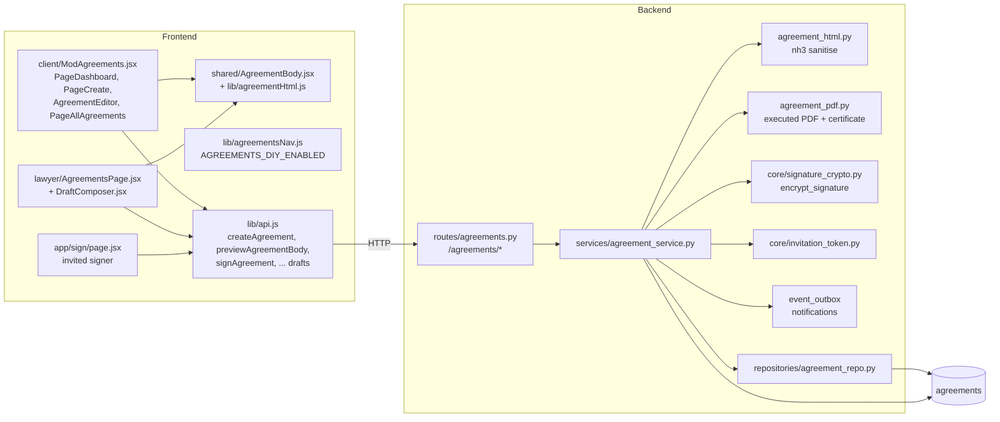
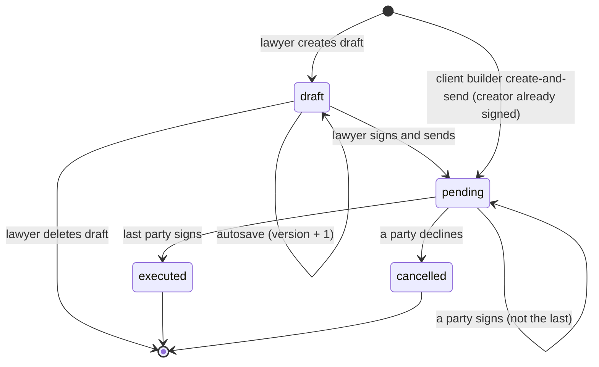

# 11 — Agreements (client builder, lawyer drafts, signing)

> Written from the code as it is on 2026-10-20. Plan files at the repo root
> (AGREEMENTS_PRODUCT_PLAN.md etc.) may be out of date; the code is the truth.

---

## 1. What it does (user's view)

The Agreements module lets people **write an agreement, sign it
electronically, send it to the other parties, and download the executed PDF**.

There are three "products" sharing one `agreements` collection:

| Product | Who writes it | Entry point | Status in code |
|---|---|---|---|
| **B — Client DIY builder** | a client (or any user) | `POST /agreements` | **Parked** behind `agreements_diy_builder_enabled` (default **off**). Has the new **rich editor** (`body_format: "html"`). |
| **C — Lawyer drafts** | a KYC-verified lawyer, for a client on one of their cases | `POST /agreements/drafts` … `/send` | Live. Body is **plain text**. |
| **Legacy engagement letters** | created by the old engagement flow | — | New engagements no longer create them, but existing ones stay viewable, signable and declinable. |

Everyone who is a party can **list**, **open**, **sign**, **decline**,
**archive** (hide from their own list) and, once executed, **download the PDF**.
People without an account can be **invited by email** and sign through a link
(`/sign` page).

---

## 2. User flow (step by step)

### 2.1 Client DIY builder (only when the flag is on)

1. Client opens **Agreements** in the client sidebar. Pages: Dashboard,
   Templates, Create, All Agreements. Templates/Create are hidden and
   unreachable while the builder is parked.
2. Client picks a template (or blank) → wizard step 0..3.
3. Client writes the body in the **rich editor** (toolbar: headings, bold,
   italic, underline, strike, lists, quote, divider, alignment, colour, size,
   four fonts, links).
4. Client adds **signers** (registered users or email addresses; up to 3
   parties including the creator).
5. At **Review** (step 3) the screen calls `POST /agreements/body-preview`.
   The server returns the **canonical, sanitised** HTML. *That* is what the
   client sees and what will be sent.
6. Client signs (draw / type / upload image), ticks consent, and clicks send.
   `POST /agreements` with `body_format: "html"` and an `Idempotency-Key`.
7. In **one transaction** the agreement is created with the creator already
   signed; other account parties get a notification (via outbox) and email;
   external parties get an invitation link by email.

### 2.2 Lawyer draft (Product C)

1. Lawyer opens a case → composes an agreement for that case's client
   (`DraftComposer`).
2. `POST /agreements/drafts` creates a **private draft** (only the lawyer sees
   it). Autosave uses `PATCH /agreements/drafts/{id}` with `expected_version`.
3. Lawyer clicks sign & send → `POST /agreements/drafts/{id}/send` with
   `expected_version`, `expected_body_sha256`, signature, consent and an
   `Idempotency-Key`. The draft becomes `pending` with the lawyer signed.
4. The client sees it in **All Agreements** and signs or declines.

### 2.3 Signing and after

1. A party opens the agreement (`GET /agreements/{id}`) — the body is shown
   with `AgreementBody` (HTML cleaned again in the browser, or plain text).
2. **Sign** → `POST /agreements/{id}/sign`. When the last party signs, the
   status becomes `executed` and all parties are notified.
3. **Decline** → `POST /agreements/{id}/decline` (optional reason) → status
   `cancelled`.
4. **Download** → `GET /agreements/{id}/pdf` (parties only, only executed).
5. **Invited signer** (no account) → the email link is
   `{frontend_url}/sign#token=…` (built in `utils/email.py`). The token is in
   the URL **fragment**, which browsers never send to a server. `app/sign/page.jsx`
   reads it into memory and immediately removes it from the address bar with
   `history.replaceState`, then sends it in the POST body to
   `/agreements/invitation/view` and `/invitation/sign`. No token → "This link
   is missing its signing token. Ask the sender for a new one." The page shows
   the body, who has signed / is pending, a signature pad and a consent
   checkbox (the Sign button stays disabled until both are given). After
   signing it says "Nothing further is needed from you."
6. The sender can **reissue** (new link, old one stops) or **revoke** an
   invitation. In the client UI, the agreement view has a reissue button that
   shows the new link **once**; there is **no UI for revoke** (API only).
7. **Archive** ("Remove from my list" in the client row menu) hides an
   agreement from the caller's own list; the **Archived** filter shows them and
   "Restore to my list" calls `/unarchive`. Client list filters: All, Signed,
   Pending, Rejected, Archived.

---

## 3. Code flow

### 3.1 Diagram

### 3.2 Rich body path (client builder) — step by step

1. `AgreementEditor` (in `ModAgreements.jsx`) edits HTML. A template's plain
   text is turned into paragraphs by `textToAgreementHtml` (every character
   escaped).
2. At Review: `previewAgreementBody(body)` → `POST /agreements/body-preview`
   → `agreement_service.preview_body` → `normalise_body` (line endings,
   refuse control characters) → `agreement_html.sanitise` (nh3 with an
   allowlist) → returns `{body_html, has_text}`. **Writes nothing.**
3. Send: `createAgreement({... body_format: "html"})` → `POST /agreements` →
   `create_and_send_agreement`:
   - flag check (`agreements_diy_builder_enabled`) → 403 if off;
   - `_resolve_parties` (2–3 parties, no duplicates, account or email);
   - optional `case_id` → `_authorise_case_link`;
   - refuse the unreviewed-template marker;
   - require `consent` and a known signature method;
   - `normalise_body` then **`canonical_html_or_refuse`**: if
     `sanitise(body) != body` → refused; if no visible text → refused;
   - `body_sha256 = sha256(body)`;
   - `_id = HMAC(secret, creator|idempotency_key)` → idempotent and
     unguessable;
   - one transaction: insert the agreement (creator signed, signature
     encrypted), park notifications in the outbox, add `invitation_created`
     audit entries;
   - after commit: email account parties and external invitees. Raw invitation
     tokens are returned once as `invitation_tokens_do_not_store`; only their
     **hashes** are stored.

### 3.3 Lawyer draft path

`create_draft` → `_require_verified_lawyer` (role lawyer, active,
`lawyer_profile.kyc_verified`) + `_require_case_relationship` → max 20 live
drafts → insert with `status: draft`, `version: 1`, `body_format:
"plain_text"`, `body_sha256: None`.

`update_draft` → optimistic concurrency on `version` (stale write refused, not
merged).

`sign_and_send_draft` → re-checks KYC and case relationship (they may have
lapsed), checks `expected_version` and `expected_body_sha256`, then one
transaction: `draft → pending`, creator signed, body hash stamped, audit
entry, notification parked. Rate limited.

### 3.4 Signing path

`submit_signature`: refuse drafts, executed, declined and expired agreements;
then a transaction that (a) conditionally marks *this* party signed (filter
`status: pending` and party not yet signed), (b) recomputes the agreement-level
`eto_classification` (the **weakest** signature), (c) sets `executed` if all
parties signed, (d) appends a `signed` audit entry with `body_sha256`, and (e)
parks notifications (`agreement_executed` to all, or "signed" to the others).

### 3.4b Decline, archive, invitations, draft delete

- `decline_agreement`: a draft → refused (author gets "This is still a
  draft…", anyone else 404); not a party → 403; already `executed` → 422
  "already fully executed and cannot be declined"; already `cancelled` → 422
  "already been declined". Reason (≤ 2000 chars) is trimmed; empty = none.
  One transaction re-checks party membership and updates only if the status
  is still `pending`, writes a `declined` audit entry (with reason and IP) and
  parks a notification to the other parties.
- `set_archived` (archive / unarchive): caller must be a party or the
  creator (else 403); `$addToSet` / `$pull` the caller's id in `archived_by`;
  nothing else changes.
- `revoke_invitation`: caller must be a party or the creator (403); sets
  `invite.revoked_at` only if not already revoked (else 422 "does not exist or
  was already withdrawn"); writes an `invitation_revoked` audit entry. A
  signature already made is **not** undone.
- `reissue_invitation`: **only the creator** (403 otherwise — a new token is
  bearer authority to sign that slot); agreement must be `pending` and not
  expired; party must be **external** (registered users never had a token, →
  404) and **unsigned** (422). The token hash is **replaced** (old link dies),
  expiry reset, `revoked_at` cleared (a reissue un-revokes), `invitation_reissued`
  audit entry; the update is conditional on the slot still being unsigned.
  Then the new link is emailed; the response carries the new token once
  (`invitation_tokens_do_not_store`) and `invitation_delivery`.
- `delete_draft`: not found → 404; not the author → 403; status not `draft`
  → 422 "has been sent and can no longer be deleted". Deleting frees a slot
  in the 20-draft cap.
- Invitation token lookups (`_party_for_token`): token < 20 chars or unknown →
  404 for everything; revoked → 403 "withdrawn by the sender"; expired → 403
  "has expired". The token is looked up by **hash** and compared in constant
  time. `invitation/view` returns only the title, body, format, hash, status,
  "you" (with `identity_verified: false`), each party's name + signed flag,
  and the link expiry — never other signatures, ids or the audit log.
- `create_draft` extra checks: `client_id` must differ from the lawyer ("An
  agreement needs two different parties."); a case is required; the case's
  `lawyer_id` must be the caller and its `client_id` the named client (403);
  an old executed engagement is **not** accepted as permission.

### 3.5 Executed PDF

`executed_pdf` → parties only, status must be `executed` → `agreement_pdf.
build_executed_pdf`: body (rich HTML rendered through
`agreement_html.pdf_blocks`, or plain text escaped with `P()`), then an
**evidence certificate**: who signed, how, server UTC time, IP when verifiable,
and the body digest. The download itself is recorded.

### 3.6 All endpoints

Router prefix `/api/v1/agreements` (`routes/agreements.py`). "User" =
`get_current_user` (any signed-in role); "Lawyer" = `require_lawyer`.

| Method | Full path | Who | Notes |
|---|---|---|---|
| POST | `/api/v1/agreements` | user | client builder create + sign + send; `Idempotency-Key` required (422 `missing_idempotency_key`); rate limit `agreement_send_rate_limit`; 403 while builder parked |
| POST | `/api/v1/agreements/body-preview` | user | canonical HTML `{body_html, has_text}`; writes nothing |
| GET | `/api/v1/agreements?page=1&page_size=20&status=&archived=false` | user | paginated `{items, total, page, page_size, pages}`; `page_size` 1–50; unknown `status` → 422; items carry **no** body, body hash, audit log or signature data |
| POST | `/api/v1/agreements/invitation/view` | **no auth** | body `{token}` (20–200 chars); limit `20/hour` |
| POST | `/api/v1/agreements/invitation/sign` | **no auth** | body `{token, method, signature_data, consent}`; limit `20/hour` |
| POST | `/api/v1/agreements/{id}/archive` | party / creator | hide from own list |
| POST | `/api/v1/agreements/{id}/unarchive` | party / creator | put back |
| GET | `/api/v1/agreements/{id}/pdf` | party | executed only; `inline` PDF, `Cache-Control: private, no-store`; download recorded |
| GET | `/api/v1/agreements/{id}` | party / creator | someone else's draft → 404 |
| POST | `/api/v1/agreements/{id}/sign` | party | body `{method, signature_data, consent}` |
| POST | `/api/v1/agreements/{id}/decline` | party | body `{reason?}` (≤ 2000) |
| POST | `/api/v1/agreements/{id}/invitations/{party_id}/reissue` | creator | send rate limit; returns new token once |
| POST | `/api/v1/agreements/{id}/invitations/{party_id}/revoke` | party / creator | no UI caller |
| POST | `/api/v1/agreements/drafts` | lawyer (+KYC, +case) | 201; body `{title, body_html, client_id, case_id}` |
| PATCH | `/api/v1/agreements/drafts/{id}` | lawyer (author) | autosave; `{expected_version ≥ 1, title?, body_html?}`; not rate limited |
| DELETE | `/api/v1/agreements/drafts/{id}` | lawyer (author) | drafts only; returns `{success, message: "Draft deleted"}` |
| POST | `/api/v1/agreements/drafts/{id}/send` | lawyer (author) | `Idempotency-Key` required; body `{expected_version, expected_body_sha256 (64 hex), method, signature_data, consent}`; send rate limit |

Field limits (`schemas/agreement.py`): title 1–300 chars, body 1–300,000,
signature data 1–200,000 (a base64 PNG), party `full_name` ≤ 200. Each party
is **either** `user_id` **or** `email`, never both or neither. Create models
use `extra="forbid"`, so an unknown field is a 422 rather than silently
ignored. Signature methods: `canvas`, `typed`, `image_upload`. `consent` must
be `true`.

---

## 4. Data & states

### 4.1 Collection `agreements` — key fields

| Field | Meaning |
|---|---|
| `_id` | random for drafts; HMAC-derived for create-and-send |
| `title`, `body_html` | the text (name is historical — may be plain text) |
| `body_format` | `"plain_text"` or `"html"` |
| `body_sha256` | SHA-256 of the stored body; `None` while a draft |
| `version` | draft optimistic-lock counter |
| `status` | `draft`, `pending`, `executed`, `cancelled` |
| `parties[]` | `user_id` or external `{party_id, email, invite{token_hash, expires_at}}`, `signed`, `signed_at`, `signature_method`, `signature_data` (encrypted), `eto_classification`, `consent_at` |
| `eto_classification` | a **neutral description** of the weakest signature ("Typed name", "Signature drawn in browser", …) |
| `case_id`, `engagement_id` | optional links |
| `audit_log[]` | `created`, `sent`, `signed`, `declined`, `invitation_created`, `invitation_emailed` / `invitation_email_failed`, `invitation_reissued`, `invitation_revoked`, … each with actor, server time, IP (if verifiable) and `body_sha256` |
| `idempotency_receipts` | request fingerprints by key |
| `archived_by[]` | users who hid it from their own list |
| `sent_at`, `expires_at` | `expires_at = sent + 90 days` |
| `created_by`, `created_at`, `updated_at` | |

Derived on every read (never stored): `signed_count`, `total_parties`,
`partially_signed`, `awaiting`.

### 4.2 Lifecycle

"Expired" is **not** a status: after `expires_at` every signing path refuses
(`_refuse_if_expired`), so the agreement can never become executed.

---

## 5. Key logic & rules (and WHY)

**HTML sanitising — nh3 "canonical-or-refuse".** `agreement_html.sanitise`
runs `nh3.clean` with an allowlist of only what the toolbar can make (`p, div,
br, h1–h3, strong, b, em, i, u, s, strike, sub, sup, span, a, ul, ol, li,
blockquote, hr`). Every `style` is **rebuilt** from a few checked properties
(alignment, colour, size, one of the allowed fonts) — no `url()`, no
positioning, no images, classes, ids or scripts. Links only `http`, `https`,
`mailto`. On send, the server does **not** clean silently: if `sanitise(body)
!= body` the request is refused. **Why:** the creator signs in the same
request, and the hash must be of exactly the text they reviewed. Since the
Review step shows the server's own canonical form, an honest client always
passes.

**Plain text is never sanitised.** Old and lawyer bodies are `plain_text`.
Running nh3 on them would rewrite text like `X < Y` and then the **hash** would
be of something the signer never read. Escaping happens at the render sinks
(browser view, PDF) instead.

**Defence in depth in the browser.** `AgreementBody` cleans HTML again with
the same allowlist (`lib/agreementHtml.js`) before `dangerouslySetInnerHTML`.

**Body normalisation.** `\r\n` → `\n` so the same text has the same hash on
Windows and Linux. Control characters (NUL etc.) are **refused**, not
stripped, for the same "signer must see what is hashed" reason.

**Permissions.**
- Drafts are visible **only to their author** (`AgreementRepository.visible_to`);
  even `status=draft` in the list filter cannot show someone else's draft.
- Lawyer drafts need `require_lawyer` **and** KYC verification **and** a case
  relationship with the client — checked at create **and** at send.
- PDF: parties only, executed only.
- Archive only touches the caller's own list (`archived_by`); a sent agreement
  can never be deleted because the other parties hold it too.

**Transactions — fail closed.** Sign, decline and create-and-send each run in
one Mongo transaction. If transactions aren't available the call is refused
instead of falling back to several separate writes (which could leave a
signature with no audit entry).

**Idempotency.** Create-and-send and draft-send require `Idempotency-Key`. A
retry with the same payload returns the original; a different payload under
the same key is a conflict.

**Invitation tokens.** Never in the URL (it would land in logs and history) —
they go in the POST body. Only token hashes are stored. Invitation routes are
the only unauthenticated ones and have their own `20/hour` limit. They are
declared **before** `/{agreement_id}` routes so FastAPI does not match
`invitation` as an id.

**Rate limits.** Sending (create-and-send, draft send, reissue) uses
`agreement_send_rate_limit` (default `10/hour`). Autosave is deliberately not
limited.

**Signatures encrypted.** `encrypt_signature` binds each signature to the
agreement id and party.

**No legal claims.** The old "Advanced Electronic Signature (ETO 2002)" label
was removed; `eto_classification` now only describes **how** someone signed.
The PDF certificate states recorded facts only, uses **server** UTC time, and
escapes all user text (reportlab markup could otherwise load a server file via
``).

**Unreviewed templates refused.** The six built-in templates were US
boilerplate; a body still containing `[UNREVIEWED SAMPLE - NOT LEGAL CONTENT]`
is refused at create **and** at sign.

**Parties.** Max 3 (`MAX_PARTIES`), no duplicates. A case is optional for the
client builder; if given, the creator must be on it.

**Expiry.** 90 days (`AGREEMENT_TTL_DAYS`), checked on every signing path
rather than by a sweep job, so "expired" is always enforced. **Invitation
links expire separately after 7 days** (`core/invitation_token.DEFAULT_TTL_DAYS`);
the sender then reissues one.

**Invitation emails are best effort, after commit.** They are not queued in
the outbox (that would mean storing the raw token). Each send records
`invitation_emailed` or `invitation_email_failed` in the audit log, and the
creator always gets the links back once so they can pass them on themselves.

**Invited signers are not identity-checked.** Their party row says
`identity_verified: false`; the product only proves an invitation was sent to
an address.

**Feature flags** (`backend/app/core/config.py` + frontend env):

| Flag | Default | Effect |
|---|---|---|
| `agreements_diy_builder_enabled` | `False` | client builder; off → 403 in the **service** (not just the route) |
| `NEXT_PUBLIC_AGREEMENTS_DIY_ENABLED` | unset → false | hides Templates/Create pages in the client UI; must be flipped **after** the backend |
| `agreement_send_rate_limit` | `"10/hour"` | send / reissue limit |

---

## 6. Files

| File | Role |
|---|---|
| [client/ModAgreements.jsx](../../frontend/src/components/client/ModAgreements.jsx) | client module: dashboard, templates, create wizard with rich editor, all agreements |
| [lib/agreementsNav.js](../../frontend/src/lib/agreementsNav.js) | sidebar ↔ module navigation; `AGREEMENTS_DIY_ENABLED` |
| [lib/agreementHtml.js](../../frontend/src/lib/agreementHtml.js) | browser-side allowlist cleaner, text→HTML |
| [shared/AgreementBody.jsx](../../frontend/src/components/shared/AgreementBody.jsx) | shows a body (HTML cleaned, or plain text) |
| [shared/SignaturePad.jsx](../../frontend/src/components/shared/SignaturePad.jsx) | draw / type / upload signature |
| [lawyer/AgreementsPage.jsx](../../frontend/src/components/lawyer/AgreementsPage.jsx) | lawyer list, open, sign, decline, download |
| [lawyer/DraftComposer.jsx](../../frontend/src/components/lawyer/DraftComposer.jsx) | lawyer draft editor (plain text) |
| [app/sign/page.jsx](../../frontend/src/app/sign/page.jsx) | invited signer page (no account) |
| [lib/api.js](../../frontend/src/lib/api.js) | agreement + draft API helpers (search "Agreements") |
| [agreements.py](../../backend/app/api/v1/routes/agreements.py) | all `/agreements` routes |
| [agreement_service.py](../../backend/app/services/agreement_service.py) | business rules, transactions, idempotency, signing |
| [agreement_html.py](../../backend/app/services/agreement_html.py) | nh3 allowlist sanitiser, visible text, PDF blocks |
| [agreement_pdf.py](../../backend/app/services/agreement_pdf.py) | executed PDF + evidence certificate |
| [agreement_repo.py](../../backend/app/repositories/agreement_repo.py) | queries, visibility rule, paging |
| [schemas/agreement.py](../../backend/app/schemas/agreement.py) | request / response models |
| [core/constants.py](../../backend/app/core/constants.py) | `AgreementStatus`, `SignatureMethod` |
| [core/invitation_token.py](../../backend/app/core/invitation_token.py) | token create / hash / constant-time match / 7-day expiry / state |
| [utils/email.py](../../backend/app/utils/email.py) | invitation email with `/sign#token=` link |

Note: `services/agreement.py` is **not** part of this module — it computes
inter-annotator agreement for the labelling tool.

---

## 7. Known limits (from the code)

- The **client builder is parked** (backend and frontend flags both off), so
  in the default setup a client can only view / sign / decline agreements sent
  to them; they cannot create one.
- The **rich HTML format** exists only on the client create-and-send path.
  Lawyer drafts are always `plain_text`.
- All built-in templates are **withdrawn** pending review by a Pakistani
  lawyer; the server refuses their marker text.
- No legal classification of signatures (ETO) is given; restoring one needs
  counsel-approved wording.
- Without a case, any authenticated user can send a signature request to any
  email; the only bounds are auth, the 10/hour limit and the email wording
  (stated in the code comments).
- Max 3 parties; expiry is fixed at 90 days.
- Transactions are required; on a standalone MongoDB, sign / decline / send
  are refused.
- `create_lawyer_agreement`'s docstring still says "not reachable from the
  route yet"; the live lawyer path is the **draft** routes.
