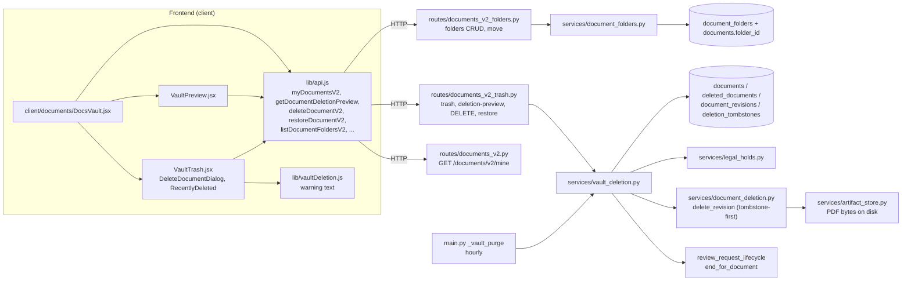
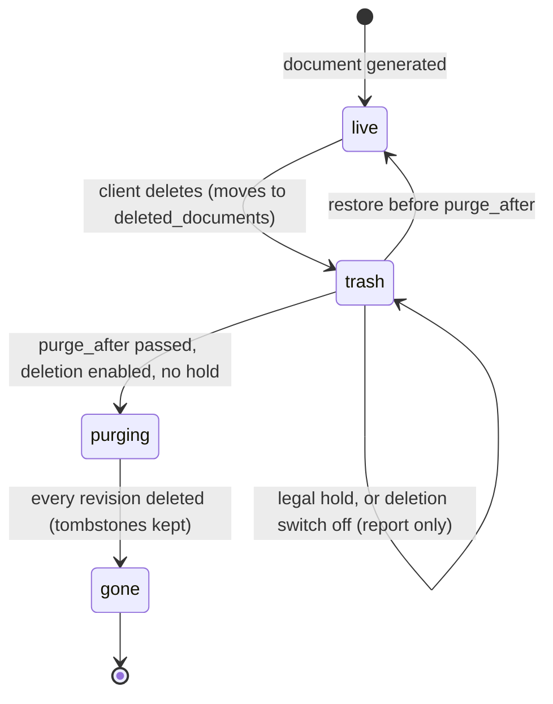
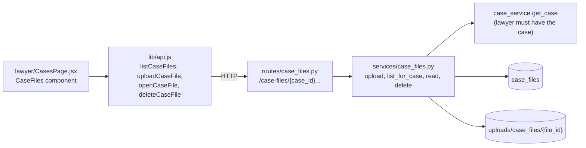
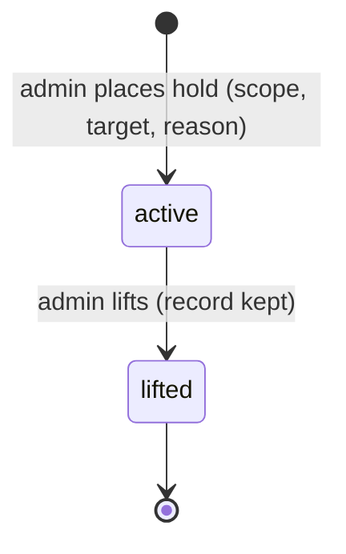

# 12 — Vault, Case Files and KYC Documents

> Written from the code as it is on 2026-10-20. Plan files at the repo root may
> be out of date; the code is the truth.

This page covers three ways files are kept:

| Area | Who | What is stored | Main backend |
|---|---|---|---|
| **Vault** | client (and lawyer for their own drafts) | documents made in the drafting workspace (DOCUMENTS_V2) — organised in folders, deletable with a 30-day "Recently deleted" | `documents_v2*.py`, `vault_deletion.py`, `document_folders.py`, `document_deletion.py`, `artifact_store.py` |
| **Case files** | lawyer only | private uploads on a case: summons, orders, copies (PDF/PNG/JPEG ≤ 10 MB) | `routes/case_files.py`, `services/case_files.py` |
| **KYC documents** | lawyer (upload), admin (view) | verification photo + up to three credentials | `services/kyc_documents.py` |

Plus two cross-cutting services: **`retention.py`** (what *would* be deleted
and when) and **`legal_holds.py`** (a freeze that beats every deletion).

---

# Part A — Client side: the Vault

## A1. What it does (user's view)

The client's **Document Vault** lists every document the client has generated
in the drafting workspace. The client can:

- see each document with its status and current version;
- **preview** and **download** the exact PDF of a version;
- make **folders**, rename / delete them, and file a document into a folder
  (deleting a folder never deletes documents — they go back to "no folder");
- **delete** a document → it moves to **Recently deleted** and can be
  **restored** for 30 days;
- send a document to a lawyer for review (Review requests tab — see the review
  request flow docs; only shown when that feature is on);
- open a document in the drafting workspace to edit.

"Upload file" is shown **disabled** — there is no backend for uploading
arbitrary files into the Vault yet.

## A2. User flow

1. Client opens **Documents → Vault**.
2. The list loads with `GET /documents/v2/mine` (optionally `?folder=` or
   `?case=`), newest first, cursor paginated.
3. Folders panel loads `GET /documents/v2/folders` (with counts).
4. **New folder** → `POST /documents/v2/folders {name}`. **Rename** → `PATCH`.
   **Delete folder** → `DELETE` (documents return to "no folder").
5. **Move to folder** → `PUT /documents/v2/{doc_id}/folder {folder_id | null}`.
6. **Delete a document**:
   1. Screen first asks `GET /documents/v2/{id}/deletion-preview`.
   2. A dialog shows the server's warnings (`lib/vaultDeletion.js`):
      "You can restore it for 30 days (until …)", open review requests will be
      cancelled, a lawyer who accepted a review keeps read-only access until a
      date. If the document is **with a lawyer for review**, delete is blocked.
   3. Client confirms → `DELETE /documents/v2/{id}`.
7. **Recently deleted** → `GET /documents/v2/trash`; **Restore** →
   `POST /documents/v2/{id}/restore` (only before `purge_after`).
8. After 30 days an hourly job purges the document (only if deletion is
   switched on — see rules).

## A3. Code flow

**Delete** (`vault_deletion.delete_document`):

1. Find the document in `documents` with `client_id == caller` and
   `schema_version == 2`. If not there but already in the trash → return the
   trash entry (idempotent). Else 404.
2. If `review_status == "submitted"` → `409 document_under_review`.
3. Build the trash entry: the full row + `deleted_at`, `deleted_by`,
   `purge_after = now + vault_recovery_days`, `purge_started_at: None`.
4. **With review requests on**: one transaction that inserts into
   `deleted_documents`, deletes from `documents` (the filter repeats "not under
   review", so a review accepted a millisecond earlier wins), and calls
   `review_request_lifecycle.end_for_document` (cancels open requests,
   starts the read-only retention of accepted ones).
   **With it off**: insert into trash first, then remove — a crash leaves a
   duplicate that the next attempt resolves, never a lost document.

**Restore** (`restore_document`): refused if `purge_started_at` is set or
`purge_after` has passed; otherwise copy the row back to `documents` (without
the trash fields) and remove the trash row. A cancelled review request stays
cancelled.

**Purge** (`purge_due`, every hour from `main.py::_vault_purge`, only if
`documents_v2` is on):

1. Find trash rows with `purge_after <= now` (bounded batch).
2. Skip any covered by a **legal hold** on the owner or the case.
3. If `documents_v2_deletion_enabled` is **off** → report only, delete nothing.
4. Otherwise, for each revision call `document_deletion.delete_revision`:
   tombstone first → delete the PDF artifact (only if no other revision uses
   the same key) → delete extracted content → delete the revision row. A
   revision still needed by a review request returns `held` and is kept.
5. Remove the trash row only when no revision is left; until then the document
   shows as "being removed".

**Why move-not-destroy:** because the row leaves `documents`, every other
read (list, open, preview, submit) simply stops finding it. No read path needs
a "deleted?" filter that one of them could forget.

**Folders** (`document_folders.py`): a folder is just a name owned by the
caller. A document records `folder_id`. Names are unique per owner ignoring
case and surrounding spaces. A caller can file only documents they **own**
(`client_id` == caller) — a lawyer can never file a client's document.
Limits and errors: empty name → 422 `name_required`; name > **60** chars →
422 `name_too_long`; at most **100** folders per owner → 409 `folder_limit`;
duplicate name (create or rename) → 409 `folder_exists`; a folder or document
that is not the caller's → 404 `not_found`. Deleting a folder also un-files
documents of that folder that are sitting in **Recently deleted**, and returns
`documents_unfiled` (count).

**More delete / restore details** (`vault_deletion.py`):
- `deletion_preview` returns `recoverable_days`, the would-be `purge_after`,
  `blocked` (text when the document is under review), the count of open
  review requests (submitted / viewed) and each accepted review with lawyer
  name, version and `read_only_until` (already-expired ones are left out).
- If the transactional delete fails because Mongo transactions are not
  available, the call answers **503** (it does not fall back).
- `restore_document` is idempotent: if the document is already back in the
  Vault it answers `restored: true`. Past `purge_after` or once purge has
  started → **409 `recovery_expired`** ("its recovery period has ended").
- `list_trash` returns up to 50 rows (max 100), newest deletion first; each
  row has `restorable` = purge not started **and** `purge_after` still in the
  future, so the Restore button is only offered when it will work.
- Purge batches are **50** rows per hourly run (`PURGE_BATCH`).

**Vault list** (`GET /documents/v2/mine`): `limit` default 25, clamped
1–100; `folder=none` means "no folder"; a cursor is valid only with the same
`folder` / `case`. Each item carries id, title, template, case, folder, review
status, a `recovery` hint, dates, current revision id + version +
`pdf_sha256`, and `downloadable` (revision `generated` with a hash). It never
returns `body_text`, receipts or pending events (they hold idempotency keys).

**Preview / download** (`GET /documents/v2/{doc_id}/revisions/{revision_id}/preview`):
the revision is named in the path; optional `expected_pdf_sha256` → 409
`revision_changed` if the stored hash differs ("This document was regenerated
since you loaded it"); revision not finished → 409 `revision_not_ready`; file
unreadable → 503 `artifact_unavailable`. Response is the PDF with a strong
`ETag` (the hash), `X-Revision-Id`, `X-Revision-Version`. A non-owner (e.g. a
reviewing lawyer) may only fetch revisions they were given.

## A4. Data & states

| Collection | Key fields |
|---|---|
| `documents` | `_id`, `client_id` (the owner, whoever it is), `schema_version: 2`, `title`, `template_type`, `current_version`, `current_revision_id`, `review_status`, `folder_id`, `case_id` |
| `deleted_documents` | the same row + `deleted_at`, `deleted_by`, `purge_after`, `purge_started_at` (index `vault_trash_purge_due`) |
| `document_revisions` | immutable versions; `artifact_key`, `pdf_sha256` |
| `deletion_tombstones` | `_id = revision id`, `pdf_sha256`, `artifact_key`, `reason`, `steps_done[]`, `completed_at` |
| `document_folders` | `owner_id`, `name`, normalised name |
| disk `{upload_root}/v2/docs/{revision}.{fence}.pdf` | PDF bytes (`artifact_store.py`) |

---

# Part B — Lawyer side

## B1. Lawyer Vault

Same design and backend as the client Vault (`lawyer/VaultPage.jsx`,
`lawyer/VaultTrash.jsx`, `lawyer/VaultPreview.jsx`), but separate code copies
(tests check the two roles never import each other's screens). It lists the
**lawyer's own** documents — drafts they saved from the drafter — with folders,
delete/restore and preview. Ownership is the same `client_id` field, so a
lawyer can never delete or file a client's document they only reviewed. The
trash routes use `require_client_or_lawyer`.

## B2. Private case files

### What it does

On a case's page, the lawyer sees a **"Your files"** card: they can upload a
summons, an order, a copy of a CNIC, etc. **Only the uploading lawyer** sees
these files — the client is not shown them (product decision). The lawyer can
open a file in a new tab and delete it. On a closed case the card is
read-only.

### User flow

1. Lawyer opens a case → **Documents** tab. It shows the client's case
   documents (`GET /documents/case/{id}`) and, below, the `CaseFiles` card.
2. `CaseFiles` loads `GET /case-files/{case_id}`.
3. **Upload**: lawyer picks a file. The browser refuses > 10 MB at once; then
   `POST /case-files/{case_id}` (multipart).
4. **Open**: `GET /case-files/{case_id}/{file_id}/download` → blob URL opened
   in a new tab (revoked after 60 s; `opener` cleared).
5. **Delete**: confirm dialog → `DELETE /case-files/{case_id}/{file_id}`.

### Code flow

**Upload** (`case_files.upload`):

1. Route: `require_lawyer`; refuse a declared `Content-Length` over 10 MB +
   64 KB before reading; read at most 10 MB + 1 byte.
2. `_case_for` → `case_service.get_case(case_id, lawyer_id, "lawyer")` — the
   normal case access rule (403/404 if the lawyer is not on it).
3. Case status `closed` or `dismissed` → 409.
4. Empty → refused; over 10 MB → refused.
5. `sniff(data)` — type from **magic bytes** only: `%PDF-`, PNG signature,
   JPEG `FF D8 FF`. Anything else → "Only PDF, PNG or JPEG".
6. `file_id = secrets.token_urlsafe(16)`; write to `<id>.part` then rename
   (atomic); path is checked to stay inside the `case_files` folder.
7. Insert a row with `sha256`. If the insert fails, the file is unlinked.

**Read**: re-checks case access, finds the row by `_id + case_id + owner_id`
(someone else's id → 404, not 403), reads the file and verifies its SHA-256
(mismatch → 409). The route returns it `inline` with a safe
`Content-Disposition` (ASCII + RFC 5987 UTF-8 name), `X-Content-Type-Options:
nosniff` and `Cache-Control: private, no-store`.

**Delete**: same ownership checks, delete row, then unlink file. Note: the
backend does **not** check the case status on delete — only the UI makes the
card read-only on a closed case; upload on a closed/dismissed case is refused
with 409 "This case is closed; files can no longer be added."

**Other details**: a `file_id` that is not 8–64 chars of `A-Za-z0-9_-` is a
404 before any lookup. The display name has control and `"\/:*?<>|`
characters replaced by spaces and the stem cut to 120 chars; the extension
always comes from the sniffed type. The list returns at most 200 files,
newest first. Errors: empty file → 422 "The file is empty."; wrong type →
422 "Only PDF, PNG or JPEG files can be uploaded."; hash mismatch on read →
409 "The stored file does not match what was uploaded."

### Data

`case_files` collection: `_id` (server id = disk name), `case_id`,
`owner_id` (the lawyer), `name` (cleaned label, max 120 chars + extension),
`content_type`, `size`, `sha256`, `created_at`. No status lifecycle: a file
exists or it was deleted.

## B3. KYC documents (lawyer → admin)

- During onboarding ("Credentials & Photo") the lawyer uploads files via
  `POST /users/me/kyc/documents` (rate limit `20/minute`) and lists them with
  `GET /users/me/kyc/documents`.
- Kinds (`kyc_documents.KINDS`): `photo` (JPEG/PNG), `bar_certificate`,
  `education`, `professional` (JPEG/PNG/PDF). **5 MB** max, read in 1 MB
  chunks; type checked from bytes (`detect_mime`).
- One file per kind; re-uploading replaces it, and the old file is removed
  only **after** the record points to the new one.
- Files live at `{upload_root}/kyc/{user_id}/`; metadata in
  `users.lawyer_profile.kyc_documents.{kind}`.
- An admin views a file through `GET /admin/kyc/{lawyer_id}/documents/{kind}`
  (`require_admin`), never a static path.
- **Account closure** erases them tombstone-first: the record is cut down to
  file ids and marked `kyc_erasure_pending`, files are deleted, then the record
  is removed. Failures are retried hourly (`main.py::_kyc_erasure_retry` →
  `retry_pending_erasures`).

---

# Part C — Retention and legal holds (shared)

## C1. Retention (`retention.py`)

- Approved periods (2026-09-03): **12 months** for user-visible data
  (conversations, chat/research sessions, turns, checkpoints, intake sessions
  and their evidence); **7 years** for accountability records (answer
  provenance, outbox, conversation tombstones).
- The clock is **last activity** (`updated_at`), not creation, so an active
  thread is never cut.
- **Closed cases: 12 years**, counted from `closed_at` (never while a case
  is open), chosen against the Limitation Act 1908's 12-year window for
  executing a decree. An intake that became a case follows the case period;
  an intake never bound to a case follows the 12-month period. Cases with no
  recorded closure are reported separately (protected).
- DOCUMENTS_V2 stores are registered too (report only): `document_revisions`
  12 months, `review_events` and `deletion_tombstones` 7 years, from record
  creation.
- Each store has its own stated **clock** (`CLOCKS`): last activity, record
  creation, or case closure — so the policy page and the sweep cannot
  disagree.
- One sweep may remove at most **500** records (`MAX_PER_RUN`), so a mistake
  stays small.
- `plan()` is a **dry run**: it reports what would go. Admin routes
  `GET /admin/retention/policy` (periods + clocks, `describe()`) and
  `GET /admin/retention/plan`. Actual deletion is separate (for example
  `POST /admin/retention/intakes/purge`).
- **Why not a TTL index:** it cannot see a legal hold, cannot delete across
  collections together, and cannot be dry-run. TTLs remain only for
  `ws_tickets` and `refresh_blocklist`.

Vault documents have their **own** recovery period (`vault_recovery_days`,
default 30, allowed 1–365) and their own purge job (Part A).

## C2. Legal holds (`legal_holds.py`)

- A hold freezes **a user** or **a case** (never one message).
- **Admins only** (`POST /admin/retention/holds`,
  `DELETE /admin/retention/holds/{scope}/{target_id}`,
  `GET /admin/retention/holds`), with a required reason. A lawyer must ask an
  admin — so nobody can freeze (or un-freeze) data about their own conduct.
- Scope must be `user` or `case` (else 422); an empty reason → 422 "A legal
  hold must record why it was placed."; reason stored trimmed to 500 chars.
- Idempotent through a partial-unique index (two admins → one hold).
- Lifting sets `lifted_at`; the record is **kept** for audit.
- Holds **beat everything**: retention plans skip held records, the Vault
  purge skips held documents, `intake_deletion` checks `is_held`, and
  "delete conversation" under a hold hides instead of removing.

---

## All endpoints (this page)

All under `/api/v1`. The Vault trash and folder routers check
`documents_v2` **before** authentication (404 `feature_disabled`), and are
mounted **before** `documents_v2` so `/trash` and `/folders` are not read as a
document id. Other `/documents/v2/*` routes (create, generate, workspace,
submit, review…) belong to the drafting / review docs.

| Method | Full path | Who | Notes |
|---|---|---|---|
| GET | `/api/v1/documents/v2/mine?cursor=&limit=25&folder=&case=` | any signed-in owner | Vault list (see A3) |
| GET | `/api/v1/documents/v2/{doc_id}` | owner / allowed reader | one document |
| GET | `/api/v1/documents/v2/{doc_id}/revisions?limit=50` | owner / allowed reader | versions, newest first, `limit` 1–100 |
| GET | `/api/v1/documents/v2/{doc_id}/revisions/{revision_id}/preview?expected_pdf_sha256=` | owner / allowed reader | PDF bytes (see A3) |
| GET | `/api/v1/documents/v2/trash` | client or lawyer (owner) | Recently deleted |
| GET | `/api/v1/documents/v2/{doc_id}/deletion-preview` | client or lawyer (owner) | warnings before delete |
| DELETE | `/api/v1/documents/v2/{doc_id}` | client or lawyer (owner) | move to trash; 409 `document_under_review` |
| POST | `/api/v1/documents/v2/{doc_id}/restore` | client or lawyer (owner) | 409 `recovery_expired` |
| GET | `/api/v1/documents/v2/folders` | client or lawyer | `{items (with counts), limit: 100}` |
| POST | `/api/v1/documents/v2/folders` | client or lawyer | 201; `{name}` |
| PATCH | `/api/v1/documents/v2/folders/{folder_id}` | client or lawyer | rename `{name}` |
| DELETE | `/api/v1/documents/v2/folders/{folder_id}` | client or lawyer | documents go to no folder |
| PUT | `/api/v1/documents/v2/{doc_id}/folder` | client or lawyer | `{folder_id \| null}` |
| POST | `/api/v1/case-files/{case_id}` | lawyer | 201; multipart `file` |
| GET | `/api/v1/case-files/{case_id}` | lawyer | `{items}` (max 200) |
| GET | `/api/v1/case-files/{case_id}/{file_id}/download` | lawyer (uploader) | inline bytes |
| DELETE | `/api/v1/case-files/{case_id}/{file_id}` | lawyer (uploader) | 204 |
| GET | `/api/v1/users/me/kyc/documents` | lawyer | own KYC files |
| POST | `/api/v1/users/me/kyc/documents` | lawyer | `20/minute`; multipart kind + file |
| GET | `/api/v1/admin/kyc/{lawyer_id}/documents/{kind}` | admin | view one KYC file |
| GET | `/api/v1/admin/retention/policy` | admin | periods + clocks |
| GET | `/api/v1/admin/retention/plan` | admin | dry-run plan |
| POST | `/api/v1/admin/retention/intakes/purge?dry_run=&limit=` | admin | intake deletion |
| GET | `/api/v1/admin/retention/holds?include_lifted=false` | admin | list holds |
| POST | `/api/v1/admin/retention/holds` | admin | place hold |
| DELETE | `/api/v1/admin/retention/holds/{scope}/{target_id}` | admin | lift hold |

---

## 5. Key logic & rules — summary (and WHY)

| Rule | Where | Why |
|---|---|---|
| Ownership = `client_id` on the document; every query scoped to the caller; not-yours = 404 | `vault_deletion`, `document_folders`, trash/folder routes | one owner field for both roles; nothing about other people's documents leaks |
| Delete = move to `deleted_documents`, restorable for 30 days | `vault_deletion` | user mistakes are recoverable; reads need no "deleted?" filter |
| Can't delete while `review_status == submitted` (checked in the read **and** in the delete filter) | `vault_deletion` | a lawyer must not lose a document they are reviewing |
| Purge needs `documents_v2_deletion_enabled` (separate switch) | `vault_deletion.purge_due`, `document_deletion` | destroying data is a separate, deliberate decision |
| Tombstone-first, resumable revision deletion; shared artifacts kept | `document_deletion` | crash-safe; leaves an audit trace of what was erased |
| Review-request retention can hold a revision | `review_request_lifecycle.revision_is_held` | a lawyer keeps read-only access for `review_request_retention_days` |
| Legal hold beats retention and user delete | `legal_holds` | a dispute must not trigger evidence destruction |
| Case files private to the uploading lawyer; access re-checked through the case every call | `case_files` | product decision; a lawyer removed from a case loses its files |
| File type from magic bytes, size capped before reading, server-minted names, path containment | `case_files`, `kyc_documents` | no spoofed types, no path traversal, no huge uploads |
| SHA-256 verified on read | `case_files.read` | detects a changed or corrupted file on disk |
| KYC files only through authorised routes; tombstone-first erasure on closure | `kyc_documents` | sensitive files never public, never orphaned |

**Feature flags** (`backend/app/core/config.py`):

| Flag | Default | Effect |
|---|---|---|
| `documents_v2` | `False` | the whole Vault (mine, folders, trash) — off → 404 `feature_disabled` |
| `documents_v2_deletion_enabled` | `False` | purge actually deletes; off → report only |
| `vault_recovery_days` | `30` | restore window |
| `document_review_requests` | `False` | review tab + transactional delete with request lifecycle |
| `review_request_retention_days` | `30` | lawyer's read-only window after delete / engagement end |
| `upload_root` | `backend/uploads` | root for v2 PDFs, case files, KYC files |

Case files and KYC documents have **no** feature flag.

---

## 6. Files

| File | Role |
|---|---|
| [client/documents/DocsVault.jsx](../../frontend/src/components/client/documents/DocsVault.jsx) | client Vault screen: list, folders, review tab |
| [client/documents/VaultTrash.jsx](../../frontend/src/components/client/documents/VaultTrash.jsx) | delete dialog + Recently deleted |
| [client/documents/VaultPreview.jsx](../../frontend/src/components/client/documents/VaultPreview.jsx) | preview a revision |
| [lib/vaultDeletion.js](../../frontend/src/lib/vaultDeletion.js) | warning sentences from the deletion preview |
| [lawyer/VaultPage.jsx](../../frontend/src/components/lawyer/VaultPage.jsx) | lawyer's own Vault |
| [lawyer/VaultTrash.jsx](../../frontend/src/components/lawyer/VaultTrash.jsx) | lawyer trash |
| [lawyer/CasesPage.jsx](../../frontend/src/components/lawyer/CasesPage.jsx) | case page; `CaseFiles` card |
| [lib/api.js](../../frontend/src/lib/api.js) | Vault, folder, trash, case-file and KYC helpers |
| [documents_v2.py](../../backend/app/api/v1/routes/documents_v2.py) | `GET /documents/v2/mine` and other V2 routes |
| [documents_v2_trash.py](../../backend/app/api/v1/routes/documents_v2_trash.py) | trash, deletion preview, delete, restore |
| [documents_v2_folders.py](../../backend/app/api/v1/routes/documents_v2_folders.py) | folder CRUD and move |
| [vault_deletion.py](../../backend/app/services/vault_deletion.py) | move-to-trash, restore, purge |
| [document_folders.py](../../backend/app/services/document_folders.py) | folder rules |
| [document_deletion.py](../../backend/app/services/document_deletion.py) | tombstone-first revision deletion |
| [artifact_store.py](../../backend/app/services/artifact_store.py) | PDF bytes on disk (atomic publish, sweeps) |
| [retention.py](../../backend/app/services/retention.py) | retention periods + dry-run plan |
| [legal_holds.py](../../backend/app/services/legal_holds.py) | holds: place, lift, covers |
| [case_files.py (route)](../../backend/app/api/v1/routes/case_files.py) | `/case-files` routes |
| [case_files.py (service)](../../backend/app/services/case_files.py) | upload, list, read, delete |
| [kyc_documents.py](../../backend/app/services/kyc_documents.py) | lawyer KYC files |
| [users.py](../../backend/app/api/v1/routes/users.py) | `/users/me/kyc/documents` |
| [admin.py](../../backend/app/api/v1/routes/admin.py) | KYC file view, retention plan, holds |
| [main.py](../../backend/app/main.py) | `_vault_purge` (hourly), `_kyc_erasure_retry` (hourly) |

---

## 7. Known limits (from the code)

- The Vault only works when `documents_v2` is on (default off).
- Purge is **report-only** by default (`documents_v2_deletion_enabled =
  False`), so trashed documents are never actually destroyed unless that is
  switched on.
- **No file upload into the Vault** — the "Upload file" button is disabled.
- Retention `plan()` is a dry run; the 12-month / 7-year periods are not
  enforced automatically by this module.
- Case files are stored **unencrypted** on local disk (only the analyzer uses
  encryption), have no virus scan, a cap of 200 rows per list, and no
  versioning — delete is immediate and permanent (no trash).
- Case-file delete removes the row first, then the file; if unlinking fails
  the file stays on disk with no row (no sweep for it in this module).
- The client is never shown case files; there is no way to share one with the
  client.
- KYC documents: 5 MB per file, one file per kind.
