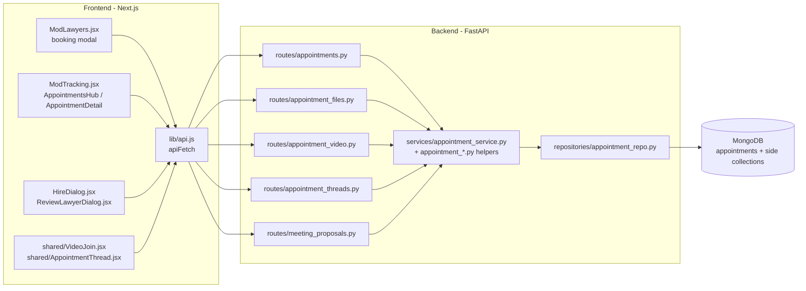
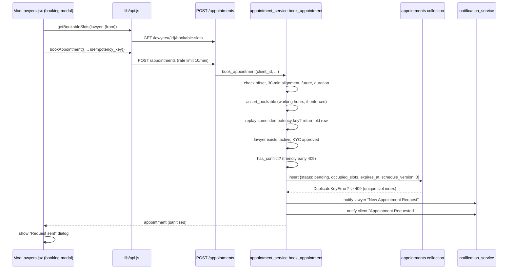
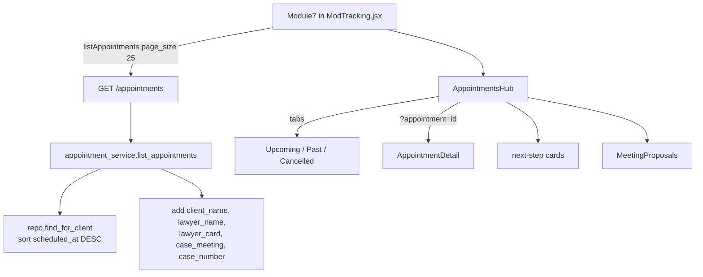
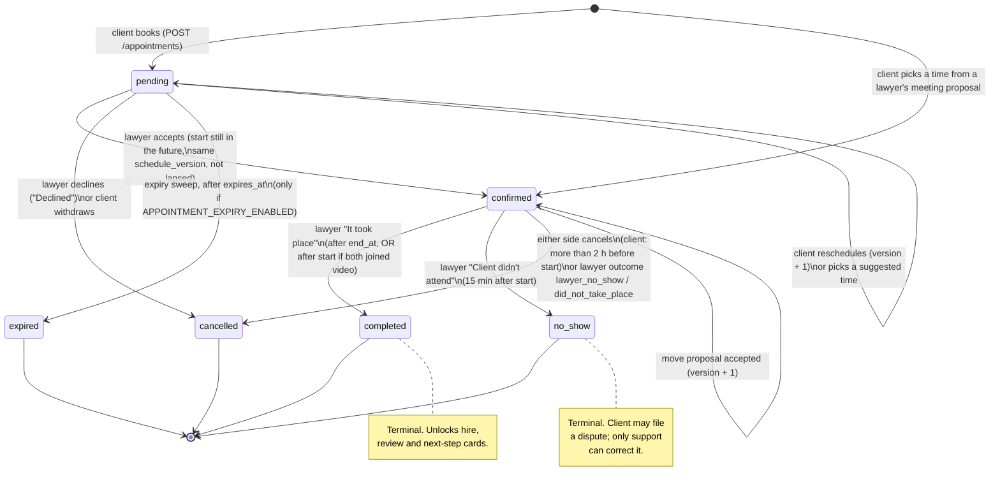

# 13 — Appointments (client side + the shared lifecycle)

This file covers the **client's** view of appointments. It also holds the
**full appointment lifecycle and the backend rules**, because both sides use the
same backend. The lawyer's screens are in
[14-appointments-lawyer.md](14-appointments-lawyer.md), which points back here
for the lifecycle.

Written by reading the code in October 2026. If this doc and the code disagree,
the code is right.

---

## 1. What it does

A client finds a lawyer and asks for a consultation at a time. The lawyer
accepts or declines. If accepted, they meet (video, phone or in person). After
the meeting the lawyer records what happened. A completed consultation unlocks
the next steps: **hire this lawyer**, **leave a review**, or **book a follow-up**.

Around that core there are smaller features:

- change the time of a request, or agree a new time for a confirmed meeting;
- pick one of the times the lawyer suggested instead;
- attach documents and share a short case summary with the lawyer;
- message the lawyer about this one appointment;
- join an in-app video call (when Daily.co is set up);
- report a wrong record ("I was marked absent but I attended");
- see **case meetings** — meetings the hired lawyer proposed on a case.

---

## 2. User flow (client)

### 2.1 Booking a consultation

1. On the **Lawyers** page the client opens a lawyer and presses the book button.
   The booking modal opens (`ModLawyers.jsx`).
2. The client picks a **date**. The modal asks the server for that lawyer's
   **bookable slots** (`GET /lawyers/{id}/bookable-slots`).
   - If the lawyer has published working hours, only those free times are shown.
     "Free" is computed on the server (`lawyer_availability_service.bookable_slots`):
     working hours − exception days − half-hours held by **pending/confirmed**
     appointments − **court hearings** on the lawyer's open cases (held for
     **3 hours** from the hearing time; the **whole day** if the hearing has no
     time) − the lawyer's **diary entries** − times already passed. A range
     may be at most **31 days**.
   - The modal also asks for the next **14 days** and shows an **"Earliest
     open: …"** hint the client can click.
   - If the lawyer has **no** hours and hours are **not enforced**
     (`appointment_working_hours_enforced = False`, the default), the client may
     pick from a fixed request grid: 09:00 to 20:30 every 30 minutes
     (`REQUEST_TIMES`).
   - If the lawyer has no hours and hours **are** enforced, nothing can be
     booked ("This lawyer has not published working hours yet…").
3. The client picks a **time**, a **mode**, an optional **case** it is about,
   and an optional **note** (server max 1000 chars). Every booking is
   **60 minutes** (the modal hard-codes `duration_minutes: 60`).
   - The modal offers only **Video call** and **In person**. The API also
     accepts `phone`, but the booking modal does not offer it.
   - The case list shows only the client's cases that are **not** `draft`,
     `closed` or `dismissed`. A draft case is also refused by the server
     (422 "This case is still a draft, so it cannot have appointments booked
     against it yet. Confirm it at the end of the intake first.").
4. **Send request** → `POST /appointments`. The request carries an
   **idempotency key**, so a double-click or a retry after a lost response
   does not create two appointments.
5. On success the modal changes to **"Request sent to {name}"** with a four-step
   "what happens next" list (Sent → lawyer confirms or declines → Meet → Next
   step) and two buttons: *Back to lawyers* and *View my appointment*
   (goes to `/appointments?appointment=<id>`).
6. If the server answers **409** (slot just taken, or the client already has an
   appointment at that time), the time is marked taken and cleared so the client
   picks another. The server's wording differs by which unique index refused:
   "You already have an appointment during this time" (client slot) or "This
   time slot was just booked" (lawyer slot). A 422 Pydantic error list is
   joined into one readable line in the modal.
7. Server-side refusals before insert (`book_appointment`):
   - `scheduled_at` without a UTC offset, not on :00/:30, or not in the future → 422.
   - Lawyer not found / not a lawyer → 404; inactive → 422 "no longer active";
     KYC not approved → 422 "not approved yet"; an **auto-approved** lawyer
     whose profile is incomplete → 422 "has not finished their profile yet".
   - `case_id` not found → 404; case of another client → 403 "Case does not
     belong to you"; draft case → 422.
   - Same idempotency key with **different** details → 409
     `idempotency_mismatch`.
   - Working hours (only when enforced): outside hours, no hours configured,
     or clashing with a hearing/diary entry → 422.

### 2.2 Waiting for the lawyer

- The appointment shows **"Waiting for lawyer"** (yellow chip).
- While it is **pending**, the client can:
  - **change the time** (reschedule — only allowed while pending, and only
    before the request's own start time). The form asks
    `GET /lawyers/{id}/bookable-slots` for that day and offers only free
    times (or the 09:00–20:30 grid when the lawyer has no hours and hours are
    not enforced). If the reply is lost (status 0) the UI re-reads the
    appointment and only closes the form if the new time is really stored;
  - **cancel** (withdraw) the request;
  - **accept one of the lawyer's suggested times**, if the lawyer offered some
    (if the confirm step fails, the UI says "Moved to that time — it is waiting
    for your lawyer to confirm");
  - **attach files** (up to 5) and choose, per file, whether the lawyer may see it
    *before* accepting;
  - **share a case summary** with the lawyer.
- Messages are **not open yet** while pending (the thread says "awaiting
  confirmation").

### 2.3 After the lawyer answers

- **Accepted** → status `confirmed`. The client is notified. The card shows a
  countdown ("Starts in 3 h 10 min"), *Add to calendar* (.ics download), and a
  way to join:
  - a **Join Meeting** link if the lawyer pasted one, or
  - **Join video** (in-app Daily.co) if video is configured on the server, or
  - "Joining link not shared yet — your lawyer will add it."
  - Phone mode: the lawyer's phone number is shown **only** for a confirmed
    phone consultation.
- **Declined** → status `cancelled` with `cancelled_from = "pending"` and
  `cancelled_by = "lawyer"`. The UI calls this **"Declined"**, not "Cancelled".
- **No answer in time** → status `expired` (only if the expiry flag is on — see
  §5.4).

### 2.4 Before and during the meeting (confirmed)

- **Messages** are open. Both sides can write in the appointment's thread.
- **Cancel**: the client may cancel a confirmed meeting only **more than 2 hours
  before** it starts. Inside that window the server refuses and tells the client
  to contact the lawyer (the UI offers "Message").
- **Propose a new time**: either side may propose **one** new time; the other
  side accepts or declines. The old time stays until it is accepted. The
  client's form offers a fixed 08:00–21:30 half-hour grid (not the lawyer's
  working hours), a reason ≤ 300 chars, and is hidden once the meeting has
  started.
- **Join video**: opens a pre-join screen (camera check), then the call.

### 2.5 After the meeting

- When the scheduled end passes, the card says **"Ended · to be closed"**. The
  client **cannot** mark it complete — only the lawyer records the outcome.
- When the lawyer records **"It took place"**, status becomes `completed`. Now
  the client sees:
  - a **next-step to-do card** at the top of the Appointments page
    ("Hire {name} for a case" / "{name} sent you terms"), shown for completed
    consultations from the last **30 days** whose hire is not started or whose
    terms are waiting for the client (at most **2** cards are shown);
  - **Hire** → opens `HireDialog` right on this page;
  - **Review** → opens `ReviewLawyerDialog` right on this page (hidden if the
    client already reviewed that lawyer; the page asks
    `getReviewEligibility` for at most **6** lawyers of recent completed
    consultations — if the check fails the button stays and the dialog itself
    says "already reviewed");
  - *Get a document reviewed* and *Book a follow-up* links.
- If the lawyer records a **no-show**, the client can **report it as wrong**.
  If the lawyer never records anything for more than 2 hours after the end, the
  client can report **"outcome not recorded"**.

### 2.6 Case meetings

After the client hires a lawyer, the lawyer can **propose a meeting** on the case
(up to three times). On the Appointments page these appear as **"Meeting
proposed"** cards at the top. The client chooses a time (it becomes a
**confirmed** appointment immediately — no second accept needed) or presses
"None of these work for me" (optional message ≤ 500 chars). Times that have
already passed are shown struck through and cannot be picked. The cards
re-load on any `appointment_propos…` notification, and `?section=proposals`
in the URL scrolls to them. Appointments on a case that this lawyer holds show
a **blue left border** and a **blue "Case meeting · {case number}" chip**.

---

## 3. Code flow

### 3.1 The layers



The client app is mounted once in `app/(client)/layout.jsx`. The URL
`/appointments` only picks the screen (`components/client/clientRoutes.js` maps
`/appointments` → `appointments`). `ModTracking.jsx` (exported as `Module7`)
renders it. With `standalone="appointments"` it shows **`AppointmentsHub`**
(the Appointments page). Inside Tracking, the same data shows as
**`PageAppointments`** (expanded cards). One list, one set of rules.

### 3.2 Booking



**Why the idempotency key?** The frontend keeps one key per booking *intent*
(`createBookingKeyHolder`). A retry of the same intent reuses the key, so the
server returns the already-created appointment instead of making a second one.
A key is retired after success, so the next booking is really new. The server
also stores a `payload_fingerprint`: the same key with *different* details is
not treated as a replay.

### 3.3 Listing and opening



- `Module7` reads `?appointment=<id>` (open that one) and `?thread=open` (open
  its messages) from the URL.
- The list is paged (25 per page) with a "load more" that removes duplicates.
- A failed read shows an error banner. It **never** shows "no appointments" on
  a failed read — that would be a lie about the client's diary.
- When a WebSocket notification of type `appointment_*` arrives
  (`onNotification`), the list is re-read, so the card updates when the lawyer
  acts.

### 3.4 The client's actions → endpoints

| Client action (component) | `lib/api.js` | Route | Service |
|---|---|---|---|
| Book (`ModLawyers`) | `bookAppointment` | `POST /appointments` | `appointment_service.book_appointment` |
| Free times (`ModLawyers`) | `getBookableSlots` | `GET /lawyers/{id}/bookable-slots` | `lawyer_availability_service` |
| List / open (`Module7`) | `listAppointments`, `getAppointment` | `GET /appointments`, `GET /appointments/{id}` | `list_appointments`, `get_appointment` |
| Change time of a request (`RescheduleAppointment`) | `rescheduleAppointment` | `PATCH /appointments/{id}/reschedule` | `reschedule_appointment` |
| Pick a suggested time (`ApptSuggestion`) | `acceptAppointmentSuggestion` | `POST /appointments/{id}/accept-suggestion` | `appointment_suggestions.accept_suggestion` |
| Propose / accept / decline / withdraw a move (`ApptMoveProposal`) | `proposeNewTime` etc. | `POST /appointments/{id}/reschedule-proposal[/accept\|/decline\|/withdraw]` | `appointment_reschedule_proposals` |
| Cancel / withdraw (`CancelAppointment`) | `cancelAppointment` | `PATCH /appointments/{id}/cancel` | `cancel_appointment` |
| Files (`ApptFiles`) | `listAppointmentFiles`, `uploadAppointmentFile`, `openAppointmentFile`, `deleteAppointmentFile` | `/appointment-files/{id}[/{file}[/download]]` | `appointment_files` |
| Share summary (`ApptSummaryShare`) | `getSummaryDraft`, `shareSummary`, `revokeSummary` | `/appointments/{id}/summary[/draft]` | `appointment_summary_share` |
| Messages (`ApptMessages` → `AppointmentThread`) | `listAppointmentMessages`, `sendAppointmentMessage` | `/appointments/{id}/messages` | `appointment_message_service` |
| Read receipts | `getThreadSummary`, `markThreadRead` | `GET /appointment-threads/summary`, `POST /appointment-threads/{id}/read` | `appointment_thread_reads` |
| Video (`ClientJoinVideo` → `VideoJoin`) | `getVideoConfig`, `getVideoStatus`, `joinVideo` | `/appointment-video`, `/appointment-video/{id}`, `/appointment-video/{id}/join` | `appointment_video` |
| Report a wrong record (`ReportIssue`) | `openAppointmentDispute`, `listAppointmentDisputes` | `/appointments/{id}/disputes` | `appointment_disputes` |
| Case meeting proposals (`MeetingProposals`) | `listMeetingProposals`, `acceptMeetingProposal`, `declineMeetingProposal` | `/meeting-proposals[/{id}/accept\|/decline]` | `meeting_proposal_service` |
| Hire after consultation (`HireDialog`) | `listHireConsultations`, `requestEngagement` | `GET /appointments/hire-eligible/{lawyer}`, engagements routes | `list_consultations_for_hire` → see [15](15-hire-engagements.md) |
| Review (`ReviewLawyerDialog`) | `getReviewEligibility`, `submitReview` | reviews routes | gated by `exists_completed` |

### 3.5 All endpoints (full paths)

All routers are mounted under `API_PREFIX = /api/v1` in `main.py`. "Any" means
any signed-in user; the service then checks that the caller is a party.

**`routes/appointments.py`** (prefix `/appointments`)

| Method + path | Who | Rate limit | What |
|---|---|---|---|
| `POST /api/v1/appointments` | client | 10/min | Book (201). |
| `GET /api/v1/appointments` | any (client/lawyer; admin → 403) | — | List own. Query: `status`, `page` (≥1), `page_size` (1–50, default 10), `starts_from`, `starts_before` (aware datetimes), `upcoming_only`, `order=time\|action` (last two used by the lawyer list). Client list is newest first; lawyer list (`order=time`) is earliest first. |
| `GET /api/v1/appointments/hire-eligible/{lawyer_id}` | client | — | Completed consultations with this lawyer not yet used by any engagement. |
| `GET /api/v1/appointments/availability/{lawyer_id}?date=YYYY-MM-DD` | any | — | **Deprecated** (marked in OpenAPI). Returns only the slots already taken that PKT day. Replaced by `/lawyers/{id}/bookable-slots`; kept so outside callers do not break. |
| `POST /api/v1/appointments/{id}/disputes` | client | 10/min | Report a wrong record (201). |
| `GET /api/v1/appointments/{id}/disputes` | client | — | The client's own reports on this appointment. |
| `GET /api/v1/appointments/outcomes/pending` | lawyer | — | Outcome queue (keyset: `after_end_at`, `after_id`, `cutoff`, `page_size` 1–200, `immediate`). See [14 §3.2](14-appointments-lawyer.md). |
| `GET /api/v1/appointments/{id}/messages` | party | — | Thread page (`page_size` 1–100, default 30; cursor `before_created_at` + `before_id`, both or neither). |
| `POST /api/v1/appointments/{id}/messages` | party | — | Send (201). |
| `GET /api/v1/appointments/{id}` | party or admin | — | One appointment. |
| `PATCH /api/v1/appointments/{id}/confirm` | lawyer | — | Accept; body `schedule_version` (required), `meeting_link`. |
| `PATCH /api/v1/appointments/{id}/meeting-link` | lawyer | — | Add/replace HTTPS link (pending/confirmed, video only). |
| `PATCH /api/v1/appointments/{id}/reschedule` | client | 10/min | Move a pending request. |
| `POST /api/v1/appointments/{id}/suggest-times` | lawyer | 10/min | Offer 1–3 other times. |
| `POST /api/v1/appointments/{id}/accept-suggestion` | client | 10/min | Pick a suggested time. |
| `GET /api/v1/appointments/{id}/summary/draft` | client | — | Redacted draft text. |
| `GET /api/v1/appointments/{id}/summary` | party | — | Read the shared snapshot. |
| `PUT /api/v1/appointments/{id}/summary` | client | — | Share / update (text 1–3000). |
| `DELETE /api/v1/appointments/{id}/summary` | client | — | Revoke. |
| `POST /api/v1/appointments/{id}/reschedule-proposal` | party | 10/min | Propose a new time for a confirmed meeting. |
| `POST /api/v1/appointments/{id}/reschedule-proposal/withdraw` | proposer | — | Withdraw own proposal. |
| `POST /api/v1/appointments/{id}/reschedule-proposal/decline` | other side | — | Decline. |
| `POST /api/v1/appointments/{id}/reschedule-proposal/accept` | other side | 10/min | Accept; body `proposal_id`. |
| `PATCH /api/v1/appointments/{id}/cancel` | party or admin | — | Cancel / decline / withdraw; body `reason` (≤500), `outcome_code`. |
| `PATCH /api/v1/appointments/{id}/complete` | lawyer | — | Complete; body `lawyer_notes` (≤2000), optional `meeting_link` (omitting it keeps the stored link). |
| `PATCH /api/v1/appointments/{id}/no-show` | lawyer | — | Client did not attend. |

**Other routers**

| Method + path | Who | What |
|---|---|---|
| `POST /api/v1/appointment-files/{appointment_id}` | client of it | Upload (multipart `file`, `note`, `share_before_accept`) (201). |
| `GET /api/v1/appointment-files/{appointment_id}` | party | List (`{items, status}`). |
| `GET /api/v1/appointment-files/{appointment_id}/{file_id}/download` | party (lawyer per §5.7) | Bytes, `Content-Disposition: inline`, `X-Content-Type-Options: nosniff`, `Cache-Control: private, no-store`. |
| `DELETE /api/v1/appointment-files/{appointment_id}/{file_id}` | client of it | Delete (204). |
| `GET /api/v1/appointment-video` | any | `{configured}` — is Daily set up at all. |
| `GET /api/v1/appointment-video/{appointment_id}` | party | `{configured, eligible, opens_at, closes_at}` for the Join button. |
| `POST /api/v1/appointment-video/{appointment_id}/join` | party | `{room_url, token, expires_at}`. |
| `POST /api/v1/appointment-video/{appointment_id}/attendance` | party | `{video_met}`: asks Daily's `/meetings` report whether both were in the room together; writes `video_attended` if so (2026-10-21). |
| `GET /api/v1/appointment-threads/summary?ids=a,b,…` | client/lawyer | Unread + last message per appointment (≤100 ids, `ids` ≤4000 chars). |
| `POST /api/v1/appointment-threads/{appointment_id}/read` | party | Mark read. |
| `POST /api/v1/meeting-proposals` | lawyer | Propose a case meeting (201). |
| `GET /api/v1/meeting-proposals?case_id=&status=` | client/lawyer (others get `[]`) | Own proposals, newest first, max 100. `status` ∈ open, accepted, declined, withdrawn, expired, cancelled. |
| `POST /api/v1/meeting-proposals/{id}/accept` | client | Body `option_index` (0–2). Returns `{proposal, appointment}`. |
| `POST /api/v1/meeting-proposals/{id}/decline` | client | Body `reason` (≤500). |
| `POST /api/v1/meeting-proposals/{id}/withdraw` | lawyer | Withdraw an open proposal. |
| `GET /api/v1/lawyers/{lawyer_id}/bookable-slots?from=&to=&duration_minutes=` | any | Free times per PKT day (see §2.1). |
| `GET /api/v1/lawyers/{lawyer_id}/availability` | any | The lawyer's published hours (`configured: false` if none — no invented defaults). |
| `GET /api/v1/admin/appointment-disputes` | admin | Open reports, oldest first (`page`, `page_size` 1–100). |
| `GET /api/v1/admin/appointment-disputes/{dispute_id}` | admin | Full support view incl. private note. |
| `PATCH /api/v1/admin/appointment-disputes/{dispute_id}` | admin | Decide (see §5.9). |

Lawyer-only endpoints (`/lawyers/me/availability`, `/lawyer-actions`,
`/case-consultations/{case_id}`) are listed in
[14 §3.5](14-appointments-lawyer.md).

---

## 4. Data & states

### 4.1 Collections

| Collection | What it holds |
|---|---|
| `appointments` | The appointment itself. **Only the state machine writes its status.** |
| `appointment_messages` | Messages of one appointment's thread. |
| `appointment_thread_reads` | "Read up to" time per (appointment, user) — read receipts. |
| `appointment_files` | Metadata of files the client attached (bytes are on disk under `upload_root/appointment_files`). |
| `appointment_summaries`, `appointment_share_audit` | Shared case-summary snapshot, and an audit log of share/update/revoke. |
| `appointment_video_rooms` | One Daily.co room per appointment (name, url, version, deleted_at). |
| `video_usage` | Monthly participant-minute counter for the video budget. |
| `appointment_disputes` | Client reports that a record is wrong. |
| `meeting_proposals` | A lawyer's proposed case meeting (up to 3 times). |
| `notifications` | All notices; a unique `logical_event_id` stops duplicates. |
| `lawyer_availability` | One document per lawyer (`_id` = lawyer id): weekly `working_hours` and `exceptions` (days off). Read by bookable-slots and by `assert_bookable`. |
| `lawyer_events` | The lawyer's private diary entries; they block bookable slots and case-meeting times. |
| `engagements` | Hire requests; linked by `appointment_id`. See [15](15-hire-engagements.md). |

### 4.2 Key fields on an appointment

| Field | Meaning |
|---|---|
| `_id` | Random url-safe id. |
| `client_id`, `lawyer_id`, `case_id` | Who and (optionally) which case. |
| `scheduled_at`, `end_at`, `duration_minutes` | UTC times. Duration 30–180, multiple of 30. |
| `status` | `pending`, `confirmed`, `completed`, `cancelled`, `no_show`, `expired`. |
| `mode` | `video`, `in_person`, `phone`. |
| `timezone` | Always `Asia/Karachi` for now (server-owned). |
| `occupied_slots` | Every half-hour the meeting covers. Powers the double-booking guard. Never sent to the browser. |
| `schedule_version` | Goes up each time the time changes. Used to stop "accept a time you never saw". |
| `expires_at` | When an unanswered request stops holding the slot. **Not sent to the browser** (see §7). |
| `idempotency_key`, `payload_fingerprint` | Booking replay protection. Never sent to the browser. |
| `notes` | Client's note (or the lawyer's agenda for a proposed case meeting). |
| `lawyer_notes` | **Private** to the lawyer. Only returned when the viewer is the lawyer. |
| `meeting_link` | HTTPS join link — only allowed on video appointments. |
| `cancel_reason`, `cancelled_by`, `cancelled_from`, `outcome_code` | How it ended. `cancelled_from="pending"` + `cancelled_by="lawyer"` = "Declined". |
| `time_suggestion` | Up to 3 other times the lawyer offered for a pending request. |
| `reschedule_proposal`, `reschedule_history` | Open move proposal for a confirmed meeting, and accepted moves. |
| `video_attended.lawyer`, `video_attended.client`, `video_attended.verified_at` | Written only when **Daily's own report** shows both in the room together near the meeting's time (2026-10-21). Used for the "met" rule. (`video_joined`, written at token time by older code, no longer counts.) |
| `proposal_id` | Set when the appointment came from a lawyer's meeting proposal (response shows `from_proposal: true`). |
| `last_message_at` | Time of the latest thread message (written inside the send transaction). Not sent to the browser. |
| `time_suggestion.for_version`, `reschedule_proposal.for_version` | The `schedule_version` a suggestion / proposal was made against. |

Fields **added at read time** (not stored): `client_name`, `lawyer_name`,
`video_met`, `from_proposal`, `case_meeting`, `case_number`, and for clients a
`lawyer_card` (specialisations, experience, rating, office, and the phone number
only for a confirmed phone consultation).

### 4.2a Indexes

From [appointment_index_spec.py](../../backend/app/db/appointment_index_spec.py)
and [indexes.py](../../backend/app/db/indexes.py):

| Collection | Index | Kind | Why |
|---|---|---|---|
| `appointments` | `uniq_appointment_lawyer_slot` (`lawyer_id`, `occupied_slots`), partial pending/confirmed | unique, **correctness** | No lawyer double-booking (§5.1). |
| `appointments` | `uniq_appointment_client_slot` (`client_id`, `occupied_slots`), partial pending/confirmed | unique, **correctness** | No client in two meetings at once. |
| `appointments` | `uniq_appointment_idempotency` (`client_id`, `idempotency_key`), partial on key being a string | unique, **correctness** | Booking replay. Partial (not sparse) so bookings without a key do not collide. |
| `appointments` | `appointment_pending_expiry` (`status`, `expires_at`), partial pending | query | Expiry sweep. Not a TTL index — a TTL would delete the record. |
| `appointments` | `appointment_confirmed_outcome` (`status`, `end_at`, `_id`), partial confirmed | query | Outcome queue keyset. |
| `appointments` | `appointment_confirmed_reminder` (`status`, `scheduled_at`, …), partial confirmed | query | Reminders. |
| `appointments` | plain: `client_id`, `lawyer_id`, `case_id` (sparse), `status`, `scheduled_at`, (`lawyer_id`,`scheduled_at`), `created_at` desc | query | Listings. |
| `appointment_disputes` | `uniq_active_appointment_dispute` (`active_key`), partial string | unique | One open report per appointment. |
| `appointment_disputes` | `appointment_dispute_queue` (`status`, `created_at`, …) | query | Support queue. |
| `appointment_messages` | `appointment_message_timeline`, `uniq_appointment_message_key` (appointment, sender, key), `appointment_message_notify_pending` | unique + query | Thread paging, send retry, owed notices. |
| `meeting_proposals` | (`client_id`,`status`), (`lawyer_id`,`case_id`), `uniq_open_meeting_proposal` (`case_id`, partial open/accepting), `meeting_proposal_expiry_notice` | unique + query | One open proposal per case; owed expiry notices. |
| `engagements` | `uniq_engagement_appointment` (`appointment_id`, partial string) | unique | One hire attempt per consultation. |

The three **correctness** indexes are created and checked by a separate,
unconditional enforcer (`enforce_appointment_correctness_indexes`); the app
refuses to start without them. An old index `uniq_pending_slot` (exact start
only, pending only) is listed as obsolete and is dropped only after the new
ones exist. `appointment_files`, `appointment_thread_reads`,
`appointment_summaries`, `appointment_video_rooms` and `video_usage` have no
dedicated indexes (they are read by `_id` or by a small `appointment_id` scan).

### 4.3 The lifecycle (state diagram)

The real allowed transitions are in
[appointment_transitions.py](../../backend/app/services/appointment_transitions.py)
(`_ALLOWED`). There is no separate "declined" status — a decline is a
`cancelled` row with `cancelled_from = "pending"`.



**Terminal states** (`completed`, `cancelled`, `no_show`, `expired`) have no way
out through the API. The code says why: a completed appointment gates the
client's right to review the lawyer (`exists_completed`), so a reversible
outcome would make that right reversible too. Only a support officer resolving a
dispute can correct a record (see §5.9).

### 4.4 What the client sees for each state

From `hubChip`, `ApptNow` and `apptStep` in `ModTracking.jsx`:

| Status | Chip | Progress strip (Requested → Confirmed → Meeting → Next step) |
|---|---|---|
| `pending` | Waiting for lawyer (yellow) | step 1 |
| `confirmed`, not ended | ✓ Confirmed · in 2 h | step 2 |
| `confirmed`, ended | Ended · to be closed | step 2 |
| `completed` | Completed | step 3 |
| `cancelled` | Declined / Cancelled (red) | hidden |
| `expired` | Expired | hidden |
| `no_show` | No show | hidden |

Tabs on the hub: **Upcoming** = pending or confirmed and not yet ended (soonest
first); **Cancelled** = `cancelled`; **Past** = everything else (newest first).

---

## 5. Key logic & rules (and why)

### 5.1 Slots: why half-hours

From [appointment_slots.py](../../backend/app/services/appointment_slots.py):

- A start must be on **:00 or :30 UTC**, exact to the minute.
- A duration must be **30–180 minutes** and a **multiple of 30**.
- Each appointment stores `occupied_slots` = every half-hour it covers
  (half-open: a 10:00–11:00 meeting covers 10:00 and 10:30, not 11:00).

**Why:** "check for overlap, then insert" has a race — two bookings can both see
"free" and both insert. MongoDB transactions do not stop this either (no
predicate locks). So overlap is turned into an **equality** problem: two
overlapping meetings always share at least one half-hour instant, and two
**unique indexes** refuse the second insert:

- `uniq_appointment_lawyer_slot` on `(lawyer_id, occupied_slots)`
- `uniq_appointment_client_slot` on `(client_id, occupied_slots)`

Both are **partial**: only `pending` and `confirmed` rows count, so a cancelled
meeting frees its slots. `has_conflict()` in the repo is only a *friendly early
error*; the indexes are the real guard. The rigid 30-minute rule is what makes
"overlap ⇒ shared instant" true (a 45-minute meeting could overlap another
without sharing an instant).

The app refuses to start if these indexes are missing
(`assert_appointment_booking_ready` in `main.py`).

### 5.2 Time zone

`BOOKING_TZ = Asia/Karachi` is fixed on the server. Pakistan has no daylight
saving, so local-time maths cannot hit a gap. Times are stored as UTC and shown
as PKT ("20 Oct 2026 at 15:00 PKT").

### 5.3 Transitions are checked twice: "which" and "when"

`_transition()` in `appointment_service.py` does:

1. **Which** — `is_allowed(source, target)` from the table. A violation is a
   **409 Conflict** (you are looking at an old copy; reload).
2. **When** — `timing_error(...)`. A violation is a **422** (nothing is stale;
   you must wait):
   - `confirmed`: refused if the start has already passed.
   - `completed`: refused **before `end_at`**, **unless** the two met on video
     (`met = True`) **and** the start has passed.
   - `no_show`: refused until **15 minutes after the start** (`NO_SHOW_GRACE`).
3. **Atomic write** — `compare_and_set` updates only if the status is still the
   one that was read (and the version, if given). If nothing matched, the code
   re-reads and gives the **real** reason: "request expired", "the client
   changed the time", or "already cancelled".

### 5.4 Expiry of unanswered requests

From [appointment_expiry.py](../../backend/app/services/appointment_expiry.py).
At booking, `expires_at` is stored as:

```
deadline = min( start,
                max( start − 24h,  created + 2h ),
                created + 7 days )
```

- `start − 24h`: normally the slot is released a day before, while someone else
  can still use it.
- `created + 2h`: a floor, so a last-minute request is not born already expired
  (but never past the start).
- `created + 7d`: a hard cap that a reschedule cannot move, so a request cannot
  be pushed forward forever.

The sweep
([appointment_expiry_sweep.py](../../backend/app/services/appointment_expiry_sweep.py))
moves lapsed `pending` rows to `expired` (one conditional write per row,
pinned to its `schedule_version`; a row that moved meanwhile is counted as
`moved` and left alone) and tells **both** sides: the client gets "Booking
Request Expired" ("That time is free again…" or, if the start has passed,
"That time has now passed…"), the lawyer gets "Unanswered Request Closed".
Event ids `appointment:{id}:expired:{recipient}` stop duplicates. **It is OFF by
default** (`appointment_expiry_enabled = False`). The same one flag also makes
the **accept** path refuse a lapsed request ("This appointment request has
expired."). They share one flag on purpose: one without the other would leave a
request either confirmable just before being expired, or stuck neither
confirmable nor expired.

Even when on, the sweep refuses to run if any pending row lacks a stored
`expires_at` (old rows), so it never reports a false "all clear".
`survey_legacy_pending` only **counts** such old rows (no write, no ids).

**Startup gate.** When `appointment_expiry_enabled = True`, the app **refuses
to start** (`assert_appointment_expiry_activation_ready` in `main.py`,
raising `AppointmentExpiryNotReady`) unless: `REDIS_URL` is set **and**
reachable (there is no single-process exemption for this job), the
`appointment_pending_expiry` index exists, and every pending row has a stored
`expires_at`. With the flag off none of this is checked.

### 5.5 Cancelling

`cancel_appointment` (client, lawyer or admin):

- A **client** cannot cancel a **confirmed** meeting within **2 hours** of the
  start (`_CANCEL_CUTOFF_MINUTES = 120`). Pending requests can be withdrawn any
  time.
- It stores `cancel_reason`, `cancelled_by`, `cancelled_from` (the old status).
- A lawyer cancelling a pending request = **decline**; the notice title is
  "Request Declined".
- `outcome_code` (`lawyer_no_show` / `did_not_take_place`) is only for the
  **lawyer**, only on a **confirmed** meeting that **has started**. The client is
  told "Your lawyer could not attend — you can book a new time" and is **not**
  marked absent.
- The video room is closed (best effort).
- **Who is told:** client cancels → lawyer; lawyer cancels → client; admin
  cancels → both. Titles: "Request Declined", "Your lawyer could not attend",
  "Appointment did not take place" or "Appointment Cancelled", with
  "Reason: …" appended when given.
- There is **no time rule for the lawyer** on the server: a lawyer may cancel a
  confirmed meeting even after it ended (without an outcome code). The
  lawyer's UI hides Cancel once the meeting has ended.

### 5.5a Notifications sent by the state changes

All are best-effort (`_notify`): a failed notice is logged (exception class
only) and never turns a committed change into an error.

| Event | To | Type | Title |
|---|---|---|---|
| Book | lawyer + client | `appointment_booked` | "New Appointment Request" / "Appointment Requested" |
| Client reschedules pending | lawyer | `appointment_booked` | "Appointment Time Changed" |
| Confirm | client | `appointment_confirmed` | "Appointment Confirmed" |
| Meeting link added | client | `appointment_confirmed` | "Joining Details Added" |
| Suggest times | client | `appointment_proposed` | "Your lawyer suggested other times" |
| Move proposed / withdrawn / declined / accepted | other side | `appointment_proposed` | "New time proposed", "Proposal withdrawn", "Proposal declined", "Appointment moved" |
| Cancel / decline | see §5.5 | `appointment_cancelled` | see §5.5 |
| Complete | client | `appointment_completed` | "Consultation Completed" |
| No-show | client | `appointment_no_show` | "Appointment Marked as Missed" ("If that is wrong, contact them directly.") |
| Expired | both | `appointment_expired` | §5.4 |
| Message | other side | `appointment_message` | "New message about your appointment" (no text) |
| Reminder | both | `appointment_reminder` | "Appointment tomorrow" / "Appointment starting soon" |
| Outcome nudge | lawyer | `appointment_outcome_nudge` | "Consultation needs an outcome" |
| Dispute decided | client (+ lawyer if corrected) | `appointment_dispute_resolved`, `appointment_record_corrected` | "Your report has been reviewed", "Appointment record corrected" |
| Meeting proposal sent / chosen / declined / withdrawn / expired | client / lawyer | `appointment_proposed`, `appointment_proposal_accepted/declined/withdrawn/expired` | "Meeting proposed", "Meeting confirmed", "Meeting times declined", "Meeting proposal withdrawn", "Proposed times passed" |

All carry `payload.appointment_id` (or `proposal_id` + `case_id`), which the
notification click uses to deep-link.

### 5.6 Changing the time

There are three different mechanisms, because a pending request and a confirmed
meeting are different things:

| Situation | Who | How | Rule |
|---|---|---|---|
| **Pending** request | client only | `PATCH /reschedule` | Only the time changes (not lawyer, mode, duration). Must send the `schedule_version` it saw. Version goes +1. `expires_at` recomputed from the original `created_at` (the 7-day cap does not move). |
| **Pending** request | lawyer offers | `POST /suggest-times` (1–3 times + note) | Stored in `time_suggestion`. When the client picks one (`accept-suggestion`), the server **reschedules** then **confirms** in one go — the lawyer already agreed to those times. If the confirm step fails (e.g. expired), the request stays pending at the new time. |
| **Confirmed** meeting | either side | `POST /reschedule-proposal`, then the other side `/accept` or `/decline`; proposer may `/withdraw` | Only **one** active proposal. Proposal expires at the earliest of 48 h, the current start, or the proposed start. Accept is **one conditional write** (still confirmed, same version, same proposal, not expired) that moves the slots, bumps the version, adds to `reschedule_history`, and closes the old video room. A slot clash → 409 and the old time stays. |

**Why the version?** A lawyer might be reading a request while the client moves
it. Without the version the lawyer would "accept" a time they never saw.

More detail per mechanism:

- **Pending reschedule** (`reschedule_appointment`): refused with 409 if not
  pending ("Cancel it and book a new time instead"), 422 if the request's own
  start has already passed, 409 with the real reason if the version did not
  match ("changed a moment ago"). Since 2026-10-20 it calls
  `assert_bookable` for the new time, exactly like booking: when working hours
  are enforced, a time outside them, in court or in the diary is refused with
  422 and nothing is written (a no-op while enforcement is off, the default).
  It does not re-check KYC. The lawyer is notified with event id
  `appointment:{id}:rescheduled:{version+1}`.
- **Suggest times** (`appointment_suggestions.suggest_times`): lawyer only,
  pending only, and only **before the request's start** (422 otherwise —
  "Decline it instead"). Each time must have an offset, be aligned and in the
  future, and must not equal the requested time; duplicates are dropped and
  options are sorted. Note ≤ 300. A new suggestion **replaces** the old one
  (the lawyer's button then reads "Change suggestion"). Suggested times are
  **not** checked against working hours or the lawyer's diary.
- **Accept suggestion**: the chosen time must be one of the offered ones (422
  "Pick one of the times your lawyer suggested"). After the attempt the
  `time_suggestion` is removed. The response carries `suggestion_confirmed`
  (true/false).
- **Move proposals** (`appointment_reschedule_proposals`): only the client or
  lawyer of a **confirmed** appointment (other roles → 409). Refused once the
  meeting has started, if the new time equals the current one, or if a proposal
  is already active ("You already proposed a new time. Withdraw it first" /
  "The other side has proposed a new time. Accept or decline it first"). You
  cannot decline your own proposal, and only the proposer may withdraw it. An
  expired proposal is simply ignored; nothing sweeps it. Proposed times are
  **not** checked against working hours or the diary — only the slot indexes on
  accept. `reschedule_history` entries hold `from`, `to`, `proposed_by`,
  `accepted_by`, `at`.

### 5.7 Files on an appointment

From [appointment_files.py](../../backend/app/services/appointment_files.py):

- Only the **client** uploads or deletes, and only while `pending` or
  `confirmed`. Max **5 files**, max **10 MB**, type decided from the bytes
  (PDF / PNG / JPEG). A short note (≤ 300 chars) per file. A SHA-256 is stored
  and checked on download.
- Each file has `share_before_accept` (a tick box: "show to the lawyer before
  they accept").
- What the **lawyer** gets depends on status:

| Appointment status | Lawyer sees |
|---|---|
| `pending` | **Only** files with `share_before_accept = true` (name and open). Other files are not listed at all — not even their names. |
| `confirmed`, `completed`, `no_show` | All files, can open. |
| `cancelled`, `expired` | Nothing — empty list, every file "not found". |

Anyone who is not a party gets **404 "not found"**, never 403, so an id reveals
nothing. Admins are not parties here, so they get 404 too.

Errors and details:

- Upload or delete outside pending/confirmed → **409**; a 6th file → **409**
  "at most 5 files. Remove one first."; empty file, note > 300 or > 10 MB →
  **422**. The route refuses early from the `Content-Length` header (10 MB +
  64 KB form overhead) before reading the body.
- The client's list shows each file's `share_before_accept` and
  `lawyer_can_open`; the lawyer's list shows `can_open`.
- On download the SHA-256 is recomputed; a mismatch is **409** "The stored
  file does not match what was uploaded."
- Bytes are written to a `.part` file and renamed, and the file is removed
  again if the database insert fails. The stored name is a random id; the
  client's filename is only a cleaned label.

> Note: an older plan said "lawyer sees names while pending, opens after
> accept". The **current code is stricter**: while pending, unticked files are
> hidden completely.

### 5.8 Shared case summary

[appointment_summary_share.py](../../backend/app/services/appointment_summary_share.py):
the client gets a **draft** built from their case (or booking note), with CNIC,
phone numbers and emails **redacted**. They edit it and **share**. What is
stored is a **snapshot** — later case edits do not leak to the lawyer. The
client can **revoke** at any time (a copy already read cannot be recalled; the
UI says so). The lawyer can read it while `pending`, `confirmed`, `completed`
or `no_show` (`_LAWYER_READS`); after cancel/expiry the lawyer gets
`{shared: false}`. Every action is audited (`share`, `update`, `revoke`, with
character count). This is separate from files.

Details: the draft is built from the linked case's title, type · province and
description (only if the case is the client's own), plus "What I want to
discuss: {booking note}"; it is cut to 3000 chars, then redacted (CNIC
`#####-#######-#`, Pakistani mobile numbers, emails). The response says how
many items were hidden; the UI also warns "Check that your home address
isn't in it". Share/update is allowed only while `pending` or `confirmed`
(409 otherwise); text 1–3000 chars. Revoke removes the stored text. Draft,
share and revoke are client-only; anyone else gets 404.

### 5.9 Disputes ("report a problem")

[appointment_disputes.py](../../backend/app/services/appointment_disputes.py):

| Category | Allowed when |
|---|---|
| `incorrect_no_show` | status is `no_show` |
| `outcome_not_recorded` | status is `confirmed` and `end_at` was more than **2 hours** ago (same grace as the outcome queue) |

Filing **changes nothing** on the appointment. It opens a report (`open`) for
support, who decide `resolved` or `dismissed` (decisions:
`confirm_no_show`, `correct_to_completed`, `dismiss_report`). Only one open
report per appointment (unique `active_key` index). **Why so careful:** if a
client could fix their own record, they could invent a completed consultation
just to unlock a review.

More rules:

- The statement is required, ≤ 2000 chars. The category sent must match what
  the stored status allows (422 otherwise). An appointment that is not the
  client's → 404 "Appointment not available".
- A retry with the **same** category and text returns the existing report; a
  different text while one is open → **409**.
- The client's view never shows the support officer's private `support_note`.
- **Support** (admin) decides through `PATCH /api/v1/admin/appointment-disputes/{id}`
  with `expected_version` (required), `decision`, `resolution_explanation`
  (1–2000, shown to the client) and optional `support_note` (≤ 2000, private).
  A stale version or an already-decided report → 409.
- `correct_to_completed` moves the appointment straight to `completed` (from
  `no_show` or `confirmed`, whichever the category implies) in one pinned
  write — this is the **only** path that leaves a terminal state, and it
  bypasses the normal transition table on purpose. It is done **before** the
  report is closed, so a crash leaves the appointment corrected and the report
  still open (the retry finishes it).
- Afterwards the client gets "Your report has been reviewed"; if the record was
  corrected, the lawyer gets "Appointment record corrected".

### 5.10 Messages and read receipts

[appointment_message_service.py](../../backend/app/services/appointment_message_service.py):

- Only the appointment's own client and lawyer (not admins — private words).
- `thread_state`: **writable only while `confirmed`**; `pending` = "awaiting
  confirmation"; any ended status = read-only.
- Send is retry-safe (idempotency key, unique per appointment+sender+key).
- The send runs in a **transaction** that first touches the appointment *only if
  still confirmed*, so no message can land after the meeting was cancelled or
  completed.
- The other person gets a notification **without the message text**. Delivery
  is durable (`notify: "pending"` → `"sent"`; owed notices are re-sent on the
  next read/send).
- If the MongoDB server does not support transactions, sending fails with
  "Messages are unavailable on this server right now" (**503**).
- Text is trimmed, 1–**2000** chars; `idempotency_key` 8–128 chars (required).
- A non-party (or an admin) gets **403** "You do not have access to this
  appointment." — the same answer for a missing id.
- Sending while pending → 409 "Messages open once the lawyer confirms this
  appointment."; after it ended → 409 "This conversation is closed…". Reusing a
  key with different text → 409.
- Reading returns newest page first (oldest-first within the page) with
  `can_send`, `send_state` (`open` / `awaiting_confirmation` / `read_only`) and
  `appointment_status`; a reschedule keeps the same thread. Up to 20 owed
  notices are delivered on each read/send.

[appointment_thread_reads.py](../../backend/app/services/appointment_thread_reads.py):
`POST /appointment-threads/{id}/read` stores "read up to now";
`GET /appointment-threads/summary?ids=…` returns, for up to 100 appointments,
the last message preview (90 chars) and how many messages **from the other
person** came after the last read. Kept on the server so counts are right on
every device.

### 5.11 Video (Daily.co)

[appointment_video.py](../../backend/app/services/appointment_video.py):

- **Needs `DAILY_API_KEY`.** With no key, `configured()` is false, the UI hides
  Join video, and the pasted-link path is used.
- The key never reaches the browser. On **Join**, the server creates (or reuses)
  a **private room per appointment and schedule version** and returns a
  short-lived **meeting token**.
- Join is allowed only for **video** mode, **confirmed** status, from **24 hours
  before the start** until **15 minutes after the end**. Token lasts at most
  2 hours and never past room expiry. Lawyer gets `is_owner`. Recording is never
  enabled.
- **Monthly budget** (`daily_monthly_minutes_budget`, default 8000, allowed
  0–100000): each person's first join per schedule reserves (length + 15)
  minutes. When the budget is
  used up, Join refuses and the meeting link must be used. A warning is logged
  at 80%.
- **The "met" rule (fixed 2026-10-21):** pressing Join only hands out a token
  (with the person's `user_id`) and records **nothing**. Attendance is read from
  **Daily's `/meetings` report** by `appointment_video.verify_attendance`: the
  lawyer and the client must have been in the room **at the same time**, inside
  15 min before the start → 15 min after the end. Only then is
  `video_attended` written and `video_met = true`, and the lawyer may
  **complete the consultation as soon as it has started**, instead of waiting
  for the booked end. The check runs when the other person joins the call, when
  the call closes (`POST /appointment-video/{id}/attendance`), and again
  server-side inside `complete_appointment` before an early completion. Daily
  not answering → not verified (fail-closed); the booked end still allows
  completion as before. **Why:** a short meeting that clearly happened should not
  have to wait out the booked hour. Joining a day early to test the camera does
  **not** count as meeting.
- Room is deleted on cancel and when a move is accepted.
- Rooms are `private`, named `aai-{hash of id}-v{schedule_version}`, at most
  **4 participants**, no knocking, no Daily pre-join UI, and ejected at room
  expiry (end + 15 min). The token holds `user_name` (≤ 60 chars).
- Errors: not a party → 404; no key → **503** "In-app video isn't set up. Use
  the meeting link instead."; not video, not confirmed, too early ("Video
  opens a day before…"), too late, or budget used up → **409**; Daily not
  answering or refusing → **503** ("…or use the meeting link").
- The budget reservation is per (appointment, version, person) and per calendar
  month (`video_usage._id = "YYYY-MM"`); a re-join is not charged again.
- `GET /appointment-video/{id}` gives the Join button `eligible` (video +
  confirmed), `opens_at` (start − 24 h) and `closes_at` (end + 15 min).

### 5.12 Reminders and the scheduler

| What | File | Flag (default) | Rule |
|---|---|---|---|
| Appointment reminders | [appointment_reminders.py](../../backend/app/services/appointment_reminders.py) | `appointment_reminders_enabled` (**False**) | Two windows before a **confirmed** meeting: **T-24h** (23–24 h before) and **T-1h** (0–60 min before). Both parties. Event id includes appointment, window, **schedule version** and recipient, so a moved meeting is reminded again and nobody is reminded twice. Never writes to the appointment. |
| Outcome nudges (to the lawyer) | [appointment_outcomes.py](../../backend/app/services/appointment_outcomes.py) | `appointment_outcome_nudges_enabled` (**False**) + required `appointment_outcome_nudges_activated_at` | Confirmed meetings more than **2 h** past their end. Capped per run (20 fresh + 5 retries). Only meetings due after the activation time, so turning it on does not message about all history. |
| Expiry sweep | [appointment_expiry_sweep.py](../../backend/app/services/appointment_expiry_sweep.py) | `appointment_expiry_enabled` (**False**) | See §5.4. Runs last, batch 50. |
| Hearing reminders | [hearing_reminders.py](../../backend/app/services/hearing_reminders.py) | `hearing_reminders_enabled` (**False**) | Not appointments — court hearings on cases. One reminder per person the **PKT day before** the hearing date. Skips hearings with an outcome and closed/dismissed cases. Event id includes the date, so a moved hearing is reminded again. |

The three appointment jobs run in
[appointment_scheduler.py](../../backend/app/services/appointment_scheduler.py).
If **all three** flags are off, **no task is created at all**. Each job has its
own **strict Redis lock** (`lock:scheduler:appointment_reminders`, `…_outcome_nudges`,
`…_expiry`). "Strict" means: if Redis is missing or down, the job **skips**
rather than running on every worker at once (sending the same message N times).
For a one-process local demo, `scheduler_single_process = True` allows an
in-process lock instead. Timing: job timeout < lock TTL < interval (default
interval 15 min; reminders require ≤ 30 min so the 60-minute T-1h window is
never stepped over — the config validator enforces this).

More scheduler details:

- Each job is also **skipped for that cycle** if its query index is missing
  (`appointment_confirmed_reminder`, `appointment_confirmed_outcome`,
  `appointment_pending_expiry`), and nudges are skipped if
  `appointment_outcome_nudges_activated_at` is not set (the config validator
  already refuses `nudges_enabled` without it; a naive datetime is refused).
- Order per cycle: reminders → nudges → expiry, each in its own try/timeout,
  so one failing job does not stop the others. Lock TTL = 0.8 × interval; job
  timeout = 0.75 × TTL, at most 300 s. Interval allowed 1–720 min.
- Batch caps: reminders 100 (1–500), nudges 25 (1–500), expiry 50 (1–200).
- Reminder text never carries notes or reasons. For a video meeting with no
  link it adds "Your lawyer hasn't added a meeting link yet" (client) /
  "There is no meeting link yet. Add one from the appointment." (lawyer).
  Window edges: `(now + earliest, now + latest]`.
- Nudges: one notice per appointment (event id
  `appointment:{id}:outcome_due:{lawyer}`); failed sends are retried with
  backoff 15 min → 1 h → 6 h → 1 day.

Hearing reminders run in a separate loop in `main.py` with the ordinary
(fail-open) `acquire_period_lock("lock:scheduler:hearing_reminders")`, which is
fine because the unique `logical_event_id` stops duplicates. That loop only
starts when Redis is enabled or `run_schedulers = True`, and
`hearing_reminders_enabled` is on (interval `hearing_reminder_interval_minutes`,
default 60).

### 5.13 Hire and review after a consultation

- `GET /appointments/hire-eligible/{lawyer_id}` lists this client's **completed**
  consultations with that lawyer that have **not** already been used by any
  engagement (one hire attempt per consultation).
- `completed_consultation_for_hire` re-checks on the server when the hire is
  requested. So "Hire" is only real after the lawyer marks the meeting complete.
- Review eligibility uses `exists_completed(client, lawyer)`.
- `_hire_refusal` is the **one** rule shared by the list and the check: same
  lawyer, status `completed`, and the completion timing rule still holds. No
  appointment id → 422 "Book a consultation with this lawyer first."

### 5.14 Case meetings

- `mark_case_meetings()` sets `case_meeting = true` when the appointment's case
  has `lawyer_id` equal to the appointment's lawyer (the lawyer is engaged on
  that case), and adds the `case_number`. A case the client owns but did not give
  to this lawyer is **not** a case meeting.
- Meeting proposals
  ([meeting_proposal_service.py](../../backend/app/services/meeting_proposal_service.py)):
  lifecycle `open → accepted | declined | withdrawn | expired | cancelled`, with a
  short `accepting` claim so two clicks cannot create two appointments. Times
  must be aligned, in the future, within **90 days**, and different. Choosing a
  time calls `create_confirmed_from_proposal`, which re-checks the slot indexes
  and the lawyer's diary entries and hearings (hearings count as 60 min, from
  10:00 if no time). Working hours are **not** applied — the lawyer chose the
  times.
- More proposal rules:
  - **Propose** (lawyer): case must exist (404), be assigned to this lawyer
    (403), have a `client_id` on the platform (422 "This client is not on
    Attorney.AI… Add the meeting to your own diary instead"), and not be
    closed/dismissed. Mode **video or in person only**; a link only for video
    (HTTPS); duration 30–180 in 30s; agenda 3–300 chars; 1–3 options, each with
    an offset. Every time is checked at propose time against the lawyer's
    appointments, diary and hearings (422 naming the clashing time). Only one
    open/accepting proposal per case (409; unique index enforces it under a
    race). The client gets "Meeting proposed".
  - **Accept** (client): proposal must be the client's (404) and `open` (409).
    If the case changed (closed, other lawyer, other client) the proposal is
    written `cancelled` and 409 is returned. The time must not have passed
    (422) and must still be free in the diary (409). Status goes
    `open → accepting → accepted`; if creating the appointment fails it goes
    back to `open`. The appointment gets `notes = agenda`, the proposal's
    link, `proposal_id`, and an `expires_at` (unused since it is confirmed).
    The lawyer gets "Meeting confirmed".
  - **Decline** (client, reason ≤ 500) and **withdraw** (lawyer) work only on an
    `open` proposal (409 otherwise, 404 if not theirs) and notify the other side.
  - **Expiry is lazy.** Every list/accept/propose first writes `expired` on
    open proposals whose times have all passed, and sends the lawyer a
    one-time "Proposed times passed" notice (`expiry_notice: pending → sent`,
    retried on the next read). `sweep_expired` exists but is **not scheduled**
    anywhere. The response also reports an all-past open proposal as
    `expired`, and `option_passed[i]` per time.

### 5.15 Privacy of responses

`_sanitize()` is an **allow-list** (`_PUBLIC_FIELDS`). It fails closed: a new
stored field is hidden until someone adds it on purpose. `lawyer_notes` is only
added when `for_lawyer=True`. "Not found" and "not yours" give the **same**
answer ("Appointment not available", **403**) so ids cannot be probed.

Who counts as allowed (`_actor_filter`): **admin** sees/cancels any
appointment (stated on purpose, not by fall-through); a client only their own;
a lawyer only theirs; any other role → 403. Note the side features use their
own rule: files, video and summary answer **404** to non-parties (admins
included), messages answer **403** with a different text.

A stored status the code does not know is answered **409** ("a state this
version cannot act on") and logged, never a 500. Old rows without
`timezone` / `schedule_version` are read as `Asia/Karachi` / `0` without a
migration; naive stored datetimes are read as UTC.

**Meeting links** (`validate_https_meeting_link`, shared by confirm, complete,
set-link and meeting proposals): ≤ 500 chars, scheme must be `https`, and
there must be a real hostname (`https://user@` is refused). Blank means "no
link" on confirm/complete but is refused on `PATCH /meeting-link`. A new link
is only allowed on a **video** appointment; links already stored on other
modes are left alone.

---

## 6. Files

| File | Role |
|---|---|
| [ModLawyers.jsx](../../frontend/src/components/client/ModLawyers.jsx) | Booking modal, slot picking, idempotent submit, "Request sent" dialog. |
| [ModTracking.jsx](../../frontend/src/components/client/ModTracking.jsx) | `Module7`: loads appointments; `AppointmentsHub` (page), `AppointmentDetail`, `PageAppointments` (Tracking tab), `MeetingProposals`, `ApptFiles`, `ApptMessages`, `RescheduleAppointment`, `ApptSuggestion`, `ApptMoveProposal`, `CancelAppointment`, `ReportIssue`, `ApptSummaryShare`, `ClientJoinVideo`. |
| [HireDialog.jsx](../../frontend/src/components/client/HireDialog.jsx) | Hire request / terms, opened in place from an appointment. |
| [ReviewLawyerDialog.jsx](../../frontend/src/components/client/ReviewLawyerDialog.jsx) | Review form, opened in place. |
| [VideoJoin.jsx](../../frontend/src/components/shared/VideoJoin.jsx) | Join video button, `useVideoConfigured()`. |
| [VideoCall.jsx](../../frontend/src/components/shared/VideoCall.jsx) | The in-app call (Daily). |
| [AppointmentThread.jsx](../../frontend/src/components/shared/AppointmentThread.jsx) | Message thread UI shared by both sides. |
| [clientRoutes.js](../../frontend/src/components/client/clientRoutes.js) | Maps `/appointments` and `/tracking` URLs to screens. |
| [lib/api.js](../../frontend/src/lib/api.js) | All appointment API functions. |
| [routes/appointments.py](../../backend/app/api/v1/routes/appointments.py) | Main appointment endpoints. |
| [routes/appointment_files.py](../../backend/app/api/v1/routes/appointment_files.py) | Files endpoints. |
| [routes/appointment_video.py](../../backend/app/api/v1/routes/appointment_video.py) | Video config/status/join. |
| [routes/appointment_threads.py](../../backend/app/api/v1/routes/appointment_threads.py) | Read receipts + unread summary. |
| [routes/meeting_proposals.py](../../backend/app/api/v1/routes/meeting_proposals.py) | Case meeting proposals. |
| [appointment_service.py](../../backend/app/services/appointment_service.py) | Book, confirm, cancel, complete, no-show, reschedule, list, sanitize, case meetings. |
| [appointment_transitions.py](../../backend/app/services/appointment_transitions.py) | The state table and timing rules (pure). |
| [appointment_slots.py](../../backend/app/services/appointment_slots.py) | Half-hour slot model (pure). |
| [appointment_expiry.py](../../backend/app/services/appointment_expiry.py) | Deadline formula (pure) + the expiry flag. |
| [appointment_expiry_sweep.py](../../backend/app/services/appointment_expiry_sweep.py) | Retires lapsed requests (flag off). |
| [appointment_suggestions.py](../../backend/app/services/appointment_suggestions.py) | Lawyer suggests times for a pending request. |
| [appointment_reschedule_proposals.py](../../backend/app/services/appointment_reschedule_proposals.py) | Moving a confirmed meeting by agreement. |
| [appointment_files.py](../../backend/app/services/appointment_files.py) | Files and who may see them. |
| [appointment_summary_share.py](../../backend/app/services/appointment_summary_share.py) | Redacted, revocable summary snapshot. |
| [appointment_message_service.py](../../backend/app/services/appointment_message_service.py) | Thread messages. |
| [appointment_thread_reads.py](../../backend/app/services/appointment_thread_reads.py) | Read receipts. |
| [appointment_video.py](../../backend/app/services/appointment_video.py) | Daily rooms, tokens, budget, "met" recording. |
| [appointment_disputes.py](../../backend/app/services/appointment_disputes.py) | Client reports, support decisions. |
| [appointment_outcomes.py](../../backend/app/services/appointment_outcomes.py) | Outcome queue + nudges. |
| [appointment_reminders.py](../../backend/app/services/appointment_reminders.py) | T-24h / T-1h reminders. |
| [appointment_scheduler.py](../../backend/app/services/appointment_scheduler.py) | Runs reminders / nudges / expiry with strict locks. |
| [hearing_reminders.py](../../backend/app/services/hearing_reminders.py) | Day-before court hearing reminders. |
| [meeting_proposal_service.py](../../backend/app/services/meeting_proposal_service.py) | Lawyer-proposed case meetings. |
| [appointment_repo.py](../../backend/app/repositories/appointment_repo.py) | Queries, `compare_and_set`, `has_conflict`, ordering. |
| [appointment_index_spec.py](../../backend/app/db/appointment_index_spec.py) | Unique slot indexes and query indexes. |
| [schemas/appointment.py](../../backend/app/schemas/appointment.py) | Request/response models. |
| [core/config.py](../../backend/app/core/config.py) | Appointment, video, scheduler flags. |
| [core/constants.py](../../backend/app/core/constants.py) | `AppointmentStatus`, `AppointmentMode`, notification types. |

---

## 7. Known limits (from the code)

- **Expiry, reminders and outcome nudges are OFF by default.** With defaults, an
  unanswered pending request **never expires** and keeps holding its slots.
  `expires_at` is stored but deliberately **not shown** to anyone, because
  nothing acts on it while the sweep is off.
- **Hearing reminders are OFF by default** too.
- **Video needs `DAILY_API_KEY`.** Without it, only a pasted HTTPS link (video
  mode only) works.
- **Working hours are not enforced by default.** A lawyer with no hours can
  still be requested on the 09:00–20:30 grid.
- **One time zone only** (Asia/Karachi). Overseas clients are planned but the
  DST rules are not written.
- The booking modal always books **60 minutes**, although the backend accepts
  30–180.
- The client **cannot** mark a meeting complete; if the lawyer never records an
  outcome, the client's only route is a dispute after 2 hours.
- Messages need a MongoDB that supports transactions (replica set); otherwise
  sending is refused.
- The booking modal never offers **phone** mode, though the API accepts it
  (only phone appointments show the lawyer's phone number).
- A **suggested time** and a **move proposal** are not checked against the
  lawyer's working hours, hearings or diary on the server — only against other
  appointments (unique slot indexes). (A **pending reschedule** is checked
  since 2026-10-20 — see §5.6.)
- `has_conflict` (the friendly early 409) checks only the **lawyer's** diary;
  a client clash is only caught by the unique index at insert.
- The meeting-proposal expiry sweep is not scheduled; proposals expire only
  when someone reads or acts on them.
- `GET /appointments/availability/{lawyer_id}` is deprecated but still live.
- Completing or marking a no-show does **not** delete the video room; it simply
  expires 15 minutes after the end.
