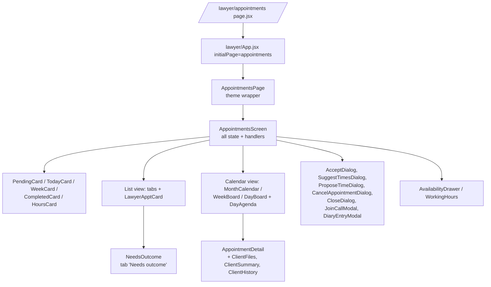
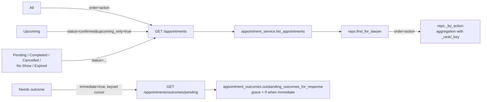
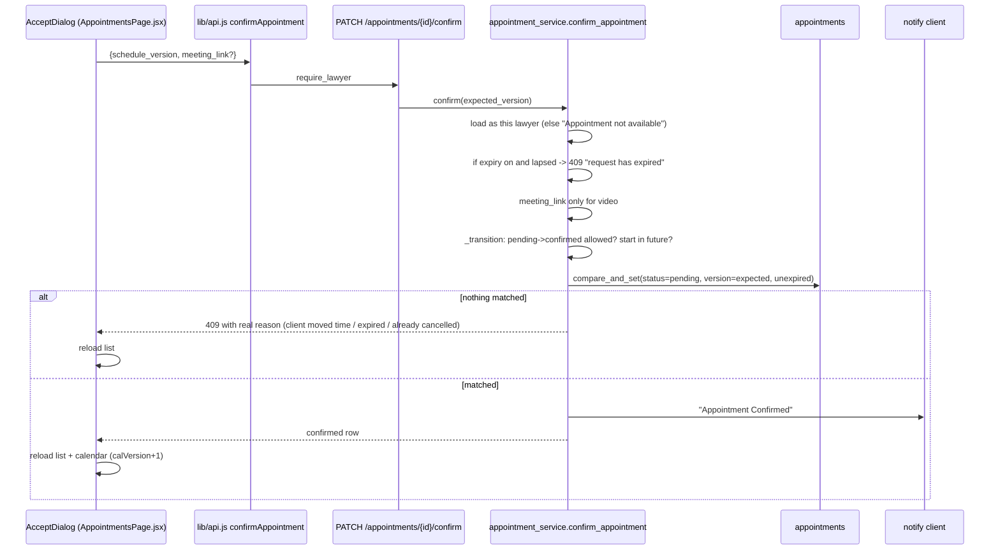
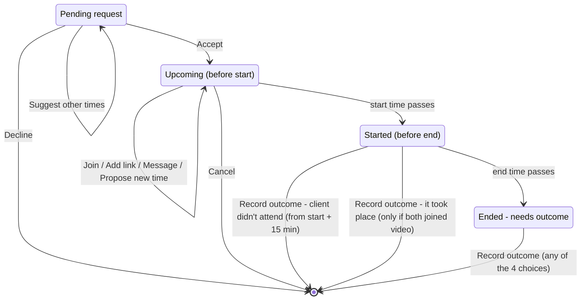

# 14 — Appointments (lawyer side)

This file covers the **lawyer's** screens. The appointment **lifecycle, state
diagram and all shared backend rules** (slots, expiry, timing rules, files,
messages, video, reminders, disputes) are in
[13-appointments-client.md](13-appointments-client.md) — read §4 and §5 there
first. This file only repeats a rule when the lawyer's UI depends on it.

Written by reading the code in October 2026. If this doc and the code disagree,
the code is right.

---

## 1. What it does

The lawyer's **Appointments** page is a work list plus a calendar. From it the
lawyer:

- **answers requests** — Accept (optionally with a joining link), Decline, or
  Suggest other times;
- **meets** — join the in-app video or a pasted link, message the client;
- **records outcomes** after the meeting — It took place / The client didn't
  attend / I couldn't attend / It didn't take place;
- **moves** a confirmed meeting by proposing a new time;
- sees the **calendar** (month / week / day) with appointments, court hearings
  and private diary entries, and sets **working hours**.

The **Dashboard**, **Clients** and **Cases** pages show the same "what is
waiting on me" numbers and jump straight into the right appointment or dialog.

---

## 2. User flow (lawyer)

### 2.1 A new request arrives

1. The lawyer gets a notification "New Appointment Request". Clicking it opens
   the Appointments page on that appointment (deep link, §3.4).
2. On the **Pending** tab (or the "Pending" dashboard card on the page), each
   request card shows the client, time, mode, case title, the client's note,
   any files the client chose to share early, and a **clash check**:
   "No clash with your other appointments or hearings" or "Clashes with: …"
   (confirmed appointments, hearings and diary entries — not other pending
   requests).
3. The lawyer chooses:
   - **Accept** → `AcceptDialog`. Shows what is being agreed, the clash list (a
     clash must be ticked "I understand" before accepting — the lawyer's call,
     not a block), and for video a field for the joining link (sent **with**
     the confirmation). If in-app video is configured, a link is optional.
   - **Suggest other times** → `SuggestTimesDialog` (1–3 times + a note ≤ 300).
     The request stays pending; the client picks one and it becomes confirmed
     automatically. Offered only while the request's start is still in the
     future. Sending again **replaces** the earlier suggestion (the button then
     reads "Change suggestion"), and the card shows "You suggested: … — waiting
     for {client} to pick one." The server does not check suggested times
     against working hours or the diary.
   - **Decline** → `CancelAppointmentDialog` with an optional reason. Stored as
     `cancelled` (from `pending`), the client sees "Declined".
   - **Accept all** (Pending card) → accepts every request that has **no
     clash**, one by one, each with its own `schedule_version`.
4. Accept is disabled once the start time has passed ("This time has already
   passed — cancel the request instead"). Decline always stays available.

### 2.2 Before the meeting (Upcoming)

- **Join Call** (if a link is stored) / **Join video** (in-app) / **Add joining
  link** (`JoinCallModal` → `PATCH /appointments/{id}/meeting-link`).
- **Message client** (shows unread count; a chat badge appears on the card's
  corner when the client wrote something new).
- **Propose new time** (`ProposeTimeDialog`) — only before the start and only
  when there is no open proposal. The client accepts or declines. If the
  **client** proposed, the card offers Accept / Decline; the lawyer can
  withdraw their own.
- **Cancel** — allowed for the lawyer at any time before the end (the 2-hour
  cutoff is a **client-only** rule). This is a **UI** rule: the Cancel button
  is hidden once the meeting has ended. The server has no time limit for a
  lawyer's cancel of a confirmed meeting.
- **Join / Add link** buttons are hidden once the meeting has ended.
- The detail panel shows **Client's documents** (`ClientFiles`), the
  **summary the client shared** (`ClientSummary`, `GET /appointments/{id}/summary`
  — readable while pending, confirmed, completed or no_show), and **"Your other
  appointments with this client"** (`ClientHistory`, up to 5, only this
  lawyer's appointments with this client).

### 2.3 After the meeting (Needs outcome)

1. When `end_at` passes, the meeting moves from **Upcoming** to **Needs
   outcome**. The card warns: "Record what happened. Until you complete it, the
   client cannot hire you or leave a review."
2. **Record outcome** opens **`CloseDialog`** ("Complete the consultation") with
   four choices:

| Choice | API call | Result |
|---|---|---|
| It took place (+ private notes) | `PATCH /appointments/{id}/complete` | `completed`; notes stored as `lawyer_notes` (never shown to the client) |
| The client didn't attend | `PATCH /appointments/{id}/no-show` | `no_show` (cannot be undone; client may dispute) |
| I couldn't attend | `PATCH /appointments/{id}/cancel` with `outcome_code: "lawyer_no_show"` | `cancelled`; client told they can rebook, **not** marked absent |
| It didn't take place | `PATCH /appointments/{id}/cancel` with `outcome_code: "did_not_take_place"` | `cancelled` with that reason |

3. **Early completion ("met" rule).** If both lawyer and client joined the
   in-app video within 15 minutes before the start or later (`video_met`), the
   Record outcome button appears **as soon as the meeting has started**, and
   "It took place" is selectable before the booked end.
4. **No-show before the end.** From **15 minutes after the start** the lawyer can
   open the dialog early, but then **only** "The client didn't attend" is
   selectable; the other options wait for the end (unless they met on video).
5. If the server refuses because the row changed elsewhere (404/409), the
   dialog closes, the list and counts are re-read, and a notice explains why.

### 2.4 After completion

- The completed card shows the hire status: "Review request" (client sent a hire
  request → opens **Cases › New requests**), "Open case" (hired), or "No further
  action needed".
- The client can now hire, review or book a follow-up (see
  [13 §2.5](13-appointments-client.md) and [15](15-hire-engagements.md)).

### 2.5 Case meetings (from the Cases page)

On a case the lawyer holds, **Propose a meeting** (`ProposeMeetingModal` in
`CasesPage.jsx`) sends up to **3 times**, a mode (video / in person), a length
(30 / 60 / 90 min), an agenda and an optional link. The client picks one in
their app → a **confirmed** appointment is created (no accept step). On the
Appointments page these show as **case meetings** (`caseMeeting`,
`caseNumber`), marked apart from first consultations.

Server rules the lawyer meets here (full list in
[13 §5.14](13-appointments-client.md)): the case must be theirs, not closed,
and have a client who is on the platform; mode video or in person only (a link
only for video); the server accepts 30–180 minutes; agenda 3–300 chars; every
time aligned, future, within 90 days and free of the lawyer's appointments,
diary and hearings; one open proposal per case. If the client lets all times
pass, the proposal is written `expired` the next time anyone reads it and the
lawyer gets one "Proposed times passed" notice. If the client declines, the
lawyer gets "Meeting times declined" with the client's optional message; if
the client chooses, "Meeting confirmed".

The Cases page also reads `GET /api/v1/case-consultations/{case_id}`
(`case_consultations.for_case`, lawyer of that case only, else 403/404): the
**originating consultation** (from the engagement's stored `appointment_id`,
preferring an accepted engagement; never guessed by date —
`originating_unavailable: true` when the link is missing or points to another
client/lawyer), plus up to **50** other appointments on that case with this
lawyer (`linked`), and `has_hire`.

### 2.6 Working hours and diary

- **Working hours** (`WorkingHours` / `AvailabilityDrawer`) use
  `GET /api/v1/lawyers/me/availability` and `PUT /api/v1/lawyers/me/availability`.
  The PUT **replaces the whole schedule** (lawyer taken from the token; admin
  may manage any lawyer in the service). Rules
  (`lawyer_availability.validate_schedule`): weekday 0 (Mon)–6 (Sun); `start`
  and `end` exactly `HH:MM` on :00/:30; end after start; no two intervals on
  the same weekday may overlap ("combine them into one"); exception dates
  `YYYY-MM-DD`, each listed once, reason ≤ 200 chars. All in Asia/Karachi.
- Clients see only `GET /lawyers/{id}/availability` (hours plus the
  **dates** off — the reasons stay private) and the computed bookable slots.
- Saved hours only **block** bookings when `appointment_working_hours_enforced`
  is on; with it off they are advice that shapes the client's slot list.
- **Diary entries** (`DiaryEntryModal`, `lawyer_events` via
  `listLawyerEvents` / `createLawyerEvent` / `deleteLawyerEvent`) are private.
  They are removed from clients' bookable slots and block case-meeting times.
- **Export Excel** downloads the shown month as CSV
  (`attorney-ai-diary-YYYY-MM.csv`): appointments + diary entries sorted by
  time, UTF-8 BOM and CRLF for Excel, and cells starting with `= + - @` are
  prefixed with `'` so Excel does not run them as formulas.

---

## 3. Code flow

### 3.1 Page structure

### 3.2 Tabs → API queries

Tabs: **All, Needs outcome, Upcoming, Pending, Completed, Cancelled, No Show,
Expired**. The UI shows `confirmed` as **"Upcoming"** (`mapApiAppt`).

**`order=action` ("All" in the order it is worked)** —
`AppointmentRepository._by_action` computes two sort keys inside MongoDB:

| `_rank` | Group | Sorted by |
|---|---|---|
| 0 | **Needs outcome**: `confirmed` and `end_at < now` | oldest end first |
| 1 | **Request to answer**: `pending` and (`expires_at` missing or in the future) | nearest answer-by time first |
| 2 | **Upcoming**: other `confirmed` | earliest start first |
| 3 | **Everything else** (history, lapsed requests) | newest first |

**Why in the database:** paging (`$skip`/`$limit`) and `total` then agree with
the order. Sorting in the browser would only sort one page.

**`upcoming_only`** means *confirmed and not yet ended* (`end_at ≥ now`). An
ended meeting is not "upcoming" — it belongs to Needs outcome.

Other list details:

- Without `order=action` the lawyer's list is sorted **earliest first**
  (`scheduled_at` ascending); the client's list is newest first.
- The list tabs page **25** at a time (`PAGE_SIZE`) with "load more"; a first-page
  failure and a later-page failure are shown differently (the rows already
  loaded are kept).
- The overview cards' totals for confirmed / pending / completed come from
  three `GET /appointments?status=…&page_size=1` calls (only `total` is
  read); `null` means "unknown".
- The **calendar** fetches all appointments in pages of **50** (server max),
  at most **20 pages** (1000 rows); beyond that it warns "Only your first 1000
  appointments are shown". Diary entries are read for the visible range.
- Unread message counts on cards come from
  `GET /appointment-threads/summary?ids=…` for the visible appointments.
- The outcome queue's `page_size` is 1–200 (default 25 on the route). The
  cursor must be passed back **whole** (`after_end_at`, `after_id`,
  `cutoff`); a partial cursor or a future `cutoff` is refused (422).

**Needs outcome** uses the outcome queue with **`immediate=true`**, so the grace
is **0**: a meeting is listed the moment it ends. The default 2-hour grace
(`DEFAULT_GRACE`) is kept for reminders/nudges and disputes, so a meeting that
runs a bit late is not nagged. The queue uses a **keyset cursor**
(`end_at`, `_id`) instead of page numbers, because rows leave the queue as
outcomes are recorded and page numbers would skip rows.

### 3.3 Answering a request

**Why `schedule_version` is required:** the client may move a pending request
while the lawyer is reading it. The status stays `pending`, so only the version
can tell that the time changed. If the row has no usable version the UI refuses
to send and reloads instead of guessing.

Decline / suggest / move / outcomes follow the same pattern:

| Lawyer action | `lib/api.js` | Route | Service |
|---|---|---|---|
| Accept | `confirmAppointment` | `PATCH /appointments/{id}/confirm` | `confirm_appointment` |
| Decline / cancel | `cancelAppointment(id, reason)` | `PATCH /appointments/{id}/cancel` | `cancel_appointment` |
| Suggest other times | `suggestAppointmentTimes` | `POST /appointments/{id}/suggest-times` | `appointment_suggestions.suggest_times` |
| Add / change joining link | `setMeetingLink` | `PATCH /appointments/{id}/meeting-link` | `set_meeting_link` (pending or confirmed, video only, HTTPS) |
| Propose / accept / decline / withdraw a move | `proposeNewTime`, `acceptNewTime`, `declineNewTime`, `withdrawNewTime` | `/appointments/{id}/reschedule-proposal…` | `appointment_reschedule_proposals` |
| It took place | `completeAppointment(id, {lawyer_notes})` | `PATCH /appointments/{id}/complete` | `complete_appointment` |
| Client didn't attend | `markNoShow` | `PATCH /appointments/{id}/no-show` | `mark_no_show` |
| I couldn't attend / didn't take place | `cancelAppointment(id, null, code)` | `PATCH /appointments/{id}/cancel` | `cancel_appointment` with `outcome_code` |
| Needs outcome list | `listPendingOutcomes({immediate:true, cursor})` | `GET /appointments/outcomes/pending` | `appointment_outcomes` |
| Counts | `getLawyerActions` | `GET /lawyer-actions` | `lawyer_actions.action_counts` |
| Client's files | `listAppointmentFiles`, `openAppointmentFile` | `/appointment-files/{id}…` | `appointment_files` |
| Join video | `joinVideo` | `POST /appointment-video/{id}/join` | `appointment_video.join` |
| Attendance check (after the client joins / the call closes) | `checkVideoAttendance` | `POST /appointment-video/{id}/attendance` | `appointment_video.check_attendance` → Daily `/meetings`; on yes the page re-reads (`attorney:video-met`) |
| Propose a case meeting (Cases page) | `proposeMeeting`, `listMeetingProposals`, `withdrawMeetingProposal` | `/meeting-proposals…` | `meeting_proposal_service` |
| Client's shared summary | `readSharedSummary` | `GET /appointments/{id}/summary` | `appointment_summary_share.read` |
| Unread counts on cards | `getThreadSummary` | `GET /appointment-threads/summary` | `appointment_thread_reads.summary` |
| Working hours | `getMyWorkingHours`, `saveMyWorkingHours` | `GET/PUT /lawyers/me/availability` | `lawyer_availability_service` |
| Case consultations (Cases page) | `getCaseConsultations` | `GET /case-consultations/{case_id}` | `case_consultations.for_case` |

### 3.5 All lawyer-side endpoints (full paths)

Every appointment endpoint is listed with its full path in
[13 §3.5](13-appointments-client.md). These are the ones the lawyer uses or
that exist only for lawyers:

| Method + path | Who | What |
|---|---|---|
| `GET /api/v1/appointments?order=action&upcoming_only=…` | lawyer | Work list (§3.2). |
| `GET /api/v1/appointments/outcomes/pending` | lawyer | Needs outcome queue (keyset). |
| `GET /api/v1/appointments/{id}` | lawyer of it | One row (with `lawyer_notes`). |
| `PATCH /api/v1/appointments/{id}/confirm` | lawyer | Accept. |
| `POST /api/v1/appointments/{id}/suggest-times` | lawyer | Suggest times (10/min). |
| `PATCH /api/v1/appointments/{id}/meeting-link` | lawyer | Add/replace link. |
| `PATCH /api/v1/appointments/{id}/cancel` | lawyer | Decline / cancel / outcome codes. |
| `PATCH /api/v1/appointments/{id}/complete` | lawyer | It took place. |
| `PATCH /api/v1/appointments/{id}/no-show` | lawyer | Client didn't attend. |
| `POST /api/v1/appointments/{id}/reschedule-proposal[/accept\|/decline\|/withdraw]` | lawyer or client | Move a confirmed meeting. |
| `GET/POST /api/v1/appointments/{id}/messages` | lawyer or client | Thread. |
| `GET /api/v1/appointments/{id}/summary` | lawyer or client | Shared summary. |
| `GET /api/v1/appointment-files/{id}`, `GET …/{file_id}/download` | lawyer (per status) | Client's files. |
| `GET /api/v1/appointment-video`, `GET /api/v1/appointment-video/{id}`, `POST …/{id}/join` | lawyer or client | Video (lawyer token is `is_owner`). |
| `GET /api/v1/appointment-threads/summary`, `POST /api/v1/appointment-threads/{id}/read` | lawyer or client | Read receipts. |
| `POST /api/v1/meeting-proposals`, `POST /api/v1/meeting-proposals/{id}/withdraw` | lawyer | Case meeting proposals. |
| `GET /api/v1/meeting-proposals?case_id=&status=` | lawyer or client | Own proposals. |
| `GET /api/v1/lawyer-actions` | lawyer | Shared counts (§3.6). |
| `GET /api/v1/lawyers/me/availability`, `PUT /api/v1/lawyers/me/availability` | lawyer | Own working hours. |
| `GET /api/v1/case-consultations/{case_id}` | lawyer of the case | Originating + linked consultations. |

### 3.4 Deep links between lawyer pages

The lawyer app is one React app with pages switched by state, not by URL. To
open "that exact item" on another page, the caller **writes an id to
`sessionStorage`** (survives a reload on the way) **and dispatches a window
event** (for when the page is already open). The target page reads the key once
at mount, listens for the event, then removes the key.

| Key | Event | Set by | Opens |
|---|---|---|---|
| `attorney:lawyer-open-appointment` | `attorney:open-appointment` | `App.jsx` (notification click), `DashboardPage`, `ClientsPage`, `CasesPage` | That appointment on the Appointments page |
| `attorney:lawyer-open-appointment-thread` | — | `App.jsx`, `ClientsPage` | Also opens its message thread |
| `attorney:lawyer-record-outcome` | `attorney:record-outcome` | `DashboardPage`, `ClientsPage` ("Record outcome") | Switches to **Needs outcome** and opens `CloseDialog` for that meeting |
| `attorney:lawyer-open-request` | `attorney:open-request` | `AppointmentsPage` (completed card → "Review request"), `DashboardPage` | **Cases › New requests** on that hire request |

For `record-outcome`, the page re-reads the appointment with `getAppointment`.
It opens the dialog only if the row is still `confirmed` and its end has
passed. Otherwise it removes the key and shows "That meeting no longer needs an
outcome. Here are the ones that do." The key is kept until the dialog closes,
so a refresh re-opens it.

`attorney:lawyer-appts-range` (in `localStorage`, not session) remembers the
calendar range (day / week / month).

### 3.6 Shared counts (`lawyer_actions.py`)

`GET /lawyer-actions` → [lawyer_actions.py](../../backend/app/services/lawyer_actions.py).
Before this, the Dashboard, Appointments page and Clients page each counted in
their own way and disagreed. Now all read one set of database filters
(`queries()`):

| Count | Filter | Is it the lawyer's action? |
|---|---|---|
| `appointment_requests` | `pending` and (`expires_at` null or in the future) | yes |
| `outcomes_to_record` | `confirmed` and `end_at < now` (**no grace**) | yes |
| `hire_requests` | engagements `requested` | yes |
| `upcoming` | `confirmed` and `end_at ≥ now` | no (info) |
| `waiting_for_client` | engagements `terms_proposed` | no — the client owes the answer |

The response also has `to_do` (sum of the three action counts) and `next` —
the **oldest** item of each action queue — so a button like "Record outcome" can
open the one to do first. The Clients index uses the **same filters** grouped by
client, so a client card can never disagree with these numbers (see
[17](17-lawyer-dashboard-and-clients.md)).

On the Appointments page the **Needs outcome** tab count comes from this
endpoint; `null` means "not known" and is never shown as 0.

---

## 4. Data & states

The appointment document, its fields and the full lifecycle diagram are in
[13 §4](13-appointments-client.md). The lawyer UI renames statuses for display:

| Stored status | Lawyer UI label | Tab |
|---|---|---|
| `pending` | Pending | Pending (and rank 1 in All) |
| `confirmed`, not ended | Upcoming | Upcoming (rank 2 in All) |
| `confirmed`, ended | Upcoming + "Record what happened" | **Needs outcome** (rank 0 in All) |
| `completed` | Completed | Completed |
| `cancelled` | Cancelled (a declined request too) | Cancelled |
| `no_show` | No Show | No Show |
| `expired` | Expired | Expired |

The lawyer's action buttons by situation (from `LawyerApptCard` and the gates in
`AppointmentsScreen`):

Front-end gates (they mirror the server's `timing_error`; the **server** is
the real rule):

| Gate | True when |
|---|---|
| `canAccept` | now < start |
| `canNoShow` | now ≥ start + 15 min (`NO_SHOW_GRACE_MS`) |
| `canComplete` | now ≥ end, **or** (`videoMet` and now ≥ start) |

The page reads `Date.now()` once per tick (`CLOCK_TICK_MS = 30000`) so every
button on one paint is decided against the same instant.

Other collections the lawyer page reads: `cases` (hearing dates and titles for
the calendar and the "About" line), `lawyer_events` (private diary meetings and
events), the lawyer's working hours, and `engagements` (hire state on completed
cards).

---

## 5. Key logic & rules (lawyer-specific)

1. **Re-read, do not patch.** After every action the page calls `reload()` and
   bumps `calVersion`, because the server owns the outcome and the new row
   carries the new `schedule_version` that later actions must pin.
2. **Stale responses lose.** `requestToken` makes only the newest list request
   write state, so switching tabs quickly never shows rows from an old tab.
   `moreInFlight` (a ref, not state) stops a double click loading the same page
   twice.
3. **Clashes are advice, not a block.** `requestClashes` checks confirmed
   appointments, hearings (counted as 60 min from their time, 10:00 if none)
   and diary entries. Accept with a clash needs an explicit tick. "Accept all"
   skips clashing requests. The server's real guard is the unique slot index
   (only appointments — diary entries are not in it).
4. **Private notes.** "It took place" notes are saved as `lawyer_notes`, which
   `_sanitize` returns only to the lawyer.
5. **Outcome codes vs no-show.** "I couldn't attend" and "It didn't take place"
   end as `cancelled` with an `outcome_code`, so the client is **not** recorded
   as absent. Only "The client didn't attend" writes `no_show`, which the client
   can dispute. All four are only possible on a **confirmed** meeting that **has
   started**; the server checks both.
6. **No-show grace.** A no-show is refused until 15 minutes after the start, so
   the client has time to arrive (it is a mark against them).
7. **Early completion.** `video_met` (both joined from 15 min before the start)
   lets the lawyer complete from the start. Joining a day early to test the
   camera does not count. See [13 §5.11](13-appointments-client.md).
8. **Files while pending.** The lawyer only receives files the client ticked
   "show before accept"; all files appear once accepted; nothing after decline,
   cancel or expiry. See [13 §5.7](13-appointments-client.md).
9. **Case meeting proposals** (server rules in `meeting_proposal_service`):
   only on a case assigned to this lawyer and not closed; 1–3 different, aligned,
   future times within 90 days; each time must not clash with the lawyer's
   appointments, hearings or diary; only **one open proposal per case**
   (withdraw it first to send new times). Open proposals whose times have all
   passed are written as `expired`.
10. **Notifications drive refresh.** New `appointment_*` notifications reach the
    page over the WebSocket; the page re-reads so a client's cancel or move
    shows without a manual refresh.

---

## 6. Files

| File | Role |
|---|---|
| [app/lawyer/appointments/page.jsx](../../frontend/src/app/lawyer/appointments/page.jsx) | Route; renders the lawyer `App` on the appointments page. |
| [AppointmentsPage.jsx](../../frontend/src/components/lawyer/AppointmentsPage.jsx) | The whole page: `AppointmentsScreen`, tabs, `NeedsOutcome`, `LawyerApptCard`, `AcceptDialog`, `SuggestTimesDialog`, `ProposeTimeDialog`, `CancelAppointmentDialog`, `CloseDialog`, `JoinCallModal`, calendar boards, `WorkingHours`, `DiaryEntryModal`, CSV export. |
| [App.jsx](../../frontend/src/components/lawyer/App.jsx) | Lawyer shell; notification clicks write the open-appointment keys. |
| [DashboardPage.jsx](../../frontend/src/components/lawyer/DashboardPage.jsx) | Uses `/lawyer-actions`; deep links (open appointment, record outcome, open request). |
| [ClientsPage.jsx](../../frontend/src/components/lawyer/ClientsPage.jsx) | Client cards with next action; deep links into appointments. |
| [CasesPage.jsx](../../frontend/src/components/lawyer/CasesPage.jsx) | `ProposeMeetingModal`, case meeting proposals, New requests (reads `attorney:lawyer-open-request`). |
| [VideoJoin.jsx](../../frontend/src/components/shared/VideoJoin.jsx), [VideoCall.jsx](../../frontend/src/components/shared/VideoCall.jsx) | Shared video join and call. |
| [AppointmentThread.jsx](../../frontend/src/components/shared/AppointmentThread.jsx) | Shared message thread. |
| [lib/api.js](../../frontend/src/lib/api.js) | API functions listed in §3.3. |
| [routes/appointments.py](../../backend/app/api/v1/routes/appointments.py) | Confirm, cancel, complete, no-show, suggest-times, meeting-link, outcomes/pending, list. |
| [routes/lawyer_clients.py](../../backend/app/api/v1/routes/lawyer_clients.py) | `GET /lawyer-actions` and the Clients index. |
| [routes/meeting_proposals.py](../../backend/app/api/v1/routes/meeting_proposals.py) | Case meeting proposals. |
| [lawyer_actions.py](../../backend/app/services/lawyer_actions.py) | The one shared definition of "waiting on the lawyer". |
| [routes/lawyers.py](../../backend/app/api/v1/routes/lawyers.py) | `/lawyers/me/availability`, `/lawyers/{id}/availability`, `/lawyers/{id}/bookable-slots`. |
| [lawyer_availability_service.py](../../backend/app/services/lawyer_availability_service.py), [lawyer_availability.py](../../backend/app/services/lawyer_availability.py) | Working hours: validation, bookable slots (minus appointments, hearings, diary), `assert_bookable` when enforced. |
| [routes/case_consultations.py](../../backend/app/api/v1/routes/case_consultations.py), [case_consultations.py](../../backend/app/services/case_consultations.py) | A case's originating consultation and linked meetings. |
| [appointment_service.py](../../backend/app/services/appointment_service.py) | State changes, listing, sanitising (`lawyer_notes` for lawyer only). |
| [appointment_outcomes.py](../../backend/app/services/appointment_outcomes.py) | Outcome queue (keyset), grace, nudges. |
| [appointment_suggestions.py](../../backend/app/services/appointment_suggestions.py) | Suggest other times. |
| [appointment_reschedule_proposals.py](../../backend/app/services/appointment_reschedule_proposals.py) | Moving a confirmed meeting. |
| [meeting_proposal_service.py](../../backend/app/services/meeting_proposal_service.py) | Case meeting proposals. |
| [appointment_repo.py](../../backend/app/repositories/appointment_repo.py) | `find_for_lawyer`, `_by_action` ranking, outcome queue query. |
| [appointment_transitions.py](../../backend/app/services/appointment_transitions.py) | State table and timing rules (shared). |

---

## 7. Known limits (from the code)

- The front-end gates copy the server's timing rules; if they drift, the server
  still refuses and the dialog shows the server's reason.
- The **record-outcome deep link** only opens the dialog when the meeting's end
  has passed. A meeting that could be completed early (both joined video) is
  sent to the Needs outcome tab instead of opening the dialog.
- `ClientFiles` still has a "Opens after you accept" label for locked files, but
  the backend no longer returns locked files to the lawyer while pending (it
  hides them completely), so that label is not normally reached.
- "Accept all" confirms requests one at a time; a failure is counted and shown
  ("Accepted 3; 1 could not be accepted").
- Diary entries and hearings are **not** in the unique slot index, so a clash
  with them is only a warning on accept (case meeting proposals do check them on
  the server).
- Outcome nudges, reminders and expiry are **off by default** (see
  [13 §5.12](13-appointments-client.md)); with defaults, the only prompt to
  record an outcome is the Needs outcome tab and the dashboard count.
- The lawyer **cannot change the time of a pending request** directly — only
  suggest times — and cannot move a confirmed meeting without the client's
  acceptance.
- Suggested times and move proposals are not checked against the lawyer's own
  working hours, hearings or diary on the server (only against other
  appointments), so a lawyer can offer a time that clashes with a hearing.
- The server lets a lawyer cancel a confirmed meeting after it has ended; only
  the UI hides the button.
- The calendar shows at most 1000 appointments (20 × 50) and says so.
- Meeting proposals expire lazily (on the next read/action); the
  `sweep_expired` job exists but is not scheduled.
