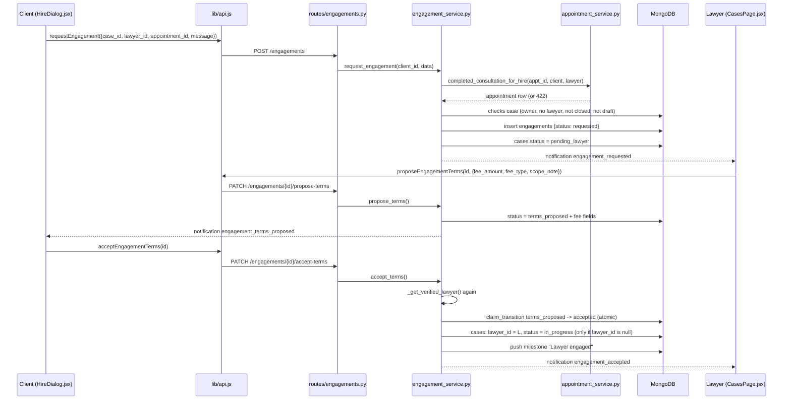
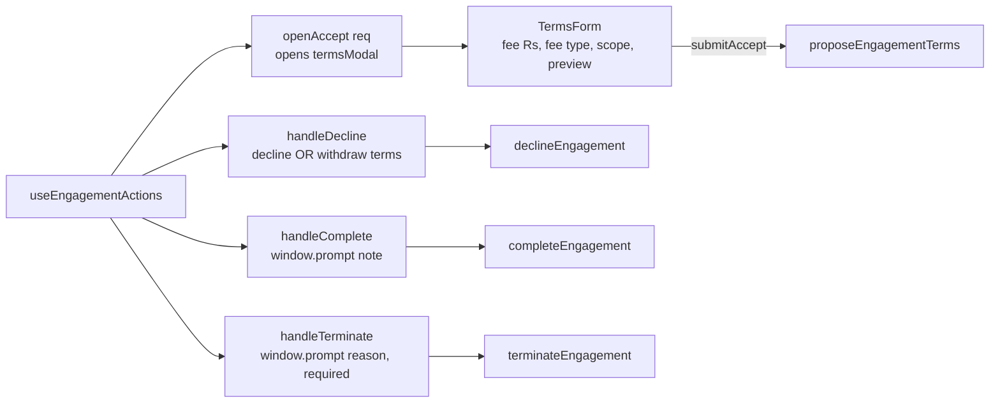
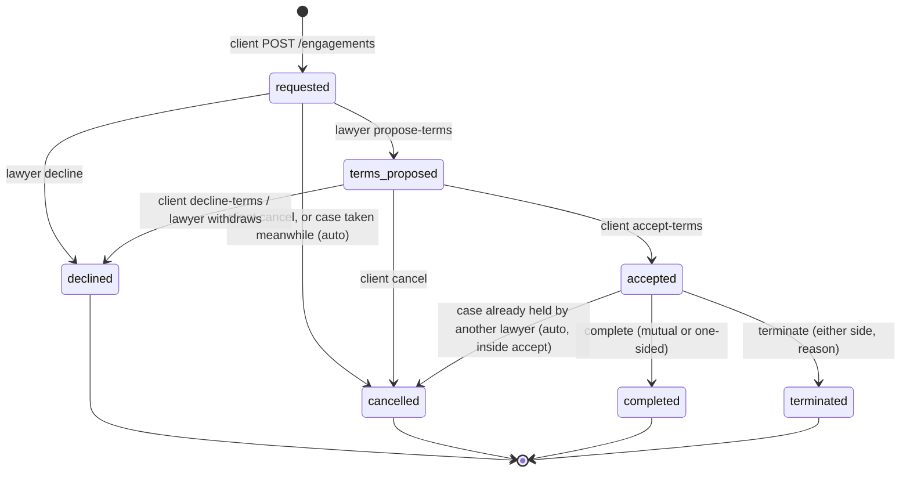

# 15 — Hire a lawyer (engagements)

> Written from the code in October 2026. If this doc and the code disagree, the code is right.

## 1. What it does

After a client has had a **completed consultation** with a lawyer, the client can ask that lawyer to take a case. This request is called an **engagement**.

- The client sends a **hire request** (for one case).
- The lawyer answers with **terms**: a fee in rupees, a fee type, and an optional note on what the fee covers.
- The client **accepts** or **declines** the terms.
- Only when the client accepts does the lawyer get the case. The case moves to `in_progress`.
- Later, either side can **complete** the engagement (work finished) or **terminate** it (relationship ended early).

The client can also **review** (rate) a lawyer after a completed consultation or after hiring them.

The key idea: **the client sees the price before anything is agreed.** The lawyer never "takes" a case by themselves.

## 2. User flow

### Hiring, step by step

| # | Who | What they do | Where in the UI |
|---|-----|--------------|-----------------|
| 1 | Client + lawyer | Have a consultation. The lawyer marks it **completed** (see doc 14). | Appointments |
| 2 | Client | Clicks **Request to hire** on the completed consultation. Chooses a case (or a draft, or describes a new matter), writes an optional message, sends. | Client Appointments page → `HireDialog` (mode `request`) |
| 3 | Lawyer | Sees the request in **Cases → New hire requests** (also on Dashboard brief and Clients page). Clicks **Send terms**. | `CasesPage` → `TermsForm` |
| 4 | Lawyer | Enters fee (Rs), picks fee type (Fixed / Per hour / Per hearing), optional scope. A preview line shows what the client will see. Sends. | `TermsForm` |
| 5 | Client | Opens **Review terms**. Sees fee, fee type, scope. Clicks **Accept and engage** or **Decline** (optional reason). | `HireDialog` (mode `terms`) |
| 6 | System | On accept: the case gets `lawyer_id`, status `in_progress`, a milestone "Lawyer engaged" is added, the lawyer is notified. | backend |
| 7 | Either | Later: **Mark complete** (handshake) or **End engagement** (reason required). | Lawyer: case Overview. Client: Lawyers page (`ModLawyers`) |
| 8 | Client | Leaves a star review of the lawyer. | `ReviewLawyerDialog` on the Appointments page |

Other exits before acceptance:

- Client can **withdraw** the request (`requested` or `terms_proposed`) → `cancelled`.
- Lawyer can **decline** a request, or **withdraw** terms already sent → `declined`.

### What the client sees in `HireDialog`

`HireDialog` picks its **mode** from the engagement attached to the appointment:

| Mode | When | Shows |
|------|------|-------|
| `request` | no engagement yet for this consultation | case picker, new-matter fields, message box, **Send hire request** |
| `sent` | status `requested` | lawyer, case, date, message, **Withdraw request** |
| `terms` | status `terms_proposed` | big fee (`Rs 50,000`), fee type label, scope, **Accept** / **Decline** |
| `closed` | any other status | "It was declined/cancelled… book a follow-up to ask again" |

The case picker in `request` mode:

- Lists cases from `hireableCases()` (live, no lawyer, no open request).
- If the consultation was booked **for a case**, only that case is offered.
- Draft cases are offered as "draft, confirmed when sent". On send, the dialog first calls `confirmCase`.
- "＋ Describe a new matter" creates a case first (`createCase`) with title, area of law, province and description.
  - Checks before creating: title ≥ 3 chars, area of law chosen (civil / family / criminal / constitutional), province chosen, description ≥ 10 chars. Errors show inside the dialog.
  - After the case is created its id is kept, so pressing Send again after a failed request **reuses** that case instead of creating a second one.
- If loading the cases or engagements fails, the dialog says "Could not load your cases. This is not the same as having none." with **Retry**.
- If the consultation was booked for a case that can no longer be sent (already has a lawyer, or a request is open), the dialog says so and the Send button is disabled.
- Withdraw and Decline each ask for confirmation inside the dialog. Decline takes an optional reason (≤ 1000 chars, "shown to" the lawyer). Escape or a backdrop click closes the dialog unless a call is running.

## 3. Code flow

### Request → terms → accept

Step by step in plain words:

1. **Frontend.** `HireDialog.sendRequest()` calls `requestEngagement()` in [lib/api.js](../../frontend/src/lib/api.js). Every engagement call is wrapped in `_changesEngagement(...)`, which clears a 2-second shared cache of `listEngagements()` so the next read is fresh.
2. **Route.** [routes/engagements.py](../../backend/app/api/v1/routes/engagements.py) checks the role with `require_client`, `require_lawyer` or `require_client_or_lawyer`, then calls the service. Routes hold no logic.
3. **Service.** [engagement_service.py](../../backend/app/services/engagement_service.py) does all checks and writes. It uses `EngagementRepository` ([engagement_repo.py](../../backend/app/repositories/engagement_repo.py)) and `CaseRepository`.
4. **Collections.** `engagements`, `cases`, `notifications` (via `notification_service`).

### All endpoints

| Method + path | Who | Service function | Result |
|---------------|-----|------------------|--------|
| `POST /engagements` | client | `request_engagement` | new row, `requested` |
| `GET /engagements?status=` | client or lawyer | `list_engagements` | own rows + names, case title, `consultation` |
| `PATCH /engagements/{id}/propose-terms` | lawyer | `propose_terms` | `terms_proposed` |
| `PATCH /engagements/{id}/accept-terms` | client | `accept_terms` | `accepted`, case assigned |
| `PATCH /engagements/{id}/decline-terms` | client | `decline_terms` | `declined` (by client) |
| `PATCH /engagements/{id}/decline` | lawyer | `decline_engagement` | `declined` (by lawyer, maybe `terms_withdrawn`) |
| `PATCH /engagements/{id}/cancel` | client | `cancel_engagement` | `cancelled` |
| `PATCH /engagements/{id}/complete` | either | `complete_engagement` | proposal, then `completed` |
| `PATCH /engagements/{id}/terminate` | either | `terminate_engagement` | `terminated`, case released |
| `GET /appointments/hire-eligible/{lawyer_id}` | client | appointment service | completed consultations that can lead to a hire (used by `ModLawyers`). Not paged (one client–lawyer pair only). A consultation **already named by any engagement** (whatever its outcome) is left out, because it could only be refused |
| `GET /lawyers/{id}/reviews?page=&page_size=` | any signed-in user | `lawyer_service.list_reviews` | a page of reviews (`page_size` 1–50, default 10). No reviewer id or email |
| `GET /lawyers/{id}/review-eligibility` | client | `lawyer_service.review_eligibility` | `{can_review, already_reviewed, reason}` |
| `POST /lawyers/{id}/review` | client | `lawyer_service.submit_review` | 201 "Review submitted" |

All paths above are under the API prefix **`/api/v1`** (for example `POST /api/v1/engagements`). The review routes live in [routes/lawyers.py](../../backend/app/api/v1/routes/lawyers.py).

`GET /engagements` details: an optional `status` filter is applied in the query; rows are sorted **newest first** (`created_at` desc). Any role other than client/lawyer gets 403 "Only clients and lawyers have engagements". The internal field `review_request_guard` is removed from every response.

### Request body limits (schemas/engagement.py)

| Body | Field | Rule |
|------|-------|------|
| `EngagementRequest` | `case_id`, `lawyer_id` | required |
| | `appointment_id` | required, at least 1 character (checked fully by the service) |
| | `message` | optional, ≤ 2000 chars (the `HireDialog` textarea stops at 1000) |
| `EngagementTerms` | `fee_amount` | required number ≥ 0 |
| | `fee_type` | required, one of `fixed`, `hourly`, `per_hearing` |
| | `scope_note` | optional, ≤ 2000 chars |
| `EngagementDecline` (decline, decline-terms) | `reason` | optional, ≤ 1000 chars |
| `EngagementComplete` | `note` ≤ 2000, `one_sided` (default false) | note required when `one_sided` (service check) |
| `EngagementTerminate` | `reason` | required, 1–1000 chars |
| `LawyerReview` | `stars` int, `comment` optional | stars 1–5 checked in the service (422); comment is **cut** to 1000 chars on save, not rejected |

### Error answers

| Where | Code | Reason |
|-------|------|--------|
| request | 422 | no `appointment_id` ("Book a consultation with this lawyer first…"), consultation with a different lawyer, not `completed`, or its end time not passed yet |
| request | 404 / 403 | consultation not the client's (same answer as missing); case missing (404) or not the client's (403) |
| request | 409 | case already has a lawyer; another open request on the case; this consultation already used for a hire (duplicate key on `appointment_id`) |
| request | 422 | case closed/dismissed, case is a draft, consultation booked for a different case, lawyer inactive / not approved / profile not finished |
| propose-terms | 403 / 422 / 409 | not your request; not in `requested` or fee/fee type missing; case taken meanwhile (request auto-cancelled) |
| accept-terms | 403 / 422 / 409 | not your engagement; no terms to accept (wrong status) or lawyer no longer verified; case held by someone else (engagement auto-cancelled) |
| decline / cancel / decline-terms | 403 / 422 | not yours; status not open (`requested`/`terms_proposed`), or for decline-terms not `terms_proposed` |
| complete | 422 | not `accepted`; the **same** party proposing a second time ("the other party needs to confirm it. Complete it one-sided…"); one-sided with no note; lost a race to a concurrent completion/termination (flag-on path) |
| terminate | 422 | not `accepted`; blank reason; lost a race ("no longer active… Reload it") |
| review | 403 / 409 / 404 | no working relationship; already reviewed; lawyer id not a lawyer |

Note: there is **no** old `PATCH /accept` route. The code comment says it was removed on purpose, because it let a lawyer set a fee and take the case in one call.

### Lawyer side: `useEngagementActions`

[CasesPage.jsx](../../frontend/src/components/lawyer/CasesPage.jsx) exports a hook `useEngagementActions(onChanged, showToast)`. It is used in three places: the Cases list, the case workspace, and the Clients page.

- `submitAccept` checks the fee is a number ≥ 0 and shows the error **inside the dialog**.
- `handleDecline` asks a different question when the status is `terms_proposed` ("withdrawing your terms") — same endpoint, honest wording.
- `TermsForm` shows the client name, case title, case number and **"After consultation on …"** (from the `consultation` field). The preview line reads like: *"Ali will see Rs 50,000 · Fixed fee (whole case). Nothing is assigned until they accept."*

## 4. Data & states

### Collection `engagements`

| Field | Meaning |
|-------|---------|
| `_id` | random string (`secrets.token_urlsafe(16)`); API returns it as `id` |
| `case_id`, `client_id`, `lawyer_id` | the three parties |
| `appointment_id` | the completed consultation this hire followed (required for new hires) |
| `status` | see diagram below |
| `message` | client's note to the lawyer |
| `fee_amount`, `fee_type`, `scope_note`, `terms_proposed_at` | lawyer's terms. `fee_type` ∈ `fixed`, `hourly`, `per_hearing` |
| `accepted_at` | when client accepted |
| `decline_reason`, `declined_by` (`client`/`lawyer`), `terms_withdrawn` | decline details |
| `completion_proposed_by`, `completion_proposed_at`, `completion_note`, `completed_at`, `completed_by`, `completion_kind` (`mutual`/`one_sided`) | completion handshake |
| `terminated_at`, `terminated_by`, `termination_reason` | early end |
| `agreement_id`, `letter_anomaly`, `letter_anomaly_at` | legacy engagement letters only (new engagements have none). `letter_anomaly` is `letter_missing` or `letter_superseded` |
| `declined_at`, `decline_source`, `declined_agreement_id` | legacy "letter declined" path: `decline_source = "engagement_letter"` tells it apart from a normal terms decline |
| `created_at`, `updated_at`, `responded_at` | `responded_at` is stamped on **every** status change (`set_status` / `claim_transition`) |

**List-only fields** added by `list_engagements` (not stored): `client_name`, `lawyer_name`, `case_title`, `case_number`, `case_type`, `case_description` (first 400 chars), `consultation`, `consultation_unavailable`.

### `consultation` and `consultation_unavailable`

`list_engagements` calls `consultations_for()` in [case_consultations.py](../../backend/app/services/case_consultations.py):

- It reads the appointments named by each engagement's **stored** `appointment_id` (one query for all).
- The appointment counts only if its `client_id` and `lawyer_id` match the engagement.
- If it matches → `consultation` = a small row (`scheduled_at`, `end_at`, `mode`, `status`, `note`).
- If not (legacy engagement with no id, or appointment gone) → `consultation = null`, `consultation_unavailable = true`.

The code never "guesses" a nearby meeting. Missing means missing.

### Engagement lifecycle

Groups defined in [constants.py](../../backend/app/core/constants.py):

- `ENGAGEMENT_OPEN_STATUSES` = `requested`, `terms_proposed` (still negotiating).
- `ENGAGEMENT_RETAINED_STATUSES` = `accepted`, `completed`, `terminated` (a real relationship happened).

### What happens to the case

| Engagement event | Case change |
|------------------|-------------|
| request created | `open` → `pending_lawyer` (only if no lawyer) |
| declined / cancelled | `pending_lawyer` → `open` (`_reopen_case`) |
| accepted | `lawyer_id` set, status `in_progress`, milestone "Lawyer engaged — name" |
| completed | status `closed`, `closed_at` set, lawyer **stays** on the case, milestone "Engagement completed" |
| terminated | `lawyer_id` cleared, status `open`, milestone "Engagement ended by the client/lawyer", old messages/tasks sealed to that lawyer |

## 5. Key logic & rules

### Request rules (`request_engagement`)

Checked in this order:

1. **Consultation first.** `appointment_service.completed_consultation_for_hire()` requires: an `appointment_id`, owned by this client, with **this** lawyer, status `completed`, and its end time really passed. Why: a client should talk to the lawyer before hiring them.
2. Case exists and belongs to the client.
3. Case has no lawyer yet, is not `closed`/`dismissed`, and is **not a draft** (`assert_not_draft`). Why: a draft is unconfirmed work and must not cost a lawyer's time.
4. If the consultation was booked for a case, the hire must be for **that** case.
5. No other open request on this case (`find_pending_for_case`).
6. Lawyer is active, KYC-verified, and — if auto-approved — has a complete profile (`_get_verified_lawyer`). Related flag: `lawyer_auto_approve` in [config.py](../../backend/app/core/config.py).

After the insert, the case is moved to `pending_lawyer` with a filter `lawyer_id: None` (so a case that got a lawyer meanwhile is not touched), and the lawyer gets the `engagement_requested` notification.

### Notifications sent

All go through `_notify()` → `notification_service.create_notification`. A failed notification is **logged and swallowed**; it never fails the engagement action. Terminate is the exception: it uses the event outbox (see Terminate).

| Event | To | Type | Title |
|-------|----|------|-------|
| request | lawyer | `engagement_requested` | "New case request" (client name, case title + number) |
| propose terms | client | `engagement_terms_proposed` | "A lawyer sent you terms" + " Fee: PKR 50,000 (fixed fee)." |
| accept terms | lawyer | `engagement_accepted` | "Your terms were accepted" + fee |
| client declines terms | lawyer | `engagement_declined` | "Your terms were declined" (+ reason) |
| lawyer declines / withdraws | client | `engagement_declined` | "Engagement request declined" or "Terms withdrawn" (+ reason, + "You can request another lawyer from the directory.") |
| client cancels | lawyer | `engagement_cancelled` | "Case request withdrawn" |
| first completion call | other party | `engagement_completion_proposed` | "Completion proposed" ("…Confirm to close the engagement.") |
| completion done | other party | `engagement_completed` | "Engagement completed" |
| terminate | other party | `engagement_terminated` | "Engagement ended" (reason; if the **lawyer** ended it and the case was released, adds "Your case is open again…") |

Every payload carries `engagement_id` and `case_id`, which the bell uses for deep links.

### Database guards (in [indexes.py](../../backend/app/db/indexes.py))

Plain indexes too: `case_id`, `client_id`, `lawyer_id`, `status`, `created_at` (desc).

- `uniq_pending_engagement` — unique partial index on `case_id` for open statuses. **At most one open request per case**, even if two requests race.
- `uniq_engagement_appointment` — unique on `appointment_id` (when it is a string). **One hire attempt per consultation**, even if it was declined or cancelled. The client must book a new consultation to ask again. `HireDialog` warns about this before withdrawing.

When a duplicate key error happens, the service reads `keyPattern` to tell which guard fired and gives the right message.

### Propose terms

- Only the lawyer the request was sent to, only from `requested`.
- `fee_amount` (≥ 0) and `fee_type` are **required** (schema + service). Why: the client must see a price before consenting.
- If the case was assigned to someone else meanwhile, the request is auto-cancelled and a 409 is returned.

### Accept terms (the important one)

- Only the client, only from `terms_proposed`. A second click on an already-accepted engagement **returns the same result** instead of an error (idempotent).
- KYC is checked **again**, before any write.
- Two atomic steps, in this order:
  1. `claim_transition(terms_proposed → accepted)` — the status filter is in the update, so only one caller wins.
  2. Claim the case with filter `lawyer_id: None`. If someone else holds it, the engagement becomes `cancelled` and a 409 is raised.
- **No engagement letter** is created any more. The accepted engagement itself is the record of consent.
- `schedule_embed(lawyer_id)` re-embeds the lawyer's profile (their case history changed), in the background.

### Complete (handshake)

- Only from `accepted`. Either party.
- First call (not one-sided) = **proposal**: stores `completion_proposed_by`, notifies the other side. Status stays `accepted`.
- The other party's call = **mutual** completion.
- `one_sided: true` completes at once but **needs a note**. Why: a silent counterparty must not block forever, but the record must say it was one-sided.
- The **same** party calling again (not one-sided) is refused with 422: the other side has to confirm, or the caller can complete one-sided.
- On completion the case is closed with filter `lawyer_id = this lawyer`, so a case that has moved on is not touched. The milestone text adds "Recorded by one party without confirmation." when it was one-sided. `completion_note` keeps the earlier proposal's note if the confirming call sends none.
- If `document_review_requests` flag is on, completion runs in one transaction that also ends the engagement's document review requests. The status write is conditional on `accepted`, so a concurrent completion/termination loses cleanly (422). With the flag off it is a plain write (works on standalone Mongo).

### Terminate

- Only from `accepted`. Either party. **Reason required** (schema `min_length=1` and service check). No confirmation needed. Why: a client must always be able to leave.
- Runs in **one MongoDB transaction** (`_run_in_transaction`): status, review requests, case release, sealing old messages/tasks (`seal_threads_for`), cancelling a pending legacy letter, and parking the notification in the **event outbox**. On a standalone MongoDB (no replica set) this returns "service unavailable".
- Inside the transaction the case is read first and given a **disposition**:
  - `released` (case still held by this lawyer) → lawyer cleared, status `open`, threads sealed, milestone "Engagement ended by the client/lawyer" with the reason.
  - `already_unassigned`, `reassigned` (another lawyer now), or `missing` → the case is **not** touched and **no** milestone is added (a case run by someone else must not get an entry about an engagement that is not its own).
- Legacy letter: cancelled only if it is still `pending` and points back to this engagement (audit entry "engagement terminated", `cancellation_source = engagement_terminated`). An executed letter is left alone. A broken link (`letter_missing` / `letter_superseded`) is **recorded** on the engagement and logged, but never blocks the termination — termination is a safety exit.
- The notification's outbox id is `engagement:{id}:terminated:{recipient}`, so a retry cannot double-send. After commit the service calls `event_outbox.drain_once()` for prompt delivery; the relay loop in `main.py` is the real guarantee.

### Reviews of lawyers

- `GET /lawyers/{id}/review-eligibility` (client only) → `{can_review, already_reviewed, reason}`.
- `POST /lawyers/{id}/review` with `stars` 1–5 and optional comment (≤ 1000 chars).
- Rule (`_has_review_relationship` in [lawyer_service.py](../../backend/app/services/lawyer_service.py)): a **retained engagement** (accepted/completed/terminated) **or** a **completed appointment**.
- One review per (client, lawyer) via a unique index. The review is inserted first, then `recompute_rating()` recalculates the lawyer's rating from all reviews (never just adds), so retries cannot double-count.
- `ReviewLawyerDialog` keeps states apart: loading, could-not-check (Retry), already reviewed, not allowed, form, done.
- `reason` values from eligibility: `already_reviewed`, `no_completed_relationship`, or `null` when allowed.
- Submitting with no relationship → 403 "You can only review a lawyer you have worked with". A **duplicate** submit first runs `recompute_rating()` (to repair a half-finished earlier attempt) and then answers 409 "You have already reviewed this lawyer".
- Public review list shows the reviewer as **"First L."** (first name + surname initial) or "Verified client", never the client id or email (`_reviewer_display_name`). Why: appearing on a lawyer's review list reveals that the person had a legal matter.
- The dialog requires a star choice before sending ("Choose a rating from 1 to 5 stars.") and limits the comment box to 1000 chars.

### Payments and billing — are they wired?

**Partly.** The backend is real; the lawyer UI to start it is hidden.

- [payment_service.py](../../backend/app/services/payment_service.py): a lawyer raises a **fee request** (`POST /payments/fee-request`) on a case. It must name an engagement that is this lawyer's, on this case, with this client, in status `accepted` or `completed`. A `terminated` engagement allows **no new** fees. Take rate (`platform_take_rate`, 5%) and names are snapshotted. Requests expire after `fee_request_expiry_days` (14).
- Checkout uses `get_provider()`: **MockProvider** while `payments_dry_run=True` (the default) or no Safepay key. The client's Tracking → Payments page calls `startCheckout` then `mockPay` when `dry_run` is true.
- The lawyer **Payments** page is in `HIDDEN_PAGES` in [App.jsx](../../frontend/src/components/lawyer/App.jsx) and commented out of the sidebar, so a lawyer cannot raise a fee request from the UI right now.
- [subscription_service.py](../../backend/app/services/subscription_service.py): lawyer plans (Free / Professional / Firm). Settings page can subscribe through the same mock checkout. Gating is **soft**: the only real limit is "free tier = 1 cause-list watch".
- The terms the lawyer sends (fee, fee type) are **display and record only** — accepting them does not create a payment.

## 6. Files

| File | Role |
|------|------|
| [routes/engagements.py](../../backend/app/api/v1/routes/engagements.py) | HTTP endpoints and role checks |
| [services/engagement_service.py](../../backend/app/services/engagement_service.py) | all engagement rules and state changes |
| [schemas/engagement.py](../../backend/app/schemas/engagement.py) | request bodies (`EngagementRequest`, `EngagementTerms`, …) and `EngagementOut` |
| [repositories/engagement_repo.py](../../backend/app/repositories/engagement_repo.py) | queries, `claim_transition`, `exists_retained_relationship` |
| [services/case_consultations.py](../../backend/app/services/case_consultations.py) | `consultations_for()` → `consultation` field |
| [services/appointment_service.py](../../backend/app/services/appointment_service.py) | `completed_consultation_for_hire`, `_hire_refusal` |
| [core/constants.py](../../backend/app/core/constants.py) | `EngagementStatus`, `EngagementFeeType`, status groups |
| [db/indexes.py](../../backend/app/db/indexes.py) | `uniq_pending_engagement`, `uniq_engagement_appointment` |
| [services/lawyer_service.py](../../backend/app/services/lawyer_service.py) | review eligibility and submit |
| [services/payment_service.py](../../backend/app/services/payment_service.py) | fee requests, checkout, settlement |
| [services/subscription_service.py](../../backend/app/services/subscription_service.py) | lawyer plans |
| [client/HireDialog.jsx](../../frontend/src/components/client/HireDialog.jsx) | client request / sent / terms / closed dialog |
| [client/ReviewLawyerDialog.jsx](../../frontend/src/components/client/ReviewLawyerDialog.jsx) | client star review dialog |
| [client/ModTracking.jsx](../../frontend/src/components/client/ModTracking.jsx) | Appointments hub: `useHireRequests`, `hireAction`, opens both dialogs |
| [client/ModLawyers.jsx](../../frontend/src/components/client/ModLawyers.jsx) | Lawyers page: also accept/decline, complete, end engagement |
| [lawyer/CasesPage.jsx](../../frontend/src/components/lawyer/CasesPage.jsx) | `useEngagementActions`, `TermsForm`, New hire requests list |
| [lib/api.js](../../frontend/src/lib/api.js) | `requestEngagement`, `listEngagements`, `proposeEngagementTerms`, … |
| [lib/caseStatus.js](../../frontend/src/lib/caseStatus.js) | `hireableCases`, `isDraftCase` |

## 7. Known limits

- **No engagement letter** is generated on accept. Old letters stay as legacy records.
- Lawyer **Payments** page is hidden, so fee requests cannot be raised from the lawyer UI. Payments run on the **mock provider** by default.
- Accepting terms does not charge anything; the fee is a recorded agreement only.
- Complete, decline and terminate on the lawyer side (and on the client Lawyers page) use `window.prompt` for the note/reason.
- `GET /engagements` is not paged; it returns every engagement of the user.
- Terminate needs a MongoDB **replica set** (transactions). On a standalone server it fails with "unavailable".
- One consultation = one hire attempt. After a decline or withdrawal the client must book another consultation.
- The client's terms view does not show a history of earlier terms; there is only one set per engagement.
