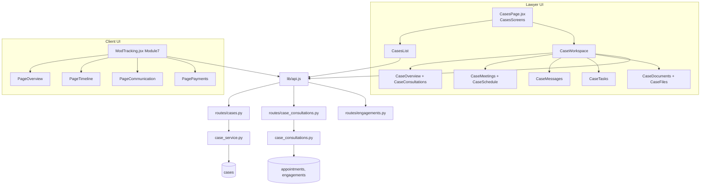
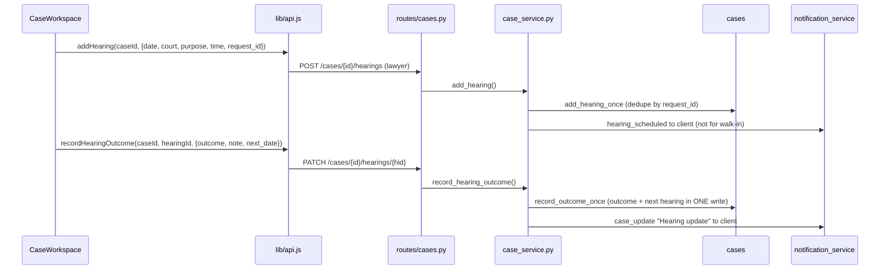
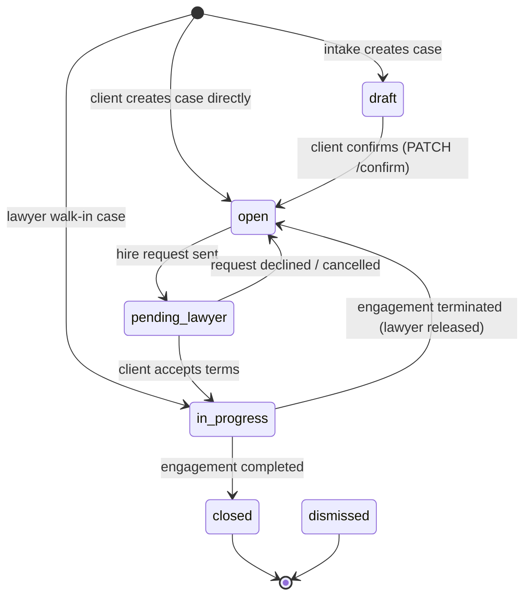
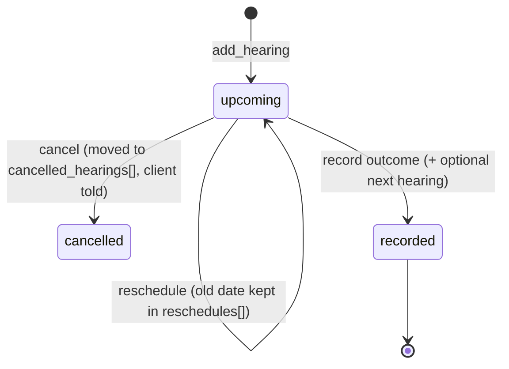

# 16 — Cases (lawyer and client)

> Written from the code in October 2026. If this doc and the code disagree, the code is right.

## 1. What it does

A **case** is one legal matter. It is stored in the `cases` collection and holds the hearings, milestones, messages and tasks of that matter.

- A **client** creates a case (usually through intake, doc 01). At first it is a **draft**; the client confirms it to make it `open`.
- A **lawyer** gets the case only when the client accepts their terms (doc 15). Then it is `in_progress`.
- A lawyer can also open a **walk-in case** for a client who is not on Attorney.AI.
- The lawyer runs the case in a **workspace**: hearings and outcomes, meetings with the client, messages, private tasks, documents.
- The client follows the case on **Tracking**: overview, timeline, hearing updates, documents, payments, messages.

There are also two lawyer-only tools close to cases:

- **Diary events** (`/lawyer-events`) — the lawyer's own private meetings/events.
- **Cause-list watcher** (`/causelist`) — watches a court case number on the Lahore High Court cause list.

## 2. User flow

### Lawyer

1. Opens **Cases** in the sidebar. Sees chips: **All**, **Needs me**, **New hire requests**, **Not filed yet**, **Active**, and a separate **Closed** tab (History: closed and dismissed cases).
2. Can answer hire requests here (Send terms / Decline / Withdraw terms — doc 15).
3. Can click **+ New case** to open a walk-in case (`NewCaseModal`). Fields: title*, case type*, province*, client name*, client phone, court, court case no., notes. The modal checks title ≥ 3, name ≥ 2 and the phone pattern before sending. If anything was typed, an outside click does not close it, and Cancel/Escape ask "Discard this new case?".
4. Opens a case → **case workspace** with a header, a stage bar (Request → Accepted → Hearing set → In court → Judgment → Closed) and five tabs:

| Tab | What the lawyer does there |
|-----|---------------------------|
| **Overview** | Next hearing, recent & upcoming feed, client card (**Message**, **Profile** → Clients page), **Consultations** card, key facts, **Engagement** card (fee, **Mark complete**, **End engagement**) |
| **Schedule** | **Meetings with client** (`CaseMeetings`, with **Join** for video) and court hearings: schedule, record outcome, reschedule, cancel |
| **Messages** | Chat with the client on this case |
| **Tasks** | Private to-do list (with checklists like "Pre-hearing checklist (civil)") |
| **Documents** | Client documents + the lawyer's V2 drafts on the case + private **case files** upload (doc 12) |

5. **Propose meeting** (header button) sends up to three times to the client; once the client picks one, it becomes an appointment linked to the case and appears under Meetings with client.
6. After a hearing, **Record outcome** (adjourned, arguments heard, evidence recorded, order reserved, decided, judge on leave, other) with an optional next date. Suggested follow-up tasks can be ticked and are created as real tasks.

### Client

1. Opens **Tracking** (`/tracking` or `/cases`). The first confirmed case is the active case (drafts are hidden).
2. Pages inside Tracking: **Overview**, **Appointments**, **Case Timeline**, **Documents**, **Payments**, **Notifications**, **Communication**, **Reminders**.
3. Sees hearing dates and the lawyer's outcome explained in plain language (English + Urdu), can share a hearing update on WhatsApp.
4. Messages the lawyer in **Communication**.
5. Ends or completes the engagement from the **Lawyers** page (doc 15).

## 3. Code flow

### Main path

### All endpoints

All paths are under the API prefix **`/api/v1`**.

| Method + path | Who (route guard) | Service function | What it does |
|---------------|-------------------|------------------|--------------|
| `POST /cases` | any signed-in user | `create_case` | new `open` case owned by the caller (`client_id = caller`). Used by the client (and HireDialog "new matter") |
| `POST /cases/walk-in` | lawyer | `create_walk_in_case` | 201, walk-in case, `in_progress`, owned by the lawyer |
| `GET /cases?page=&page_size=&status=` | any signed-in user | `list_cases` | paged list (`page_size` 1–50, default 10), newest first. Client → own cases, lawyer → assigned cases, admin → all. `status` must be a real `CaseStatus` (unknown value = 422), applied **inside** the caller's scope |
| `GET /cases/{id}` | owner client, assigned lawyer, admin | `get_case` | one case + `client_name`, `client_email` |
| `PATCH /cases/{id}` | owner client or assigned lawyer | `update_case` | only `title`, `description`, `case_type` |
| `PATCH /cases/{id}/confirm` | owner client | `confirm_case` | draft → open (optional final `case_type`) |
| `GET /cases/{id}/timeline` | same as read | `get_case` | `{case_id, milestones, hearing_dates}` |
| `POST /cases/{id}/milestones` | assigned lawyer | `add_milestone` | push a milestone (always stored `completed: false`) |
| `POST /cases/{id}/hearings` | assigned lawyer | `add_hearing` | add a hearing (dedupe by `request_id`) |
| `PATCH /cases/{id}/hearings/{hearing_id}` | assigned lawyer | `record_hearing_outcome` | outcome + optional next hearing |
| `PATCH /cases/{id}/hearings/{hearing_id}/reschedule` | assigned lawyer | `reschedule_hearing` | move an upcoming hearing |
| `POST /cases/{id}/hearings/{hearing_id}/cancel` | assigned lawyer | `cancel_hearing` | remove an upcoming hearing (copy kept) |
| `GET /cases/{id}/hearing-outcomes` | any signed-in user | — | `{key: label}` of `HEARING_OUTCOMES`. The `{id}` is **not** checked or used. The frontend does not call it (it has its own list) |
| `GET /cases/{id}/messages` | owner client, assigned lawyer, admin | `list_messages` | messages visible to the caller |
| `POST /cases/{id}/messages` | owner client, assigned lawyer, admin | `send_message` | add a message, notify the other side |
| `GET /cases/{id}/tasks` | assigned lawyer, admin (client → 403) | `list_tasks` | the lawyer's own tasks |
| `POST /cases/{id}/tasks` | assigned lawyer | `add_task` | add a task |
| `PATCH /cases/{id}/tasks/{task_id}` | assigned lawyer | `toggle_task` | set `done` true/false |
| `GET /case-consultations/{case_id}` | lawyer | `case_consultations.for_case` | originating + linked consultations |
| `POST /lawyer-events` | lawyer | `lawyer_event_service.create_event` | 201, new diary entry |
| `GET /lawyer-events?start=&end=` | lawyer | `list_events` | entries **starting** in `[start, end)`, oldest first |
| `DELETE /lawyer-events/{event_id}` | lawyer | `delete_event` | "Diary entry deleted" (404 if not yours) |

`/case-consultations` has its own prefix on purpose: the cases router owns `/cases/...`.

### Request body limits (schemas/case.py, schemas/lawyer_event.py)

| Body | Rules |
|------|-------|
| `CaseCreate` | `title`, `description` required (no length limit in the schema), `case_type` ∈ civil / criminal / constitutional / family, `province` ∈ punjab / sindh / kpk / balochistan / federal |
| `CaseUpdate` | `title`, `description`, `case_type`, all optional. Any other key (e.g. `lawyer_id`, `status`) is dropped by the service too |
| `CaseConfirm` | optional `case_type`; unknown fields refused (`extra="forbid"`) |
| `WalkInCaseCreate` | `title` 3–200, `client_name` 2–120, `client_phone` optional `^\+?[0-9][0-9 -]{6,18}$`, `description` ≤ 2000, `court` ≤ 200, `court_case_number` ≤ 60; extra fields refused |
| `MilestoneAdd` | `title` 1–200, `description` ≤ 2000, `date` required |
| `HearingAdd` | `date` required, `court` 1–200, `judge` ≤ 120, `notes` ≤ 2000, `purpose` ≤ 300, `time` must be `HH:MM` 24-hour ("Use a 24-hour time such as 09:30 or 14:00."), `outcome` must be empty ("An outcome can't be set when scheduling a hearing…"), `request_id` 16–64 chars `[A-Za-z0-9_-]` |
| `HearingOutcome` | `outcome` key (checked in service → 422 listing valid keys), `note` ≤ 2000, `next_date`, `next_time` (HH:MM), `next_purpose` ≤ 300 |
| `HearingReschedule` | `date` required, `time` HH:MM, `reason` ≤ 300; extra fields refused |
| `HearingCancel` | `reason` ≤ 300; extra fields refused |
| `MessageAdd` | `text` 1–4000 (trimmed) |
| `TaskAdd` | `title` 1–200, `due` optional, `priority` low/medium/high (default medium), `description` ≤ 2000 |
| `LawyerEventCreate` | `kind` meeting/event, `title` 1–200, `starts_at` **with a timezone offset**, between 2000 and 2099, `duration_minutes` 15–720 (default 60), `client_name` ≤ 120, `location` ≤ 200, `notes` ≤ 2000, `priority` high/medium/low; unknown fields (e.g. `lawyer_id`) refused |

### Error answers

| Code | When |
|------|------|
| 404 | case / hearing / task / diary entry not found (a diary entry of another lawyer is also 404) |
| 403 | not the owner/assigned lawyer ("Access denied to this case", "Only the assigned lawyer can …"); client reading tasks; confirm on someone else's case |
| 409 | case `closed`/`dismissed` ("This case is closed, so it can no longer be changed."); client changing the type while a lawyer is assigned; confirm with a different category than the already-open case; hearing `request_id` reused for different details; outcome already recorded; reschedule/cancel of a hearing that has an outcome or was changed/removed meanwhile; message on a walk-in case; this intake already produced a case |
| 422 | confirm on a non-draft, non-open case ("Only a draft case can be confirmed…"); unknown outcome key; reschedule to a day before today (PKT) or to the same date and time; diary window wrong (`end` ≤ `start`, more than 62 days, outside 2000–2099) |

### How the lawyer's Cases page loads

`CasesScreens` (in [CasesPage.jsx](../../frontend/src/components/lawyer/CasesPage.jsx)) does two reads on mount:

1. `listAllCases(listCases)` — every page of `GET /cases`, mapped by `_mapApiCase` (case number becomes `id`, hearings become `_apiHearings` with `status: upcoming|past`).
2. `listEngagements()` — all engagements (hire requests and active ones).

Then `buildCasesView()` in [lib/casesView.js](../../frontend/src/lib/casesView.js) splits them into sections:

| Section | Rule |
|---------|------|
| `newRequests` | engagements `requested` (lawyer owes terms) |
| `awaitingClient` | engagements `terms_proposed` (client owes answer — listed, not counted as a lawyer task) |
| `notFiled` | live cases with no upcoming hearing |
| `active` | live cases with an upcoming hearing |
| `outcomeDue` | active cases whose next hearing date has passed |
| `history` | Closed / Dismissed |

Each chip count is the **length of the rows that chip shows**, so counts and lists cannot disagree.

Inside an open case, a `case_message` notification for that case re-reads the message thread live, and opening the **Messages** tab marks that case's `case_message` notifications as read (so the bell and the Cases badge agree).

The page re-reads both lists when a notification of type `engagement_*`, `lawyer_assigned` or `case_update` arrives. Only the newest read may write (a generation counter), so a slow old answer cannot overwrite a newer one.

### Hearings

Reschedule (`PATCH …/reschedule`) and cancel (`POST …/cancel`) work the same way. They return 409 if the hearing changed meanwhile; the page then re-reads the case.

### Consultations on a case

`GET /case-consultations/{case_id}` → `case_consultations.for_case(case_id, lawyer_id)` in [case_consultations.py](../../backend/app/services/case_consultations.py):

1. Case must exist and be **assigned to this lawyer** (else 403).
2. **Originating consultation** = the engagement that gave this lawyer the case (the `accepted` one, else the newest one between them), then its stored `appointment_id` via `consultations_for()`.
3. **Linked meetings** = appointments with this `case_id` and this `lawyer_id` (up to 50), excluding the originating one.
4. Returns `{originating, originating_unavailable, has_hire, linked}`.
   - Only the 20 newest engagements of this lawyer on this case are looked at to pick the originating one.
   - Linked rows are sorted newest first. Each row has `id, scheduled_at, end_at, duration_minutes, mode, status, note`; times are sent **with** a UTC offset so the browser does not read them as local time.
   - `has_hire = false` (walk-in case, no engagement) → no originating row and `originating_unavailable = false`.

Two components read it:

- `CaseConsultations` (Overview) — shows "The consultation that led to this case" and "Meeting on this case" rows, each with **View** (opens it on the Appointments page). Shows "Consultation record unavailable" for a legacy hire. Hidden for walk-in cases and closed cases.
- `CaseMeetings` (Schedule) — shows only meetings still ahead (`confirmed`/`pending` and `end_at` in the future). `MeetingJoin` shows the in-app **VideoJoin** for a confirmed video meeting, "Waiting for the client to confirm" for pending, or "Phone call / In person — no joining link".

### Client side

`Module7` in [ModTracking.jsx](../../frontend/src/components/client/ModTracking.jsx):

- `listCases({page_size: 20})` → drops drafts (`confirmedCases`) → first case becomes active.
- `getCaseTimeline(activeCaseId)` → `GET /cases/{id}/timeline` → `milestones` and `hearing_dates`.
- `PageCommunication` → `GET/POST /cases/{id}/messages`.
- `PagePayments` → `GET /payments`, `startCheckout`, `mockPay` (doc 15).

### Lawyer diary and cause list

| Feature | Route | Service | Collection |
|---------|-------|---------|-----------|
| Diary events | `POST/GET/DELETE /lawyer-events` | [lawyer_event_service.py](../../backend/app/services/lawyer_event_service.py) | `lawyer_events` |
| Cause-list watches | `/causelist/watches`, `/check`, `/entries`, `/match-text` | [causelist_service.py](../../backend/app/services/causelist_service.py) | `causelist_watches`, `causelist_entries` |

- Diary events are read by the lawyer **Appointments** calendar and the **Dashboard** (next 7 days). Kinds: `meeting`, `event`; priority `high/medium/low`; 15–720 minutes. A read may cover at most 62 days. Another lawyer's event returns 404 (not 403), so ids cannot be probed.
- Cause list: the lawyer adds a court case number like `39043/26`. A background loop in [main.py](../../backend/app/main.py) (`_causelist_scheduler`, every `causelist_check_hours` = 6) fetches the LHC cause list and notifies when the case is listed. A Redis period-lock makes only one worker run each sweep. **Paste-to-match** handles courts that are not scraped.

## 4. Data & states

### Collection `cases` (main fields)

| Field | Meaning |
|-------|---------|
| `_id`, `case_number` | id and human number `ATT-2026-XXXXXXXX` (unique) |
| `client_id`, `lawyer_id` | owner and assigned lawyer (`null` until hired) |
| `walk_in`, `client_name`, `client_phone`, `court`, `court_case_number` | walk-in cases only |
| `title`, `description`, `case_type`, `province`, `urgency` | the matter |
| `status` | see diagram |
| `intake_id`, `ai_summary`, … | from intake (doc 01) |
| `milestones[]` | timeline entries `{title, description, date, completed}` |
| `hearing_dates[]` | `{_id, date, time, court, judge, purpose, outcome, outcome_label, outcome_note, outcome_meaning, outcome_meaning_ur, reschedules[], request_id}` |
| `cancelled_hearings[]` | cancelled hearings with `cancelled_at`, `cancelled_by`, `cancel_reason` |
| `messages[]` | `{_id, lawyer_id, sender_id, sender_role, sender_name, text, created_at}` — served only by the messages route |
| `tasks[]` | `{_id, lawyer_id, title, due, priority, done}` — lawyer only |
| `closed_at` | set when the case closes (retention clock) |
| `case_type_source`, `ai_case_type` | who changed the category, and the AI's original answer |

### Case status lifecycle

`dismissed` (and admin status changes) is set through admin routes (`/admin/cases/{id}/status`), not by the lawyer or client.

### Hearing lifecycle (inside a case)

## 5. Key logic & rules

### Who may do what (`_assert_access` and friends in [case_service.py](../../backend/app/services/case_service.py))

| Action | Allowed |
|--------|---------|
| Read case / timeline | the client owner, the assigned lawyer, admin |
| Update title/description/type | client owner or assigned lawyer. Client **cannot** change the type once a lawyer is assigned |
| Hearings, milestones, tasks | **only the assigned lawyer** |
| Messages | client and assigned lawyer; not on walk-in cases (no client account) |
| Tasks read | lawyer only; a client gets 403 "Tasks are private to the lawyer" |
| Assign lawyer | **never** through PATCH — only through engagement acceptance |

### Other rules and why

- **Closed is read-only.** `_assert_open` refuses any write on `closed`/`dismissed` with 409. A closed case is a record. The workspace shows a note and disables editing.
- **Drafts are not real cases yet.** `assert_not_draft` blocks hiring, matching and booking against a draft. `confirm_case` is atomic (filter on `status: draft`) and idempotent (a second click returns the open case; a different category returns 409).
- **Lawyer threads are sealed.** Every message and task stores `lawyer_id`. A lawyer sees only their own (`_thread_visible`). When an engagement is terminated, `seal_threads_for` stamps the departing lawyer on old rows, so the **next lawyer does not read the previous lawyer's conversation**.
- **No double hearings.** The form sends a `request_id`; `add_hearing_once` and a fingerprint stop a double-click creating two hearings.
- **Outcome is written once.** `record_outcome_once` writes the outcome and the next hearing together; a second attempt gets 409, never an overwrite.
- **Hearing days use the Pakistan calendar** (`pkt_date`) for reschedule checks.
- **Notifications never block the action.** Hearing/message notices are best-effort and logged on failure. Walk-in cases send nothing. The hearing notices use a `logical_event_id` so retries do not send twice; **message notices do not** have one.

| Action | Recipient | Type | Title | Dedupe id |
|--------|-----------|------|-------|-----------|
| add hearing | client | `hearing_scheduled` | "Hearing scheduled" ("title: hearing on 05 Nov 2026 at court") | `hearing-scheduled:{case}:{hearing}` |
| record outcome | client | `case_update` | "Hearing update" (label, lawyer's note, "Next date: …") | `hearing-outcome:{case}:{hearing}` |
| reschedule | client | `case_update` | "Hearing rescheduled" (from → to, reason) | `hearing-rescheduled:{case}:{hearing}:{time of move}` (so each move is told) |
| cancel hearing | client | `case_update` | "Hearing cancelled" (+ reason) | `hearing-cancelled:{case}:{hearing}` |
| message | the other party (client ↔ assigned lawyer; nobody if no lawyer yet) | `case_message` | "New message from {name}" + case title + first 140 chars | none |
| day-before reminder (flag) | client **and** lawyer | `hearing_reminder` | "Hearing tomorrow" | `hearing-reminder:{case}:{hearing}:{date}:{role}` |

- **Hearing double-click guard, in detail.** With a `request_id`, the service stores a SHA-256 **fingerprint** of date (as UTC), court, judge, notes, purpose and time. A repeat with the same id and same details returns the first hearing (and re-sends the notice only if it was missing). The same id with **different** details → 409 "This request was already used for a different hearing."
- **Next hearing from an outcome** gets `request_id = "next-{hearing_id}"`, copies the court and judge of the old hearing, and its purpose defaults to "Next hearing".
- **Reschedule rules.** Only a hearing with no outcome (409 otherwise). The new day must be today or later on the **Pakistan** calendar; it is stored as midnight UTC of that Pakistan day. Same day and same time → 422 "That is already the hearing's date and time". If no new time is sent, the old time is kept. The move is one conditional write that only applies if the hearing still has the date/time that was read; each move is appended to `reschedules[]` as `{from_date, from_time, to_date, to_time, reason, at}`.
- **Cancel is retry-safe.** Cancelling a hearing that is already in `cancelled_hearings[]` returns the case unchanged (no error, no second notice).
- **Case number.** `ATT-{year}-{8 hex}`; on a collision the service tries up to 5 new numbers. For an intake case, a duplicate on `uniq_case_per_intake` is not retried: it answers 409 "This intake has already produced a case. Reload the page…".
- **Confirm details.** Confirm with a `case_type` records `case_type_source = "client"`, `case_type_changed_by/at`, and stamps `confirmed_at`. A losing concurrent confirm with a different category gets 409 "concurrently confirmed with a different category".
- **Type change audit.** On any type change through PATCH the service records `case_type_source` (client/lawyer), `case_type_changed_by/at`, and — on the **first** change only — `ai_case_type` (the pipeline's original answer).
- **Matching is not run on confirm/update.** No `matched_lawyers` or `case_embedding` is written any more; matching is computed live when a screen asks.
- **Messages and tasks are not inside the case response.** `_public_case` also strips `intake_conversion_owner/epoch`. Messages/tasks come only from their own routes.
- **Admins** can read any case, its messages and tasks (`_assert_access` lets `admin` through) and see every case in `GET /cases`.
- **Toggle task** on a task of another lawyer (sealed thread) → 404 "Task".
- **AI summary safety.** `_public_case` strips `messages`, `tasks` and old `case_embedding`, and runs a CPC jurisdiction check on the AI summary; if that check fails, the summary is withheld ("review_unavailable").
- **Case context for drafting.** [case_context.py](../../backend/app/services/case_context.py) builds a **whitelist** (type, province, case number, scrubbed summary, evidence coverage) for AI drafting on a case. Emails, CNICs and phone numbers are regex-redacted. No client name or messages are passed.

### Feature flags (in [config.py](../../backend/app/core/config.py))

| Flag | Effect here |
|------|-------------|
| `hearing_reminders_enabled` (default `False`) | day-before hearing reminders to client and lawyer (`hearing_reminders.py`) |
| `hearing_reminder_interval_minutes` (60, range 5–720) | how often `_hearing_reminder_scheduler` in `main.py` runs (only started when the flag is on). It runs first, then sleeps, and takes a Redis period lock `lock:scheduler:hearing_reminders` so only one worker sends |
| `causelist_check_hours` (6) | how often watches are swept |
| `document_review_requests` (default `False`) | completing/terminating also ends document review requests (doc 09) |

Free-plan lawyers may have only **one** cause-list watch (`subscription_service.is_paid`).

### Hearing reminders (`send_due_hearing_reminders`)

- "Tomorrow" is the **Pakistan** calendar day after now. A hearing's day = its stored date + 5 hours.
- Only hearings with **no outcome**, on cases that are not `closed`/`dismissed`.
- Each person (client and lawyer, if present) gets one reminder per hearing **date**. A closed, deactivated or missing account is skipped.
- The dedupe id includes the date, so a hearing moved to another day is reminded about again.
- At most 200 send attempts per run (`DEFAULT_LIMIT`); already-sent reminders cost nothing, so the next run continues where this one stopped. A failed send is retried next run.
- Text: "Hearing tomorrow" — "{title}: hearing tomorrow at 10:00, {court}."

### Indexes on `cases` (indexes.py)

`case_number` (unique), `client_id`, `lawyer_id`, `(client_id, status)`, `status`, `case_type`, `province`, `created_at` desc, `intake_id`, `(status, closed_at)` and `(status, created_at)` for retention sweeps, and `uniq_case_per_intake` (unique partial on string `intake_id`: one case per intake). `lawyer_events` has `(lawyer_id, starts_at)`.

## 6. Lawyer vs client — comparison

| Topic | Lawyer | Client |
|-------|--------|--------|
| Main screen | Cases list + case workspace | Tracking (one active case at a time) |
| Which cases | `lawyer_id = me` | `client_id = me`, drafts hidden |
| Create a case | walk-in only (`POST /cases/walk-in`) | intake or `POST /cases` (also from HireDialog "new matter") |
| Hearings | add, record outcome, reschedule, cancel | read only, plain-language outcome (EN/UR), WhatsApp share |
| Milestones | add (`POST /milestones`) | read on Case Timeline |
| Messages | Messages tab (only own thread) | Communication page (sees all) |
| Tasks | private to-do list | not visible (403) |
| Meetings | Propose meeting, Join from Schedule | choose a proposed time, join from Appointments |
| Documents | client docs + own V2 drafts + private case files | Documents page |
| End engagement | Overview → Mark complete / End engagement | Lawyers page → complete / end |
| Payments | (Payments page hidden) | Tracking → Payments (mock checkout) |

## 7. Files

| File | Role |
|------|------|
| [routes/cases.py](../../backend/app/api/v1/routes/cases.py) | case, hearing, milestone, message, task endpoints |
| [services/case_service.py](../../backend/app/services/case_service.py) | all case rules, `HEARING_OUTCOMES`, access checks, thread sealing |
| [services/case_context.py](../../backend/app/services/case_context.py) | scrubbed case whitelist for AI drafting |
| [services/case_consultations.py](../../backend/app/services/case_consultations.py) | originating consultation + linked meetings |
| [routes/case_consultations.py](../../backend/app/api/v1/routes/case_consultations.py) | `GET /case-consultations/{case_id}` (lawyer) |
| [repositories/case_repo.py](../../backend/app/repositories/case_repo.py) | atomic array updates (`add_hearing_once`, `record_outcome_once`, …) |
| [schemas/case.py](../../backend/app/schemas/case.py) | `CaseCreate`, `WalkInCaseCreate`, `HearingAdd`, `CaseOut` |
| [services/lawyer_event_service.py](../../backend/app/services/lawyer_event_service.py) | private diary entries |
| [routes/lawyer_events.py](../../backend/app/api/v1/routes/lawyer_events.py) | `/lawyer-events` |
| [services/causelist_service.py](../../backend/app/services/causelist_service.py) | LHC fetch/parse, watches, paste match |
| [routes/causelist.py](../../backend/app/api/v1/routes/causelist.py) | `/causelist` |
| [services/hearing_reminders.py](../../backend/app/services/hearing_reminders.py) | day-before reminders (flag) |
| [lawyer/CasesPage.jsx](../../frontend/src/components/lawyer/CasesPage.jsx) | Cases list, workspace, tabs, `CaseMeetings`, `MeetingJoin`, `CaseConsultations` |
| [lib/casesView.js](../../frontend/src/lib/casesView.js) | sections, chip counts, Overview feed |
| [lawyer/CauselistPage.jsx](../../frontend/src/components/lawyer/CauselistPage.jsx) | cause-list UI |
| [client/ModTracking.jsx](../../frontend/src/components/client/ModTracking.jsx) | client Tracking pages |
| [lib/caseStatus.js](../../frontend/src/lib/caseStatus.js) | status labels, `confirmedCases`, `hireableCases` |
| [lib/api.js](../../frontend/src/lib/api.js) | `listCases`, `addHearing`, `getCaseConsultations`, `listLawyerEvents`, … |

## 8. Known limits

- The client Tracking page loads only the first **20** cases; the lawyer Cases page reads all pages.
- Hearing reminders are **off** by default.
- The cause-list scraper covers **LHC only**; other courts need paste-to-match.
- Many workspace actions (complete, end engagement, decline) use `window.prompt`.
- The workspace header comment notes things the design shows but the backend lacks: separate court filing date, fee on the case itself, client-assigned tasks, lawyer-booked meetings without the client choosing.
- `dismissed` can only be set by an admin.
- Walk-in cases have no messages, no notifications and no fee requests (no engagement exists).
