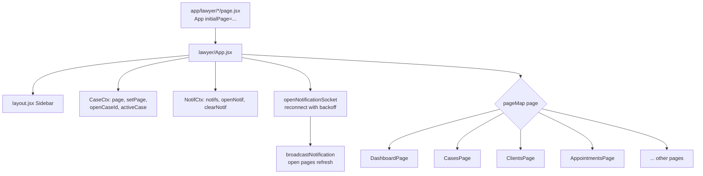
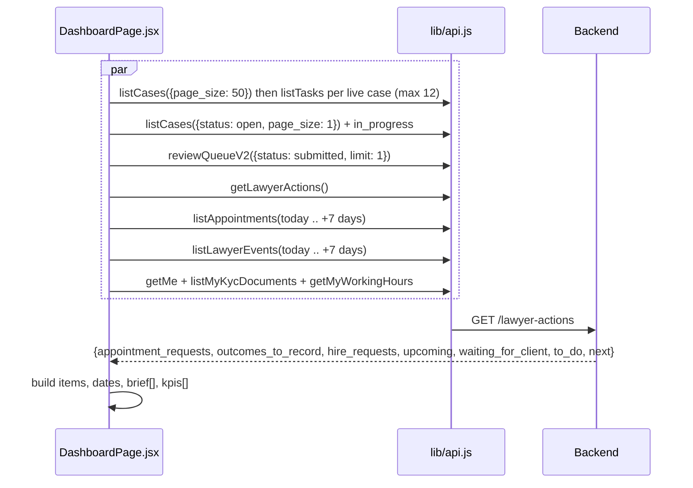
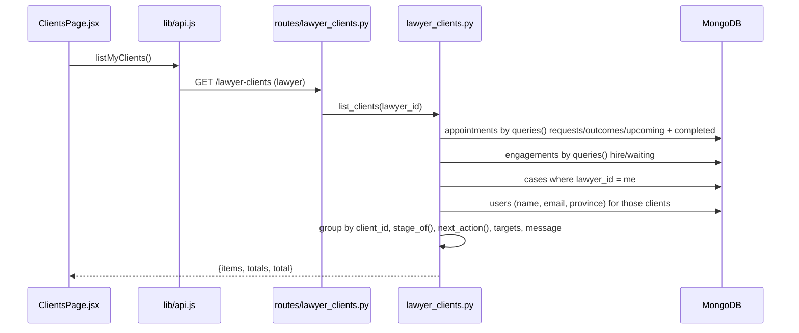
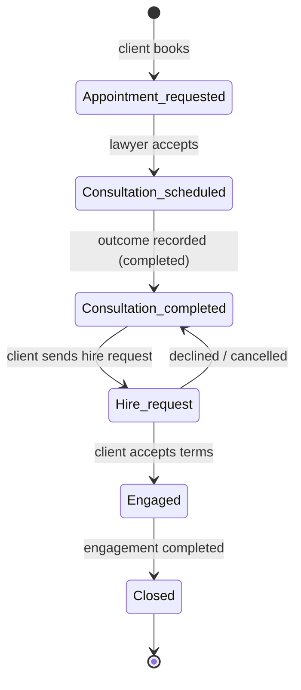

# 17 — Lawyer dashboard, Clients page and the lawyer app shell

> Written from the code in October 2026. If this doc and the code disagree, the code is right.

## 1. What it does

This doc covers three lawyer screens that tie the other modules together:

- **The app shell** (`lawyer/App.jsx`) — the sidebar, page switching, URL, notifications socket and shared context every lawyer page uses.
- **Dashboard** — the home page. Its **Daily brief** says, in plain lines, what needs the lawyer today, each with a button that opens the exact item.
- **Clients** — one card per client, built from the lawyer's appointments, hire requests and cases. Each card shows the client's **stage** and the **one next step** to take.

The Dashboard, the Appointments page and the Clients page all get their "what is waiting on me" numbers from **one backend function**, so they always agree.

## 2. User flow

### Dashboard

1. Lawyer signs in → lands on `/lawyer` → Dashboard.
2. Until setup is done, a **Setup checklist** shows: create account, upload verification documents, complete profile, set working hours.
3. The **Daily brief** lists lines like:
   - "2 tasks are overdue — oldest: …" → **Open**
   - "3 things on today — next: … at 10:30" → **Schedule**
   - "Next hearing tomorrow — …" → **Open case**
   - "1 document waiting for your review" → **Review**
   - "1 meeting needs an outcome" → **Record outcome**
   - "2 hire requests awaiting your terms" → **Send terms**
   - "1 appointment request to answer" → **Answer**
   - "1 unread client message" → **Read**
   - "1 active case has no next hearing" → **Set date**
4. Below: **Key numbers** (Active cases, Hearings this week, Docs to review, Appointments today), **Shortcuts**, **Critical dates** (overdue / this week / later), **Schedule** (Today / 7 days), **Recent cases**, **Recent activity**.
5. **Customize dashboard** (icon button) hides sections (saved in `localStorage` per account). **Ctrl/Cmd+K** opens a palette to jump to any page or ask the AI.

### Clients

1. Lawyer opens **Clients**. Sees "N clients · X need you · Y waiting for the client".
2. Filters by stage (All, Engaged, Hire request, …) or searches by name.
3. Each card shows: name, **stage badge**, "Waiting for client" tag if terms are out, facts (next appointment, email if engaged, province, appointment counts, case counts), up to three cases (click to open), and **chips** for other waiting work.
4. The big button is the **next action**: Send terms / Record outcome / Answer appointment request / View next appointment / Open case.
5. **Send terms** opens the same terms dialog as the Cases page, **right here** (no page change). After sending, the card refreshes.
6. **Message** opens the case's Messages tab (engaged client) or the appointment chat (prospective client).
7. **Suggest a meeting** (engaged clients only) opens the Propose meeting dialog on their case.

## 3. Code flow

### All endpoints of this module

Both routers live in [routes/lawyer_clients.py](../../backend/app/api/v1/routes/lawyer_clients.py) and are mounted under **`/api/v1`**. Both are `require_lawyer` (any other role → 403), take no parameters, and read only the caller's own rows.

| Method + full path | Service | Returns |
|--------------------|---------|---------|
| `GET /api/v1/lawyer-clients` | `lawyer_clients.list_clients(lawyer_id)` | `{items: [card…], totals: {stage: n}, total}` |
| `GET /api/v1/lawyer-actions` | `lawyer_actions.action_counts(lawyer_id)` | `{appointment_requests, outcomes_to_record, hire_requests, upcoming, waiting_for_client, to_do, next: {appointment_request, outcome, hire_request}, as_of}` |

The Dashboard also reads endpoints owned by other docs: `GET /cases` (doc 16), `GET /cases/{id}/tasks`, `GET /appointments`, `GET /lawyer-events`, `GET /users/me`, KYC documents, working hours, the review queue, and `GET /notifications` (doc 19).

### The shell



How it works:

- Every route under `src/app/lawyer/` (for example `app/lawyer/clients/page.jsx`) renders `<App initialPage="clients" />`. `app/lawyer/layout.jsx` wraps them in `ProtectedRoute allowedRoles={['lawyer']}` and the chat dock provider.
- Navigation is **state** (`page`, `setPage`), not a router call. `PAGE_PATH` maps each page to a URL; a `useEffect` does `history.pushState` so refresh, bookmarks and Back/Forward work (`popstate` listener).
- `HIDDEN_PAGES = {"payments", "agreements"}` — asking for either lands on the dashboard.
- **Onboarding gate:** the server (`getMe` + `isLawyerOnboarded`) decides. `localStorage` is only a cache. If the read fails, the gate **fails open** (the lawyer is not locked out).
- **Notifications:** loaded once with `getNotifications()`, then live over a WebSocket that reconnects with backoff and re-reads the list after reconnecting. `openNotif(n)` uses `lawyerNotificationTarget()` from [lib/notificationTarget.js](../../frontend/src/lib/notificationTarget.js) to choose the page (cases, appointments, documents, …) and sets the right deep-link key.
- **Sidebar badges:** unread `case_message`, unread `appointment_booked`, and the review queue's `submitted` count.
- **Local notices.** `addNotif()` adds a row made in this browser (the result of an action). It is marked `local: true`, survives a server re-read, and is **never** sent to the server to be marked read. `clearNotif(id)` marks one read (server call only for server rows); "mark all read" calls `POST /notifications/read-all`. The socket only reacts to frames of type `notification`; each new row is put at the top (replacing a row with the same id) and passed to `broadcastNotification()` so open pages can refresh.
- `<main>` has no `key={page}`, so page state is not destroyed on every navigation.

### Dashboard data



- Each read is independent (`Promise.allSettled`), so one failure does not blank the page.
- "Active cases" uses the server's **`total`** for `open` + `in_progress` (one row each), so it is exact even with more than 50 cases.
- The **brief** is built by plain rules in the component — it is **not** AI output.
- Data is read **once** on mount. There is no polling: a **Refresh** button re-runs all reads and resets "updated … ago". A 30-second timer only moves the clock-based text (countdown, "now" line, "updated … ago").
- The Clients page also reads once on mount, and again after terms are sent from it; it does not listen to live notifications.

### `GET /lawyer-actions`

Route: `actions_router` in [routes/lawyer_clients.py](../../backend/app/api/v1/routes/lawyer_clients.py) (lawyer only) → `action_counts()` in [services/lawyer_actions.py](../../backend/app/services/lawyer_actions.py).

`queries(lawyer_id, now)` holds **the** filters, used by both the counts and the Clients page:

| Key | Collection | Filter | Meaning |
|-----|-----------|--------|---------|
| `requests` | appointments | `status: pending` and (`expires_at` null or in the future) | appointment requests the lawyer can still answer |
| `outcomes` | appointments | `status: confirmed`, `end_at < now` | meeting ended, outcome not recorded (no grace period) |
| `upcoming` | appointments | `status: confirmed`, `end_at >= now` | meeting not ended yet |
| `hire` | engagements | `status: requested` | lawyer owes terms |
| `waiting` | engagements | `status: terms_proposed` | client owes an answer (**not** a lawyer action) |

`action_counts()` returns:

- `appointment_requests`, `outcomes_to_record`, `hire_requests`, `upcoming`, `waiting_for_client`
- `to_do` = sum of the three **action** counts only (requests + outcomes + hire)
- `next` = id of the **first** item in each action queue, so a button opens the one to do first. "First" means: appointment request with the earliest `scheduled_at`; outcome with the earliest `end_at`; hire request with the earliest `created_at` (ties broken by `_id`). It is `null` when that count is 0
- `as_of` = the time used

### Clients page



## 4. Data & states

Nothing on these pages is **stored**. The Clients index and the action counts are **computed on every request** from `appointments`, `engagements`, `cases` and `users`.

### Client stage (`STAGES` in `lawyer_clients.py`)

The **first** rule that matches wins:

| Order | Stage | When |
|-------|-------|------|
| 1 | `Engaged` | the client has a case with this lawyer that is not closed/dismissed |
| 2 | `Hire request` | a `requested` or `terms_proposed` engagement |
| 3 | `Consultation scheduled` | a confirmed meeting (upcoming, or ended and waiting for outcome) |
| 4 | `Appointment requested` | a pending, still-answerable request |
| 5 | `Closed` | cases with this lawyer, all finished |
| 6 | `Consultation completed` | only completed consultations |
| — | (not listed) | only declined / cancelled / expired / no-show history |



(The stage is recomputed every time, so a client can move "back" too, for example when an engagement is terminated.)

### Next action priority

`next_action(targets)` returns the **first** target that exists:

```
send_terms  >  record_outcome  >  answer_request  >  view_appointment  >  open_case
(engagement_id) (outcome_appointment_id) (pending_appointment_id) (next_appointment_id) (case_id)
```

The stage and the action are **separate on purpose**: an Engaged client can still have a meeting waiting for its outcome, and a Hire-request client can still have a new appointment request.

### One card (main fields)

| Field | Meaning |
|-------|---------|
| `stage`, `next_action {kind, target_id}` | as above |
| `pending {hire_requests, outcomes, appointment_requests}` | counts of each waiting job → **chips** for the ones that are not the main action |
| `waiting_for_client` | number of `terms_proposed` engagements → "Waiting for client" tag |
| `targets` | `engagement_id`, `outcome_appointment_id`, `pending_appointment_id`, `next_appointment_id`, `case_id`, `case_number`, `waiting_engagement_id` |
| `message` | `{kind: "case", target_id, case_number}` if there is an open case; else `{kind: "appointment", target_id}` (next meeting, else one waiting for outcome, else latest completed); else `null` |
| `email` | **only if the client has a case with this lawyer** |
| `counts`, `cases[]`, `next_appointment`, `since`, `last_activity` | card facts |

| `needs_outcome`, `latest_appointment_id`, `pending_request_id` | extra helpers: a meeting is waiting for its outcome; the newest appointment of any kind; same as `targets.pending_appointment_id` |
| `province` | from the first case that has one, else the user's profile province |

How the targets are picked:

- Each group is read in its own order: requests by `expires_at` then `scheduled_at` (the one that expires first), outcomes by `end_at`, upcoming by `scheduled_at`, completed newest first, hire/waiting by `created_at`. The **first** row of each group becomes the target, so "Answer" opens the request that expires soonest.
- `case_id` = the most recently updated **open** case, else the most recently updated case of any status.
- `cases[]` on the card is sorted newest created first; each row has `id`, `case_number`, `title` ("Untitled case" if empty), `status`.
- `since` = earliest appointment/case date; `last_activity` = latest appointment `scheduled_at` or case `updated_at`.
- Name falls back to "Client" if the user has no name.
- **Walk-in cases** (no `client_id`) never appear on the Clients page — there is no client account to group by.

Items are sorted by stage order, then most recent activity. `totals` counts clients per stage (used for the filter chips).

On the page, "X need you" counts cards whose `next_action` is `send_terms`, `record_outcome` or `answer_request`; "Y waiting for the client" counts cards with `waiting_for_client > 0`. Stage filter and name search run in the browser on the loaded list. Chips show every `pending` job except the one that is already the main button.

## 5. Key logic & rules

- **One source of truth for counts.** Before this, the Dashboard, Appointments and Clients counted differently (for example an ended meeting still counted as "upcoming"). Now all three use `lawyer_actions.queries()`. Why: numbers on different pages must not disagree.
- **Terms already sent are not the lawyer's job.** `terms_proposed` is reported as `waiting_for_client`, never in `to_do`.
- **Privacy.** Only this lawyer's own rows are read. A prospective client's **email is hidden** — contact details come with an engagement, not with a booking.
- **Lawyer only.** Both `/lawyer-clients` and `/lawyer-actions` use `require_lawyer`. They have their own prefix so they do not clash with `/lawyers/{id}`.
- **Send terms in place.** `openTermsHere(id)` re-reads `listEngagements({status: "requested"})`. If the request is gone (answered or withdrawn), it says so and refreshes instead of opening a stale dialog. It reuses `useEngagementActions` from `CasesPage.jsx` (doc 15).
- **"Suggest a meeting" only proposes.** The client chooses a time; only then is an appointment booked. Prospective clients have no case, so no such button.
- **Failed reads are not empty.** Both pages show "Could not load … This is not the same as having none" with **Try again**.
- **Setup checklist** uses `getMe` (profile fields, `kyc_verified` / `kyc_status`), `listMyKycDocuments` (4 docs) and `getMyWorkingHours().configured`.
- Related flag: `lawyer_auto_approve` in [config.py](../../backend/app/core/config.py) affects whether the "verified" step is already done at sign-up (doc 18).

### Deep links between pages (`sessionStorage` keys)

Pages send the lawyer to an **exact item** on another page. The sender writes a key and (for an open page) fires a window event; the receiver reads the key on mount, uses it, and removes it.

| Key | Written by | Read by | Opens |
|-----|-----------|---------|-------|
| `attorney:lawyer-open-request` | Dashboard, lawyer Appointments | Cases (`OPEN_REQUEST_KEY`) + event `attorney:open-request` | Cases → New hire requests, scrolled to that request (`""` = just the tab) |
| `attorney:lawyer-open-appointment` | Dashboard, Clients, App `openNotif` | Appointments + event `attorney:open-appointment` | that appointment's detail |
| `attorney:lawyer-open-appointment-thread` | Clients (Message), App `openNotif` | Appointments | that appointment with its chat open |
| `attorney:lawyer-record-outcome` | Dashboard, Clients | Appointments + event `attorney:record-outcome` | that meeting's outcome dialog (falls back to the Needs outcome tab) |
| `attorney:lawyer-case-tab` | Clients (Message → `"messages"`) | Case workspace | the case on that tab |
| `attorney:lawyer-focus-client` | Case Overview → **Profile** | Clients | that client's card, scrolled and highlighted |
| `attorney:lawyer-open-doc` | App `openNotif` | Document review | that document |
| `attorney:ai-prefill` | Dashboard palette "ask AI" | AI Assistant | question pre-filled |

Why `sessionStorage` plus an event: if the target page is **not mounted yet**, it reads the key on mount; if it **is** already mounted, it hears the event. A reload on the way still lands on the item. Every access is wrapped in `try/catch` ("storage off").

Opening a case uses context instead: `setOpenCaseId(case_number || id)` then `setPage("cases")`.

## 6. Files

| File | Role |
|------|------|
| [lawyer/App.jsx](../../frontend/src/components/lawyer/App.jsx) | shell: `pageMap`, `PAGE_PATH`, `HIDDEN_PAGES`, onboarding gate, notifications socket, contexts |
| [lawyer/layout.jsx](../../frontend/src/components/lawyer/layout.jsx) | Sidebar groups (Research, Documents, Work Management, …) and badges |
| [app/lawyer/layout.jsx](../../frontend/src/app/lawyer/layout.jsx) | route guard (`ProtectedRoute` lawyer) + chat dock |
| [lawyer/DashboardPage.jsx](../../frontend/src/components/lawyer/DashboardPage.jsx) | Dashboard: brief, KPIs, dates, schedule, palette, deep links |
| [lawyer/ClientsPage.jsx](../../frontend/src/components/lawyer/ClientsPage.jsx) | Clients cards, next action, chips, Message routing, terms in place |
| [lawyer/CasesPage.jsx](../../frontend/src/components/lawyer/CasesPage.jsx) | exports `useEngagementActions` and `ProposeMeetingModal` used by Clients |
| [lib/notificationTarget.js](../../frontend/src/lib/notificationTarget.js) | notification type → page / ids |
| [lib/api.js](../../frontend/src/lib/api.js) | `getLawyerActions`, `listMyClients`, `listEngagements`, … |
| [routes/lawyer_clients.py](../../backend/app/api/v1/routes/lawyer_clients.py) | `GET /lawyer-clients` and `GET /lawyer-actions` |
| [services/lawyer_actions.py](../../backend/app/services/lawyer_actions.py) | `queries()` and `action_counts()` |
| [services/lawyer_clients.py](../../backend/app/services/lawyer_clients.py) | `STAGES`, `stage_of`, `next_action`, `list_clients` |

## 7. Known limits

- The Dashboard reads only the first **50** cases (tasks from at most 12 live cases). Counts from those rows show as "50+" when there are more; "Active cases" uses the exact server total.
- `list_clients` reads at most **2000** rows per group.
- Dashboard section visibility is saved per browser (`localStorage`), not on the server.
- The brief does not include hire requests' `waiting_for_client` (by design — not a lawyer action).
- **Payments** and **Agreements** pages are hidden from lawyers (`HIDDEN_PAGES`), so their notifications land on the dashboard.
- Deep links rely on `sessionStorage`; with storage blocked, the target page opens without focusing the item.
