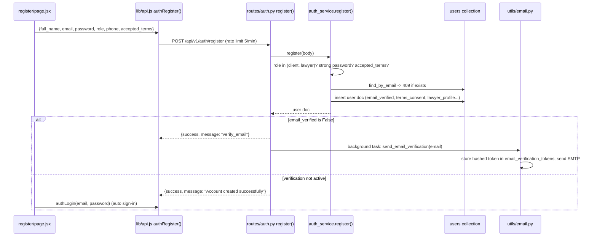
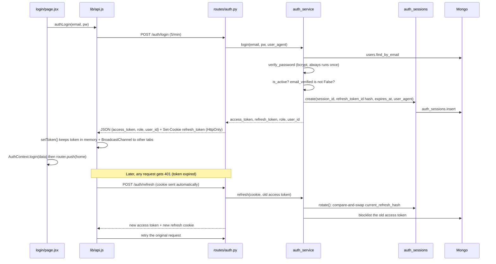
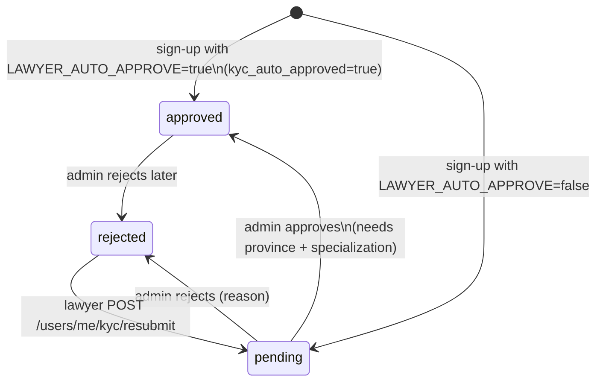
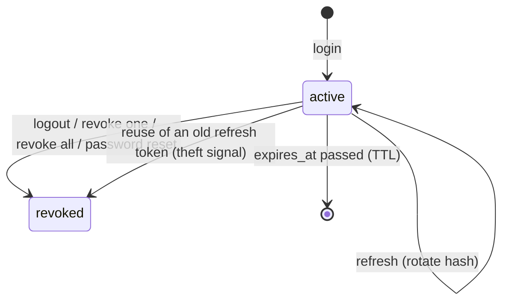

# 18 — Auth & Accounts

Sign up, email confirmation, sign in, staying signed in, signing out, password
reset, device sessions, roles, lawyer onboarding, and admin approval of
lawyers.

Read [00-architecture-overview.md](./00-architecture-overview.md) first for how
a request travels from the browser to the backend.

---

## 1. What it does

- Lets a person create a **client** or **lawyer** account. Admin accounts can
  only be created by another admin.
- Records which version of the Terms and Privacy Policy they accepted.
- Asks new users to confirm their email (when email is configured).
- Signs people in with a short-lived **access token** and a long-lived
  **refresh cookie**, one **session** per device.
- Lets people see and end their sessions, change or reset their password, and
  close their account.
- Sends a new lawyer into an **onboarding** wizard until their profile is
  complete.
- Lets an admin approve or reject a lawyer (KYC) when auto-approve is off.

---

## 2. User flow

### 2.1 Sign up

1. User opens `/register`. They pick "I need legal help" (client) or "I'm a
   lawyer".
2. They enter name, email, phone (optional), password, and tick the Terms box.
   The page checks password rules locally (`passwordProblem` in
   `AuthShell.jsx`) before calling the server.
   The phone is normalised in the browser to `+92…` (`toPkPhone` in
   `lib/phone.js`); empty stays `null`. Signing up as a lawyer also removes
   the `lawyer_onboarded` cache key so the wizard is shown.
3. Two possible outcomes:
   - **Email confirmation is on** → the page changes to "Check your inbox"
     (with "I've confirmed, sign in" and "Send a new link" buttons).
     The user opens the link in the email, which goes to
     `/verify-email#token=…`.
   - **Email confirmation is off** (no SMTP) → the page signs the user in
     straight away and sends them home. If that automatic sign-in fails (for
     example the login rate limit), the user is sent to `/login?registered=1`,
     which shows "Your account was created. Please sign in to continue."

### 2.1a Confirming the email

`/verify-email` reads `#token`, removes it from the address bar, and calls
`POST /auth/verify-email` **once** (a `useRef` guard stops React StrictMode's
double effect from spending the one-use link). Stages: *Confirming…* →
*Email confirmed* (Sign in button) or *This link has expired* (with a resend
form). Without a token the page shows the resend form.

### 2.2 Sign in

1. `/login` → email + password.
2. If the password is right but the email is not confirmed yet, the page shows
   "Please confirm your email first" with a form to resend the link.
3. Otherwise the user lands on their role's home: `/dashboard` (client),
   `/lawyer` (lawyer), `/admin` (admin).

### 2.3 Forgot password

1. `/reset-password` → enter email → "If that email exists, a reset link has
   been sent".
2. The email link is `/reset-password#token=…`. The page reads the token and
   asks for a new password (new + confirm, checked with `passwordProblem`).
   Older links of the form `?token=…` are still read too. Either way the token
   is removed from the address bar.
3. After a reset, **every** existing session of that user ends.
4. If the server says the link is invalid/expired (`isDeadLink` matches the
   message), the page switches to an "expired" stage with a way to request a
   new link.

### 2.4 Lawyer onboarding

A new lawyer who signs in is shown the onboarding wizard
([OnboardingPage.jsx](../../frontend/src/components/lawyer/OnboardingPage.jsx))
instead of the dashboard until their profile has a **bar number** and **at
least one specialization**. The wizard saves through `PATCH /users/me`,
`PATCH /users/me/lawyer-profile` and KYC uploads to
`POST /users/me/kyc/documents`.

---

## 3. Code flow

### 3.1 Register

### 3.2 Login and staying signed in

### 3.3 Page load (cold start)

When a page loads, there is no token in memory. `AuthProvider`
([AuthContext.jsx](../../frontend/src/context/AuthContext.jsx)) calls
`bootstrapAuth()`:

1. Ask other open tabs for their token over the `aai-auth` BroadcastChannel
   (150 ms).
2. If none, call `/auth/refresh` with the cookie.
3. Then call `GET /users/me` and store the user in context.

If the backend is down, it shows "Server temporarily unavailable" with a
Retry button — it does **not** log the user out.

### 3.4 Frontend guard

`ProtectedRoute` (used by each area's `layout.jsx`) waits for `loading` to
finish, then:

- not signed in → `/login`
- wrong role → that role's home (`ROLE_HOME`)
- while loading → a full-screen spinner; when the backend is unreachable →
  "Server temporarily unavailable … Your session has not been cleared" with a
  **Retry connection** button (`retryAuth` runs the cold start again).

The `/login` and `/register` pages do the opposite: once hydration finishes,
an already signed-in user is sent straight to their role's home.

### 3.5 All endpoints

Every route is mounted under `/api/v1`.

| Method + path | Auth | Rate limit | What it does / errors |
|---|---|---|---|
| `POST /api/v1/auth/register` | none | 5/min | Body `RegisterRequest` (`full_name`, `email` (EmailStr), `password`, `role` default `client`, `phone`, `accepted_terms`). 422 bad role / weak password / terms not ticked; 409 "Email already registered". Answers `message: "verify_email"` or "Account created successfully" |
| `POST /api/v1/auth/verify-email` | none | 10/min | `{token}`. 422 "This confirmation link is invalid or has expired." |
| `POST /api/v1/auth/resend-verification` | none | 3/min | `{email}`. Always 200 with the same text; real work runs in a background task |
| `POST /api/v1/auth/login` | none | 5/min | `{email, password}` → `{access_token, token_type, role, user_id}` + refresh cookie. 401 "Invalid email or password"; 403 `{code: "email_not_verified"}` |
| `POST /api/v1/auth/refresh` | refresh cookie | 20/min | 401 "Refresh token missing" / "Invalid refresh token" / "User not found" / "Session ended by a password change" / "Refresh token already rotated" / "Refresh token reuse detected; session revoked" |
| `POST /api/v1/auth/ws-ticket` | Bearer | 20/min | Returns `{ticket}`: one-time, 60 s WebSocket ticket bound to the user's auth epoch and session id |
| `POST /api/v1/auth/logout` | cookie and/or Bearer (optional) | – | Revokes the session(s) named by either token, blocklists both tokens, **always** deletes the cookie (even if revocation fails) |
| `GET /api/v1/auth/sessions` | Bearer | – | Active sessions, newest `last_used_at` first, max 100; each has `session_id`, `current`, `user_agent`, `created_at`, `last_used_at`, `expires_at` |
| `POST /api/v1/auth/sessions/revoke-all` | Bearer | – | Revokes every session + sets `tokens_valid_from`; returns `{revoked: n}`; deletes the cookie |
| `DELETE /api/v1/auth/sessions/{session_id}` | Bearer | – | Revokes one of **your** sessions. Unknown and someone else's id give the same 404 (no session-id oracle). If it is the current session, the cookie is deleted too |
| `POST /api/v1/auth/forgot-password` | none | 3/min | `{email}`. Always 200 "If that email exists, a reset link has been sent"; work in a background task |
| `POST /api/v1/auth/reset-password` | none | 5/min | `{token, new_password}`. 422 weak password; 401 "Invalid or expired reset token"; 404 user gone |
| `GET /api/v1/users/me` | Bearer | – | Own profile through the `UserProfileResponse` whitelist (no `password_hash`, `cnic_encrypted` or matching embedding) |
| `PATCH /api/v1/users/me` | Bearer | – | `UserUpdate`: `full_name`, `phone`, `province` (must be a `Province` enum value). A lawyer changing `province` is re-embedded for matching |
| `PATCH /api/v1/users/me/password` | Bearer | – | `{current_password, new_password}`. 400 "Current password is incorrect"; 422 weak password; 409 "Password changed in another request — please sign in again" |
| `POST /api/v1/users/me/close` | Bearer | – | `{password}`. 403 "Password is incorrect"; 422 with the list of blockers; else `{closed, closed_at, kyc_erasure_pending, detail}` |
| `PATCH /api/v1/users/me/lawyer-profile` | `require_lawyer` | – | `LawyerProfileUpdate` (see 5.7) |
| `POST /api/v1/users/me/kyc/resubmit` | `require_lawyer` | – | rejected → pending (see 5.8) |
| `GET /api/v1/users/me/kyc/documents` | `require_lawyer` | – | Metadata only, per kind: `file_id`, `filename`, `content_type`, `size`, `uploaded_at` |
| `POST /api/v1/users/me/kyc/documents` | `require_lawyer` | 20/min | Multipart `kind` + `file` (see 5.7) |
| `GET /api/v1/users/{user_id}` | `require_admin` | – | Any user's full profile. Registered **after** the `/me/*` routes so `{user_id}` cannot swallow them |

Errors come back in the app envelope `{"error": <detail>, "status_code": n}`.
For the unconfirmed-email case `error` is an object `{code, message}`;
`formatResponseError` in `lib/api.js` copies `code` onto the error so the login
page can branch on `error.code === "email_not_verified"`.

---

## 4. Data & states

### 4.1 `users` collection (fields used by auth)

| Field | Meaning |
|---|---|
| `_id` | random string (`secrets.token_urlsafe(16)`) |
| `role` | `client` / `lawyer` / `admin` |
| `email` | stored lower-case |
| `password_hash` | bcrypt, 12 rounds |
| `is_active` | `False` = closed or deactivated; cannot sign in |
| `email_verified`, `email_verified_at` | `False` = must confirm. Old accounts have no field and count as confirmed |
| `terms_consent` | `{terms_version, privacy_version, accepted_at}` |
| `tokens_valid_from` | any token issued before this time is rejected (set on password change / reset / "sign out everywhere") |
| `lawyer_profile` | only for lawyers: `bar_number`, `specializations`, `kyc_verified`, `kyc_status`, `kyc_auto_approved`, `kyc_rejection_reason`, `rating`, `bio`, ... |

The current consent versions are constants in
[constants.py](../../backend/app/core/constants.py):
`TERMS_VERSION = "2026-10-18"`, `PRIVACY_VERSION = "2026-10-18"`. The public
pages are `/terms` and `/privacy`.

### 4.2 Other collections

| Collection | What it holds | Cleanup |
|---|---|---|
| `auth_sessions` | one row per device sign-in: `status` (`active`/`revoked`), `current_refresh_hash`, `previous_refresh_hash`, `previous_rotated_at`, `last_used_at`, `expires_at`, `user_agent` | TTL on `expires_at` |
| `refresh_token_blocklist` | revoked JWTs (stored as a hash key) until they would expire anyway | TTL on `expires_at` |
| `email_verification_tokens` | one row per user: SHA-256 of the link token | TTL 24 h |
| `password_reset_tokens` | SHA-256 of the reset token, `active_slot` (one active link per email), `claimed_at` | TTL 1 h |
| `ws_tickets` | one-time WebSocket tickets | TTL at `expires_at` (60 s) |
| `admin_audit` | who did what (`kyc.approved`, `user.created`, ...) | — |

Indexes ([indexes.py](../../backend/app/db/indexes.py)):

| Collection | Indexes |
|---|---|
| `users` | `email` unique; `cnic_encrypted` unique + sparse; `role`, `province`, `is_active`, `lawyer_profile.kyc_verified`, `lawyer_profile.specializations`; a compound index for lawyer search (role, is_active, kyc_verified, province, specializations, rating desc) |
| `auth_sessions` | (`user_id`, `status`, `last_used_at` desc); `current_refresh_hash` unique; TTL on `expires_at` |
| `refresh_token_blocklist` | `token` unique; TTL on `expires_at` (exact JWT expiry); an old 7-day TTL on `created_at` that only cleans rows written by older releases (new rows omit `created_at` on purpose) |
| `password_reset_tokens` | `token` unique; `email`; partial unique (`email`, `active_slot`); TTL 1 h on `created_at` |
| `email_verification_tokens` | `token` unique; `user_id` unique; TTL 24 h on `created_at` |
| `ws_tickets` | TTL on `expires_at` |

### 4.2a Settings that guard auth ([config.py](../../backend/app/core/config.py))

| Setting | Default | Rule |
|---|---|---|
| `SECRET_KEY` | – | Startup fails if shorter than 32 characters or starts with "change-this" |
| `ALGORITHM` | `HS256` | Any other value is refused |
| `ACCESS_TOKEN_EXPIRE_MINUTES` / `REFRESH_TOKEN_EXPIRE_DAYS` | 60 / 7 | Must be positive |
| `LAWYER_AUTO_APPROVE` | `True` | Refused when `APP_ENV=production` |
| `EMAIL_VERIFICATION_REQUIRED` | `True` | In production, refused unless `SMTP_USER` is set |
| `FRONTEND_URL` | `http://localhost:3001` | Must be `https://` in production; used for email links and CORS |
| `APP_ENV` | `development` | `development` turns off the cookie `secure` flag and adds CORS ports 3000–3005 |

### 4.3 KYC status of a lawyer

### 4.4 Session (refresh-token family)

---

## 5. Key logic & rules (and why)

### 5.1 Tokens

- **Access token only in memory.** `lib/api.js` keeps it in a JS variable,
  never in `localStorage`. Why: a script injected into the page (XSS) cannot
  read it from storage. The durable credential is the HttpOnly cookie, which
  JavaScript cannot read.
- **Cookie settings** (`_set_refresh_cookie` in `routes/auth.py`):
  `httponly=True`, `samesite="strict"`, `secure` is on except when
  `APP_ENV=development` (so it works on `http://localhost`).
- **Refresh rotation with reuse detection**
  ([auth_sessions.py](../../backend/app/services/auth_sessions.py) `rotate`).
  The DB stores only a SHA-256 of the refresh token's `jti`. Each refresh does
  one compare-and-swap. If the presented token is:
  - current → rotate, success;
  - the one just replaced, within 5 s (`REUSE_GRACE`) → a parallel tab lost
    the race; 401 but the session stays;
  - anything older → treated as a stolen token: the **whole session is
    revoked**.
- **Sliding session.** Each successful rotation also moves the session's
  `expires_at` to the new refresh token's expiry, so a user who comes back at
  least once every 7 days stays signed in; 7 days of no use ends the session.
- **Refresh also retires the old access token.** The browser sends its current
  access token in the `Authorization` header of `/auth/refresh`; the server
  puts it in `refresh_token_blocklist` (as `sha256:<hash>`, expiring when the
  JWT would). Before rotating, refresh also refuses an inactive user and a
  token older than `tokens_valid_from`.
- **Legacy cookies.** A refresh token without `sid` (minted before sessions
  existed) is rotated the old way: it is inserted into the blocklist, and a
  duplicate insert means "already used" → 401 "Refresh token revoked".
- **What `get_current_user` checks** (every protected request): Bearer token
  present → JWT valid with `type == "access"` → not in the blocklist (new
  hashed key or old raw key) → user exists and `is_active` → not older than
  `tokens_valid_from` → its `sid` session is still active. The user is cached
  on `request.state` for the rest of the request.
- **Single-flight refresh in the browser.** `_tryRefresh` shares one promise
  between all callers, because the refresh token is single-use; parallel
  refreshes would trigger reuse detection. If the refresh fails while this
  tab had a token, it asks sibling tabs for a newer token (250 ms) — another
  tab may have won the rotation.
- **Outage is not logout.** Only a 401/403 from `/auth/refresh` counts as
  "session invalid" (`apiFetch` then clears the token and answers "Session
  expired. Please sign in again."). A 5xx or network error answers "The server
  is restarting or unavailable. Please retry in a moment." and keeps the
  session. `apiFetchMultipart` (uploads) follows the same rules.
- **401 without any token** (outside the public auth routes) is reported as
  "You are signed out. Please sign in again on this address — a session
  started on a different URL does not carry over." (cookies are per origin, so
  a localhost session does not exist on a tunnel URL). On `/auth/login`,
  `/auth/register`, `/auth/forgot-password` and `/auth/reset-password` the
  server's own 401 text is kept, so "Invalid email or password" still shows.
- **Cold start retry.** `bootstrapAuth`: sibling token (150 ms) → refresh →
  if that failed, ask siblings once more (250 ms, two tabs may have loaded at
  once) → if the refresh was an outage, return `backend_unavailable` so the
  UI shows Retry instead of logging out.
- **Cross-tab sync.** Tabs share the token and logout over the
  `aai-auth` BroadcastChannel. If another tab signs in as a different user,
  this tab reloads so it does not show one user while acting as another.

### 5.2 Login safety

- `login` always runs **one** bcrypt check, even for unknown emails (against
  `DUMMY_PASSWORD_HASH`). Why: otherwise unknown emails answer much faster,
  which tells an attacker which emails exist.
- One message for unknown email, wrong password and deactivated account:
  "Invalid email or password".
- "Please confirm your email" (`403`, `code: email_not_verified`) is shown only
  **after** the password is proven correct, for the same reason.
- Rate limits: register 5/min, login 5/min, refresh 20/min, ws-ticket 20/min,
  forgot-password 3/min, resend-verification 3/min, reset 5/min, verify
  10/min, KYC upload 20/min. The limiter key
  ([rate_limit.py](../../backend/app/core/rate_limit.py) `_user_or_ip`) is the
  user id when a valid access token is present, otherwise the client IP. A
  429 answers "Too many requests. Please slow down." If Redis (the limiter's
  store) fails, limiting is skipped (fail open) instead of returning 500.

### 5.2a Password rules

- One server rule, `validate_password_strength` in
  [validators.py](../../backend/app/utils/validators.py): **8 to 72 bytes**,
  at least one **digit** and one **uppercase letter** (72 bytes because bcrypt
  cannot hash more). Message: "Password must be 8 to 72 characters and include
  a number and an uppercase letter". Used by register, reset and change.
- The change-password path uses the same check but answers with an older,
  shorter message ("Password must be at least 8 characters with a number").
- In the browser, register and reset use `passwordProblem` (same rules,
  counted in UTF-8 bytes) and show `PasswordRules` live. The profile/settings
  password dialogs check only "8+ characters", so the server's message is
  what the user sees for the other rules.
- Passwords are bcrypt-hashed with 12 rounds. `verify_password` returns
  `False` instead of raising on an unusable hash (a closed account stores
  `"!closed"`), so signing in to a closed account is a normal 401, not a 500.

### 5.3 Email verification

- `email_verification_active()` = `EMAIL_VERIFICATION_REQUIRED` **and**
  `SMTP_USER` is set. Without SMTP, a link could never arrive, so the account
  is marked confirmed and a warning is logged. In production the settings
  validator refuses to start in that state.
- The link token is random; only its SHA-256 is stored. One link per user
  (`replace_one` with upsert) — a resend makes older links stop working.
- `verify_email` uses `find_one_and_delete` so a link works once, expires
  after 24 h, and the update also matches the email so an old link cannot
  confirm a changed address.
- Tokens are put in the URL **fragment** (`#token=`), not the query string.
  Why: a fragment is never sent to a server, so it stays out of logs. The page
  removes it from the address bar after reading it.
- `resend-verification` and `forgot-password` run their work in a
  **background task** and always answer the same text. Why: if the response
  time differed for real accounts, it would leak which emails exist.
- A resend does nothing for an unknown address, an already-confirmed account,
  or when verification is not active. If the email cannot be sent, the token
  row just written is deleted again (only a log line is kept).
- Sending ([utils/email.py](../../backend/app/utils/email.py) `_send`) uses
  `aiosmtplib` with STARTTLS to `SMTP_HOST:SMTP_PORT` (default
  `smtp.gmail.com:587`) from `EMAIL_FROM`. Without `SMTP_USER` it returns
  `False` and sends nothing. Links are built from `FRONTEND_URL`.
- After confirming, the user still has to sign in; the verify call does not
  create a session.

### 5.4 Password reset

- One active reset link per email (partial unique index
  `uniq_active_password_reset_email` on `email` + `active_slot`). When an
  unused link already exists (2026-10-20, `_replace_reset_link`):
  - asked again **within 2 minutes** (`_RESET_RESEND_AFTER`, e.g. a double
    click) → nothing new is sent; the first email is still on its way and its
    link keeps working;
  - asked again **later** → the unused link's token is swapped for a new one
    (one conditional `find_one_and_update`), a new email is sent, and the new
    link gets its own hour. The old email's link stops working;
  - a link already being used (`claimed_at` set) is never replaced.
- If the email fails to send: a brand-new row is deleted (the user can try
  again at once); a **replaced** link gets its old token and `created_at`
  back, so the email the user already has keeps working.
- Reset links from the previous release stored the raw token; the lookup
  accepts both the `sha256:` key and the raw value until they expire.
- The link is **claimed** atomically (`claimed_at`) instead of deleted first.
  If saving the new password fails, the claim is released so the same link
  can be retried. The row is deleted only after success.
- Expires after 1 hour (checked in code and by TTL).
- A successful reset sets `tokens_valid_from` and revokes all sessions. Why: a
  reset often happens *because* an account was stolen. It also sets
  `email_verified = True` (the link reached the inbox, which proves it).

### 5.5 Sessions

`GET /auth/sessions` lists active devices (`user_agent`, last used). The user
can `DELETE /auth/sessions/{id}` or `POST /auth/sessions/revoke-all`.
`revoke-all` also bumps `tokens_valid_from`, which kills old tokens that have
no session id. `user_agent` is cut to 256 characters and is for display only.
Session rows hold no token, only the SHA-256 of the current refresh `jti`
(unique index on `current_refresh_hash`).

`tokens_valid_from` is stored **truncated to the whole second** and compared
strictly (`iat < cutoff`), because JWT `iat` is whole seconds: a token minted
in the same second as the change (the immediate re-login) must still work. A
token with no `iat` is rejected.

Password change, reset and account closure write `tokens_valid_from` first
and then revoke the session rows "best effort" (`revoke_all_best_effort`): if
that clean-up fails it is only logged, because the cutoff already blocks
every old token.

Signing out (`AuthContext.logout`): calls `/auth/logout`, clears the in-memory
token, broadcasts `logout` to other tabs (they clear their token and go to
`/login`), removes `localStorage['aai-role']`, and clears the remembered
active conversation ids and the saved intake token/case id, so the next
person on a shared computer does not inherit them.

The UI for sessions is `SessionsPanel.jsx`
([lawyer copy](../../frontend/src/components/lawyer/SessionsPanel.jsx),
[shared copy](../../frontend/src/components/shared/SessionsPanel.jsx)), shown
from the lawyer Settings page and the client Profile → Security tab. Signing
out the **current** device, or all devices, calls `onSignedOut` (the page's
`logout`).

### 5.6 Roles

- Public registration accepts only `client` or `lawyer`
  (`auth_service.register`). Admins are made by an admin
  (`POST /admin/users` → `admin_service.create_user`).
- Backend: `require_client`, `require_lawyer`, `require_admin`,
  `require_client_or_lawyer` in
  [dependencies.py](../../backend/app/dependencies.py). For example
  `PATCH /users/me/lawyer-profile` uses `require_lawyer`;
  `GET /users/{user_id}` uses `require_admin` (it used to leak contact info).
- The admin service refuses to deactivate or demote the **last active
  admin** (`_assert_not_last_admin`), because there is no other way to create
  an admin again.

### 5.7 Lawyer onboarding and visibility

- With `LAWYER_AUTO_APPROVE=True` (default, demo) `initial_kyc_fields()` sets
  `kyc_verified=True`, `kyc_status="approved"`, `kyc_auto_approved=True`.
  The UI must say "registered", never "verified", because nobody checked the
  Bar licence. Production refuses to start with this flag on.
- The lawyer directory (`UserRepository.lawyer_filter`) still hides a lawyer
  until `bar_number` is a non-empty string **and** `specializations` has at
  least one item.
- The onboarding gate (`isLawyerOnboarded` in `OnboardingPage.jsx`) reads the
  **server** profile. `localStorage["lawyer_onboarded"]` is only a cache to
  avoid a flash. Why: the old version trusted only localStorage, so a lawyer
  on a new browser was trapped in onboarding forever.
- Editing profile fields that are embedded for matching calls
  `schedule_embed(user_id)` so the lawyer's search vector stays fresh.
  A given `address` is geocoded to `lat`/`lng`.
  Only `specializations`, `bio` and `experience_years` trigger a re-embed on
  `PATCH /users/me/lawyer-profile`; `province` (a top-level field) triggers it
  through `PATCH /users/me`.
- `LawyerProfileUpdate` fields: `bar_number` (4–64 chars, regex
  `^[A-Za-z0-9][A-Za-z0-9\-/ .]*[A-Za-z0-9]$` — checks shape only, nothing
  talks to a Bar Council), `specializations`, `availability`, `bio`,
  `experience_years`, `hourly_rate`, `address`. `None` values are dropped
  (`exclude_none`), so a field cannot be cleared to empty this way.
- **KYC uploads** ([kyc_documents.py](../../backend/app/services/kyc_documents.py)):
  kinds `photo` (JPEG/PNG only), `bar_certificate`, `education`,
  `professional` (PDF/JPEG/PNG). Type is detected from the first bytes, never
  from the file name. Max 5 MB (read in 1 MB chunks, 422 "File too large");
  empty file 422; unknown kind 422. Uploading the same kind again replaces the
  old file (the old file is deleted after the new record is saved; if the
  record write fails the new file is removed so nothing is orphaned).
- **KYC resubmit** refuses (422) when the profile is already verified, when it
  is not in `rejected` (already awaiting review), or when there is no bar
  number. On success it sets `pending` and clears `kyc_rejection_reason`.
  Editing the profile never re-opens a rejected review by itself.

### 5.8 Admin approvals (brief)

[admin_service.process_kyc](../../backend/app/services/admin_service.py)
(`PATCH /admin/kyc/{lawyer_id}`):

- **Approve** is refused if the profile is not matchable (missing **province**
  or **specialization** — `_matchability_gaps` in `admin_service.py`; a lawyer
  with no bar number never reaches the KYC queue at all) — otherwise the lawyer would be "approved" but never
  appear in search. On approve: set approved, create a `kyc_approved`
  notification, email the result, write `admin_audit`, and embed the lawyer
  for matching.
- **Reject**: set rejected with a reason, notify, email, audit, and remove
  the lawyer from the matching index (`forget_lawyers`).
- Email failures are logged but do not undo the decision.

### 5.9 Closing an account

`POST /users/me/close` needs the password again. It does **not** hard-delete:
it overwrites personal data and keeps the skeleton, because payments and AI
audit records must stay. It refuses while engagements or payments are still
open (`_open_obligations`). Admin "delete user" uses the same routine
(`_close_account_record`).

Details from `user_service.py`:

- **Blockers** (all listed in one 422 message, "This account cannot be closed
  yet because …"): open engagements (the open negotiation states, including
  `terms_proposed`, plus `accepted`), payments in `created`/`pending` (as payer
  for a client, payee for a lawyer), and for a lawyer, walk-in cases not
  `closed`/`dismissed`.
- **Erasure, in one write:** `is_active=False`, `is_closed=True`,
  `closed_at`, `closed_reason` (`self_service` or the admin reason),
  `full_name="Closed account"`, `email="closed+<id>@deleted.invalid"`, phone
  and avatar `None`, `password_hash="!closed"` (nothing can match it), and
  `tokens_valid_from` (so every token dies in the same write).
  `cnic_encrypted` is **unset**, not nulled (a null would collide in the
  sparse unique index).
- **Lawyers also:** bio blanked, `kyc_verified=False`, `availability=False`;
  their private diary (`lawyer_events`) is deleted *before* the closure write;
  KYC files are tombstoned in the same write and deleted afterwards. If file
  deletion fails, the reply says `kyc_erasure_pending: true` and the hourly
  `_kyc_erasure_retry` loop in `main.py` tries again. The lawyer is removed
  from the matching index (`forget_lawyers`).
- After closing, the UI calls `logout()` and hard-redirects to `/login`.

---

## 6. Files

| File | Role |
|---|---|
| [app/(auth)/login/page.jsx](../../frontend/src/app/%28auth%29/login/page.jsx) | Sign-in page, unconfirmed-email handling |
| [app/(auth)/register/page.jsx](../../frontend/src/app/%28auth%29/register/page.jsx) | Sign-up page, role switch, terms checkbox, "check your inbox" stage |
| [app/(auth)/verify-email/page.jsx](../../frontend/src/app/%28auth%29/verify-email/page.jsx) | Reads `#token`, calls verify once |
| [app/(auth)/reset-password/page.jsx](../../frontend/src/app/%28auth%29/reset-password/page.jsx) | Request link + set new password |
| [app/terms/page.jsx](../../frontend/src/app/terms/page.jsx), [app/privacy/page.jsx](../../frontend/src/app/privacy/page.jsx) | Public legal pages |
| [components/auth/AuthShell.jsx](../../frontend/src/components/auth/AuthShell.jsx) | Shared look: `AuthShell`, `PillInput`, `PasswordRules`, `passwordProblem`, visuals |
| [components/auth/ResendForm.jsx](../../frontend/src/components/auth/ResendForm.jsx) | "Send a new confirmation link" form |
| [context/AuthContext.jsx](../../frontend/src/context/AuthContext.jsx) | `AuthProvider`, `useAuth`, `login`, `logout`, cold-start hydration |
| [components/shared/ProtectedRoute.jsx](../../frontend/src/components/shared/ProtectedRoute.jsx) | Role guard used by layouts |
| [components/shared/AuthGuard.jsx](../../frontend/src/components/shared/AuthGuard.jsx) | Older guard that reads `localStorage['aai-role']` only |
| [components/lawyer/OnboardingPage.jsx](../../frontend/src/components/lawyer/OnboardingPage.jsx) | Lawyer onboarding wizard, `isLawyerOnboarded` |
| [components/lawyer/App.jsx](../../frontend/src/components/lawyer/App.jsx) | Onboarding gate (`setPage("onboarding")`) |
| [lib/api.js](../../frontend/src/lib/api.js) | `authLogin`, `authRegister`, `authVerifyEmail`, `authResendVerification`, `authForgotPassword`, `authResetPassword`, `authLogout`, `bootstrapAuth`, `getMe`, `updateMe`, `changePassword`, `closeAccount`, `listSessions`, `revokeSession`, `revokeAllSessions`, `updateLawyerProfile`, KYC helpers, admin helpers |
| [routes/auth.py](../../backend/app/api/v1/routes/auth.py) | `/auth/*` endpoints, refresh cookie |
| [routes/users.py](../../backend/app/api/v1/routes/users.py) | `/users/me`, password, close, lawyer profile, KYC docs |
| [routes/admin.py](../../backend/app/api/v1/routes/admin.py) | `/admin/kyc/*`, `/admin/users/*` |
| [services/auth_service.py](../../backend/app/services/auth_service.py) | register, login, refresh, logout, verify email, forgot/reset |
| [services/auth_sessions.py](../../backend/app/services/auth_sessions.py) | session create, rotate, revoke, list |
| [services/user_service.py](../../backend/app/services/user_service.py) | profile, change password, lawyer profile, KYC resubmit, close account |
| [services/admin_service.py](../../backend/app/services/admin_service.py) | KYC decisions, user management, audit |
| [dependencies.py](../../backend/app/dependencies.py) | `get_current_user`, `require_*` |
| [core/security.py](../../backend/app/core/security.py) | bcrypt, JWT, `tokens_valid_from` check |
| [core/ws_ticket.py](../../backend/app/core/ws_ticket.py) | one-time WebSocket tickets |
| [core/live_auth.py](../../backend/app/core/live_auth.py) | `ActiveSessionGate` for sockets |
| [schemas/auth.py](../../backend/app/schemas/auth.py) | request/response models |
| [schemas/user.py](../../backend/app/schemas/user.py) | `UserUpdate`, `PasswordChange`, `LawyerProfileUpdate` (bar-number regex), `UserProfileResponse` whitelist |
| [core/rate_limit.py](../../backend/app/core/rate_limit.py) | slowapi limiter, user-or-IP key, Redis fail-open |
| [core/exceptions.py](../../backend/app/core/exceptions.py) | 401/403/404/409/422 classes and the `{error, status_code}` envelope |
| [utils/validators.py](../../backend/app/utils/validators.py) | `validate_password_strength`, `PASSWORD_POLICY` |
| [services/kyc_documents.py](../../backend/app/services/kyc_documents.py) | KYC upload/list, closure tombstone, erasure retry |
| [lib/phone.js](../../frontend/src/lib/phone.js) | `toPkPhone` (sign-up phone → `+92…`) |
| [utils/email.py](../../backend/app/utils/email.py) | SMTP send, verification / reset / KYC emails |
| [repositories/user_repo.py](../../backend/app/repositories/user_repo.py) | user queries, `lawyer_filter` |
| [db/indexes.py](../../backend/app/db/indexes.py) | TTL and unique indexes for the collections above |

---

## 7. Known limits (from the code)

- Without SMTP, email verification is silently skipped (only a log warning)
  in development, and no reset or verification email can be sent at all.
- `AuthGuard.jsx` trusts `localStorage['aai-role']`, which any user can edit.
  It is UX only; the real checks are on the server. `ProtectedRoute` is the
  guard the layouts actually use.
- There is no "remember me": every sign-in gets the same 7-day refresh
  lifetime (sliding: each refresh extends it by 7 days from that moment).
- `PATCH /users/me` has no length limits on `full_name` or `phone`, and the
  phone format is not validated on the server.
- Email addresses cannot be changed (no endpoint).
- The `secure` cookie flag is off when `APP_ENV=development`.
- With `LAWYER_AUTO_APPROVE` on (the default), the admin KYC queue is empty
  for new lawyers; nobody checks a Bar licence.
- Rate limits are per process unless Redis is configured.
