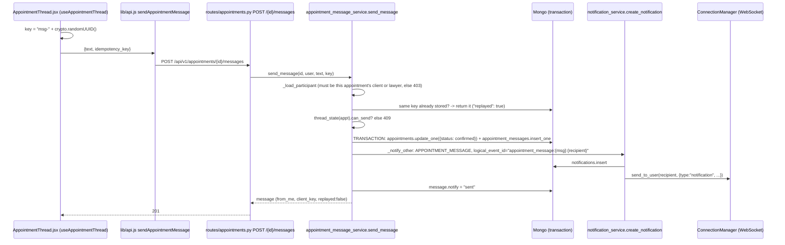
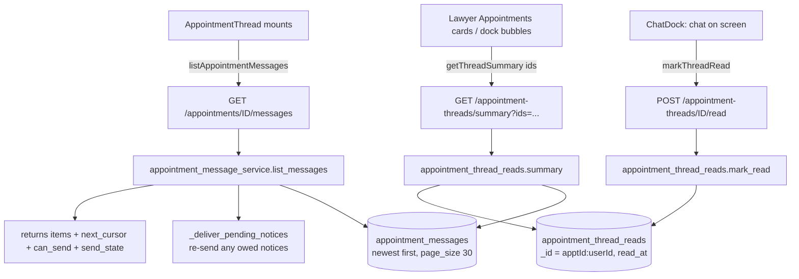
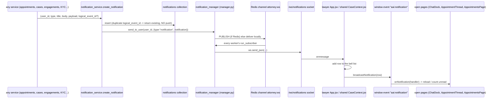
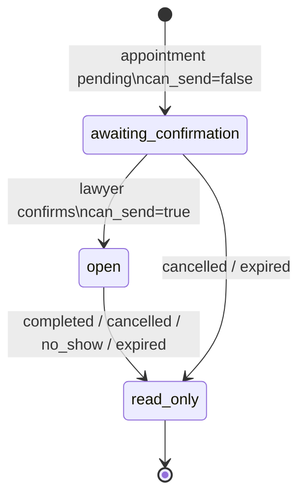

# 19 — Messaging & Notifications

How a client and a lawyer write to each other, how the lawyer's floating chat
windows work, how unread counts are kept, and how notifications reach the
bell icon live.

Read [00-architecture-overview.md](./00-architecture-overview.md) (sections 5
and 6) first for WebSockets, Redis fan-out and the event outbox.

---

## 1. What it does

There are **two separate message systems** and **one notification system**:

| System | Between | Stored in | Open when |
|---|---|---|---|
| **Appointment thread** | the client and lawyer of ONE appointment | `appointment_messages` collection | appointment is `confirmed` |
| **Case messages** | the client and the hired lawyer of a case | `messages` array inside the `cases` document | case is not closed and has a client account |
| **Notifications** | server → one user | `notifications` collection | always |

On top of these:

- **Read receipts** for appointment threads (`appointment_thread_reads`), so a
  card can say "2 new · 'hello'" on any device.
- **Lawyer chat dock**: chat windows that stay open while the lawyer moves
  between pages.
- **Live push** of every new notification over the `/ws/notifications`
  WebSocket.
- **Emails** for a few account events (see section 5.6). Messages themselves
  are never emailed.

---

## 2. User flow

### 2.1 Appointment messages

1. A client books an appointment. While it is **pending**, the thread shows
   "Messages open once the lawyer confirms this appointment."
2. The lawyer confirms. Now both sides can write.
   - Client: inside the appointment card on Tracking / Appointments
     ([ModTracking.jsx](../../frontend/src/components/client/ModTracking.jsx)).
   - Lawyer: "Message client" on the Appointments page opens the **chat dock**
     ([ChatDock.jsx](../../frontend/src/components/lawyer/ChatDock.jsx)).
3. The other side gets a notification "New message about your appointment"
   (without the text). Clicking it opens that appointment on its thread.
4. When the appointment is completed, cancelled, a no-show or expired, the
   thread becomes **read-only**. It can still be read.

### 2.2 Lawyer chat dock

- **Docked** (default): a full-height panel on the right, over the page. Many
  chats appear as tabs.
- **Floating**: small windows in the corner, like WhatsApp Web.
- The choice is saved in `localStorage["attorney:lawyer-chat-docked"]`.
- At most **three** chats. Opening a fourth closes the oldest.
- "–" tucks chats into round bubbles that show how many new messages arrived.
- Quick-reply chips ("I'm running 10 minutes late." ...) fill the composer.

### 2.3 Case messages

On the lawyer's Cases page
([CasesPage.jsx](../../frontend/src/components/lawyer/CasesPage.jsx)) a case
has a messages tab. Sending creates a `case_message` notification for the
other side, with a short preview of the text.

### 2.4 Notifications (the bell)

- Lawyer: bell in the lawyer header opens `NotificationPanel` in
  [components/lawyer/layout.jsx](../../frontend/src/components/lawyer/layout.jsx).
- Client: `NotifDrawer` in
  [components/client/Dashboard.jsx](../../frontend/src/components/client/Dashboard.jsx).
- Clicking a row marks it read and **opens the thing it is about** (an
  appointment, a case, a document...). "Mark all read" clears the badge.

---

## 3. Code flow

### 3.0 All endpoints

HTTP paths are under **`/api/v1`**; the WebSocket is mounted **without** that prefix.

| Method + full path | Who | Service | Notes |
|---|---|---|---|
| `GET /api/v1/appointments/{id}/messages?page_size=&before_created_at=&before_id=` | the appointment's client or lawyer | `appointment_message_service.list_messages` | `page_size` 1–100 (default 30); newest page first, oldest-first inside it. Sending only one half of the cursor → 422 "Pass both before_created_at and before_id, or neither." Returns `{items, next_cursor, can_send, send_state, appointment_status}` |
| `POST /api/v1/appointments/{id}/messages` | the appointment's client or lawyer | `send_message` | 201. Body `{text 1–2000 (trimmed), idempotency_key 8–128}`; unknown fields refused |
| `GET /api/v1/appointment-threads/summary?ids=a,b,c` | any signed-in client/lawyer | `appointment_thread_reads.summary` | `ids` string ≤ 4000 chars; at most 100 distinct ids used. Ids that are not the caller's appointments are **silently dropped**; an admin (or empty list) gets `{items: {}}`. Returns `{items: {apptId: {unread, last: {text (≤ 90 chars + "…"), from_me, created_at}}}}`. Threads with no message are not in `items` |
| `POST /api/v1/appointment-threads/{id}/read` | the appointment's client or lawyer (else 403, same as the thread) | `mark_read` | upserts `read_at`; returns `{appointment_id, read_at}` |
| `GET /api/v1/cases/{id}/messages` | case client, assigned lawyer, admin | `case_service.list_messages` | see doc 16 |
| `POST /api/v1/cases/{id}/messages` | case client, assigned lawyer, admin | `case_service.send_message` | `text` 1–4000 |
| `GET /api/v1/notifications` | any signed-in user | `notification_service.get_notifications` | newest 30 + all unread (≤ 100) |
| `PATCH /api/v1/notifications/{id}/read` | any signed-in user | `mark_read` | filter is `{_id, user_id}`. Someone else's (or a missing) id changes nothing and **still answers success** "Marked as read" (no 404) |
| `POST /api/v1/notifications/read-all` | any signed-in user | `mark_all_read` | marks all of the caller's unread rows, sets `read_at` |
| `WS /ws/notifications?ticket=…` | ticket holder | `notification_socket` | closes `4001` for a missing/used/expired ticket, `4003` for an inactive user or a session that is no longer valid |

### 3.1 Sending an appointment message

### 3.2 Reading a thread and unread counts

### 3.3 Notification life cycle

### 3.4 Opening the notification socket (frontend)

Both the lawyer shell
([components/lawyer/App.jsx](../../frontend/src/components/lawyer/App.jsx)) and
the client shell (through
[components/shared/CaseContext.jsx](../../frontend/src/components/shared/CaseContext.jsx))
do the same thing:

1. `getNotifications()` → `GET /notifications` to fill the list.
2. `openNotificationSocket(onMessage)` in
   [lib/api.js](../../frontend/src/lib/api.js):
   - `POST /auth/ws-ticket` → one-time 60 s ticket,
   - `new WebSocket(websocketUrl('/ws/notifications') + '?ticket=…')`.
3. On close: reconnect with backoff `reconnectDelay(n)` = 1 s, 2 s, 4 s …
   up to 30 s.
4. On a successful **re**connect: read the full list again, so nothing sent
   while offline is lost.
5. The client shell also refreshes its appointment or case list when a
   notification of that kind arrives (`refreshFor`): any `appointment_*` type
   re-reads appointments (`page_size` 50); `engagement_*`, `lawyer_assigned`,
   `case_update` and `hearing_scheduled` re-read cases (`page_size` 50).
6. Rows made in this browser (an action's result) are marked `local`. They are
   never sent to `PATCH /notifications/{id}/read` (their made-up id would be
   refused) and they survive a server re-read. "Mark all read" marks every row
   in the list read at once (optimistic), then calls `POST /notifications/read-all`.

On the server
([notification_socket.py](../../backend/app/websockets/notification_socket.py)):
consume the ticket (bad ticket → close `4001`) → check the user is active
(else close `4003`) → `connect` → send
`{"type":"unread_count","count":N}` → loop: wait up to 30 s for any frame,
then re-check auth with `ActiveSessionGate`; close with `4003` if the account
or session is no longer valid.

---

## 4. Data & states

### 4.1 `appointment_messages`

| Field | Meaning |
|---|---|
| `_id` | random id |
| `appointment_id` | the thread |
| `sender_id`, `sender_role` | from the signed-in user, never from the request body |
| `text` | plain text, trimmed, 1–2000 chars (`MAX_MESSAGE_LENGTH`) |
| `idempotency_key` | sent by the browser; unique per (appointment, sender, key) |
| `created_at` | UTC |
| `notify` | `pending` → `sent` (+ `notified_at`) |

Indexes (`_appointment_message_indexes` in
[indexes.py](../../backend/app/db/indexes.py)): timeline
`(appointment_id, created_at desc, _id desc)`, unique key
`uniq_appointment_message_key`, and a partial index on `notify: "pending"`.

The send also writes `last_message_at` on the appointment.

### 4.2 Thread state (one rule, `thread_state`)

A reschedule keeps the same appointment id, so the thread continues.

### 4.3 `appointment_thread_reads`

One row per (appointment, user): `_id = "{appointment_id}:{user_id}"`,
`appointment_id`, `user_id`, `read_at`. Unread = messages from the **other**
person with `created_at > read_at` (all of them if the user never read the
thread).

`mark_read` sets `read_at` to **now or the newest message's time, whichever is
later**. Why: a message stamped a moment in the future (clock skew) must not
stay "unread" after the user has read it.

### 4.4 Case messages (inside `cases`)

Each item in `cases.messages[]`: `_id`, `lawyer_id` (the engagement it belongs
to), `sender_id`, `sender_role`, `sender_name`, `text` (1–4000 chars),
`created_at`.

### 4.5 `notifications`

| Field | Meaning |
|---|---|
| `_id` | random id (the frontend reads `notif._id`) |
| `user_id` | recipient |
| `type` | a `NotificationType` value, e.g. `appointment_message`, `case_message`, `engagement_accepted`, `kyc_approved`, `document_returned`, `payment_received` |
| `title`, `body` | display text |
| `payload` | small dict of ids: `appointment_id`, `case_id`, `doc_id`, `message_id`, sometimes `route` |
| `read`, `read_at` | read state |
| `logical_event_id` | optional; unique + sparse index `uniq_notification_logical_event` (from `v2_index_spec.py`); makes a redelivery a no-op. Sparse so old rows without the field do not collide |
| `created_at` | **TTL: deleted after 30 days** |

Other indexes: `user_id`, `read`, `created_at` desc, and the TTL index on `created_at`.

Error answers for appointment messages:

| Code | When |
|---|---|
| 403 | not the appointment's client/lawyer, appointment missing, or caller is an admin ("You do not have access to this appointment.") |
| 409 | thread pending ("Messages open once the lawyer confirms this appointment."), thread ended ("This conversation is closed… You can still read it."), same key with different text, or a raced duplicate whose winner cannot be read |
| 422 | half a paging cursor; text empty/too long; key shorter than 8 |
| 503 | standalone Mongo (no transactions) — "Messages are unavailable on this server right now. Nothing was sent." |

The full list of types is `NotificationType` in
[constants.py](../../backend/app/core/constants.py). That enum is the
contract the frontend switches on.

---

## 5. Key logic & rules (and why)

### 5.1 Who can read a thread

`_load_participant` allows only the appointment's own `client_id` or
`lawyer_id`. **Admins cannot read threads** (private words between two people).
"Not yours" and "does not exist" both return the same 403, so ids cannot be
probed.

### 5.2 A send can never land after the appointment ended

`_insert_while_confirmed` runs one Mongo **transaction**:
1. `appointments.update_one({_id, status: "confirmed"}, {$set: last_message_at})`
2. if that matched, insert the message.

If a cancel/complete commits first, step 1 matches nothing and the send is
refused (409). Why a transaction: it orders the send and the status change.
On a standalone Mongo (no replica set) the service returns **503** "Messages
are unavailable on this server right now" instead of writing non-atomically.

### 5.3 Retry-safe sending (idempotency)

The browser makes a key per message (`newKey()` in
[AppointmentThread.jsx](../../frontend/src/components/shared/AppointmentThread.jsx)).
If the reply is lost, the hook retries with the **same** key. The server:

- finds the stored message with that key and returns it (`replayed: true`),
  even if the thread has since closed — the message was sent while it was open;
- refuses (409) if the same key comes with **different** text;
- handles two racing sends with the unique index (`DuplicateKeyError` → read
  the winner).

### 5.4 Notices are durable

A message is stored with `notify: "pending"`. After the notification is
created it becomes `sent`. If the process dies in between, the next read or
send of that thread calls `_deliver_pending_notices` (up to 20) to send what
is owed. `logical_event_id = "appointment_message:{message_id}:{recipient}"`
makes a second delivery harmless.

The notification body **never contains the message text** ("X sent you a
message about your appointment"), because notifications can show on a lock
screen.

### 5.5 Notifications: stored first, pushed second

`create_notification` inserts the row, then tries the WebSocket push. A push
failure is only logged. Why: the row *is* the notification; if a push error
raised, an outbox would retry a delivery that already happened.

With a `logical_event_id`, a duplicate insert returns the existing row and
does **not** push again (no double "ping").

`get_notifications` returns the newest 30 **plus** all unread (up to 100),
merged and sorted. Why: an old unread notice behind 30 newer read ones used
to be invisible and uncounted.

### 5.6 Who creates notifications and emails

Many services call `create_notification`, including appointment_service,
appointment_message_service, appointment_reminders, appointment_outcomes,
case_service, engagement_service, meeting_proposal_service, document_service,
quick_review, review_request_notifications, agreement_service,
payment_service, subscription_service, causelist_service, hearing_reminders,
dispute_intake and admin_service. DOCUMENTS_V2 events go through the
**event outbox** (destination `"notifications"`).

Besides DOCUMENTS_V2, the outbox is also used **inside transactions** by
`engagement_service` (engagement terminated, doc 15) and `agreement_service`
(sign/decline) through `park_in_transaction`, so the state change and its
notice commit together.

How the event outbox ([event_outbox.py](../../backend/app/services/event_outbox.py)) works:

- Each row's `_id` **is** the `logical_event_id`, so parking the same event twice
  gives one row. `park()` swallows errors (returns `False`); `park_in_transaction()`
  **raises** (even on a duplicate key), so the whole transaction aborts instead
  of committing a change with no notice.
- Destinations are an **allowlist**: only `"notifications"`. An unknown
  destination is marked `dead`, never delivered.
- `drain_once()` claims up to 50 due rows, each with a 120 s **lease** (so two
  workers do not deliver the same row), calls `create_notification(...,
  logical_event_id)`, and marks it `delivered`.
- On failure: retry with backoff `2^attempts` seconds (max 300 s) for up to
  **2 hours** (`retry_until`), then `dead`. Only the exception **class name** is
  stored, never the message (it could contain secrets).
- `_event_outbox_relay` in [main.py](../../backend/app/main.py) runs `drain_once()`
  every `provenance_relay_seconds` (30 s), **always** (not behind a flag). The
  DOCUMENTS_V2 relay also drains it; both are safe together because of the lease.
  (The module docstring still says "no scheduler drains it yet" — that is out of date.)
- Indexes: `(status, next_attempt_at)`, `(destination, status)`, `retry_until`.

Emails ([utils/email.py](../../backend/app/utils/email.py)) are sent only for:
email verification, password reset, KYC result, and agreement
invitations/notifications. There is **no email for chat messages**. With no
`SMTP_USER`, `_send` returns `False` and logs a warning.

### 5.7 Where a click goes

[lib/notificationTarget.js](../../frontend/src/lib/notificationTarget.js):

- `lawyerNotificationTarget(type, payload)` → `{page, caseId, appointmentId, thread, docId}`.
  `appointment_message` opens that appointment **and** its thread (via
  `sessionStorage["attorney:lawyer-open-appointment-thread"]`, then the dock).
- `clientNotificationTarget(type, payload)` → a URL, e.g.
  `/appointments?appointment=ID&thread=open`.
- `notificationCategory(type)` → icon and colour group.
- `broadcastNotification` / `onNotification` — a tiny in-page event bus on the
  `aai:notification` window event. Pages subscribe to it instead of opening
  their own sockets.

### 5.8 The chat dock's unread logic

In `ChatDockProvider`:

- What is **on screen** is read: every visible chat calls `markThreadRead`.
- A live `appointment_message` for a chat on screen → mark read again; for an
  open-but-hidden chat → `unread[id] += 1`.
- Hidden chats also ask the server `getThreadSummary` so the bubble count is
  right after a page reload.
- `readTick` is shared through context so the Appointments page re-reads its
  card summaries after the dock marks something read.

The dock lives in [app/lawyer/layout.jsx](../../frontend/src/app/lawyer/layout.jsx),
**above** the pages, which is why it survives navigation. Outside that layout
(`useChatDock()` returns `null`), pages fall back to the inline thread.

### 5.9 Case message visibility

`_thread_visible` in [case_service.py](../../backend/app/services/case_service.py):
a lawyer sees only messages tagged with their own `lawyer_id` (or old
untagged ones); the client and admins see all. When an engagement ends,
`seal_threads_for` stamps the departing lawyer on untagged messages so the
next lawyer does not inherit them. Sending is refused for closed cases and for
walk-in clients with no account.

---

## 6. Files

| File | Role |
|---|---|
| [components/shared/AppointmentThread.jsx](../../frontend/src/components/shared/AppointmentThread.jsx) | `useAppointmentThread` hook + thread UI (load, older pages, send, retry) |
| [components/lawyer/ChatDock.jsx](../../frontend/src/components/lawyer/ChatDock.jsx) | `ChatDockProvider`, `useChatDock`, docked/floating windows, bubbles |
| [app/lawyer/layout.jsx](../../frontend/src/app/lawyer/layout.jsx) | mounts `ChatDockProvider` around all lawyer pages |
| [components/lawyer/AppointmentsPage.jsx](../../frontend/src/components/lawyer/AppointmentsPage.jsx) | "Message client", card unread line via `getThreadSummary` |
| [components/lawyer/PreJoin.jsx](../../frontend/src/components/lawyer/PreJoin.jsx) | opens the dock from the video pre-join screen |
| [components/client/ModTracking.jsx](../../frontend/src/components/client/ModTracking.jsx) | client appointment cards with the thread |
| [components/lawyer/CasesPage.jsx](../../frontend/src/components/lawyer/CasesPage.jsx) | case messages (`listMessages`, `sendMessage`) |
| [components/shared/ChatPieces.jsx](../../frontend/src/components/shared/ChatPieces.jsx) | shared chat bubble look |
| [components/lawyer/App.jsx](../../frontend/src/components/lawyer/App.jsx) | lawyer notification list, socket + reconnect, `openNotif` |
| [components/lawyer/layout.jsx](../../frontend/src/components/lawyer/layout.jsx) | `NotificationPanel` (lawyer bell) |
| [components/shared/CaseContext.jsx](../../frontend/src/components/shared/CaseContext.jsx) | client notification list, socket + reconnect, `refreshFor` |
| [components/client/Dashboard.jsx](../../frontend/src/components/client/Dashboard.jsx) | `NotifDrawer` (client bell) |
| [lib/notificationTarget.js](../../frontend/src/lib/notificationTarget.js) | click targets, categories, event bus, `reconnectDelay` |
| [lib/api.js](../../frontend/src/lib/api.js) | `listAppointmentMessages`, `sendAppointmentMessage`, `getThreadSummary`, `markThreadRead`, `listMessages`, `sendMessage`, `getNotifications`, `markNotificationRead`, `markAllNotificationsRead`, `getWsTicket`, `openNotificationSocket`, `websocketUrl` |
| [lib/socket.js](../../frontend/src/lib/socket.js) | `createSocketOwner` — stops two sockets opening at once (used by the client AI chatbot socket in `ModChatbot.jsx`, not by the notification socket) |
| [routes/appointments.py](../../backend/app/api/v1/routes/appointments.py) | `GET/POST /appointments/{id}/messages` |
| [routes/appointment_threads.py](../../backend/app/api/v1/routes/appointment_threads.py) | `GET /appointment-threads/summary`, `POST /appointment-threads/{id}/read` |
| [routes/cases.py](../../backend/app/api/v1/routes/cases.py) | `GET/POST /cases/{id}/messages` |
| [routes/notifications.py](../../backend/app/api/v1/routes/notifications.py) | `GET /notifications`, `PATCH /{id}/read`, `POST /read-all` |
| [services/appointment_message_service.py](../../backend/app/services/appointment_message_service.py) | access rule, `thread_state`, send/list, durable notices |
| [services/appointment_thread_reads.py](../../backend/app/services/appointment_thread_reads.py) | `mark_read`, `summary` |
| [services/case_service.py](../../backend/app/services/case_service.py) | `send_message`, `list_messages`, `_thread_visible`, `seal_threads_for` |
| [services/notification_service.py](../../backend/app/services/notification_service.py) | `create_notification`, `get_notifications`, `mark_read`, `mark_all_read` |
| [repositories/notification_repo.py](../../backend/app/repositories/notification_repo.py) | notification queries |
| [services/event_outbox.py](../../backend/app/services/event_outbox.py) | durable notification delivery for V2 events |
| [schemas/appointment_message.py](../../backend/app/schemas/appointment_message.py) | `AppointmentMessageCreate` (text ≤ 2000, key required) |
| [websockets/notification_socket.py](../../backend/app/websockets/notification_socket.py) | `/ws/notifications` |
| [websockets/manager.py](../../backend/app/websockets/manager.py) | `ConnectionManager`, Redis fan-out |
| [core/ws_ticket.py](../../backend/app/core/ws_ticket.py) | one-time socket tickets |
| [utils/email.py](../../backend/app/utils/email.py) | the only email sender |
| [db/indexes.py](../../backend/app/db/indexes.py) | message indexes, notification TTL + `logical_event_id` |

---

## 7. Known limits (from the code)

- **Two different message systems.** Appointment threads have paging,
  idempotency, read receipts and durable notices. Case messages have none of
  these: they are an unbounded array in the case document, returned whole,
  and their notification is best-effort (a crash after the write loses it).
- Case-message notifications include up to 140 characters of the text;
  appointment-message notifications deliberately include none. The two
  policies differ.
- Read receipts are used only on the lawyer side (chat dock and
  Appointments cards). The client UI does not call `markThreadRead` or
  `getThreadSummary`.
- Unread counts in the summary stop at 99 (`count_documents(..., limit=99)`),
  and the summary accepts at most 100 appointment ids.
- Appointment messaging needs a Mongo replica set (transactions); on a
  standalone server sending returns 503.
- Notifications are deleted after 30 days (TTL), read or not.
- The socket's first `unread_count` loads every unread row just to count it.
- The lawyer sidebar badges count only `case_message` and
  `appointment_booked` notifications.
- Without Redis, live push reaches only sockets held by the same backend
  process.
- No email is sent for new messages; a user who is offline sees them only on
  their next visit.
