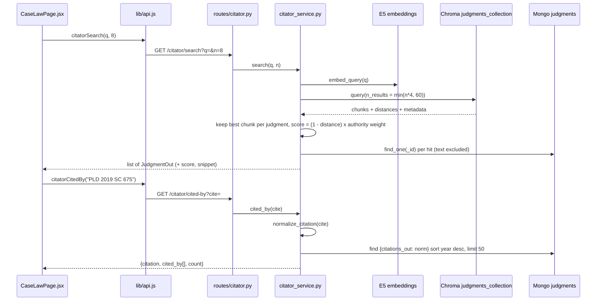
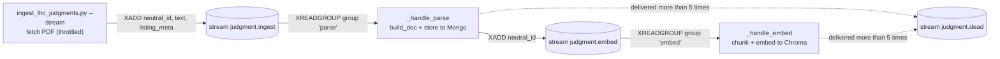
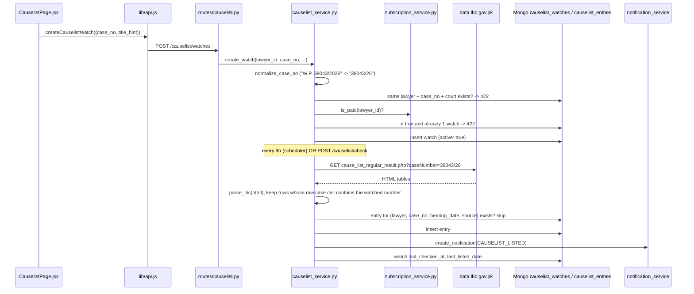
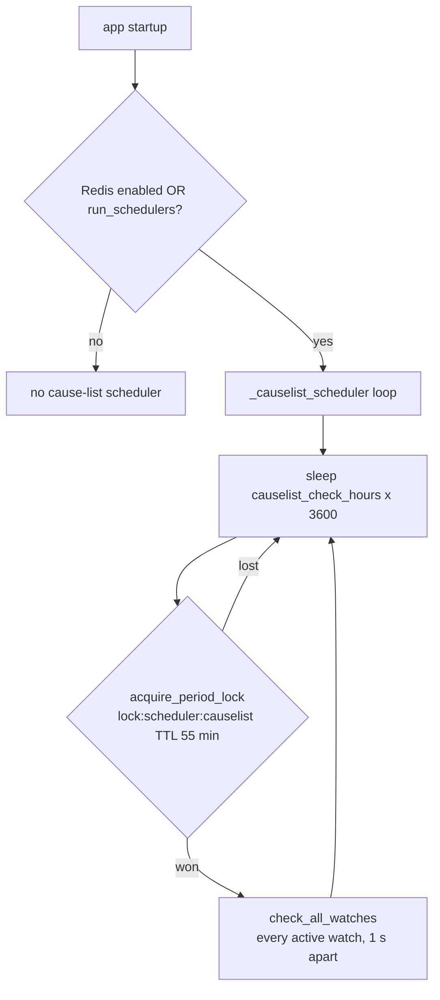

# 22 — Case law search, citator and cause list (lawyer)

> Written from the code in October 2026. If this doc and the code disagree, the code is right.

## 1. What it does

These are two separate lawyer tools that both read **public court data**.

**A. Legal Library** (`/lawyer/caselaw`, page id `caselaw`, sidebar "Research → Legal Library")

- **Search judgments.** The lawyer types a legal issue in plain words. The backend does a **semantic (vector) search** over a corpus of Pakistani judgments and returns the closest ones.
- **Citator ("who cites this precedent?").** The lawyer types a reporter citation such as `PLD 2019 SC 675` or `1996 SCMR 1544`. The backend returns every judgment **in the corpus** that cites it.
- Every result shows the citations that judgment itself makes. Clicking one runs the citator on it, so the lawyer can walk the citation graph.

**B. Cause List Watcher** (`/lawyer/causelist`, page id `causelist`, sidebar "Work Management → Cause Lists")

- The lawyer **watches** a court case number (e.g. `39043/26`).
- The backend checks the **Lahore High Court (LHC) regular cause list** for that number every 6 hours (and when the lawyer clicks **Check Now**).
- When the case appears on a list for a new date, it is saved as an **entry** and the lawyer gets a **notification**.
- For other courts (district courts etc.) the lawyer can **paste** a cause list as text, and the backend finds their watched numbers in it.
- Free plan = **1 watch**. Paid plans (Professional / Firm) = unlimited.

**Important:** there is **no "good law" / treatment check**. The citator only answers "which judgments in our corpus cite X". It does not know whether a judgment was followed, distinguished or overruled. The code says this openly (see section 5).

## 2. User flow

### Legal Library

| # | Who | What they do | Where in the UI |
|---|-----|--------------|-----------------|
| 1 | Lawyer | Opens Legal Library. The header shows corpus size: "N judgments · M citation links". | `CaseLawPage` → `citatorStats()` |
| 2 | Lawyer | Types an issue, e.g. "post-arrest bail in narcotics cases", presses **Search**. | "Search judgments" box |
| 3 | System | Shows up to 8 judgment cards: title, case no, judge, id, "% match", tag line or snippet, a **Court PDF ↗** link, and up to 8 **CITES:** chips. | `JudgmentCard` |
| 4 | Lawyer | Clicks a **CITES** chip (e.g. `2021 SCMR 1023`) or types a citation into the Citator box and clicks **Find citing judgments**. | "Citator" box |
| 5 | System | Shows "`2021 SCMR 1023` is cited by **N** judgments in the corpus" and the list (newest year first, max 50). | citedby results |

There is also a hand-over from the AI Assistant: in the Sources panel, "Open in Legal library" writes the term into `sessionStorage["attorney:caselaw-query"]` and switches page. `CaseLawPage` reads it once, deletes it, and runs the search straight away.

### Cause List Watcher

| # | Who | What they do | Where in the UI |
|---|-----|--------------|-----------------|
| 1 | Lawyer | Enters a case number (`39043/26`) and an optional label, clicks **+ Watch**. | "Watch a case" box |
| 2 | System | Normalises the number, refuses duplicates, applies the free-plan limit, saves the watch. | `create_watch` |
| 3 | System | Every 6 hours the scheduler checks all active watches against the LHC site. | `_causelist_scheduler` in `main.py` |
| 3b | Lawyer | Or clicks **⟳ Check Now** to check their own watches immediately. Toast: "N new listings found", "no new listings", or "Court website unreachable". | header button |
| 4 | System | Each new (case, date) listing is saved and a `causelist_listed` notification is sent. | `check_watch` → `_notify` |
| 5 | Lawyer | Sees **Upcoming listings** (today or later, earliest first): date badge, case no + title, judge, court room, serial #, list type, remarks. Can **Share** on WhatsApp. | "Upcoming listings" |
| 6 | Lawyer | Clicking the notification opens the Cause List page (`notificationTarget.js` → page `causelist`). | notification bell |
| 7 | Lawyer | Optional: pastes a district-court list into **Paste a cause list** → **Find my cases**. Matching lines are shown (not saved, no notification). | "Paste a cause list" |
| 8 | Lawyer | Removes a watch with the **×** on its chip. Its saved entries are deleted too. | watch chip |

## 3. Code flow

### Legal Library: search and citator

Plain words:

1. **Frontend.** [CaseLawPage.jsx](../../frontend/src/components/lawyer/CaseLawPage.jsx) calls `citatorSearch`, `citatorCitedBy`, `citatorStats` from [lib/api.js](../../frontend/src/lib/api.js). (`citatorJudgment(id)` exists in `api.js` but no page uses it.)
2. **Route.** [routes/citator.py](../../backend/app/api/v1/routes/citator.py) checks only that the user is logged in (`get_current_user`) and validates the query lengths. No logic.
3. **Service.** [citator_service.py](../../backend/app/services/citator_service.py) does the search and the reverse lookup.
4. **Stores.** Text and metadata in MongoDB collection `judgments`. Vectors in Chroma collection `judgments_collection`.

### Endpoints

| Method + path | Who | Service function | Result |
|---------------|-----|------------------|--------|
| `GET /citator/search?q=&n=` | any logged-in user | `search(q, n)` | up to `n` (1–20, default 8) judgments with `score`, `snippet` |
| `GET /citator/cited-by?cite=` | any logged-in user | `cited_by(cite)` | `{citation, cited_by, count}` (max 50) |
| `GET /citator/stats` | any logged-in user | `corpus_stats()` | `{judgments, with_citations, citation_edges}` |
| `GET /citator/judgment/{neutral_id}` | any logged-in user | `get_judgment(id)` | one judgment + `text_preview` (first 3000 chars) |
| `POST /causelist/watches` | lawyer | `create_watch` | new watch |
| `GET /causelist/watches` | lawyer | `list_watches` | own watches, newest first |
| `DELETE /causelist/watches/{id}` | lawyer | `delete_watch` | `{success}`; also deletes its entries |
| `POST /causelist/check` | lawyer | `check_lawyer_watches` | `{checked, new_entries, source_errors}` |
| `GET /causelist/entries?upcoming=true` | lawyer | `list_entries` | own entries, hearing date ascending |
| `POST /causelist/match-text` | lawyer | `match_pasted_list` | `[{case_no, watch_id, line}]` |

### How a judgment gets INTO the corpus (ingestion)

Nothing in the web app adds judgments. The corpus is filled by **scripts** run by hand from `backend/`.

| Script | Source | Notes |
|--------|--------|-------|
| [ingest_lhc_judgments.py](../../backend/scripts/ingest_lhc_judgments.py) | LHC site: PDFs at `http://sys.lhc.gov.pk/appjudgments/{YEAR}LHC{SEQ}.pdf`, plus the listing page `data.lhc.gov.pk/reported_judgments/...` | `--latest` (listing, ~50 with tag lines) or `--year Y --start A --end B`. 1 s delay between fetches. `--stream` sends work to Redis Streams instead of doing it inline. |
| [ingest_judgments.py](../../backend/scripts/ingest_judgments.py) | local folder of PDFs from 6 courts (SC, LHC, SHC, PHC, BHC, IHC) | sets court / province / authority per folder; drops OCR citations with impossible years |
| [ingest_sc_parquet.py](../../backend/scripts/ingest_sc_parquet.py) | 1,414 Supreme Court judgments from a parquet file | discards the file's own 1024-d embeddings and re-embeds with our 768-d E5 model |

The LHC path has four stages, all in `citator_service.py`:

| Stage | Function | What it does |
|-------|----------|--------------|
| Fetch | `fetch_pdf_text(neutral_id)` | Downloads the PDF with `httpx`, extracts text with `pypdf`. 404 → `None` (gap in the sequence). Network error → `ServiceUnavailableError`. |
| Parse | `build_doc(neutral_id, text, listing_meta)` | Pure function. Parses case no, title, judge, hearing date from the first 2,500 chars; extracts all citations (`citations_out`); adds fixed `court=LHC`, `province=punjab`, `authority=binding_provincial`. |
| Store | `store_judgment(doc)` | `insert_one` into `judgments` with `_id = neutral_id`. Duplicate key = already ingested. |
| Embed | `embed_judgment(neutral_id, text)` | Splits text into ≤ 24 chunks of ~1,200 chars on sentence boundaries, embeds with E5, `upsert`s into Chroma with ids `{neutral_id}:{i}`. Runs in a thread (`asyncio.to_thread`). Never raises. |

`ingest_judgment()` runs all four inline. It skips ids already in Mongo and texts shorter than 200 chars.

### The Redis Streams pipeline (`--stream` mode)

[citator_stream.py](../../backend/app/services/citator_stream.py) splits the same stages across processes using **Redis Streams**:

- Workers are started with [citator_workers.py](../../backend/scripts/citator_workers.py) `--role parse | embed | both`. Start more processes with the same role to split the work.
- Each worker loop (`_drain_once`) does two things per pass:
  1. **Recover**: `XAUTOCLAIM` takes over entries that sat un-acked for more than 60 s (a dead worker's work).
  2. **Read new**: `XREADGROUP ... ">"` with a blocking wait (`citator_block_ms`).
- `_process` runs the handler. **Success → `XACK`.** **Failure → no ack**, so the entry stays in the Pending Entries List and is retried later. If an entry was delivered more than `citator_max_deliveries` (5) times, it is copied to `judgment.dead` and acked (poison message).
- Streams are trimmed to about `citator_stream_maxlen` (10,000) entries.
- `stream_stats()` returns stream lengths and pending counts (for demos).

Settings in [config.py](../../backend/app/core/config.py): `citator_stream_maxlen=10000`, `citator_block_ms=5000`, `citator_claim_min_idle_ms=60000`, `citator_batch=10`, `citator_max_deliveries=5`.

### Cause list: watch → check → notify

The scheduler is in [main.py](../../backend/app/main.py):

## 4. Data & states

### Mongo `judgments`

| Field | Meaning |
|-------|---------|
| `_id` | LHC neutral id like `2026LHC4480` (other scripts use their own ids / slugs) |
| `court`, `province`, `authority` | e.g. `LHC` / `punjab` / `binding_provincial`. Used for precedent ranking. |
| `year`, `seq` | from the neutral id |
| `pdf_url` | link to the court PDF (LHC path only) |
| `case_no`, `title`, `judge`, `hearing_date` | parsed from the first page |
| `tag_line`, `uploaded_date` | from the listing page, only with `--latest` |
| `citations_out` | normalised reporter citations this judgment makes — **the citator's reverse index** |
| `text`, `text_chars` | full text (never returned by the API, only `text_preview` on the single-judgment view) |
| `ingested_at` | timestamp |

### Chroma `judgments_collection`

One vector per chunk. Id `{judgment_id}:{i}`. Metadata: `judgment_id`, `court`, `province`, `authority`, `year`, `judge`, `title`. A Chroma hit whose judgment is **not** in Mongo is dropped by `search()`.

### Redis streams

| Stream | Fields | Consumer group |
|--------|--------|----------------|
| `judgment.ingest` | `neutral_id`, `text`, `listing_meta` (JSON string) | `parse` |
| `judgment.embed` | `neutral_id` | `embed` |
| `judgment.dead` | `src_stream`, `group`, `orig_id`, `neutral_id`, `reason` | none (for inspection) |

Redis key `lock:scheduler:causelist` — the period lock for the cause-list sweep.

### Mongo `causelist_watches`

| Field | Meaning |
|-------|---------|
| `_id` | `secrets.token_urlsafe(16)` |
| `lawyer_id` | owner |
| `court` | default `"lhc"` |
| `case_no` | canonical `number/2-digit-year`, e.g. `39043/26` |
| `title_hint` | the lawyer's own label |
| `case_id` | optional link to an Attorney.AI case (the UI never sends it) |
| `active` | always `true` (nothing sets it false) |
| `last_checked_at`, `last_listed_date` | updated after each check; the latest hearing date seen |
| `created_at` | timestamp |

### Mongo `causelist_entries`

One row per (lawyer, case_no, hearing_date, source).

| Field | Meaning |
|-------|---------|
| `watch_id`, `lawyer_id`, `case_id` | links |
| `hearing_date` | ISO `YYYY-MM-DD` (converted from the court's `dd-mm-yyyy`) |
| `bench`, `judge`, `court_room` | from the bench header above the row |
| `seq`, `connected` | serial number; `connected = true` when the seq cell says "and" (a connected matter) |
| `category`, `title`, `lawyer`, `remarks` | the row's columns |
| `case_no`, `case_no_raw` | canonical and as printed (e.g. `CM/1/39043/26`) |
| `list_type` | from the row colour (table below) |
| `source` | `lhc_regular` |
| `found_at` | when we found it |

Row colour → `list_type` (`_COLOR_MEANING`):

| `bgcolor` | Meaning |
|-----------|---------|
| `#ff0000` | Old Cause List |
| `#ffff00` | Regular Cause List |
| `#90ee90` | Stay Matters |
| `#ffb6c1` | Part-heard |
| `#ffdab9` | Judgment Reserved |

### Notification

Type `causelist_listed` (`NotificationType.CAUSELIST_LISTED` in [constants.py](../../backend/app/core/constants.py)).

- Title: `Case 39043/26 is on the cause list`
- Body: `<title> — listed for 2026-07-06 · <judge> · <court room> · Seq #12`
- Payload: `case_no`, `hearing_date`, `watch_id`

## 5. Key logic & rules

### How citations are parsed (`extract_citations`)

Pakistani law reports come in two shapes. Both regexes allow extra spaces because PDFs break citations across lines.

| Family | Pattern | Examples | Normalised to |
|--------|---------|----------|---------------|
| Volume-first | `PLD`/`PLJ` + year + court + page | `PLD 2019 SC 675`, `PLJ 2020 Lahore 14` | `PLD 2019 SC 675`, `PLJ 2020 Lah 14` |
| Year-first | year + reporter + page. Reporters: SCMR, CLC, YLR, MLD, PCr.LJ, PLC, CLD, PTD, NLR, GBLR, SCP | `2021 SCMR 1023`, `2020 PCr. LJ 55` | `2021 SCMR 1023`, `2020 PCr.LJ 55` |

Rules:

- The court word after PLD/PLJ must be in `_COURT_CANON` (`sc`, `lahore`→`Lah`, `karachi`/`sindh`→`Kar`, `peshawar`→`Pesh`, `quetta`, `islamabad`→`Isl`, `fsc`, `ajk`, `fc`). Anything else is dropped. **Why:** this kills false matches like "PLD 2019 the 5".
- Page numbers go through `int()` (so `0675` becomes `675`). Reporter spacing is removed (`PCr. LJ` → `PCr.LJ`).
- Duplicates are removed, first-seen order kept.
- `normalize_citation(raw)` runs the same extractor on what the lawyer typed. **Why:** the lookup string must match the stored form exactly, or `cited_by` finds nothing. If nothing parses, it just collapses whitespace and searches that.

The same `extract_citations` is reused by the AI answer checker (`verify_cases` in [citation_verification.py](../../backend/app/ai/citation_verification.py)) and the Document Analyzer report. In `verify_cases`, "cited by N judgments in the corpus" counts as proof the citation **exists**; "not found" is only **unverifiable**, never "fake", because the corpus is too small for absence to mean anything.

### How a title is parsed (`_parse_title`)

Four layouts, tried in this order: stacked (`Versus` alone on its own line), inline (`A vs B` / `A V/S B`), leading `Vs.` (first party on the lines above, with letterhead and case-number lines filtered out by `_TITLE_NOISE`), and parenthesised `(A v. B)`. **Why stacked is first:** it is the original rule; keeping it first means re-ingesting never changes a title that was already right.

### How search ranks results (`search`)

1. Embed the query with the same E5 model used for the chunks.
2. Ask Chroma for `n × 4` chunks (max 60), because several chunks may come from one judgment.
3. Keep only the **best (smallest distance) chunk per judgment**.
4. `semantic_score = 1 − distance`. Final `score = min(semantic_score × weight, 1.0)`.
5. Sort by `score`, keep the top `n`, load each from Mongo (without `text`).

Precedent weight (`_precedent_weight`):

| Authority of the judgment | Weight |
|---------------------------|--------|
| `binding_national` (Supreme Court) | 1.15 |
| `binding_provincial` and same province as the query | 1.10 |
| another province's High Court, or no province given | 1.00 |

**Why a boost and not a filter:** persuasive judgments from other provinces are still useful, and with a corpus mostly from one court a filter would often return nothing.

**But note:** the Legal Library route calls `search(q, n)` **without a province**, so in this page the only boost that fires is the Supreme Court one. The province-aware ranking is used by the AI chat pipeline (`_retrieve_case_law` in [retrieval_node.py](../../backend/app/ai/nodes/retrieval_node.py)).

### How a judgment reference is formatted (`format_reference`)

Used by the AI pipeline, not the Legal Library page. Most corpus judgments are **unreported** (no PLD/SCMR number yet), so the honest reference is parties + case number + court + year:

`Nisar Ahmad Khan Vs The State etc. — Crl. Misc. 3189/26 (LHC 2026)`

If fields are missing it degrades step by step. With no title and no case number it returns `LHC 2026 judgment [ref: 2026LHC4480]`. `is_reportable_citation()` treats anything with `[ref:` or starting `Unidentified` as **not** citable. **Why:** the old output `LHC 2026LHC4480` looked like a citation but is an internal id a lawyer cannot look up.

### What `citation_format.py` is (and is not)

[citation_format.py](../../backend/app/services/citation_format.py) is about **statute** citations in generated documents, not case law. `cite("Prevention of Electronic Crimes Act, 2016", ["20","21","24"])` → `sections 20, 21 and 24 of the Prevention of Electronic Crimes Act, 2016`.

- `normalise_section` makes `489 f` / `489F` / `489-F` all `489-F`.
- `section_list(text)` returns sections **only** if the field reads as a section list (has a marker like `s.20`, or only numbers and statute short forms). **Why:** "he sent 500 messages" must not become "section 500".
- `cite()` refuses an empty list. **Why:** a bare Act name cannot be verified.
- Glosses go **after** the citation (`cite_with_glosses`) so the citation checker can still read the list.

### "Good law" / treatment

**Not implemented.** No field records "followed / distinguished / overruled". [answer_citations.py](../../backend/app/ai/answer_citations.py) says judgments stay `currency = unknown` because a judgment "is overruled, which this system does not track at all". The citator shows **who cites** a case, not **how**.

### Redis Streams rules

- **Idempotent parse:** if the id is already in Mongo, skip and do not forward. If two workers race, the loser gets `DuplicateKeyError` and returns; only the winner forwards to embed.
- **Idempotent embed:** Chroma `upsert` with fixed ids, so re-running is safe.
- **At-least-once:** an un-acked entry is retried; after 5 deliveries it goes to the dead stream so one bad PDF cannot block the queue forever.
- **Why streams at all:** fetching is slow and throttled (network), embedding is slow and CPU-bound. A queue lets them run at their own speed and lets you add more embed workers.

### Cause-list rules

**Case number normalisation (`normalize_case_no`).** Regex `(\d{1,6})\s*/\s*(\d{4}|\d{2})(?!\d)`. The **last** number/year pair wins and a 4-digit year is cut to 2 digits. So `W.P. 1234/2025` → `1234/25` and `CM/1/39043/26` → `39043/26`. **Why:** that is how the LHC list prints it, and the last pair is the main case in composite references.

**Create watch.**

1. Number must contain a `number/year` pair, else 422 "Enter the court case number like 39043/26".
2. Same lawyer + number + court already watched → 422 "You are already watching …".
3. **Free-plan limit:** if `subscription_service.is_paid(lawyer_id)` is false (tier not Professional/Firm with status active or trialing) and the lawyer already has ≥ 1 watch → 422 "The free plan includes 1 cause-list watch. Upgrade to Professional for unlimited watches." This is the only hard plan limit in the app.

**Fetching the LHC list (`fetch_lhc`).** One GET to `https://data.lhc.gov.pk/dynamic/cause_list_regular_result.php` with `caseNumber` set, `courtName=All Courts`, `location=All`. The site filters on its side, so **one small request per watch**. It covers the Principal Seat and the Bahawalpur, Multan and Rawalpindi benches. Any HTTP error → `ServiceUnavailableError` ("Could not reach the LHC cause list right now").

**Parsing (`parse_lhc`).** The page is a sequence of tables in document order:

- A table with **one row and one `<th>`** containing a `dd-mm-yyyy` date is a **bench header**: date, bench type, judge(s), `[ court room ]`. It sets the context for the rows after it.
- A row with **exactly 6 `<td>`** that contains a case number is a **case row**: seq, category, case no, title, lawyer, remarks. The row colour gives `list_type`.

**Matching (`check_watch`).** A row counts if the watched number is in `extract_case_nos(case_no_raw)` — **any** pair in the raw cell, not just the last. **Why:** it also catches connected matters printed like `CM/1/39043/26`.

**De-duplication.** Before saving, `entry_repo.exists(lawyer_id, case_no, hearing_date, source)`. Same case on the same date → no new entry and **no second notification**. A new date → new entry and a new notification.

**Manual vs scheduled check.**

| | `check_lawyer_watches` (Check Now) | `check_all_watches` (scheduler) |
|---|---|---|
| Watches | this lawyer's active watches | every active watch |
| Delay between requests | 0.5 s | 1.0 s |
| On court error | counts in `source_errors`, continues | logs, counts `errors`, continues |
| Returns | `{checked, new_entries, source_errors}` | summary only (logged) |

**Why the delays:** be polite to the court server.

**Scheduler (`_causelist_scheduler`).** It **sleeps first**, then sweeps, every `causelist_check_hours` (6). Every worker runs the loop; `acquire_period_lock` (Redis `SET NX EX`, TTL 55 min) lets only one worker sweep per period. The lock is never released, it just expires. **Why 55 min:** longer than a sweep, far shorter than 6 h, so a crashed worker cannot block the next period. If Redis errors, the lock **fails open** (runs anyway). **Why:** a duplicate sweep only wastes requests, because entries are de-duplicated. Without Redis the loop only starts when `run_schedulers` is true.

**Paste fallback (`match_pasted_list`).** Splits the pasted text into lines, finds every `number/year` in each line, normalises it, and reports it if it equals a watched number. Results are de-duplicated on (case_no, line) and each line is cut to 300 chars. **Nothing is saved and no notification is sent.** Max paste size 200,000 chars.

**Delete.** A watch owned by someone else returns 404 (not 403), so ids of other lawyers' watches are not confirmed. Its entries are deleted with it.

## 6. Files

| File | Role |
|------|------|
| [lawyer/CaseLawPage.jsx](../../frontend/src/components/lawyer/CaseLawPage.jsx) | Legal Library page: search box, citator box, `JudgmentCard`, AI hand-over via `sessionStorage` |
| [lawyer/CauselistPage.jsx](../../frontend/src/components/lawyer/CauselistPage.jsx) | Cause List Watcher page: add/remove watch, Check Now, upcoming listings, WhatsApp share, paste match |
| [app/lawyer/caselaw/page.jsx](../../frontend/src/app/lawyer/caselaw/page.jsx), [app/lawyer/causelist/page.jsx](../../frontend/src/app/lawyer/causelist/page.jsx) | Next.js routes that render the lawyer `App` on these pages |
| [lawyer/layout.jsx](../../frontend/src/components/lawyer/layout.jsx) | sidebar entries "Legal Library" and "Cause Lists" |
| [lawyer/AILegalPage.jsx](../../frontend/src/components/lawyer/AILegalPage.jsx) | "Open in Legal library" hand-over |
| [lib/notificationTarget.js](../../frontend/src/lib/notificationTarget.js) | `causelist_listed` notification → Cause List page |
| [lib/api.js](../../frontend/src/lib/api.js) | `citatorSearch`, `citatorCitedBy`, `citatorStats`, `citatorJudgment`, `createCauselistWatch`, `listCauselistWatches`, `deleteCauselistWatch`, `checkCauselist`, `listCauselistEntries`, `matchCauselistText` |
| [routes/citator.py](../../backend/app/api/v1/routes/citator.py) | citator endpoints (any logged-in user) |
| [routes/causelist.py](../../backend/app/api/v1/routes/causelist.py) | cause-list endpoints (`require_lawyer`) |
| [schemas/citator.py](../../backend/app/schemas/citator.py) | `JudgmentOut`, `CitedByResult`, `CorpusStats` |
| [schemas/causelist.py](../../backend/app/schemas/causelist.py) | `WatchOut`, `EntryOut`, `CheckResult`, `MatchHit` |
| [services/citator_service.py](../../backend/app/services/citator_service.py) | fetch/parse/store/embed, `extract_citations`, `search`, `cited_by`, `format_reference` |
| [services/citator_stream.py](../../backend/app/services/citator_stream.py) | Redis Streams pipeline (parse + embed consumer groups, dead-letter) |
| [services/causelist_service.py](../../backend/app/services/causelist_service.py) | LHC scraper, parser, watches, checks, notifications, paste match |
| [repositories/causelist_repo.py](../../backend/app/repositories/causelist_repo.py) | watch and entry queries (`find_all_active`, `exists`, upcoming filter) |
| [services/subscription_service.py](../../backend/app/services/subscription_service.py) | `is_paid()` for the 1-watch free limit |
| [services/citation_format.py](../../backend/app/services/citation_format.py) | canonical **statute** citation strings for generated documents |
| [ai/citation_verification.py](../../backend/app/ai/citation_verification.py) | `verify_cases` uses the citator index to confirm a case citation exists |
| [ai/nodes/retrieval_node.py](../../backend/app/ai/nodes/retrieval_node.py) | AI chat uses `search(..., province)` + `format_reference` |
| [ai/tools/legal_tools.py](../../backend/app/ai/tools/legal_tools.py) | `search_case_law` tool wraps `citator_service.search` |
| [main.py](../../backend/app/main.py) | `_causelist_scheduler` and when it is started |
| [core/redis_client.py](../../backend/app/core/redis_client.py) | `acquire_period_lock` |
| [core/config.py](../../backend/app/core/config.py) | `causelist_check_hours`, `citator_*` stream settings |
| [db/collections.py](../../backend/app/db/collections.py) | `causelist_watches`, `causelist_entries` collections |
| [scripts/ingest_lhc_judgments.py](../../backend/scripts/ingest_lhc_judgments.py) | LHC ingest (inline or `--stream`) |
| [scripts/citator_workers.py](../../backend/scripts/citator_workers.py) | starts parse / embed stream consumers |
| [scripts/ingest_judgments.py](../../backend/scripts/ingest_judgments.py), [scripts/ingest_sc_parquet.py](../../backend/scripts/ingest_sc_parquet.py) | multi-court and Supreme Court corpus ingest |

## 7. Known limits

- **No "good law" check.** The citator does not know if a judgment was followed, distinguished or overruled. It only lists who cites it, within our corpus.
- **Corpus is small and offline.** It only grows when someone runs the ingest scripts. "Cited by 0" means "not in our corpus", not "never cited". The `verify_cases` message still hard-codes "502 Lahore High Court judgments", which is older than the multi-court/SC ingest scripts.
- **The page text says "Lahore High Court reported judgments"**, but the multi-court and SC scripts put other courts in the same collection.
- **Court PDF link may be broken.** Only the LHC ingest path sets `pdf_url`. For judgments from the other scripts the card still renders "Court PDF ↗" with no URL.
- **Legal Library search is not province-aware.** The route never passes `province`, so only the Supreme Court boost applies there.
- `GET /citator/judgment/{id}` and `citatorJudgment()` exist, but no page opens a full judgment view.
- **Citator endpoints are open to any logged-in user** (not only lawyers), unlike the cause-list endpoints.
- **The AI drafting stream** (`_retrieve_case_law_context` in [routes/ai.py](../../backend/app/api/v1/routes/ai.py)) still labels case law `LHC {id}` — the internal-id style that `format_reference` was written to replace.
- **No Mongo indexes** are created for `judgments.citations_out`, `causelist_watches` or `causelist_entries` in `indexes.py`. `cited_by` and the entry `exists()` check scan the collection.
- **Duplicates are checked in code, not by a unique index.** A Check Now running at the same moment as the scheduled sweep could save the same listing twice and send two notifications. The same race applies to creating the same watch twice.
- **Only the LHC regular cause list is scraped.** The `court` field accepts any string, but `check_watch` always calls the LHC endpoint. Other courts only via the paste fallback, which saves nothing and sends no notification.
- **First scheduled sweep is 6 hours after startup** (the loop sleeps first). A restarted demo server will not check until then, unless the lawyer clicks Check Now.
- **Watches cannot be paused.** `active` is always `true`; there is no endpoint to change it. `case_id` can be stored but the UI never sends it and the service does not check it.
- **Scraper depends on the court's HTML.** If LHC changes its table shape (header `<th>`, 6 columns, `bgcolor`), `parse_lhc` silently returns no rows.
- **Stream workers must not run 24/7.** The consumer loop polls Redis all the time; on a metered hosted Redis this uses up the command quota (warning in `citator_workers.py`). Streams need Redis 5.0+, and `XAUTOCLAIM` recovery needs 6.2+.
- **Ingest is plain HTTP.** The LHC PDF host is `http://` (noted in the code).
