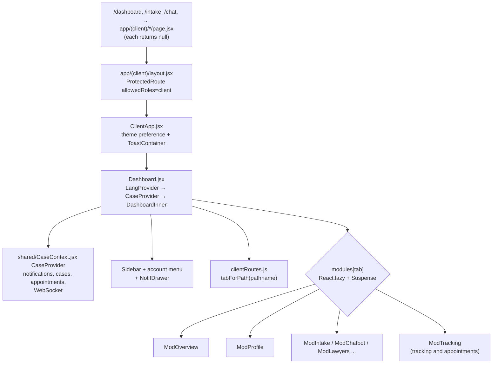
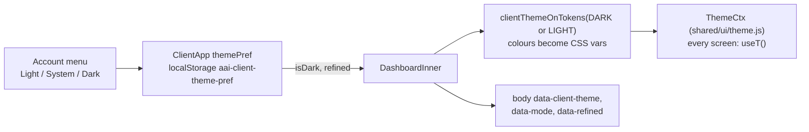
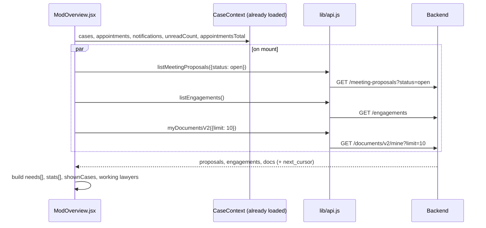
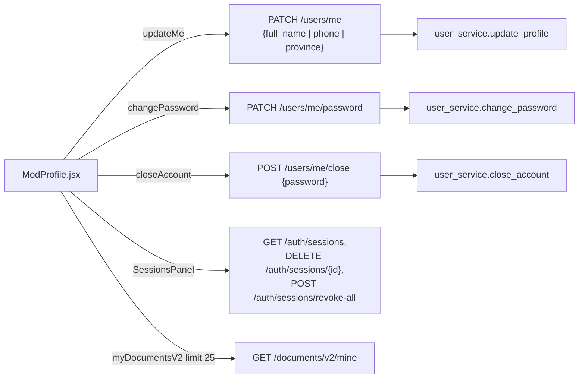

# 25 — Client app shell, Overview dashboard, profiles & settings, public website

> Written from the code in October 2026. If this doc and the code disagree, the code is right.

## 1. What it does

This doc covers the parts that hold the other modules together, plus the pages anyone can see without signing in:

| Part | What the user sees |
|------|--------------------|
| **Client app shell** | The client's left sidebar (Overview, Legal Intake, Appointments, Tracking, AI Chat, Lawyers, Documents, Agreements), the account menu (Profile, Urdu/English, Theme, Sign out), the notification bell and drawer. |
| **Client Overview** (`/dashboard`) | A greeting, "what needs you" right now, the next appointment, four number cards, your cases, recent documents, your lawyer and the latest activity. |
| **Client Profile** (`/profile`) | Personal details (name, phone, province), language, profile-completeness ring, password change, signed-in devices, close account. |
| **Lawyer Profile & Settings** (`/lawyer/profile`, `/lawyer/settings`) | The lawyer's public details (practice areas, bar number, fee, bio…), and settings: verification uploads, quick-review offer, password, devices, theme, plan, close account. |
| **Public website** | `/`, `/about`, `/features`, `/faqs`, `/blogs`, `/plans`, `/touch`, `/terms`, `/privacy` (marketing and legal text) and `/sign` (signing an agreement from an email invitation, no account needed). |
| **Shared bits** | `LenisProvider` (smooth scrolling), `ErrorBoundary`, `Mesh`, `RevisionHistory`. |

## 2. User flow

### Client: moving around the app

1. The client signs in → `/dashboard`. `ProtectedRoute` lets in only `role === "client"`. Anyone else goes to their own home page, or to `/login` if not signed in.
2. They click a sidebar item. The screen changes **at once**, and then the URL changes to match (`/intake`, `/chat`, …). Refresh, bookmarks and the Back button all work.
3. Badges on the sidebar:
   - **Legal Intake** (gold): how many draft cases are waiting to be confirmed.
   - **Lawyers** (cyan): how many hire offers have terms a lawyer proposed (`terms_proposed`).
   - **Tracking** (red): unread notifications.
   The sidebar is split into three always-open groups: **Your matters** (Overview, Legal Intake, Appointments, Tracking), **Get help** (AI Chat, Lawyers), **Paperwork** (Documents, Agreements). Profile is not in the list; it is in the account menu. Badge counts above 99 show as "99+".
   - A green **New matter** button at the top always goes to `/intake`.
   - A collapse button shrinks the sidebar to icons (hover shows the label). On a phone the sidebar is a drawer instead and cannot be collapsed.
4. **Documents** and **Agreements** open a small sub-menu (AI drafting / Templates / Vault, and Dashboard / Templates / All agreements). The ▲/▼ toggle only opens the menu; it does not navigate. The Agreements "Templates" entry exists only while `AGREEMENTS_DIY_ENABLED` is on.
5. The **bell** opens the notification drawer. Clicking a notification marks it read and opens what it is about (a document, a review request, an appointment, …).
6. The **account menu** (click your name at the bottom): Profile, switch to Urdu, pick a theme (Light / System / Dark), Sign out.

### Client: Overview

1. "Assalam o Alaikum, *first name*" plus a one-line summary, e.g. "2 things need you, and your next appointment is tomorrow."
2. The **Needs you** box shows the first waiting item with one button: *Choose a time* (a meeting the lawyer proposed), *Review* (a draft case), *Review* (terms from a lawyer).
3. **Next appointment** card with Details / Book a meeting.
4. Four number cards → each opens its page.
5. **Your cases** (Active / Closed tabs, first 4), **Recent documents** (first 3), **Your lawyer**, **Latest activity** (5 newest notifications).
6. A search box (press `/` to jump to it) filters the cases and documents shown on this page.

### Client: Profile

1. **Personal** tab: click *Edit* / *+ Add* on Full name, Phone or Province → type or pick → *Save*. Email can't be edited here.
2. The language switch (English / اردو) changes the whole app.
3. **Security** tab: change password (you are then signed out), see and sign out devices, **Delete account…** (asks for your password).
4. Side panel: "Your account at a glance" (Cases / Appointments / Documents counts, each a link) and quick links: *Start a new legal intake* (`/intake`), *Help & support* (`/faqs`), *Sign out*.

### Lawyer: Profile and Settings

- **Profile**: one form (first/last name, phone, practice areas, bar number, years of experience, fee, province, office address, bio, "available" switch) with a completeness ring. *Save* (or Ctrl/Cmd+S) saves everything at once. It warns you if you try to leave with unsaved changes.
- **Settings**: sections Overview · Verification · Document review · Password · Devices & activity · Appearance · Plan & usage · Sign out & delete. The section is kept in the URL hash (`/lawyer/settings#password`), so Back/Forward work. Press `/` to search the sections.

## 3. Code flow

### 3.1 The client shell

How it works, step by step:

1. **Mounted once.** `app/(client)/layout.jsx` renders `<ClientApp />` one time. Every page file inside `(client)` (`dashboard/page.jsx`, `cases/page.jsx`, `tracking/page.jsx`, `profile/page.jsx`, …) just returns `null`. **Why:** before, each page mounted its own copy of the whole app. Every sidebar click then rebuilt the shell, reloaded cases, appointments and notifications, and reopened the notification socket.
2. **URL → screen.** [clientRoutes.js](../../frontend/src/components/client/clientRoutes.js) has two maps:

   | URL | Tab (screen) |
   |-----|--------------|
   | `/dashboard` | `overview` → ModOverview |
   | `/intake` | `intake` → ModIntake |
   | `/chat` | `chatbot` → ModChatbot |
   | `/lawyers` | `lawyers` → ModLawyers |
   | `/documents` | `documents` → ModDocuments |
   | `/agreements` | `agreements` → ModAgreements |
   | `/tracking` **and** `/cases` | `tracking` → ModTracking |
   | `/appointments` | `appointments` → ModTracking with `standalone="appointments"` |
   | `/profile` | `profile` → ModProfile |
   | `/tools` | `tools` → ModTools (hidden from the sidebar, but the URL still works) |

   `DashboardInner` watches `usePathname()`. When the path changes it calls `setTab(tabForPath(path))`.
3. **Screen first, URL after.** `goTo(href)` in Dashboard does `setTab(...)` right away and then `router.push(href)` inside `startTransition`. Modules do the same through `useClientRouter()` from [clientNav.js](../../frontend/src/components/client/clientNav.js), which wraps the Next router. Its `push` calls `ClientNavCtx.show(tab)` first. **Exception:** an href with `?` or `#` waits for the real URL change, because the screen reads that query when it mounts (for example `/lawyers?case_id=…`).
4. **Lazy screens.** Each `Mod*.jsx` is a `React.lazy` chunk inside one `<Suspense fallback="Loading…">`. Chunks are fetched early in two ways: (a) when you hover or focus a sidebar item, and (b) after the first screen is up, the rest are fetched **one at a time** in idle periods (`prefetchScreensSlowly`). **Why:** fetching all of them at once caused a CPU and network spike that could delay a click on a slow machine.
5. **Shared client state.** `CaseProvider` (in [shared/CaseContext.jsx](../../frontend/src/components/shared/CaseContext.jsx)) loads data once when the app opens:
   - `getNotifications()` → `GET /notifications`
   - `listCases({page_size: 50})` → `GET /cases`
   - `listAppointments({page_size: 50})` → `GET /appointments`

   Then it opens `openNotificationSocket()` → `/ws/notifications?ticket=…`. Each live notification is added to the list, broadcast to open pages (`broadcastNotification`), and makes the provider re-read whatever it is about: `appointment_*` re-reads appointments; `engagement_*`, `lawyer_assigned`, `case_update` and `hearing_scheduled` re-read cases. If the socket drops, it reconnects with backoff and re-reads everything once it is back.
6. **Notifications drawer** (`NotifDrawer` in Dashboard.jsx). On click: `markNotificationDone(id)` → `PATCH /notifications/{id}/read`, then:
   - if the payload has `doc_id` → open that document;
   - else if it has `review_request_id` → `/documents?tab=review-requests&request=…`;
   - otherwise → `clientNotificationTarget(type, payload)` from `lib/notificationTarget.js`.

   *Mark all read* → `POST /notifications/read-all`.
7. **Lawyers badge** (`termsCount`): `listEngagements()` → `GET /engagements`, counting rows with `status === "terms_proposed"`. It is read once, then again only when you **leave** Lawyers, Tracking, Appointments or Overview, the screens where terms get answered. `listEngagements` also reuses the same reply for 2 seconds, so screens opening together share one request.

### 3.2 Theme (client)

- [ClientApp.jsx](../../frontend/src/components/client/ClientApp.jsx) keeps `themePref` (`light` | `system` | `dark`) in `localStorage` under `aai-client-theme-pref`. It also writes the resolved `aai-theme` (`dark`/`light`). If nothing is saved, it opens in **System**.
- **What the three choices actually mean** (from the code comments):
  - **Light** = light palette + "refined" fixes.
  - **System** = the app's **original** dark theme, exactly as it was. It does **not** follow the operating system setting.
  - **Dark** = the refined dark theme.
- [clientTheme.js](../../frontend/src/components/client/clientTheme.js):
  - `CLIENT_TOKENS_CSS` defines CSS variables (`--bg`, `--surface`, `--ink`, …) scoped to `[data-client-theme]`.
  - `clientThemeOnTokens(t)` returns the theme object with its neutral colours pointed at those variables (`bg: "var(--bg)"`, …). Accent colours stay hex, because callers add an alpha to them (`${t.primary}33`), which `var()` cannot take.
  - `CLIENT_REFINED_CSS` (contrast fixes, measured against WCAG) applies only under `[data-refined]`.
  - The whole refinement is one switch, `CLIENT_THEME_REFINED`, turned off with `NEXT_PUBLIC_CLIENT_THEME_REFINED=0`. When it is off, the menu shows a single Light/Dark toggle instead.
- **Why the attributes go on `<body>`:** dialogs are portalled to `<body>`, so they need the variables there too. The attributes are removed when the client app unmounts, so they never leak into the lawyer shell.
- Switching theme uses the View Transitions API: the new theme spreads in a circle from the button you clicked. Browsers without it get a short fade, and reduced-motion users get no animation.
- [client/theme.js](../../frontend/src/components/client/theme.js) and [shared/theme.js](../../frontend/src/components/shared/theme.js) just re-export `ThemeCtx`, `useT`, `DARK`, `LIGHT` from [shared/ui/theme.js](../../frontend/src/components/shared/ui/theme.js). There is **one** context object for everyone.
- Rule from the project: client styling lives in `components/client` (clientTheme.js). The lawyer side has its own `lawyer/theme.js` and `draftingTheme.js`.

### 3.3 Overview data

- Proposals are read again whenever an `appointment_propos*` notification arrives (`onNotification`).
- Each read is separate and its errors are caught, so one failure does not blank the page.

### 3.4 Client profile

All in [routes/users.py](../../backend/app/api/v1/routes/users.py) → [services/user_service.py](../../backend/app/services/user_service.py):

| Endpoint | Body schema | What the service does |
|----------|-------------|------------------------|
| `GET /users/me` | – | Returns the account through `UserProfileResponse`, a whitelist, so `password_hash`, the encrypted CNIC and the lawyer's 384-dim matching embedding are never sent. |
| `PATCH /users/me` | `UserUpdate`: `full_name`, `phone`, `province` (enum) | `$set` those fields + `updated_at` (`null` fields are dropped). A province outside the `Province` enum is a 422. No server-side length or phone-format check. If a **lawyer** changes `province`, their matching embedding is rebuilt (`schedule_embed`), because province is part of the embedded text and is used as the search filter. In the client UI, an empty name is refused before sending, and a successful save is merged into `useAuth().user` (`updateUser`) without re-reading the profile. |
| `PATCH /users/me/password` | `current_password`, `new_password` | Checks the current password (wrong → **400** "Current password is incorrect"). The new one must pass `validate_password_strength`: **8–72 bytes, a number and an uppercase letter** (weak → 422; note the 422 text only says "at least 8 characters with a number", an older message). Updates only if the hash has not changed in the meantime (otherwise **409** "Password changed in another request — please sign in again"). Sets a "tokens valid from" cutoff and revokes all sessions. |
| `POST /users/me/close` | `password` | Checks the password (wrong → **403** "Password is incorrect"), then `_close_account_record`. It **refuses** (422) while engagements (incl. `terms_proposed`/`accepted`) or `created`/`pending` payments are still live — and, for a lawyer, open walk-in cases — and says which ones. Otherwise it **anonymises** the account (name "Closed account", email `closed+<id>@deleted.invalid`, phone/avatar cleared, unusable password, `is_active: false`) rather than deleting the row, because payments, audit trail and case history must stay. Reply: `{closed, closed_at, kyc_erasure_pending, detail}`. |

After a password change or closure, the UI calls `logout()` and does a hard redirect to `/login`. On the client Profile, closure first shows "Account closed. Signing you out…" and signs out 1.5 s later; a refusal shows the server's reason in a toast. The client password dialog checks in the browser only: current password given, new one 8+ characters, the two new entries match. The lawyer Settings dialog also refuses a new password equal to the current one.

### 3.5 Lawyer profile & settings

These run inside the lawyer shell (doc [17](17-lawyer-dashboard-and-clients.md)). [app/lawyer/profile/page.jsx](../../frontend/src/app/lawyer/profile/page.jsx) renders `<App initialPage="profile" />` → [ProfilePage.jsx](../../frontend/src/components/lawyer/ProfilePage.jsx). Settings works the same way → [SettingsPage.jsx](../../frontend/src/components/lawyer/SettingsPage.jsx).

**ProfilePage**

| Action | Call | Endpoint |
|--------|------|----------|
| Load | `getMe()` | `GET /users/me` (top-level fields + `lawyer_profile`) |
| Save (both at once, `Promise.all`) | `updateMe({full_name, phone, province})` | `PATCH /users/me` |
| | `updateLawyerProfile({bar_number, experience_years, hourly_rate, address, availability, bio, specializations})` | `PATCH /users/me/lawyer-profile` (lawyers only) → `user_service.update_lawyer_profile` |
| Change password / close account (dialogs) | `changePassword`, `closeAccount` | same as the client |

What `update_lawyer_profile` does:

- If `address` is given, it geocodes it and stores `lat`/`lng`.
- It writes the fields as `lawyer_profile.<field>`.
- It re-embeds the lawyer for matching **only** if `specializations`, `bio` or `experience_years` changed. **Why:** a fee change does not change the embedded text, so re-embedding would load the model for nothing.

The page checks fields in the browser before saving: first name required, phone 10–13 digits, bar number using the **server's own regex**, experience 0–70, fee up to Rs 1,000,000. That way a typo is shown next to the field instead of coming back as a server 422.

The KYC badge comes from `lawyer_profile.kyc_status` (or `kyc_verified`). **Why:** the old page printed "Verified" for everyone.

**SettingsPage** (on load it fetches subscription, plans, me, KYC docs, sessions and the review offer)

| Section | Endpoints |
|---------|-----------|
| Overview | summary of the data below |
| Verification | `GET /users/me/kyc/documents`, `POST /users/me/kyc/documents` (multipart, kinds `photo`, `bar_certificate`, `education`, `professional`; 5 MB; type checked from the file bytes), `POST /users/me/kyc/resubmit` (the only way from *rejected* back to *pending*) |
| Document review | `GET` / `PUT /quick-review/offer` (`enabled`, `fee_pkr`, `turnaround_hours`); see doc [09](09-document-review.md) |
| Password | `PATCH /users/me/password` |
| Devices & activity | lawyer `SessionsPanel` → `/auth/sessions…` (doc [18](18-auth-accounts.md)) |
| Appearance | no endpoint: Dark/Light toggle from the lawyer `ThemeCtx` |
| Plan & usage | `GET /billing/plans`, `GET /billing/subscription`, `POST /billing/subscribe`, `POST /billing/cancel`; when the reply is `dry_run` it calls `POST /payments/{id}/mock-pay` to settle at once |
| Sign out & delete | `logout()`, `POST /users/me/close` |

**All endpoints in [routes/users.py](../../backend/app/api/v1/routes/users.py)** (prefix `/api/v1/users`; the `/auth/*` ones are listed in doc [18](18-auth-accounts.md) §3.5):

| Method + full path | Who | Notes |
|---|---|---|
| `GET /api/v1/users/me` | any signed-in user | own profile |
| `PATCH /api/v1/users/me` | any signed-in user | `full_name`, `phone`, `province` |
| `PATCH /api/v1/users/me/password` | any signed-in user | 400 / 409 / 422 as above |
| `POST /api/v1/users/me/close` | any signed-in user | password re-check, obligation check, anonymise |
| `PATCH /api/v1/users/me/lawyer-profile` | lawyer (`require_lawyer`, 403 otherwise) | `LawyerProfileUpdate` |
| `POST /api/v1/users/me/kyc/resubmit` | lawyer | 422 if already verified, not rejected, or no bar number |
| `GET /api/v1/users/me/kyc/documents` | lawyer | metadata only (`file_id`, `filename`, `content_type`, `size`, `uploaded_at`) per kind |
| `POST /api/v1/users/me/kyc/documents` | lawyer | multipart `kind` + `file`; 5 MB; `photo` JPEG/PNG, others PDF/JPEG/PNG; re-upload replaces; rate limit 20/min |
| `GET /api/v1/users/{user_id}` | admin only | any user's profile; clients and lawyers see each other through the public `/lawyers/{id}` instead. Declared last so it cannot catch `/me` |

[routes/lawyers.py](../../backend/app/api/v1/routes/lawyers.py) is **not** used by these two pages. Working hours (`/lawyers/me/availability`) are edited from the lawyer Dashboard and Appointments pages.

### 3.6 Public site

All public pages are **outside** the `(client)` group, so `ProtectedRoute` does not wrap them. Root [app/layout.jsx](../../frontend/src/app/layout.jsx) → [Providers.jsx](../../frontend/src/app/Providers.jsx) = `LenisProvider` + `AuthProvider` around every page.

| URL | Component | Static or data-driven |
|-----|-----------|------------------------|
| `/` | [app/page.jsx](../../frontend/src/app/page.jsx) → `LandingClient` (a client-side re-export) → [Landing.jsx](../../frontend/src/components/shared/Landing.jsx) | **Static.** Hero, "What is", "Who is it for", "Why choose", stats, testimonials, call-to-action. The stats (e.g. "11+ Legal Professionals") and the testimonials are hard-coded. |
| `/about` | [about/page.jsx](../../frontend/src/app/about/page.jsx) | Static |
| `/features` | [features/page.jsx](../../frontend/src/app/features/page.jsx) | Static |
| `/faqs` | [faqs/page.jsx](../../frontend/src/app/faqs/page.jsx) | Static list with a search/filter in local state |
| `/blogs` | [blogs/page.jsx](../../frontend/src/app/blogs/page.jsx) | Static `BLOGS` array with a category filter (no blog backend) |
| `/plans` | [plans/page.jsx](../../frontend/src/app/plans/page.jsx) | **Static.** Prices hard-coded (Free / Professional Rs 1,999 / Firm Rs 7,999; annual 1,499 / 5,999), monthly/annual toggle |
| `/touch` | [touch/page.jsx](../../frontend/src/app/touch/page.jsx) | Contact form. Submit only sets `sent = true`; **nothing is sent anywhere** |
| `/terms`, `/privacy` | [terms/page.jsx](../../frontend/src/app/terms/page.jsx), [privacy/page.jsx](../../frontend/src/app/privacy/page.jsx) → [LegalDocument.jsx](../../frontend/src/components/shared/LegalDocument.jsx) | Static text. `TERMS_VERSION` / `PRIVACY_VERSION` (`2026-10-18`) must match the backend constants that registration stores with the account (doc [18](18-auth-accounts.md)). Shows a "draft for a university project, not reviewed by a lawyer" notice. |
| `/sign` | [sign/page.jsx](../../frontend/src/app/sign/page.jsx) | **Data-driven, no account.** Reads `#token=…` from the URL fragment, removes it from the address bar, keeps it only in a ref, then calls `POST /agreements/invitation/view` and `POST /agreements/invitation/sign` (draw / type / upload signature + consent). See doc [11](11-agreements.md). |

[PublicLayout.jsx](../../frontend/src/components/shared/PublicLayout.jsx) is the shared header and footer for all of these except `/sign`:

- Header: Home dropdown (Features, FAQs), Blogs, Pricing, About Us, Sign Up, Login.
- Footer: company and support links (Terms, Privacy, Refund Policy → `/faqs#pricing`), social links.
- A floating WhatsApp button.
- `activePage` underlines the current link.

### 3.7 Other client routes

| Route | What it renders | Covered in |
|-------|------------------|-----------|
| `/(client)/cases`, `/(client)/tracking` | `null`; the layout shows **ModTracking** (both URLs map to tab `tracking`) | [16 — Cases](16-cases-lawyer-and-client.md) |
| `/(client)/appointments` | `null`; the layout shows **ModTracking** `standalone="appointments"` | [13 — Appointments (client)](13-appointments-client.md) |
| `/(client)/documents/analyzer` | Server `redirect("/documents")`. The analyzer is a lawyer-only tool, so old client links land on Documents. | [10 — Document analyzer](10-document-analyzer-lawyer.md) |
| `/client/review-requests/[id]` | Server `redirect(reviewRequestDeepLink(id))` → `/documents?tab=review-requests&request={id}`. The id is checked and passed only as a query value, so this cannot redirect anywhere else. Whether the request exists, and is yours, is decided later by the Documents page against the server. | [09 — Document review](09-document-review.md) |

## 4. Data shown and where each number comes from

### Client sidebar

| Shown | Source | Rule |
|-------|--------|------|
| Intake badge | `CaseContext.cases` (`GET /cases`, first 50) | `cases.filter(isDraftCase).length` |
| Lawyers badge | `GET /engagements` | count where `status === "terms_proposed"` |
| Tracking badge, bell number | `CaseContext.notifications` | `unreadCount` = rows with `read === false` (shown as 99+ / 9+ when large) |
| Name / initials in account menu | `useAuth().user.full_name`, `email` | – |

### Overview ([ModOverview.jsx](../../frontend/src/components/client/ModOverview.jsx))

| Shown | Source | Rule |
|-------|--------|------|
| "Active cases" card | `cases` from context | `activeCases(cases)` in [lib/caseStatus.js](../../frontend/src/lib/caseStatus.js): confirmed (not draft), not closed/dismissed, known status |
| "Appointments" card | `appointmentsTotal` (the server's `total`) | falls back to `appointments.length` if `total` is missing; subtitle "Next: …" = earliest future appointment that is not cancelled/declined/rejected/no-show/completed |
| "Documents" card | `GET /documents/v2/mine?limit=10` | `items.length`, with `+` if there is a `next_cursor` (so at most "10+"); `—` until loaded |
| "Lawyers" card | engagements + cases | distinct lawyers on (a) an `accepted` engagement for a case, or (b) a case's own `lawyer_id` if that case is not ended or draft |
| Summary line / **Needs you** | proposals + cases + engagements | list = open meeting proposals + draft cases + `terms_proposed` engagements; first item is shown. While proposals are still loading it says "Checking…"; if their read fails it shows Retry instead of "nothing needs you" |
| Next appointment card | `appointments` | as above; days bar = days left (capped at 30); "N more upcoming"; *Load more appointments* when `appointmentsComplete === false` |
| Your cases (Active N / Closed N) | `cases` | Closed = `closed`/`dismissed`; Active = everything else (`cases.length - closed`); first 4 shown, filtered by search; 5-step stage bar from `STAGE_OF` |
| Recent documents | same documents read | first 3 after search; type tag from `template_type` (NOTICE / AGRMT / DOC) |
| Your lawyer | first of the "working" list | name comes from engagement or appointment rows (the case itself has no lawyer name) |
| Latest activity | `notifications.slice(0, 5)` | – |

The page comment says there are **no estimated numbers**. An old hard-coded "AI Insight: 78% win probability" card was removed.

### Client Profile ([ModProfile.jsx](../../frontend/src/components/client/ModProfile.jsx))

| Shown | Source |
|-------|--------|
| Name, email, phone, province, avatar, "Member since" | `useAuth().user` (`created_at`) |
| Completeness % | 4 checks: name, email, phone, province |
| "At a glance" Cases | `CaseContext.cases.length` (all cases, drafts included) |
| "At a glance" Appointments | `appointmentsTotal` or list length |
| "At a glance" Documents | `GET /documents/v2/mine?limit=25` → count, `+` if more |
| Devices | `SessionsPanel` → `GET /auth/sessions` |
| Two-step sign-in | always "Not available yet" (honest placeholder) |

### Lawyer Profile

Completeness ring = 9 checks: name, phone, practice areas, bar number, experience, fee, province, office address, bio of at least 40 characters. Rating and review count come from `lawyer_profile.rating` and `total_reviews`.

## 5. Key logic & rules (and why)

| Rule | Where | Why |
|------|-------|-----|
| Client app mounted once in the `(client)` layout; pages return `null` | `(client)/layout.jsx` | Stops a rebuild, data reload and socket reopen on every click |
| Screen changes first, URL follows in a transition | `Dashboard.goTo`, `useClientRouter` | Waiting for the route change (and the dev compile) felt like a frozen click |
| Hrefs with a query wait for the URL | `instantTabFor` | The target screen reads the query when it mounts |
| Screens are lazy and prefetched one at a time | `SCREEN_CHUNKS`, `prefetchScreensSlowly` | First load used to download about 1.8 MB of every screen; prefetching all at once caused spikes |
| `casesReady` is separate from `cases` | CaseContext | `[]` before the reply would read as "no cases" and could trigger wrong defaults; it settles on failure too, so screens don't wait forever |
| `reloadCases` has one request in flight; a failed reload keeps the old list | CaseContext | Avoids a race where a stale reply wins; never tells a user their cases vanished because a refresh failed |
| Appointments cache is one page (50) with `appointmentsComplete`/`appointmentsTotal`; more is loaded only on click | CaseContext | Honest about being partial without pulling all history into memory for every screen |
| Local (browser-only) notifications are never sent to `PATCH /notifications/{id}/read` | `markNotificationDone` | Their made-up ids were refused by the server |
| Socket reconnects with backoff and re-reads everything after reconnect | CaseContext | Before, a dropped socket meant no notifications until a reload |
| Drafts are not "active cases" | `lib/caseStatus.js` | A draft is not a filed matter; one shared predicate, so a new screen can't forget the rule |
| Lawyers badge refetched only when leaving the screens where terms are answered | Dashboard | It used to refetch on every tab change, duplicating those screens' own requests |
| Legal Tools and Property Dispute hidden from the sidebar (code kept) | `SIDE_ITEMS` comment | Owner's scope decision, 2026-09-23; restoring them means putting two lines back |
| Profile shows only real account data | ModProfile | It used to show a fake "Last login from Pixel 6", "Security score: Good" and a fake photo upload |
| Sign-out always ends with a hard `window.location.assign("/login")` | ModProfile, lawyer Settings/Profile | Clears every bit of in-memory app state with the session; `logout()` itself also clears saved conversation ids and intake values and tells other tabs |
| Account closure = password + obligation check + anonymise, not delete | `user_service.close_account` | Payments, audit and other people's case records must survive; a borrowed session must not be able to close the account |
| Password change revokes all sessions | `user_service.change_password` | A change is often a response to a suspected compromise |
| Lawyer re-embedding only when the embedded text changed | `update_lawyer_profile` | Avoids a model load for edits that don't affect matching |
| Invitation token kept only in memory and sent in the body | `/sign` | The fragment is not sent to the server; the token is the whole authority to sign |
| Terms/privacy versions shared with the backend | `LegalDocument.jsx` | Registration stores which version the user agreed to |

## 6. Files

### Client shell & theme

| File | Role |
|------|------|
| [app/(client)/layout.jsx](../../frontend/src/app/%28client%29/layout.jsx) | Mounts `ProtectedRoute` + `ClientApp` once |
| [app/(client)/dashboard/page.jsx](../../frontend/src/app/%28client%29/dashboard/page.jsx) | Returns `null` (same for the other `(client)` pages) |
| [ClientApp.jsx](../../frontend/src/components/client/ClientApp.jsx) | Theme preference, toast provider, sign-out |
| [Dashboard.jsx](../../frontend/src/components/client/Dashboard.jsx) | Sidebar, account menu, notification drawer, topbar, lazy screens |
| [clientRoutes.js](../../frontend/src/components/client/clientRoutes.js) | URL ↔ tab maps |
| [clientNav.js](../../frontend/src/components/client/clientNav.js) | `ClientNavCtx`, `instantTabFor`, `useClientRouter` |
| [shared/CaseContext.jsx](../../frontend/src/components/shared/CaseContext.jsx) | `CaseProvider`: notifications, cases, appointments, socket |
| [client/CaseContext.jsx](../../frontend/src/components/client/CaseContext.jsx) | Re-export of the shared one |
| [clientTheme.js](../../frontend/src/components/client/clientTheme.js) | Client tokens, refined theme switch, `clientThemeOnTokens` |
| [client/theme.js](../../frontend/src/components/client/theme.js), [shared/ui/theme.js](../../frontend/src/components/shared/ui/theme.js) | `ThemeCtx`, `useT` |
| [lib/i18n.jsx](../../frontend/src/lib/i18n.jsx) | `LangProvider` (English/Urdu, `localStorage` `aai-lang`), `useIsMobile` |
| [lib/caseStatus.js](../../frontend/src/lib/caseStatus.js) | Draft/ended/active case rules |
| [lib/notificationTarget.js](../../frontend/src/lib/notificationTarget.js) | Where a notification opens, broadcast, reconnect delay |
| [ProtectedRoute.jsx](../../frontend/src/components/shared/ProtectedRoute.jsx) | Role gate; "server unavailable" screen with Retry |

### Overview & profile

| File | Role |
|------|------|
| [ModOverview.jsx](../../frontend/src/components/client/ModOverview.jsx) | Client Overview |
| [ModProfile.jsx](../../frontend/src/components/client/ModProfile.jsx) | Client Profile |
| [shared/SessionsPanel.jsx](../../frontend/src/components/shared/SessionsPanel.jsx) | Signed-in devices (client) |
| [lawyer/ProfilePage.jsx](../../frontend/src/components/lawyer/ProfilePage.jsx) | Lawyer profile |
| [lawyer/SettingsPage.jsx](../../frontend/src/components/lawyer/SettingsPage.jsx) | Lawyer settings |
| [lawyer/SessionsPanel.jsx](../../frontend/src/components/lawyer/SessionsPanel.jsx) | Signed-in devices (lawyer copy) |
| [app/lawyer/profile/page.jsx](../../frontend/src/app/lawyer/profile/page.jsx), [app/lawyer/settings/page.jsx](../../frontend/src/app/lawyer/settings/page.jsx) | `<App initialPage=…>` |
| [lib/api.js](../../frontend/src/lib/api.js) | `updateMe`, `changePassword`, `closeAccount`, `getMe`, `updateLawyerProfile`, KYC, billing, sessions |
| [routes/users.py](../../backend/app/api/v1/routes/users.py) | `/users/me…` routes |
| [schemas/user.py](../../backend/app/schemas/user.py) | `UserUpdate`, `LawyerProfileUpdate`, `UserProfileResponse` |
| [services/user_service.py](../../backend/app/services/user_service.py) | Profile update, password, closure, lawyer profile |
| [routes/billing.py](../../backend/app/api/v1/routes/billing.py), [services/subscription_service.py](../../backend/app/services/subscription_service.py) | Plans and subscription (lawyer Settings) |
| [routes/quick_review.py](../../backend/app/api/v1/routes/quick_review.py) | Review offer (lawyer Settings) |

### Public site

| File | Role |
|------|------|
| [app/layout.jsx](../../frontend/src/app/layout.jsx), [app/Providers.jsx](../../frontend/src/app/Providers.jsx) | Root layout; Lenis + Auth providers |
| [app/page.jsx](../../frontend/src/app/page.jsx), [LandingClient.jsx](../../frontend/src/components/shared/LandingClient.jsx), [Landing.jsx](../../frontend/src/components/shared/Landing.jsx) | Home page |
| [PublicLayout.jsx](../../frontend/src/components/shared/PublicLayout.jsx) | Public header, footer, WhatsApp button |
| [LegalDocument.jsx](../../frontend/src/components/shared/LegalDocument.jsx) | Terms/Privacy layout + version constants |
| [about](../../frontend/src/app/about/page.jsx), [features](../../frontend/src/app/features/page.jsx), [faqs](../../frontend/src/app/faqs/page.jsx), [blogs](../../frontend/src/app/blogs/page.jsx), [plans](../../frontend/src/app/plans/page.jsx), [touch](../../frontend/src/app/touch/page.jsx), [terms](../../frontend/src/app/terms/page.jsx), [privacy](../../frontend/src/app/privacy/page.jsx), [sign](../../frontend/src/app/sign/page.jsx) | Public pages |
| [app/(client)/documents/analyzer/page.jsx](../../frontend/src/app/%28client%29/documents/analyzer/page.jsx) | Redirect → `/documents` |
| [app/client/review-requests/[id]/page.jsx](../../frontend/src/app/client/review-requests/%5Bid%5D/page.jsx) | Redirect → Documents review-requests tab |

### Shared bits

| File | Where it is used |
|------|------------------|
| [LenisProvider.jsx](../../frontend/src/components/shared/LenisProvider.jsx) | Wraps **every** page (Providers.jsx). Smooth scrolling; hooks into GSAP ScrollTrigger when GSAP loads. That's why scrollable app areas carry `data-lenis-prevent`: without it, the mouse wheel did nothing inside them. |
| [shared/RevisionHistory.jsx](../../frontend/src/components/shared/RevisionHistory.jsx) | Client drafting workspace (`client/documents/DocsDrafts.jsx`). Lists versions from `GET /documents/v2/{id}/revisions` (no body text); stays silent if the feature is off (`feature_disabled`). |
| [lawyer/RevisionHistory.jsx](../../frontend/src/components/lawyer/RevisionHistory.jsx) | Lawyer `DocumentsPage.jsx` and `MyDocuments.jsx`. A **forked copy** (same logic today) so lawyer screens can change without touching client screens; a fix both need must be made in both. |
| [ErrorBoundary.jsx](../../frontend/src/components/shared/ErrorBoundary.jsx) | Only imported by the legacy `client/App.jsx`, which nothing renders. See Known limits. |
| [Mesh.jsx](../../frontend/src/components/shared/Mesh.jsx) | Background glow + grid; **not imported anywhere** |
| [shared/ThemeToggle.jsx](../../frontend/src/components/shared/ThemeToggle.jsx), [client/ThemeToggle.jsx](../../frontend/src/components/client/ThemeToggle.jsx) | Old Light/Dark pill button; **not used**. The live client toggle is the account-menu segment in Dashboard.jsx. |
| [client/App.jsx](../../frontend/src/components/client/App.jsx) | Legacy shell (landing/dashboard switch by state); **not used** |
| [casecontent.jsx](../../frontend/src/components/client/casecontent.jsx) | Older copy of CaseContext; **not imported** |
| [dashboardHelpers.jsx](../../frontend/src/components/client/dashboardHelpers.jsx) | Two helper components with no imports/exports; **not imported** (it would not compile on its own) |

## 7. Known limits

Only what the code shows:

1. **No live error boundary.** `ErrorBoundary` is used only by the unused legacy `client/App.jsx`, and there is no `error.jsx` / `global-error.jsx` in `src/app`. A render crash in a client screen falls back to Next.js's default error handling.
2. **"System" theme is not the OS setting.** It means "the app's original dark theme". A user who picks System on a light-mode computer still gets the dark theme.
3. **Counts can disagree across pages:**
   - Overview's **Active cases** card leaves drafts out, but the **Active N** tab on "Your cases" counts everything not closed (drafts included).
   - Profile's **Cases** counts all cases, including drafts.
   - Documents: Overview reads 10 (shows up to "10+"), Profile reads 25 (up to "25+").
4. **Client cases list is the first 50** (`page_size: 50`). Badges and counts built from `cases` only see those 50. Appointments have a "load more" link; cases do not.
5. **Email can't be changed.** The Profile email row says "change it in Security", but the Security tab only shows the email; there is no change-email control or endpoint.
6. **Password rule differs.** The client and lawyer profile/settings dialogs check only "8+ characters". The server also needs a number **and an uppercase letter** (and at most 72 bytes), so such a password is rejected by the server and its message is shown — and that message mentions only the number, not the uppercase letter. (Sign-up and reset use `passwordProblem`, which checks all the rules.)
7. **Emptying a lawyer profile field does not clear it.** The lawyer form sends `null` for empty fields, and both routes use `model_dump(exclude_none=True)`, so `null` is dropped and the old value stays. Practice areas can't be cleared to none, for the same reason. The toast still says "Profile updated".
8. **Lawyer province** is read from `lawyer_profile.province` or the top-level `province`, but saved only to the top-level field.
9. **Profile "go" links do a full page load.** `window.location.assign` (Help, Start intake, the glance cards) remounts the whole client app instead of using the instant client router.
10. **Public pages are static.** `/plans` hard-codes prices, although `GET /billing/plans` calls itself the "single source of truth for the /plans page" (the numbers match today). Landing stats and testimonials are hard-coded. `/blogs` has no backend.
11. **`/touch` contact form sends nothing.** It only shows the "sent" state.
12. **Lawyer plan upgrade in dev settles at once.** When the billing reply is `dry_run`, Settings calls `POST /payments/{id}/mock-pay` straight away.
13. **Two-step sign-in** is shown as "Not available yet" (client) and left out of lawyer Settings.
14. **Dead files** remain: `client/App.jsx`, `casecontent.jsx`, `dashboardHelpers.jsx`, `Mesh.jsx` and both `ThemeToggle.jsx` files.
15. **Hidden screens.** `ModTools` (reachable only by typing `/tools`) and `ModDisputes` (no URL in `TAB_PATH`, so not reachable) are still mounted in `modules`, by the owner's scope decision.
