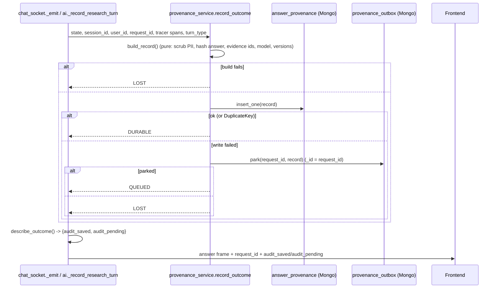
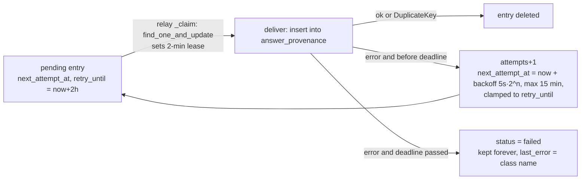
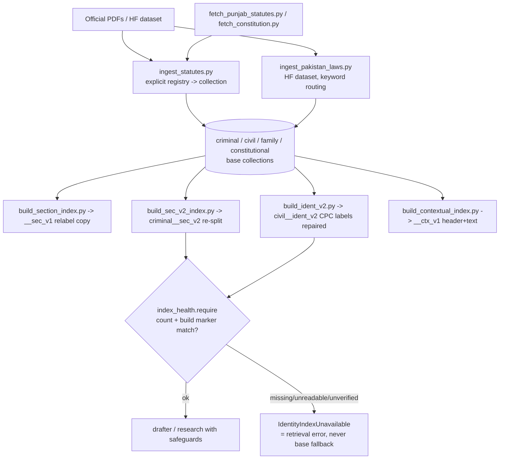

# 26 — Provenance, legal corpus, labelling & evaluation

> Written from the code in October 2026. If this doc and the code disagree, the code is right.
> The RAG graph itself (nodes, retrieval, citations) is in doc [03](03-ai-pipeline-rag.md). This doc covers what sits **around** it: the audit trail, the law library, human labelling, and the evaluation harnesses.

## 1. What it does

| Part | One-line job |
|------|--------------|
| **Provenance** | For every AI turn (answer, clarification, refusal, shortcut, error) write one **audit record**: what was asked, which law chunks and tools were used, which model wrote the answer, the decision scores, and a SHA-256 of the answer. Lawyers can open it from an **audit icon** under a research answer. |
| **Provenance outbox** | If the audit write fails, park the record in a second collection and retry for 2 hours. The answer tells the user honestly if it is **not** audited. |
| **Legal corpus & sources** | The law library in ChromaDB (4 statute collections + judgments), the versioned "identity" indexes, the health check that refuses an unverified index, and the **gates** that stop the system calling the Punjab CPC or the 2012 Constitution text "current law" for everyone. |
| **Labelling** | Admin-only API (and a CLI) where a human judges recorded turns: which chunks were relevant and whether the answer/refusal was right. Two annotators → Krippendorff's alpha → one authoritative label → exported eval set. |
| **Evaluation** | Pure metric code (`app/ai/evaluation/`) + many offline scripts and datasets under `backend/evals/` (RAG retrieval, drafter v1/v2, research, chat length, legal sources). |
| **Document migration** | One-off tool that moves legacy documents into the DOCUMENTS_V2 revision model (dry-run → approve → apply → rollback). |

---

## 2. Flow (who triggers what)

| Trigger | What happens | Where |
|---------|--------------|-------|
| Client sends a chat message over the WebSocket | Every exit path goes through `_emit()`, which calls `provenance_service.record_outcome(...)` once per turn. | [chat_socket.py](../../backend/app/websockets/chat_socket.py) |
| Lawyer sends a research question | `_record_research_turn()` writes one record (clarification **or** final answer). | [ai.py](../../backend/app/api/v1/routes/ai.py) |
| Lawyer uses "Draft with AI" (`/ai/draft/stream`) | After the stream ends, `record_answer()` with `session_id = "draft:<user_id>"`. | [ai.py](../../backend/app/api/v1/routes/ai.py) |
| Every 30 s on every worker | `_provenance_relay()` → `provenance_outbox.drain_once()` delivers parked records. | [main.py](../../backend/app/main.py) |
| Lawyer clicks the audit icon under an answer | `GET /provenance/{request_id}/view` → `ProvenancePanel` shows the whitelist view. | [AILegalPage.jsx](../../frontend/src/components/lawyer/AILegalPage.jsx) |
| Client/lawyer clicks Helpful / Not helpful | `POST /ai/rate` checks the provenance record belongs to this user + session, then upserts into `response_ratings`. | [ai.py](../../backend/app/api/v1/routes/ai.py) |
| Admin monitor | `GET /admin/...` calls `provenance_outbox.health()` (counts only, no ids). | [admin.py](../../backend/app/api/v1/routes/admin.py) |
| Admin / annotator | `/labeling/queue`, `/labeling/label`, `/labeling/stats`, `/labeling/agreement`, exports. Or the CLI `scripts/label_provenance.py`. | [labeling.py](../../backend/app/api/v1/routes/labeling.py) |
| Developer (backend stopped) | Corpus build scripts and eval scripts in `backend/scripts/`. | see §5.4 and §5.6 |

---

## 3. Code flow (mermaid)

### 3.1 Writing one audit record



### 3.2 Outbox relay



### 3.3 Lawyer opens the audit trail

```mermaid
flowchart LR
    U[Lawyer clicks AuditButton] --> F[ProvenancePanel]
    F -->|aiProvenance(request_id)| R["GET /provenance/{id}/view<br/>require_lawyer"]
    R --> S[provenance_service.get_by_request<br/>filter: request_id AND user_id]
    S --> V[provenance_view.build_view<br/>whitelist projection]
    V --> F
    S -.not found or not yours.-> X[404 same response]
```

### 3.4 From recorded traffic to an evaluation set

```mermaid
flowchart TD
    AP[(answer_provenance)] -->|unlabeled_records: answer turns only,<br/>not synthetic, not error, no invariant_violation| Q[Annotator queue]
    Q -->|POST /labeling/label or label_provenance.py| L[(retrieval_labels<br/>key = request_id + labeler)]
    B[baseline_label.py<br/>is_baseline=true] --> L
    L --> AG[agreement.py<br/>Krippendorff alpha]
    L --> AU[authoritative_labels:<br/>adjudicated wins / agreed merged / disputed excluded]
    AU --> E1[export_retrieval_dataset<br/>answerable + unanswerable]
    AU --> E2[export_calibration_pairs]
    E1 --> ER[scripts/evaluate_retrieval.py<br/>Hit@K, MRR, nDCG]
    E2 --> FC[scripts/fit_conformal.py]
```

### 3.5 How the corpus is built and checked



---

## 4. Data & states

### 4.1 Collections

| Collection | What | Key fields | Retention |
|------------|------|------------|-----------|
| `answer_provenance` | One audit record per turn | `request_id` (unique index `uniq_provenance_request_id`), `user_id`, `session_id`, `created_at` | **No TTL** — accountability record. Also kept when a conversation is deleted (`conversation_service.DELETION_EFFECTS` says `"provenance": "retained"`). |
| `provenance_outbox` | Records whose direct write failed | `_id` = request_id, `record`, `status` (`pending`/`failed`), `attempts`, `lease_owner`, `lease_expires_at`, `next_attempt_at`, `retry_until`, `last_error` | Delivered entries are deleted; **failed entries kept indefinitely** (no policy chosen yet). |
| `retrieval_labels` | Human (or baseline) judgements | `request_id`, `labeler`, `chunk_labels {chunk_id: bool}`, `relevant_chunks`, `answer_verdict`, `labeled_depth`, `is_adjudication`, `is_baseline`, `schema_version = "label-v2"` | — |
| `response_ratings` | Thumbs up/down | `user_id`+`request_id` (one per person per answer), `rating`, previews copied **from the provenance record**, not from the browser | — |
| Chroma `criminal_collection`, `civil_collection`, `family_collection`, `constitutional_collection`, `judgments_collection` | The law library (base) | chunk metadata: `statute`, `section_number`, `province`, `law_type`, `source_file` | see doc 03 |
| Chroma `criminal_collection__sec_v2`, `civil_collection__ident_v2` (+ `__sec_v1`, `__ident_v1`, `__ctx_v1`) | Versioned copies with repaired labels | `sec_schema`, `ident_version`, `build_run_id`, `provision_label`, `rule_spans` | base never modified |

### 4.2 The provenance record (`build_record`, `SCHEMA_VERSION = "prov-v2"`)

| Group | Fields | Notes |
|-------|--------|-------|
| Identity | `request_id`, `session_id`, `user_id`, `created_at`, `turn_type`, `is_synthetic`, `invariant_violation` | `turn_type` ∈ `answer`, `clarification`, `blocked`, `shortcut`, `error` |
| Asked | `query`, `normalized_query` (PII-scrubbed, ≤1000 chars), `language`, `case_type`, `province` | |
| Case | `case_id`, `case_context_supplied`, `case_context_hash`, `case_record_version`, `case_context_used_by` (`retrieval`/`generation`) | facts are **never** stored, only a fingerprint |
| Model | `answer_llm` (the call that wrote the text), `llm_calls` (every attempt incl. failed primaries), `answer_llm_origin` (`current_turn` / `cached_source` / `none`) | from `provider_health.current_turn()` |
| Answer | `answer_sha256` (full text), `answer_preview` (scrubbed, ≤500 chars) | answer itself lives in chat history |
| Evidence | `statute_chunks` (≤20: chunk_id, statute, section, source_file, province, law_type), `case_law` (≤20), `tool_calls` (≤10, args truncated to 120 chars), `web_search_used` | ids only, no chunk text |
| Measurement | `citation_grounding` (from `citation_grounding.grounding_report`) | a measurement, not an error rate |
| Decision | `arbitration {output, source, confidence}`, `signals {relevance_score, signal_variance, bm25_confidence, confidence}`, `is_grounded`, `cache_hit`, `convergence_status`, `attempts {retrieval, generation, clarification_depth}` | |
| Execution | `execution` (tracer summary + `models` list) | |
| Reproducibility | `versions {embedding_model: "intfloat/multilingual-e5-base/v1", chunking: "v2"}` | |

### 4.3 Audit outcome → what the user sees

| Outcome | `audit_saved` | `audit_pending` | UI (`auditNotice` in [trust.js](../../frontend/src/lib/trust.js)) |
|---------|---------------|-----------------|------|
| `durable` | true | false | nothing (silence is the normal case) |
| `queued` | true | true | info: "Audit record pending" |
| `lost` | false | false | warn: "Not recorded in the audit trail … save a copy" |

Rating buttons are only enabled when `audit_saved` is true and not pending (both chat surfaces).

### 4.4 Label verdicts

| Verdict | Meaning | `answered` | `correct` (for calibration) |
|---------|---------|-----------|-----------|
| `correct` | answered, right | yes | yes |
| `incorrect` | answered, wrong | yes | no |
| `correct_refusal` | refused, refusing was right | no | yes |
| `wrong_refusal` | refused, but could have answered | no | no |

---

## 5. Key logic & rules (and WHY)

### 5.1 Provenance

| Rule | Why |
|------|-----|
| **Never raises.** `record_outcome` swallows everything and returns `durable/queued/lost`. | An audit write must not fail the legal answer it describes. |
| **One record per turn, from one place.** In the WebSocket, all exits (shortcut, refusal, clarification, error, answer) leave through `_emit()`. An unknown/missing `turn_type` is logged as a bug and recorded as `error`. | Before this, shortcuts and the exception handler emitted with no record. |
| **Owner-scoped reads.** `user_id` is in the Mongo filter, not checked afterwards. Not found and "someone else's" both return 404. | Legal questions are sensitive; a different response would confirm another user's request id. |
| **Answer is hashed, not copied.** | Proves which answer the record describes without a second copy of legal correspondence. |
| **`answer_llm` ≠ last successful call.** | The last call is usually the fast grounding judge; naming it would credit a 20B judge with a 120B model's answer. |
| **`is_synthetic`** comes from the env var `PROVENANCE_SYNTHETIC` **of the server process** (or `state["is_synthetic"]`). Default false. | Warm-up traffic must never enter the labelling pool as "real user questions". Setting it on a seeding script does nothing — the server writes the record. |
| **Lawyer view is a whitelist** (`provenance_view.build_view`). Nested dicts are dropped, not stringified; provider failures shown as a fixed reason + HTTP status. | A field added to the stored record later must not appear on screen automatically; provider error bodies can contain org/user ids. |
| **Lawyer-only view.** Client chat stores `request_id` but has no audit button. | Clients see findings (citation status, claim support); the machinery would be noise for them. |
| Deleting a conversation does **not** delete provenance. | It is an audit trail, and the deletion notice tells the user so. |

### 5.2 Outbox

| Rule | Why |
|------|-----|
| Outbox `_id` = `request_id`; `answer_provenance.request_id` is unique. A DuplicateKey on deliver = **success**. | At-least-once delivery made harmless by database constraints, not app checks. |
| Retry until a **deadline** (2 h), not N attempts; backoff 5 s × 2^(n-1), cap 15 min, clamped to the deadline. | An earlier "7 attempts ≈ 2 hours" was actually 5 min 20 s. A deadline states the guarantee directly. |
| Claim + lease (120 s) in one `find_one_and_update`. Relay runs on every worker, no Redis lock. | Two relays cannot take the same entry; a crashed relay's lease simply expires. |
| `last_error` stores the exception **class name** only. | Driver messages can include hosts and credentials. |
| `health()`: `fail` if any failed entries, `warn` if oldest pending > 600 s, `unknown` if unreadable. | A dead relay looks healthy except for the growing age. |
| Same Mongo deployment as the destination. | Deliberate: a full Mongo outage gives `LOST`, reported honestly. Redis was rejected because of eviction and its monthly command budget. |

### 5.3 Legal sources registry ([legal_sources/](../../backend/app/ai/legal_sources/))

Pure code (no Chroma, Mongo or network). Today it is used by the isolated pilot script `scripts/pilot_legal_sources.py` and its data file `backend/data/legal_sources/candidate_registry_v0.json` — **not** by the live request path.

| Module | What it decides |
|--------|-----------------|
| `identity.py` | Parses **instrument numbers** ("Act No. II of 2025", "S.R.O. 169(I)/2025") and **provision kinds** that share digits: `section`, `order_rule` (CPC), `schedule_entry` (Limitation Act), `article` (Constitution), `court_rule`. Roman numerals round-trip checked. Why: the base index once stored CPC Order rules and Limitation articles as "sections". |
| `registry.py` | `SourceRecord` + rules: each `source_type` maps to exactly **one retrieval lane** (`law`, `court_rules`, `judgments`, `forms`, …) or none (datasets, verification services). "In force" only if commencement is verified, the date has arrived and the check is not stale. A provincial amendment is its own record. A URL is `not_found_confirmed` only after repeated 404s ≥ 1 day apart. Only official domains count as sources. |

### 5.4 Corpus gates used at runtime

| Module | Rule | Why |
|--------|------|-----|
| [source_currency.py](../../backend/app/ai/source_currency.py) | The indexed CPC is the **Punjab Code** text (labelled `federal` in the index). Outside Punjab a CPC citation is never "supported" (`gate_supported`, `cpc_note`), CPC claims for the wrong province are downgraded, and drafter/research/intake get notices or placeholders (`apply_cpc_jurisdiction`, `apply_intake_cpc`, `case_cpc_view`). | Presenting Punjab's text as Sindh's or national law is wrong. |
| same | The Constitution text is "as modified up to **28 Feb 2012**". Any Constitution citation is moved to "not checked" with a reason. `GAZETTE_27TH` (read from the Gazette, Act XXXII of 2025) lists Articles omitted/inserted/substituted; text relying on a **wholly omitted** Article (184, 186, 186A, 191A) is withheld unless framed as history. `needs_post_2012_constitution()` flags FCCP / 26th / 27th amendment questions. | Never call the 2012 text current. |
| [authority_registry.py](../../backend/app/ai/authority_registry.py) | Lists authorities the corpus **holds** and for which jurisdiction (CPC → Punjab; pre-emption, rented premises, specific relief…), from verified snapshot provenance, not the chunk's `province`. If a question clearly **requires** one the corpus lacks for that province, it must not be answered from leftover law. Detection is narrow ("rent", "property" alone never trigger). | Avoid confident answers built on the wrong statute. |
| [index_health.py](../../backend/app/ai/index_health.py) | `EXPECTED` pins: `criminal_collection__sec_v2` = 3305 chunks + `sec_schema`; `civil_collection__ident_v2` = 4648 chunks + `build_run_id`. Result `ok/missing/unreadable/unverified`, cached 300 s (30 s on failure). Drafter and research-with-safeguards call `require()` → `IdentityIndexUnavailable` instead of falling back to base. Client chat and intake never call it. | A silent fallback made output look identity-checked when it was not. |
| [corpus_index.py](../../backend/app/ai/corpus_index.py) | Coverage map per statute (sections held, trimmed ceiling, omitted sections, headings). Absence counts as evidence only when ≥ 80 % dense and ≥ 20 sections. Section numbers ≥ 1000 dropped as extraction noise. A separate drafter index reads the identity collections. | "Not found" for a statute we barely hold would falsely accuse a real citation. |
| [corpus_as_of.py](../../backend/app/ai/corpus_as_of.py) | Only two sentences possible: "Latest amendment year detected in our corpus: {year}." or "Amendment date not established from this corpus." Reads footnote chunks on purpose. | A year in our PDF is not a "current as of" claim about the law. |
| [contextual_index.py](../../backend/app/ai/contextual_index.py) | Builds a deterministic header (instrument, provision, jurisdiction, area, status) from metadata only — never a model — for the `__ctx_v1` collections; `collection_for(base, variant)`. Selected by `settings.retrieval_index_variant` (default `"base"`). | Context helps retrieval without inventing facts; production index untouched. |

### 5.5 Labelling

| Rule | Why |
|------|-----|
| Admin-only routes. `labeler` comes from the logged-in user (email or id), never from the body. `is_baseline` is not settable over HTTP. | One annotator must not overwrite another or fake agreement; a human must not turn a machine label into eval data. |
| Labels keyed on `(request_id, labeler)`; re-labelling replaces only your own. | Two independent judgements are what agreement is computed from. |
| Queue = **answer turns only**, not `arbitration.source == "error"`, not synthetic, no `invariant_violation`; per-annotator; oldest first. | Clarifications/blocks have nothing to grade; outages are not abstention decisions; contaminated output wastes annotator time. |
| `labeled_depth`: chunks below it are **unjudged**, not irrelevant. | Otherwise nDCG@10 from labels pooled to depth 5 is understated. |
| `authoritative_labels()` rule, fixed in advance: adjudication wins → agreeing annotators merged (chunk relevant only if **all** said so) → disagreeing verdicts **excluded** and counted. | Prevents choosing the rule to suit the numbers. |
| Krippendorff's alpha (nominal) with bands; ≥ 0.80 is flagged as suspicious for legal relevance. | Legal relevance is contestable; ~0.65 is typical. |
| Provenance records are never edited by labelling. | An edited audit trail is not an audit trail. |
| Protocol: [ANNOTATION_PROTOCOL.md](../../ANNOTATION_PROTOCOL.md) (annotator should not be the system builder; no conferring). | |

### 5.6 Evaluation

**Metric library** — [legal_rag.py](../../backend/app/ai/evaluation/legal_rag.py) (pure, unit-tested): dataset schema `legal-rag-eval-v1` (languages en/ur/roman_ur/code_switched; purposes intake/client_chat/lawyer_research; question types incl. traps; splits dev/regression/holdout; review status silver → engineer_checked → lawyer_reviewed). Relevance is judged by **legal identity** (statute + section), not chunk id, so a re-chunked index is not punished. `index_section` records what the lossy index stores (e.g. PPC 489-F stored as "489"). Metrics: recall/precision@k, MRR, nDCG@k, exact hit@1, off-target instrument@1, wrong-instrument rate, jurisdiction accuracy, selective metrics, `category_coverage`, `holdout_leakage`.
[artifact.py](../../backend/app/ai/evaluation/artifact.py) stamps each result with a source fingerprint of the pipeline files, dataset hash and `EVALUATOR_VERSION`; runs are combined only when these match. `.env` is never fingerprinted.

**Harnesses** (described from their docstrings/READMEs — not run for this doc). Almost all open the embedded Chroma store: **stop the backend first**.

| Script | Measures | Command (from the file) | Data / results |
|--------|----------|------------------------|----------------|
| `eval_legal_rag.py` | Production `retrieval_node` ranking (before the LLM grader) + what each purpose would decline. Generation is "not_measured", never 0. | `python scripts/eval_legal_rag.py --dataset evals/legal_rag/datasets/dev_v1.jsonl [--expand] [--split dev] [--out ...]` | `evals/legal_rag/datasets/` (dev, citation_probe, coverage, lettered_probe, multi_issue), `results/` |
| `eval_capability.py` | Query-side capability/answerability class only (no retrieval, no model) | `python scripts/eval_capability.py [--datasets ...]` | same datasets |
| `eval_generation.py` | Real intake analysis: `generate` then `assess` (labels unseen while generating; provenance writes disabled) | `generate --datasets dev_v1,coverage_v1 --out G.jsonl` / `assess --generations G.jsonl` | |
| `eval_stability.py` | Repeat-run stability, separate dimensions (safe, available, gate stable, coverage…) | `--runs R1,R2,R3 --ids ...` | |
| `eval_agentic.py` | A/B: production intake retrieval vs agentic issue decomposition | `[--datasets multi_issue_v1]` | |
| `eval_drafter.py` (v1) | Lawyer Draft Assistant on 29 cases: unsupported claims, unlisted authorities, jurisdiction mistakes… | `run --label X --repeat 2`, `score ...`, `subject` | [evals/drafter/README.md](../../backend/evals/drafter/README.md) |
| `eval_drafter_v2.py` | Separate V2 benchmark (31 cases, locked holdout, privacy/licence checks); never compare with v1 | `audit`, `validate`, `transmit-preview`, `run --label X --approved`, `score` | [evals/drafter_v2/README.md](../../backend/evals/drafter_v2/README.md) |
| `eval_research.py` | Real `/ai/research` route with flag on/off | `run --label on_r1 --flag on`, `score ...` | `evals/research/` |
| `eval_chat_length.py`, `eval_adversarial.py` | Client answer length vs completeness; deterministic chat checks vs hand labels | `run --label baseline --out ...`, `assess --runs ...` | `evals/chat_length/` |
| `eval_fact_fidelity.py`, `eval_statute_affinity.py` | Invented-fact detection methods (dev only); whether named-statute affinity gets PPC 379 to generation (Redis forced off) | | |
| `evaluate_retrieval.py` | Hit@K / MRR / nDCG on the **labelled export** | `--dataset data/legal_uqa.json --k 1 3 5` | from `/labeling/export/retrieval` |
| `fit_conformal.py` | Conformal threshold from authoritative labels | `--alpha 0.10 [--by-case-type] [--metrics]` | |
| `label_provenance.py` / `baseline_label.py` | CLI labelling + export; machine baseline (`is_baseline=True`) | `--stats`, `--label --limit 25 --labeler usama`, `--export ...`; `--dump`, `--apply`, `--compare` | |
| `make_review_packet.py` | CSV for a lawyer to review proposed labels | `--out evals/legal_rag/review/packet_2026-10-13.csv` | |
| `pilot_legal_sources.py` | Isolated PDF parse into provisions + provenance (refuses store paths) | `--pdf <f> --source-id <id> --out <scratch>` | [evals/legal_sources/README.md](../../backend/evals/legal_sources/README.md) + BATCH2–10 notes |

All labels in these sets are **silver (one developer)** unless marked otherwise; the READMEs list items that still need a lawyer.

### 5.7 Document migration ([document_migration.py](../../backend/app/services/document_migration.py))

Backfills **legacy documents** into the DOCUMENTS_V2 revision model (`document_revisions`).

| Step | What |
|------|------|
| `dry_run()` | Writes nothing. Manifest per document: metadata hash, file sha/size/mtime, review state, deterministic revision id `uuid5(NAMESPACE, "<doc_id>:1")`. |
| `approve()` | Binds the manifest to a decision set. |
| `apply()` | Idempotent upsert; skips any document whose preconditions drifted. Present file → v1 revision (hashed, copied, text extracted, verified where possible). Missing file → `failed` revision, no body. Old approvals → `legacy_unverified`; approved but file gone → `needs_reapproval`. Legacy fields left intact. |
| `rollback()` | Restores legacy pointer/status; revision rows and review events are **kept** (audit). |
| Also | `classify`, `recovery_for` (used by documents_v2 routes to explain recovery), `activation_readiness`, `inspect_migrated`. Scripts: `_apply_migration.py`, `_verify_migration.py`, `_rollback_rehearsal.py`, `validate_v2_snapshot.py`. |

It never flips the DOCUMENTS_V2 flag. See docs 07–09 for the document flows.

---

## 6. Files

| File | Role |
|------|------|
| [provenance.py](../../backend/app/api/v1/routes/provenance.py) | `GET /provenance/{id}`, `GET /provenance?session_id=`, `GET /provenance/{id}/view` (lawyer) |
| [provenance_service.py](../../backend/app/services/provenance_service.py) | `build_record`, `record_outcome`, `record_answer`, owner-scoped reads, turn types, synthetic flag |
| [provenance_outbox.py](../../backend/app/services/provenance_outbox.py) | park, claim/lease, deliver, backoff/deadline, `stats`, `health`, `describe_outcome` |
| [provenance_view.py](../../backend/app/services/provenance_view.py) | whitelist lawyer view |
| [chat_socket.py](../../backend/app/websockets/chat_socket.py) | `_emit()` — one audit record per client turn |
| [ai.py](../../backend/app/api/v1/routes/ai.py) | research `_record_research_turn`, draft stream record, `POST /ai/rate` |
| [main.py](../../backend/app/main.py) | `_provenance_relay()` background loop |
| [admin.py](../../backend/app/api/v1/routes/admin.py) | outbox health endpoint |
| [indexes.py](../../backend/app/db/indexes.py) | `_provenance_indexes()` (provenance + labels) |
| [AILegalPage.jsx](../../frontend/src/components/lawyer/AILegalPage.jsx) | `ProvenancePanel`, `AuditButton` |
| [ModChatbot.jsx](../../frontend/src/components/client/ModChatbot.jsx) | client keeps `requestId`/audit status; no audit view |
| [trust.js](../../frontend/src/lib/trust.js) | `auditNotice`, `shortRequestId` |
| [api.js](../../frontend/src/lib/api.js) | `aiProvenance`, `rateAnswer` |
| [conversations.js](../../frontend/src/lib/conversations.js) | restores `auditSaved`/`auditPending` on reload |
| [labeling.py](../../backend/app/api/v1/routes/labeling.py) | admin labelling routes |
| [labeling_service.py](../../backend/app/services/labeling_service.py) | save, queue, stats, exports |
| [agreement.py](../../backend/app/services/agreement.py) | Krippendorff's alpha, disagreements, authoritative labels |
| [legal_sources/identity.py](../../backend/app/ai/legal_sources/identity.py) | instrument/provision parsing |
| [legal_sources/registry.py](../../backend/app/ai/legal_sources/registry.py) | source records, lanes, in-force rules |
| [source_currency.py](../../backend/app/ai/source_currency.py) | Punjab-only CPC + 2012 Constitution / 27th Amendment gates |
| [authority_registry.py](../../backend/app/ai/authority_registry.py) | which authorities are held for which province |
| [index_health.py](../../backend/app/ai/index_health.py) | verified identity index or refuse |
| [corpus_index.py](../../backend/app/ai/corpus_index.py) | statute coverage map |
| [corpus_as_of.py](../../backend/app/ai/corpus_as_of.py) | latest amendment year seen in our text |
| [contextual_index.py](../../backend/app/ai/contextual_index.py) | ctx_v1 headers, `collection_for` |
| [legal_rag.py](../../backend/app/ai/evaluation/legal_rag.py) | eval schema + metrics |
| [artifact.py](../../backend/app/ai/evaluation/artifact.py) | eval result fingerprinting |
| [document_migration.py](../../backend/app/services/document_migration.py) | DOCUMENTS_V2 backfill |
| [backend/scripts/](../../backend/scripts/) | ingest/build/eval/label scripts listed above |
| [backend/evals/](../../backend/evals/) | datasets, results, READMEs |

---

## 7. Known limits (from the code)

1. **Single failure domain.** The outbox is in the same MongoDB as `answer_provenance`; a full outage gives `LOST` (reported as `audit_saved: false`).
2. **Failed outbox entries have no retention policy** and contain the question/answer preview.
3. **Possible index conflict for double labelling.** `indexes.py` creates a plain **unique index on `retrieval_labels.request_id`** (`uniq_label_request_id`), while `labeling_service` is designed to store one label per `(request_id, labeler)`. If that index exists, a second annotator's (or a baseline's) label for the same turn would hit a duplicate-key error — which would block the agreement workflow. Worth checking before real two-annotator labelling.
4. **Lawyer draft turns enter the labelling pool.** The draft stream records `turn_type="answer"` with no statute chunks (`session_id = "draft:<uid>"`), so they pass the `_ANSWER_TURNS_ONLY` filter.
5. **No frontend for labelling.** Only the admin API and the CLI scripts exist.
6. **Clients cannot view the audit trail** (by design) — only the `request_id` and the audit notice.
7. **Corpus currency:** CPC is Punjab-only; Constitution text is 2012; many provincial and federal Acts are missing (see `evals/legal_sources/README.md`). The gates label and withhold; they never supply the missing text.
8. **`legal_sources` registry is not wired into retrieval yet** — only the pilot script uses it.
9. **`index_health` checks count + one-row read only**; damage inside HNSW files is not detected at request time.
10. **Eval labels are silver** (one developer, not lawyer-reviewed); drafter V2 holdout v1 has already been opened; build/eval scripts require the backend to be stopped because Chroma is embedded.
11. `is_synthetic` depends on the env of the **server** process; a warm-up run on a normal server is recorded as real traffic.
