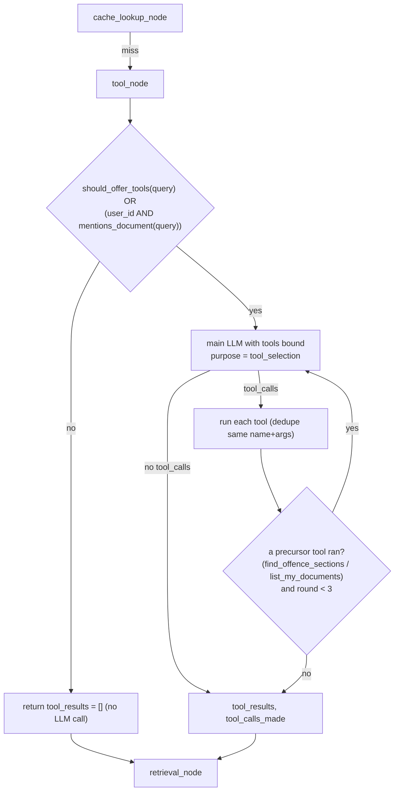
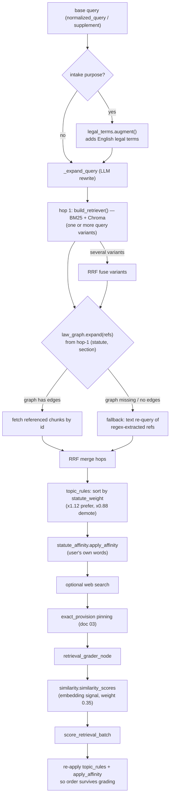
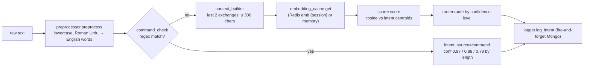

# 27 — AI internals: the supporting modules

> Written from the code in October 2026. If this doc and the code disagree, the code is right.
> Doc [03](03-ai-pipeline-rag.md) explains the main chat graph (nodes, edges, decision engine, citations). This doc covers the **helper modules around it**: the tools, the retrieval helpers, the intent classifier, the file-extraction pipeline, and the smaller top-level modules in `backend/app/ai/`.

## 1. What this doc covers

The graph in doc 03 calls many small modules. Some run on every request. Some run only when a feature flag is on. Some are used only by scripts in `backend/scripts/` (offline measurement). A few have **no callers at all**.

For each module you get:

- **what it does** in a few lines,
- **who calls it** (found by searching the imports),
- **key logic and numbers**,
- **status**, using these labels:

| Status | Meaning |
|--------|---------|
| **ACTIVE** | Runs on a live request path (chat, research, intake, drafting, analyzer). |
| **FLAG-GATED** | Code is wired in, but only runs when a setting in [config.py](../../backend/app/core/config.py) is on. The flag and its default are named. |
| **OFFLINE** | Only imported by scripts in `backend/scripts/` and by tests. Not on any request path. |
| **DEAD** | No caller in `app/` or `scripts/` (tests at most). |

## 2. Summary table

| Module | Purpose (one line) | Used by | Status |
|--------|--------------------|---------|--------|
| **Tools** | | | |
| [tools/\_\_init\_\_.py](../../backend/app/ai/tools/__init__.py) | Tool registry `LEGAL_TOOLS` + keyword cost gate `should_offer_tools` | `tool_node` | ACTIVE |
| [tools/legal_tools.py](../../backend/app/ai/tools/legal_tools.py) | 5 tools wrapping bail / court fee / inheritance / case law services | `tool_node` (via registry) | ACTIVE |
| [tools/document_tools.py](../../backend/app/ai/tools/document_tools.py) | `list_my_documents`, `read_document` bound to one user | `tool_node`, `cache_node` | ACTIVE |
| [nodes/tool_node.py](../../backend/app/ai/nodes/tool_node.py) | Lets the model call the tools, max 3 rounds | `chat_graph` in `supervisor.py` | ACTIVE |
| **Pipelines (retrieval helpers)** | | | |
| [pipelines/reranker.py](../../backend/app/ai/pipelines/reranker.py) | `RRF` — Reciprocal Rank Fusion (not a real reranker) | `retrieval_node` | ACTIVE |
| [pipelines/law_graph.py](../../backend/app/ai/pipelines/law_graph.py) | Hop-2: follow statute cross-references in a JSON graph | `retrieval_node._graph_hop2`, `main.py` warm-up | ACTIVE (falls back if file missing) |
| [pipelines/statute_affinity.py](../../backend/app/ai/pipelines/statute_affinity.py) | If the user names ONE statute, its chunks go first | `retrieval_node`, `retrieval_grader_node` | ACTIVE |
| [pipelines/topic_rules.py](../../backend/app/ai/pipelines/topic_rules.py) | Boost/demote statutes by topic (urban vs agricultural tenancy) | `retrieval_node`, `retrieval_grader_node` | ACTIVE |
| [pipelines/similarity.py](../../backend/app/ai/pipelines/similarity.py) | Real embedding cosine for the grader's 0.35 "embedding" signal | `retrieval_grader_node` | ACTIVE |
| **Intent (client chat pre-graph)** | | | |
| [intent/engine.py](../../backend/app/ai/intent/engine.py) + 8 helpers | Classifies a chat message: new question / short / detail / ok / stop / clarify | `chat_socket.py` (client WebSocket), `main.py` warm-up | ACTIVE (client chat only) |
| **Empty folders** | | | |
| `ai/memory/`, `ai/orchestrators/`, `ai/generators/` | Empty directories (not even `__init__.py`) | nobody | DEAD (empty) |
| **Data** | | | |
| [data/corpus_instruments.json](../../backend/app/ai/data/corpus_instruments.json) | List of statutes the corpus holds | `authority_registry.py`, `intake_evidence_gate_node.py` | ACTIVE (data) |
| [data/statute_omissions.json](../../backend/app/ai/data/statute_omissions.json) | Sections each Act declares omitted/repealed | `statute_omissions.py` | ACTIVE (data) |
| **Top-level `ai/*.py`** | | | |
| [agentic_decomposition.py](../../backend/app/ai/agentic_decomposition.py) | Split a story into ≤ 3 issues, retrieve per issue | `scripts/eval_agentic.py` | OFFLINE (flag `agentic_decomposition_enabled=False` exists but nothing reads it on a route) |
| [answer_confidence.py](../../backend/app/ai/answer_confidence.py) | Which confidence number the UI may show | `chat_socket.py`, `routes/ai.py` | ACTIVE |
| [citation_grounding.py](../../backend/app/ai/citation_grounding.py) | Measures: were cited sections in the retrieved evidence? | `provenance_service.py`, `citation_verification.py` | ACTIVE (measurement only, never a gate) |
| [contextual_index.py](../../backend/app/ai/contextual_index.py) | Collection-name variants, provision labels, context header strip | `retriever.py`, `retrieval_node.py`, `exact_provision.py`, index-build scripts | ACTIVE (the `ctx_v1` index itself is FLAG-GATED: `retrieval_index_variant="base"`) |
| [corpus_as_of.py](../../backend/app/ai/corpus_as_of.py) | "Latest amendment year we can see in our copy" | `document_service.py` (drafting) | ACTIVE |
| [docx_structure.py](../../backend/app/ai/docx_structure.py) | DOCX → blocks with numbering, styles, tables | `extraction_worker.py` (when `structure=True`), analyzer benchmarks | FLAG-GATED (only the Document Analyzer asks for structure; `doc_analyzer=False`) |
| [extraction_lease.py](../../backend/app/ai/extraction_lease.py) | Content hash + "is this result stale?" claim | `extraction_runner.py` | ACTIVE (its `LeaseRegistry` class is DEAD) |
| [extraction_runner.py](../../backend/app/ai/extraction_runner.py) | Runs file extraction in a killable child process | `intake_service.py`, `document_tools.py`, analyzer `extraction_stage.py`, `pii_evaluation.py` | ACTIVE |
| [extraction_worker.py](../../backend/app/ai/extraction_worker.py) | The child process: JSON in, JSON out | spawned by `extraction_runner._run_file` | ACTIVE |
| [fact_fidelity.py](../../backend/app/ai/fact_fidelity.py) | Intake summary vs client's own words (numbers, negation) | `intake_service._fact_fidelity` | ACTIVE |
| [fact_semantic.py](../../backend/app/ai/fact_semantic.py) | Embedding-based fact check for drafts | `scripts/eval_fact_fidelity.py` | OFFLINE (says "DEV ONLY, NOT WIRED") |
| [import_validator.py](../../backend/app/ai/import_validator.py) | Checks nodes do not import edges/supervisor/decision_engine | nobody | **DEAD** |
| [intake_localization.py](../../backend/app/ai/intake_localization.py) | Controlled Urdu version of a finished intake analysis | `intake_service._render` | ACTIVE (when output language is Urdu) |
| [legal_terms.py](../../backend/app/ai/legal_terms.py) | Urdu/Roman-Urdu words → English legal terms for retrieval | `retrieval_node` (intake only), `period_support.py`, `issue_relevance.py` | ACTIVE |
| [mismatch_detection.py](../../backend/app/ai/mismatch_detection.py) | Is a cited section even about the same subject as the claim? | `scripts/evaluate_a1.py` | OFFLINE ("NOT WIRED INTO ANYTHING") |
| [ocr_routing.py](../../backend/app/ai/ocr_routing.py) | Decides which pages (if any) get OCR | `extraction_worker._ocr`, `ocr_service.py` | FLAG-GATED (`english_ocr_enabled=False`) |
| [process_limits.py](../../backend/app/ai/process_limits.py) | Hard memory cap for the extraction child | `extraction_worker.main`, `extraction_runner._run_file` | ACTIVE for the analyzer only (opt-in env var) |
| [provider_health.py](../../backend/app/ai/provider_health.py) | Provider cooldowns, `PURPOSE_*` labels, per-turn LLM attribution | `llm.py`, almost every node, routes, provenance | ACTIVE |
| [section_repair.py](../../backend/app/ai/section_repair.py) | Fixes "489-F stored as 489"; section splitter for ingestion | runtime: one regex (`LETTERED_HEADING`); rest: build scripts | ACTIVE (regex) / OFFLINE (rest) |
| [selective_metrics.py](../../backend/app/ai/selective_metrics.py) | Risk–coverage, AURC, ECE, refusal stats | `scripts/fit_conformal.py` | OFFLINE |
| [statute_omissions.py](../../backend/app/ai/statute_omissions.py) | Loads the omitted-sections map | `corpus_index.py`, `contextual_index.py`, `intake_evidence_gate_node.py`, `scripts/build_omission_map.py` | ACTIVE |
| [tracing.py](../../backend/app/ai/tracing.py) | LangChain callback that records node/LLM/tool spans | `chat_socket.py`, `routes/ai.py` | ACTIVE (`get_trace()` is DEAD) |

---

## 3. Tools and `tool_node`

### 3.1 Where it fits

`tool_node` runs **after a cache miss and before retrieval**, in `chat_graph` only (the intake graph has no tool node). See the graph in doc 03 §3.2.



### 3.2 [tools/\_\_init\_\_.py](../../backend/app/ai/tools/__init__.py) — the registry and cost gate

- `LEGAL_TOOLS` = the only tools the model can call: `find_offence_sections`, `check_bail_eligibility`, `calculate_court_fee`, `compute_inheritance_shares`, `search_case_law`. Comment: "the blast radius of the agent is exactly this file".
- `should_offer_tools(query, case_type)`: a **word-boundary** regex over trigger words (bail, zamanat, ضمانت, FIR, 497, fee, suit, inheritance, wirasat, heir, judgment, precedent, …). No match → `tool_node` returns at once, so the tool schemas never cost tokens. It is tuned to **over-fire**: a false positive costs one model call; a false negative loses an exact figure.
- Why word boundaries: substring matching made "fir" fire on "first" and "share" on "shareholder".

### 3.3 [tools/legal_tools.py](../../backend/app/ai/tools/legal_tools.py) — thin adapters over `app/services/`

| Tool | Wraps | Key behaviour |
|------|-------|---------------|
| `find_offence_sections(query)` | `bail_checker.search`, `tool_contract.provision_refs` | Identifies an offence only. **Hides the `bailable` field** on purpose, so the model must call the bail tool next. Returns `outcome`: `found` / `ambiguous` (several sections **tie** on top relevance, e.g. "fraud" → 420/406/468) / `not_in_table` (with a note that this is not proof the section does not exist) / `error`. An explicit "Section 420 PPC" is resolved by the shared citation parser first. |
| `check_bail_eligibility(law, section, arrested=None)` | `bail_checker` | The "authoritative" bail answer (CrPC Second Schedule). If `arrested` is omitted it returns both routes (s.497 post-arrest and s.498 pre-arrest). |
| `calculate_court_fee(claim_value, suit_type, province, court_level="district")` | `court_fee` | Court Fees Act 1870. `suit_type` and `province` are typed `Literal`s so the model cannot invent values. |
| `compute_inheritance_shares(estate_value, heirs)` | `inheritance` | `heirs` is a typed `HeirsInput` model. |
| `search_case_law(query, limit=5)` | `citator_service.search` (async) | Lahore High Court judgments. Empty → returns an error with the hint "Do not invent a citation". |

Rules followed by every tool: errors are **returned** (`{"error": ...}`), never raised, so the graph survives; the service's own `disclaimer`/`verify` fields are kept.

### 3.4 [tools/document_tools.py](../../backend/app/ai/tools/document_tools.py) — the user's own files

- `build_document_tools(user_id, role)` builds `list_my_documents` and `read_document` **per request**, closed over the authenticated `user_id`. The user id is never a tool argument, so the model cannot ask for another user's file (no IDOR). No user → no tools.
- Files come from intake evidence: `IntakeRepository.find_evidence_by_client(user_id)`. (So a lawyer on the research screen will normally get "You have not uploaded any documents" — only client intake uploads are searched.)
- `read_document` → `_read_file` → `extraction_runner.extract_one` (child process, see §6). Text is capped at `_MAX_CHARS = 12_000`. If extraction was partial, the result carries `incomplete`, `completeness`, a `warning` naming the unread pages, and a hint "Do not assume the missing parts are unimportant".
- `USER_SCOPED_TOOL_NAMES` and `mentions_document()` live here because **`cache_node` also needs them**: a turn that could touch private files must never be cached (doc 03, `cache_block_reason`).
- Database errors are logged, never shown to the model (a driver message could leak a connection string).

### 3.5 [nodes/tool_node.py](../../backend/app/ai/nodes/tool_node.py)

- `_MAX_ROUNDS = 3` (the bail chain needs find → read → check). Note: the module docstring still says "bounded at 2 rounds" — the constant (3) is what runs.
- Loops again **only** if a "precursor" tool ran (`find_offence_sections`, `list_my_documents`). This saved one empty main-model round (~7 s, ~3k tokens) on every tool query.
- Same `(name, args)` called twice → not re-run; answered with "Already called. Previous result: …".
- Unknown tool name → an error `ToolMessage`, loop continues.
- **Fail-open:** if the LLM call fails, the node stops and retrieval continues as normal.
- Output goes to `tool_results` (not `retrieved_chunks`), so the grader cannot score a computed figure away (doc 03).
- Uses the **main** model tier: `get_llm(purpose=PURPOSE_TOOL_SELECTION)`.

---

## 4. Retrieval helpers in `ai/pipelines/`

`retriever.py` and `answerability.py` are in doc 03. The other five files are here.

### 4.1 Where they fit



All of these run in **both** graphs: `chat_graph` and `intake_graph` share `retrieval_node` and `retrieval_grader_node`.

### 4.2 [reranker.py](../../backend/app/ai/pipelines/reranker.py) — `RRF` (fusion only)

- Despite the name, there is **no reranker model**. The class `RRF` does Reciprocal Rank Fusion: each document gets `sum(1 / (60 + rank))` over the lists it appears in. Documents are de-duplicated by `(page_content, sorted metadata)`. `rearrange(top_k=0)` keeps all.
- Called twice in `retrieval_node`: to fuse multi-query variants, and to merge hop 1 + hop 2.
- **Why no cross-encoder:** the long docstring records a measured, reverted experiment. On "Can a tenant be evicted without notice in Punjab?" the ms-marco cross-encoder moved the right statute (Punjab Rented Premises Act 2009) from #1 (after topic rules) to #10 at k=10 and #24 at k=50, and took 734–2,434 ms. Widening first-stage k to 50 was reverted too.

### 4.3 [law_graph.py](../../backend/app/ai/pipelines/law_graph.py) — hop-2 over cross-references

- Loads `backend/chroma_data/law_graph.json` (NetworkX node-link JSON, **not pickle**, for safety). The file exists (~860 KB, built 1 Sep by `scripts/build_law_graph.py`).
- `get_graph()` is cached once per process and pre-loaded in the background warm-up in `main.py`.
- `expand(refs, max_targets=8)`: node id = `"<statute lower, spaces→_>::<section>"`. Follows out-edges and returns chunk ids sorted by edge weight (`defined_by` 1.20 beats `ref` 1.10).
- Missing or broken graph → returns `[]` and `retrieval_node` falls back to the old text re-query. It never raises.
- `stats()` has no caller.

### 4.4 [statute_affinity.py](../../backend/app/ai/pipelines/statute_affinity.py) — "the user named this statute"

- Problem it fixed: "punishment for theft under the PPC" put PPC 379 at rank 15–16, outside the top 8 the grader sees; 7 of the top 8 were CrPC.
- **Preference, not a filter.** `prefer_statute` is a stable partition: the named statute's chunks first, everything else after, order kept inside each group.
- Reads the **user's own words** (`state["user_text"]` or `state["query"]`), never the LLM rewrite — because the rewrite may add statute names the user never typed (see FAILURE_CASE_001 in doc 03).
- Two detectors, **unioned** before the "exactly one" rule:
  - registry: full names from `answer_citations.statute_alias_map()` (+ optional year) and acronyms (`PPC`, `Cr.P.C.`, `CPC`, `QSO`, `PECA`, `MFLO`, `Constitution`). Look-arounds stop `CPC` matching inside `CrPC`. "Constitution" must not be followed by "of <not Pakistan>" (so "constitution of a partnership firm" is ignored).
  - corpus: full statute names present in the retrieved chunks (≥ 8 chars, year optional), e.g. "Punjab Tenancy Act".
- Two or more statutes named → **no preference** (a comparison question needs both sides). A bare "section 379" names no statute → no preference.
- Runs after topic rules, so "under the Punjab Tenancy Act" beats the urban-tenancy topic rule.
- Measured by `scripts/eval_statute_affinity.py`.

### 4.5 [topic_rules.py](../../backend/app/ai/pipelines/topic_rules.py) — scope disambiguation

- One rule today, `"urban tenancy"`: query mentions rent / landlord / tenant / shop / makan / kiraya **and not** agricultural words (crop, cultivat, khasra, mutation …) → prefer `Punjab Rented Premises Act 2009`, demote the Punjab Tenancy Act 1887 and three other land/tenancy laws.
- `statute_weight(query, statute)`: `BOOST = 1.12`, `PENALTY = 0.88`, multiplied across rules. Deliberately small: it breaks near-ties, it does not override retrieval.
- `active_rules(query)` names the fired rules for provenance.
- Why not query expansion: measured; adding statute words raised every competitor too (target stayed at rank 6).
- Docstring warning: each rule is a legal claim — verify before adding one.

### 4.6 [similarity.py](../../backend/app/ai/pipelines/similarity.py) — real embedding signal

- Before this, the grader's "embedding" signal (weight 0.35) was a constant 0.5 for every chunk.
- Fetches the chunk vectors **already stored in Chroma** by id (no re-encoding), embeds the query once with the same e5 model, and takes a dot product (vectors are L2-normalised, so dot = cosine). Cost measured ~26 ms + ~150 ms.
- Raw e5 cosines sit in a narrow band (unrelated ≈ 0.70, best ≈ 0.87), so `rescale()` stretches `[COSINE_FLOOR 0.70, COSINE_CEILING 0.88]` onto `[0, 1]`.
- Any chunk without a vector (web results, unknown id) gets `NEUTRAL = 0.5`; any failure → all 0.5.
- Code-reading note: it always looks the ids up in the **base** collection for the case type (`CASE_TYPE_TO_COLLECTION`), not in an index variant (`ctx_v1`, `ident_v2`, `sec_v2`). If a variant collection uses different chunk ids, those chunks silently get the neutral 0.5. Worth checking when a variant index is turned on.

---

## 5. Intent classifier (`ai/intent/`) — client chat only

### 5.1 What it does and where

Before the client chat message enters the graph, `chat_socket.py` calls `intent.classify(text, session_id, history)`. It returns one of `new_query, format_brief, format_detail, affirm, stop, clarify, unknown`.

- `affirm` ("ok", "shukriya") → fixed reply `_CANNED_AFFIRM`, **graph skipped**, confidence fields from `unscored_payload()`.
- `stop` → fixed reply, graph skipped.
- `affirm`/`stop` on a message longer than `_MAX_SHORTCUT_WORDS = 15` words → treated as `new_query` (a long message is not a real "ok"). Since 2026-10-20 also when `allows_canned_reply` is false (> 6 words or it asks something).
- `format_brief` / `format_detail` (only if `is_reshape_request(query)`: ≤ 4 words or refers back) → the graph runs on the **previous question** (`client_turn_overrides` sets `followup_intent = format/deepen`, `followup_base_query`, `retrieval_query_supplement`). `format_brief` with no previous AI answer is an ordinary question.
- Everything else → normal graph turn.

The lawyer research route (`routes/ai.py`) does **not** use this package.



### 5.2 The files

| File | What it does | Key numbers |
|------|--------------|-------------|
| [\_\_init\_\_.py](../../backend/app/ai/intent/__init__.py) | Exports `classify`, `warmup`, `IntentResult`. | — |
| [engine.py](../../backend/app/ai/intent/engine.py) | Orchestrates the 8 steps above. `warmup()` loads the model and centroids once (called from `main._warmup_models` in the background); failure is logged and the engine runs LLM/keyword-only. | — |
| [preprocessor.py](../../backend/app/ai/intent/preprocessor.py) | Lowercases, maps Roman Urdu (`bas`→stop, `theek hai`→ok, `mukhtasar`→brief, `aur batao`→tell me more, `nahi`→no …) and abbreviations (`tldr`→brief), strips noise characters. | — |
| [command_check.py](../../backend/app/ai/intent/command_check.py) | Regex lists per intent (`brief`, `short`, `summary`, `simple`, `elaborate`, `in detail`, `further`, `ok`, `thanks`, `great`, `stop`, `enough`, `khatam` …). First match wins and skips the rest. | confidence 0.97 (≤ 3 words), 0.88 (4–8), 0.78 (> 8) |
| [context_builder.py](../../backend/app/ai/intent/context_builder.py) | Last 2 user+AI exchanges as "User: … / AI: …", cut to 300 chars. Only the LLM router reads it. | `_MAX_CHARS = 300` |
| [embedding_cache.py](../../backend/app/ai/intent/embedding_cache.py) | Per-session cache of message embeddings. Redis hash `emb:{session_id}` with sliding TTL, or an in-process dict (64 entries per session, GC every 500 inserts). | TTL `settings.embedding_cache_ttl = 3600` s |
| [scorer.py](../../backend/app/ai/intent/scorer.py) | `fastembed` model `BAAI/bge-small-en-v1.5` (33 MB, no torch). Centroid = mean of example phrases per intent. Cosine of the message vs each centroid. | top score < 0.35 → `unknown` |
| [confidence.py](../../backend/app/ai/intent/confidence.py) | `get_level`: HIGH = score ≥ 0.85 **and** margin ≥ 0.08; MEDIUM = score ≥ 0.60; else LOW. | `LLM_CONFIDENCE_THRESHOLD = 0.70` |
| [router.py](../../backend/app/ai/intent/router.py) | HIGH → embedding answer. MEDIUM → one fast-LLM JSON call (`PURPOSE_INTENT`); used if LLM conf ≥ 0.70, else LOW path. LOW → keyword score (0.75 for ≤ 4 words, 0.55 otherwise) if > 0.30 → else LLM again (accepted if ≥ 0.40) → else `unknown`. | — |
| [logger.py](../../backend/app/ai/intent/logger.py) | `asyncio.create_task` insert into the `intent_logs` collection (text cut to 500 chars, `model_version = "nlu-v1.0"`). Errors swallowed. | — |

### 5.3 Notes from reading the code

- **False follow-up (FIXED 2026-10-20).** `command_check` returns `format_brief` / `format_detail` for any message containing `simple`, `short`, `further`, `more about`… with no length limit, so "Explain in simple words the punishment for theft" re-answered the previous question. `chat_socket.is_reshape_request` now requires ≤ 4 words or a word pointing back; `allows_canned_reply` does the same job for `affirm`/`stop`. Tests in `tests/test_chat_response_policy.py`.
- `embedding_cache.clear_session()` and `stats()` have no callers.

---

## 6. File extraction pipeline (runner → worker → lease)

### 6.1 Why a child process

`asyncio.to_thread` with a timeout does not stop the work: the thread keeps running inside a native PDF parser and keeps a slot of the shared thread pool (12 slots on an 8-CPU host). A **child process** can be killed, a parser crash costs one file instead of the API worker, and a semaphore limits how many run.

### 6.2 Flow

```mermaid
sequenceDiagram
    participant C as Caller (intake_service / read_document / analyzer)
    participant R as extraction_runner
    participant L as extraction_lease
    participant W as extraction_worker (child process)
    participant X as extraction.extract_file
    participant O as ocr_routing + ocr

    C->>R: extract_many(files, owner_id) / extract_one / extract_isolated
    R->>L: claim_for(owner, file_id, path) → content SHA-256 + versions
    R->>R: _batch_key → same key already in _inflight? wait on that future
    R->>R: semaphore (MAX_CONCURRENT_EXTRACTIONS = 2)
    R->>W: python -m app.ai.extraction_worker (JSON job on stdin)
    W->>W: process_limits.apply_from_env() (only if AAI_CHILD_MEMORY_LIMIT_MB set)
    W->>X: extract_file(path) (structure=True → docx_structure)
    W->>O: only if job has ocr.enabled: plan_for_result / plan_for_image
    W-->>R: JSON on stdout {ok, results:[{file_id, text, result, blocks?, ocr?}]}
    R->>R: timeout → kill whole process tree; validate JSON shape
    R->>L: is_stale(claim, current_sha) → file changed? ERR_STALE_INPUT
    R-->>C: {file_id: (ExtractionResult, text)}
```

### 6.3 The modules

**[extraction_runner.py](../../backend/app/ai/extraction_runner.py)** — ACTIVE

| Function | Used by | Notes |
|----------|---------|-------|
| `extract_many(files, batch_timeout, owner_id, dedupe, ocr)` | `intake_service` (evidence on convert) | Collapses concurrent identical requests (double click, refresh) into one shared `asyncio.Future`, keyed by owner + extractor/config versions + timeouts + OCR request + `(file_id, path, sha)`. Unknown owner or unhashable file → no sharing. |
| `extract_one(path, file_id, owner_id)` | `document_tools._read_file` | One file, batch timeout = 30 + 10 s. |
| `extract_isolated(path, timeout, ocr, memory_limit_mb, structure)` | analyzer `extraction_stage.py`, `pii_evaluation.py` | No batching/dedupe; same semaphore, same child, optional memory cap. |

Numbers: `PER_FILE_TIMEOUT_SECONDS = 30`, `BATCH_TIMEOUT_SECONDS = 120`, `MAX_CONCURRENT_EXTRACTIONS = 2` (per API process). One fresh child **per file**, run one after another inside the batch deadline. Child gets `OMP_NUM_THREADS=1`. On timeout or cancellation the whole process tree is killed (`_kill_descendants`, `_terminate`). A malformed child reply → `ERR_INTERNAL`. Stated limit: the semaphore and in-flight map are **per process**, not per host (Redis would be needed for that).

**[extraction_worker.py](../../backend/app/ai/extraction_worker.py)** — ACTIVE (as a child)

Reads one JSON job from stdin, writes one JSON reply to stdout. It may import **only** `app.ai.extraction`, `docx_structure` (when structure is asked), `ocr`, `ocr_routing`, `process_limits` and the standard library — importing `app.ai.tools` (langchain, ~2.5 s) or `app.core.config` (database clients) would slow every conversion. This is also why `app/__init__.py` and `app/ai/__init__.py` must stay empty. A per-file deadline check reports later files as "timeout / not attempted" instead of "empty". OCR runs here so the OCR engine is a grandchild covered by the same tree kill.

**[extraction_lease.py](../../backend/app/ai/extraction_lease.py)** — ACTIVE in part

- `content_hash(path)`: SHA-256, read in 1 MB blocks.
- `ExtractionClaim` / `claim_for(owner_id, file_id, path)`: a result is about *these bytes, this extractor version, this owner*, not about a file id.
- `is_stale(claim, current_sha=...)`: used by `extraction_runner._refuse_stale` to drop a result whose file changed during extraction.
- `LeaseRegistry` (+ `DEFAULT_LEASE_SECONDS = 180`): an expiring per-process lease. **Not used by any app code** — only `tests/test_extraction_runner_bounds.py`. The runner does its de-duplication with its own `_inflight` future map instead. Treat `LeaseRegistry` as dead code.

**[process_limits.py](../../backend/app/ai/process_limits.py)** — ACTIVE for the analyzer only

Caps the child's memory so a decompression bomb fails with `MemoryError` inside the child. POSIX: `RLIMIT_AS`; Windows: a Job Object with `JOB_OBJECT_LIMIT_PROCESS_MEMORY` (inherited by Tesseract). Opt-in through env var `AAI_CHILD_MEMORY_LIMIT_MB`, which the runner sets only when `memory_limit_mb` is passed — today only the Document Analyzer passes it (`CHILD_MEMORY_MB`). Intake runs without a memory cap. If the OS refuses the cap it raises (never runs silently uncapped).

**[ocr_routing.py](../../backend/app/ai/ocr_routing.py)** — FLAG-GATED (`english_ocr_enabled`, default `False`)

Pure function: maps an `ExtractionResult` to an `OcrPlan`. Rules: pages that already have native text are **never** OCR'd; only `no_text_found` / `failed` pages are candidates, up to `ocr.MAX_OCR_PAGES`; legacy non-Unicode **Urdu** pages (`text_untrusted`) and whole-document `ERR_UNEXTRACTABLE_TEXT_ENCODING` are refused with `ocr_not_supported_language` (the only engine is English and would produce "fluent English nonsense"). `plan_for_image` → one page for a supported JPEG/PNG. Called from the worker and from `ocr_service.py`; both paths require `settings.english_ocr_enabled`. Production activation also needs `english_ocr_benchmark_id` (config validator).

**[docx_structure.py](../../backend/app/ai/docx_structure.py)** — FLAG-GATED (Document Analyzer, `doc_analyzer`, default `False`)

`extract_docx_structured(path)` returns canonical text **plus** a list of blocks (`heading / paragraph / list_item / table_cell`) with offsets, style, outline level, list numbering and table coordinates. Word auto-numbering ("7.2") is resolved from `numbering.xml` (style chain, overrides, restarts, decimal/letter/roman formats); anything it cannot resolve is **not guessed** and recorded as a limitation. Tracked insertions kept, deletions dropped; hidden text dropped (also where injected instructions hide). Version `docx-blocks.1`. Only the analyzer asks for `structure=True` (DOCX files), so with the analyzer off it does not run. Also used by three benchmark scripts.

---

## 7. Other top-level modules

### 7.1 Answer quality and confidence

**[answer_confidence.py](../../backend/app/ai/answer_confidence.py)** — ACTIVE

- Decides which confidence the UI shows. The model's own `{"confidence": 0.85}` is **not** shown as calibrated (it is "the model grading its own homework"); it is kept as `model_confidence` for diagnosis.
- `user_facing_confidence(state)`: cache hit → `cache_confidence`; Decision Engine ran (`arbitration_output` in answer/defer/refuse) → `arbitration_confidence`; otherwise **`None`** (UI shows "Confidence not calibrated").
- `confidence_band`: below the generation floor (`threshold_manager.get_generation_floor()`, fallback 0.2) → `low`; below 2 × floor → `moderate`; else `high`.
- `confidence_payload(state)` is shared by the WebSocket and `/ai/research` so the two cannot drift; `unscored_payload()` returns all `None` for shortcuts, gatekeeper blocks and errors (these used to claim 1.0).

**[citation_grounding.py](../../backend/app/ai/citation_grounding.py)** — ACTIVE, **measurement only**

- `grounding_report(answer, chunks)`: which cited sections appeared in the retrieved chunks (`grounded`, `ungrounded`, `grounded_ratio`). No parseable citation → `measurable: False` (not a pass).
- Called by `provenance_service._citation_grounding` and stored in each chat audit record; `retrieved_citations()` is reused by `citation_verification`.
- Deliberately **not a gate**: 83% of recorded answers cite at least one section that was not retrieved, and "ungrounded" can be correct law from memory (CrPC 154 for FIR). The docstring also records a correction: its parser does not read negation ("PPC 302 is not applicable here" was once counted as citing 302).
- Different from `answer_citations.py` (doc 03), which labels citations against the numbered evidence.

**[fact_fidelity.py](../../backend/app/ai/fact_fidelity.py)** — ACTIVE (intake)

- `check(summary, actions, understanding, extra_sources)`: compares the intake **summary** with what the client actually said (story, desired outcome, answers, evidence text).
- Two checks only: `unsupported_number` (an amount/date in the summary that appears nowhere in the client's material, after removing section numbers and statute years) and `negation_inverted` (a fact the client negated, mentioned with no negator within ~60/40 chars).
- Nothing to compare → `unchecked`, never `consistent`. Version `input-fact-fidelity-v1-limited`. Result stored as `input_fact_fidelity` by `intake_service._fact_fidelity`.

**[fact_semantic.py](../../backend/app/ai/fact_semantic.py)** — OFFLINE

Splits drafted sentences into factual clauses (drops citations, "shall/may/pray" legal language) and scores each against the lawyer's input with e5 embeddings. Docstring: "DEV ONLY, NOT WIRED into the drafter guard". Used only by `scripts/eval_fact_fidelity.py` and its test.

**[mismatch_detection.py](../../backend/app/ai/mismatch_detection.py)** — OFFLINE

`score(assertion, statute, section)`: cosine between a claim (`query:` prefix) and the stored vectors of the cited section, to catch subject-matter mismatches like "PPC 152 – limitation for appeals" (152 is about riots). Cannot catch a wrong section in the right area of law. Docstring: "NOT WIRED INTO ANYTHING"; ship decision belongs to `scripts/evaluate_a1.py`.

**[selective_metrics.py](../../backend/app/ai/selective_metrics.py)** — OFFLINE

Pure functions over `Turn(confidence, correct, abstained)`: `risk_coverage_curve`, `aurc`, `expected_calibration_error` (10 bins), `refusal_stats`, `report`. For the research paper; waits for a labelled set. Used by `scripts/fit_conformal.py`. (A separate function with the same name exists in `ai/evaluation/legal_rag.py`.)

**[agentic_decomposition.py](../../backend/app/ai/agentic_decomposition.py)** — OFFLINE

Bounded experiment: one planner LLM call finds up to `MAX_ISSUES = 3` issues (each must quote the client **verbatim**, else dropped; fallback = sentence split), retrieves per issue with the production retrieval node (`MAX_BRANCHES = 3`, `MAX_MODEL_CALLS = 4`, 30 s per branch, 90 s total), and labels each issue `supported / unsupported / ambiguous / missing_facts / conflicting_authority`. It does not generate. `decompose()` runs only if `settings.agentic_decomposition_enabled` (default `False`) or `offline=True`; **no route calls `decompose()`**, so turning the flag on changes nothing in the app. Used by `scripts/eval_agentic.py`; the flag value is recorded in eval artifacts (`ai/evaluation/artifact.py`).

### 7.2 Corpus and index helpers

**[contextual_index.py](../../backend/app/ai/contextual_index.py)** — ACTIVE (helpers) / FLAG-GATED (the `ctx_v1` index)

- `collection_for(base, variant)`: `"base"` → the base name; otherwise `"<base>__<variant>"`. Used by `retriever.py`, `exact_provision.py` and four build scripts.
- `provision_label(meta, text)`: repairs "489" → "489-F" from the chunk's own heading (uses `section_repair.LETTERED_HEADING`).
- `contextualize()` / `contextual_prefix()`: a deterministic header (Instrument, Provision, Jurisdiction, Area, Status from `statute_omissions`, Chapter: unknown) built **only from metadata**, never by a model. Used by `scripts/build_contextual_index.py` to build the separate `<base>__ctx_v1` collection.
- `strip_context(text, meta)`: removes that header before text reaches generation (`retrieval_node._docs_to_chunks`, `exact_provision`). No-op on the base index.
- The `ctx_v1` index is used only when `retrieval_index_variant` (default `"base"`) is set to `ctx_v1`.

**[section_repair.py](../../backend/app/ai/section_repair.py)** — ACTIVE (one regex) / OFFLINE (the rest)

- The defect: PDFs print "489-\nF." on two lines, so the old splitter stored PPC 489-A…489-F all as "489" (85 heading chunks + 21 continuations).
- `LETTERED_HEADING` regex: shared at runtime by `contextual_index.provision_label` and `intake_evidence` so all read a heading the same way.
- `repair_labels` / `relabels` / `buried_lettered_headings`: relabel metadata without re-embedding, written to a versioned `__sec_v1` copy (`scripts/build_section_index.py`).
- `split_provisions` (`SPLIT_VERSION = "section-split-v2"`, plus v3): the fixed section splitter used by `scripts/ingest_statutes.py`, `build_sec_v2_index.py`, `pilot_legal_sources.py`.

**[statute_omissions.py](../../backend/app/ai/statute_omissions.py)** — ACTIVE

- Loads `data/statute_omissions.json` (generated by `scripts/build_omission_map.py` from the statute texts, e.g. CrPC "266--336. [Omitted]" = 71 jury-trial sections).
- `omitted_for(statute)`, `record_for(statute, section)`, `get_records()`, `confirmed_records()`.
- Callers: `corpus_index.py` (coverage denominator: CrPC goes 0.77 → 0.99 once omitted sections are excluded; also the `OMITTED` verdict in `citation_verification`), `contextual_index.py` (status line), `intake_evidence_gate_node.py` (an omitted provision is not admissible evidence).
- **Lower bound:** PPC footnote-style omissions are not parsed, so "zero omissions" is not a clean bill of health. Missing JSON → old behaviour, never a failure.

**[corpus_as_of.py](../../backend/app/ai/corpus_as_of.py)** — ACTIVE (drafting)

- Scans Chroma (including footnote chunks that are excluded from evidence) for amendment declarations and reports the latest year **in our copy** of a statute.
- Only two fixed sentences are possible: "Latest amendment year detected in our corpus: {year}." or "Amendment date not established from this corpus." It must never become "current as of" or "in force".
- `document_service._as_of_for` attaches `as_of` records to a generated document's verification record (best-effort, silent on failure).

**[legal_terms.py](../../backend/app/ai/legal_terms.py)** — ACTIVE

- `augment(query)`: appends English legal terms for Urdu / Roman-Urdu legal words (`ضمانت` → bail, `گرفتار` → arrest, `نفقہ` → maintenance …) to the **retrieval query only**. Called in `retrieval_node` only when `retrieval_policy.purpose == "intake"`.
- Fact concepts (v2): dishonoured cheque (cheque **and** bounce), criminal intimidation (a non-negated threat; "threat to cause death" only when killing is said), cheating (only on explicit deceit words). Never maps facts to a section number.
- `legal_terms(text)` is also used by `period_support.py` and `issue_relevance.py`. Version `legal-terms-v2`.

### 7.3 Intake output

**[intake_localization.py](../../backend/app/ai/intake_localization.py)** — ACTIVE when the client's language is Urdu

- The analysis is generated and judged in **English**; this module makes a controlled **Urdu rendering** of the finished result.
- Only prose is translated (summary, actions, citation notes). Statute names, section numbers, amounts, dates are swapped for `[[T1]]` tokens first and restored after.
- Checks: same number of actions/notes; every token back exactly once; **no digit outside a token**; no item grows more than 3×; glossary check. Any failure → `status: failed` and the client sees the full English original plus a fixed Urdu notice (`URDU_FALLBACK_NOTICE`). Never half-translated.
- Grounding cautions are not translated by the model; they are stripped and shown as fixed UI text.
- Called by `intake_service._render` with a 60 s timeout; `retry_localization` can retry only the translation.

### 7.4 Infrastructure

**[provider_health.py](../../backend/app/ai/provider_health.py)** — ACTIVE

- **Cooldowns scoped by what the error proves:** 429 and 404 → this account + this model; 401/403 and 402 → the whole account; 5xx/connection → nothing (just fail over). All cooldowns bounded (`MAX_COOLDOWN_S = 900`, rate-limit default 60 s). `llm.py` checks `is_eligible()` before each provider and calls `record_success` / `record_failure`.
- **`PURPOSE_*` constants** (`triage`, `retrieval_grader`, `answer_generation`, `tool_selection`, `intent_classification`, `intake_extraction`, `document_drafting` …): every LLM call carries one, imported by nearly every node and service.
- **Per-turn attribution:** `turn_scope()` (used in `chat_socket.py` and `routes/ai.py`) creates a `TurnUsage` collector in a ContextVar, so the provenance record names the model that **wrote** the answer, not the last judge call, and a cache hit does not inherit the previous turn's model.
- Never logs prompts, answers, keys or raw error text (Groq/OpenRouter errors contain org/user ids). One `llm_call ...` log line per call.
- `snapshot()` has no caller in `app/`.

**[tracing.py](../../backend/app/ai/tracing.py)** — ACTIVE

- `TraceHandler`: a LangChain `AsyncCallbackHandler` recording node, LLM and tool spans with timings and token usage (capped at `_MAX_SPANS = 200`; values truncated to 500 chars). Deliberately not LangSmith — client legal data stays on our servers.
- `chat_socket.py` creates one per turn and passes it as a graph callback; the spans and `summary()` go into the provenance record. `routes/ai.py` uses the `trace_run()` context manager.
- `get_trace()` has no caller.

**[import_validator.py](../../backend/app/ai/import_validator.py)** — **DEAD**

`validate_worker_imports()` parses the 9 node modules with `ast` and raises `ImportBoundaryError` if any imports `graph.edges`, `graph.supervisor` or `decision_engine`. Its docstring says "call once at application startup" and "for CI: pytest fixture wraps this same call", but **nothing calls it** — not `main.py`, not `conftest.py`, not any test. The only other mention is a comment in `supervisor.py`. The rule it describes is therefore not enforced.

---

## 8. `ai/data/`

| File | What it is | Produced by | Read by |
|------|-----------|-------------|---------|
| [corpus_instruments.json](../../backend/app/ai/data/corpus_instruments.json) | `corpus-instruments-v1`, generated 2026-10-12: a sorted list of every statute name present in the four Chroma collections (synthetic Q&A excluded), e.g. "CPC 1908", "Family Courts Act 1964". | read-only scan of the collections | `intake_evidence_gate_node.py` (is this instrument held at all?), referenced by `authority_registry.py` |
| [statute_omissions.json](../../backend/app/ai/data/statute_omissions.json) | `statute-omissions/2`: per statute, sections declared omitted/repealed, with instrument where traced, plus `_parser_artifacts` (e.g. CrPC s.14 is a live section, permanently excluded). "Do not hand-edit; re-run the script." | `scripts/build_omission_map.py` | `statute_omissions.py` |

## 9. Empty and nearby folders

- `ai/memory/`, `ai/orchestrators/`, `ai/generators/`: **empty directories** (no files, no `__init__.py`). Leftovers from an early layout; safe to delete when you clean up.
- `ai/legal_sources/` (`identity.py`, `registry.py`; not in the list above): pure source-provenance code (instrument numbers, authority class, in-force on a date). Today only `scripts/pilot_legal_sources.py` imports it — OFFLINE.
- `ai/evaluation/` (`legal_rag.py`, `artifact.py`): evaluation harness helpers used by eval scripts — OFFLINE.

## 10. Dead or unwired code found

| Item | Where | Evidence |
|------|-------|----------|
| `validate_worker_imports` (whole module) | [import_validator.py](../../backend/app/ai/import_validator.py) | No import anywhere in `app/`, `scripts/`, `tests/`, `conftest.py` |
| `LeaseRegistry`, `DEFAULT_LEASE_SECONDS` | [extraction_lease.py](../../backend/app/ai/extraction_lease.py) | Only `tests/test_extraction_runner_bounds.py`; runner uses its own `_inflight` map |
| `get_trace()` | [tracing.py](../../backend/app/ai/tracing.py) | No caller |
| `law_graph.stats()` | [law_graph.py](../../backend/app/ai/pipelines/law_graph.py) | No caller |
| `embedding_cache.clear_session()`, `stats()` | [embedding_cache.py](../../backend/app/ai/intent/embedding_cache.py) | No caller |
| `provider_health.snapshot()` | [provider_health.py](../../backend/app/ai/provider_health.py) | No caller in `app/` |
| `agentic_decomposition_enabled` flag | [config.py](../../backend/app/core/config.py) | Read only inside `decompose()`, which no route calls |
| `memory/`, `orchestrators/`, `generators/` | `backend/app/ai/` | Empty folders |
| Offline-by-design | `fact_semantic`, `mismatch_detection`, `selective_metrics`, `agentic_decomposition`, `legal_sources/` | Script/test only; their docstrings say "not wired" |

## 11. Key rules (why these modules look the way they do)

| Rule | Where |
|------|-------|
| Tools return errors, never raise; tool output is kept out of `retrieved_chunks`. | `legal_tools.py`, `tool_node.py` |
| The user id is bound into document tools, never an argument. | `document_tools.py` |
| Ranking helpers **prefer**, never filter, and read the user's words, not the LLM rewrite. | `statute_affinity.py`, `topic_rules.py` |
| A missing graph/vector degrades to the old behaviour, never an error. | `law_graph.py`, `similarity.py` |
| No cross-encoder: measured and reverted. | `reranker.py` |
| Confidence shown to users is the evidence score or `None`, never the model's self-report. | `answer_confidence.py` |
| Measurement modules are not gates until measured (`citation_grounding`, `mismatch_detection`, `fact_semantic`). | those files |
| Extraction runs in a killable child; stale results (file changed) are refused. | `extraction_runner.py`, `extraction_lease.py` |
| OCR never re-reads a page with native text and never touches legacy Urdu. | `ocr_routing.py` |
| Translations keep identifiers as tokens; any failure shows the English original. | `intake_localization.py` |
| Provider failures are scoped (model vs account) and never log secrets. | `provider_health.py` |

## 12. Files

| File | Role |
|------|------|
| [tools/\_\_init\_\_.py](../../backend/app/ai/tools/__init__.py) | tool registry + keyword cost gate |
| [tools/legal_tools.py](../../backend/app/ai/tools/legal_tools.py) | bail / offence / court fee / inheritance / case law tools |
| [tools/document_tools.py](../../backend/app/ai/tools/document_tools.py) | user-bound file list/read tools |
| [nodes/tool_node.py](../../backend/app/ai/nodes/tool_node.py) | tool-calling loop in `chat_graph` |
| [pipelines/reranker.py](../../backend/app/ai/pipelines/reranker.py) | `RRF` fusion |
| [pipelines/law_graph.py](../../backend/app/ai/pipelines/law_graph.py) | hop-2 cross-reference graph |
| [pipelines/statute_affinity.py](../../backend/app/ai/pipelines/statute_affinity.py) | named-statute preference |
| [pipelines/topic_rules.py](../../backend/app/ai/pipelines/topic_rules.py) | scope boost/demote rules |
| [pipelines/similarity.py](../../backend/app/ai/pipelines/similarity.py) | stored-vector cosine for grading |
| [intent/engine.py](../../backend/app/ai/intent/engine.py) | intent pipeline orchestrator |
| [intent/preprocessor.py](../../backend/app/ai/intent/preprocessor.py) | text normalisation |
| [intent/command_check.py](../../backend/app/ai/intent/command_check.py) | regex commands |
| [intent/context_builder.py](../../backend/app/ai/intent/context_builder.py) | short history context |
| [intent/embedding_cache.py](../../backend/app/ai/intent/embedding_cache.py) | per-session embedding cache |
| [intent/scorer.py](../../backend/app/ai/intent/scorer.py) | fastembed centroid scoring |
| [intent/confidence.py](../../backend/app/ai/intent/confidence.py) | HIGH/MEDIUM/LOW thresholds |
| [intent/router.py](../../backend/app/ai/intent/router.py) | embedding → LLM → keyword routing |
| [intent/logger.py](../../backend/app/ai/intent/logger.py) | fire-and-forget intent log |
| [agentic_decomposition.py](../../backend/app/ai/agentic_decomposition.py) | offline issue decomposition |
| [answer_confidence.py](../../backend/app/ai/answer_confidence.py) | user-facing confidence |
| [citation_grounding.py](../../backend/app/ai/citation_grounding.py) | grounding measurement |
| [contextual_index.py](../../backend/app/ai/contextual_index.py) | index variants, labels, context header |
| [corpus_as_of.py](../../backend/app/ai/corpus_as_of.py) | amendment year in our copy |
| [docx_structure.py](../../backend/app/ai/docx_structure.py) | structured DOCX blocks |
| [extraction_lease.py](../../backend/app/ai/extraction_lease.py) | content claim + stale check |
| [extraction_runner.py](../../backend/app/ai/extraction_runner.py) | child-process extraction |
| [extraction_worker.py](../../backend/app/ai/extraction_worker.py) | child entry point |
| [fact_fidelity.py](../../backend/app/ai/fact_fidelity.py) | intake summary vs client input |
| [fact_semantic.py](../../backend/app/ai/fact_semantic.py) | offline semantic fact check |
| [import_validator.py](../../backend/app/ai/import_validator.py) | unused import-boundary check |
| [intake_localization.py](../../backend/app/ai/intake_localization.py) | Urdu rendering of intake |
| [legal_terms.py](../../backend/app/ai/legal_terms.py) | Urdu → English legal terms |
| [mismatch_detection.py](../../backend/app/ai/mismatch_detection.py) | offline citation subject check |
| [ocr_routing.py](../../backend/app/ai/ocr_routing.py) | OCR page plan |
| [process_limits.py](../../backend/app/ai/process_limits.py) | child memory cap |
| [provider_health.py](../../backend/app/ai/provider_health.py) | provider cooldowns, purposes, attribution |
| [section_repair.py](../../backend/app/ai/section_repair.py) | lettered-section repair + splitter |
| [selective_metrics.py](../../backend/app/ai/selective_metrics.py) | offline selective-prediction metrics |
| [statute_omissions.py](../../backend/app/ai/statute_omissions.py) | omitted-sections map |
| [tracing.py](../../backend/app/ai/tracing.py) | callback tracing |
| [data/corpus_instruments.json](../../backend/app/ai/data/corpus_instruments.json) | statutes held |
| [data/statute_omissions.json](../../backend/app/ai/data/statute_omissions.json) | omitted sections data |
| [config.py](../../backend/app/core/config.py) | flags: `agentic_decomposition_enabled`, `retrieval_index_variant`, `english_ocr_enabled`, `doc_analyzer`, `embedding_cache_ttl` |

## 13. Known limits (from the code)

- **Per-process only:** extraction concurrency (2) and de-duplication, and the intent memory cache, work per API worker, not per host.
- **Intake has no memory cap** on the extraction child; only the analyzer sets one.
- **Topic rules hold one rule** (urban tenancy). Every other statute-scope confusion is unhandled.
- **Law graph** is a build artefact from 1 Sep; if the corpus is rebuilt and the graph is not, hop-2 silently falls back to the weaker text re-query.
- **Similarity and hop-2 look ids up in the base collection** for the case type; with a variant index on, check that ids still match.
- **Intent commands have no length guard** for `format_brief`/`format_detail` (see §5.3).
- **Omissions are a lower bound** (PPC footnote omissions not parsed); `corpus_as_of` dates our PDF, not the law.
