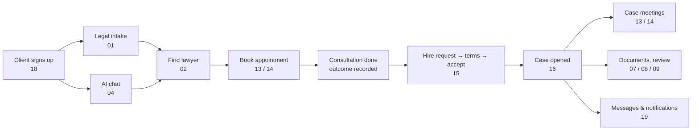

# Attorney.AI — Module Flow Docs

These docs explain **how each implemented module works in the code**: what the user does, which frontend component calls which backend route, which service holds the logic, what data is stored, and the important rules. They were written by reading the current code (October 2026), not old plan files.

> If a doc and the code disagree, the **code is right**. The plan files at the repo root (e.g. `APPOINTMENT_FLOW_PLAN.md`) are history; these docs describe what is actually built.

## Start here

| # | Doc | Who uses it |
|---|-----|-------------|
| 00 | [Architecture overview](00-architecture-overview.md) — folders, request path, auth roles, Redis/WebSocket, flags, how to run | everyone |

## Modules

Where the client and lawyer sides work very differently, there are two files. Otherwise one file covers both sides.

| # | Doc | Side |
|---|-----|------|
| 01 | [Legal intake](01-legal-intake.md) | Client (lawyer sees result) |
| 02 | [Lawyer directory & matching](02-lawyer-directory-matching.md) | Client finds lawyer, lawyer onboarding |
| 03 | [AI pipeline (RAG graph)](03-ai-pipeline-rag.md) | Shared engine behind chat + research |
| 04 | [AI chat — client](04-ai-chat-client.md) | Client |
| 05 | [AI research — lawyer](05-ai-research-lawyer.md) | Lawyer |
| 06 | [Voice input](06-voice-input.md) | Both (different modes) |
| 07 | [Documents & drafting — client](07-documents-drafting-client.md) | Client |
| 08 | [Documents & drafting — lawyer](08-documents-drafting-lawyer.md) | Lawyer |
| 09 | [Document review (client ↔ lawyer)](09-document-review.md) | Both |
| 10 | [Document analyzer](10-document-analyzer-lawyer.md) | Lawyer only |
| 11 | [Agreements](11-agreements.md) | Client (+ lawyer if any) |
| 12 | [Vault & case files](12-vault-and-case-files.md) | Both |
| 13 | [Appointments — client](13-appointments-client.md) (has the full lifecycle) | Client |
| 14 | [Appointments — lawyer](14-appointments-lawyer.md) | Lawyer |
| 15 | [Hire / engagements](15-hire-engagements.md) | Both |
| 16 | [Cases](16-cases-lawyer-and-client.md) | Both |
| 17 | [Lawyer dashboard & clients page](17-lawyer-dashboard-and-clients.md) | Lawyer |
| 18 | [Auth & accounts](18-auth-accounts.md) | Both |
| 19 | [Messaging & notifications](19-messaging-notifications.md) | Both |
| 20 | [Legal tools & calculators](20-legal-tools-calculators.md) — bail, court fee, inheritance, wasiyyat, labour dues | Both (client page hidden from sidebar) |
| 21 | [Overseas disputes desk](21-overseas-disputes-desk.md) | Client + lawyer (hidden from nav, backend live) |
| 22 | [Case law, citator & cause list](22-case-law-citator-causelist.md) | Lawyer |
| 23 | [Payments, billing & plans](23-payments-billing-plans.md) | Both (lawyer Payments page hidden) |
| 24 | [Admin panel](24-admin-panel.md) | Admin |
| 25 | [Client shell, dashboard, profile & public site](25-client-shell-dashboard-profile-public-site.md) | Client, lawyer profile, public |

## Behind the scenes

| # | Doc | What |
|---|-----|------|
| 26 | [Provenance, corpus, labelling & evaluation](26-provenance-corpus-labelling-evaluation.md) | audit trail of AI answers, legal sources, eval harnesses |
| 27 | [AI internals — supporting modules](27-ai-internals-supporting-modules.md) | every helper file in `backend/app/ai/` with ACTIVE / FLAG-GATED / OFFLINE / DEAD status |

## The main journey (how modules connect)

## How each doc is laid out

1. **What it does** — the user's view.
2. **User flow** — step by step.
3. **Code flow** — component → `lib/api.js` → route → service → collection.
4. **Data & states** — collections, fields, status lifecycle.
5. **Key logic & rules** — the decisions in the code, and why.
6. **Files** — links to the real files.
7. **Known limits** — things that are switched off or not finished.
